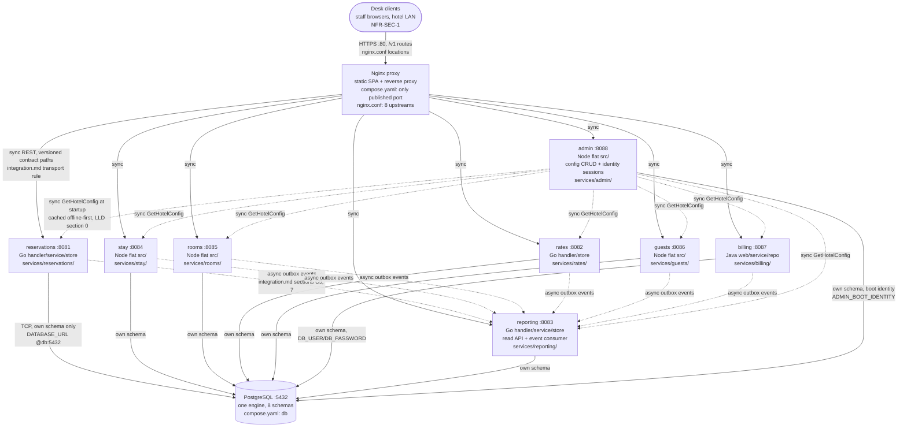
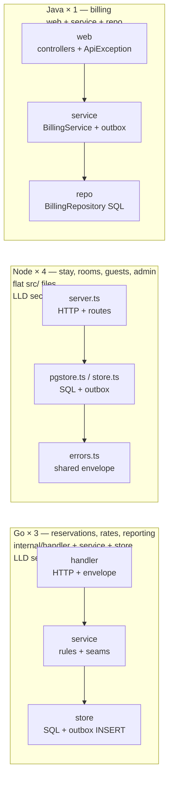

# C4 — containers and components

Status: active (Closes #193). Owned by `architect`. The deployable
containers for one MVP installation and the as-built component shape
inside each service. Companion to the deployment view
(`docs/architecture/system-architecture.md` [section 1](system-architecture.md), which shows where
these containers run); module responsibilities live in
`docs/architecture/hld.md`, per-service design in
`docs/architecture/services/*.md`. Every node/edge cites its source;
nothing here is invented.

## 1. Container diagram

Sources: container inventory from `services/*/` on disk and
`deploy/compose.yaml` (service names, images, `PORT`,
`DATABASE_URL`); proxy edges from `deploy/nginx/nginx.conf`
(upstreams + `/v1/<contract>/` locations); database edges from the
per-service `DATABASE_URL: ...@db:5432/hotel`; sync/async edge styles
from `docs/technical/integration.md` (transport rules).

Admin calls no sibling at runtime (dependency sink in reverse —
`docs/architecture/services/admin.md` [section 5](services/admin.md)); the arrows above are
other modules reading Admin, not Admin calling out. Reporting reads
no other module's store (its only input is the event log —
`docs/architecture/services/reporting.md` [section 5](services/reporting.md)). No component calls
outside the property in the MVP (no OTA, payment, or accounting
integrations — `system-architecture.md` [section 1](system-architecture.md)).

## 2. Component diagram (as-built layering per stack)

Sources: LLD [sections 1–8](lld.md) + the 8 service pages section 2 (layer→file tables).
Three shapes, all intentional per ADR-0002 (accepted 2026-10-24,
Closes #188):

Contract edges between components are the versioned REST operations
and the `contracts/events/` JSON Schemas
(`docs/technical/integration.md` sections C9, 7; event flow in
`docs/architecture/event-flow.md`). Each service's `contract-tests/`
directory pins its side of those contracts.

<!-- ao-role: architect -->
Role: architect · AO session hotel-mgmt-257
