# Event / data flow — outbox to reporting rebuild

Status: active (Closes #193). Owned by `architect`. How domain events
travel from the owning modules' transactional outbox tables into the
reporting read model. Contract rules live in
`docs/technical/integration.md` (§§C9, 7: at-least-once, ordered per
aggregate, idempotent apply by event id); payloads are the JSON
Schemas in `contracts/events/`. Every node/edge cites its source;
unresolved gaps are flagged, never filled in.

## 1. Flow diagram

```mermaid
flowchart LR
    subgraph EMIT[Owning modules — outbox INSERT in the same commit as the write]
        RES[(reservations.outbox<br/>aggregate reservation:<br/>created, checked-in,<br/>modified, cancelled, no-show<br/>postgres.go:268,385,560,653,730)]
        STAY[(stay.outbox<br/>aggregate stay:<br/>checked-in, checked-out,<br/>moved, actual-times-recorded<br/>pgstore.ts:97,201,286,349<br/>helper :460-468)]
        ROOMS[(rooms.outbox<br/>aggregates room, room-type:<br/>room-upserted, state-changed,<br/>blocked, block-released<br/>pgstore.ts:169,307,588,634<br/>helper :56-64)]
        RATES[(rates.outbox<br/>aggregates rate-plan,<br/>restriction, discount:<br/>rate-plan-changed,<br/>restriction-changed,<br/>discount-changed<br/>postgres.go:110,144,175,201<br/>helper :70-75)]
        GUESTS[(guests outbox, in-memory push<br/>aggregate guest:<br/>guest-upserted, stay-linked<br/>store.ts:216,257-261<br/>pgstore has no outbox writer yet;<br/>the guests.outbox table exists)]
        BILL[(billing outbox<br/>aggregates folio, day-close:<br/>charge-posted, payment-recorded,<br/>day-close-completed,<br/>approval-recorded<br/>BillingService.java:162,188,201,277)]
    end
    DISP[Dispatcher — event dispatcher<br/>relays outbox rows per-aggregate order<br/>reporting store.go:37<br/>system-architecture.md §1: no Kafka]
    subgraph RPT[Reporting read model — services/reporting]
        APPLY[Apply — folds one event,<br/>idempotent by event id,<br/>advances per-subscription offset<br/>store.go:191-215]
        REBUILD[Rebuild — full outbox replay<br/>clears projections + offsets<br/>store.go:217-235]
        PROJ[(Projections<br/>known types only:<br/>reservation.created / cancelled / no-show :243,267<br/>stay.checked-in / checked-out :275,299<br/>rate.availability-set :331<br/>folio.charge-posted :345<br/>folio.payment-recorded :373<br/>config.changed :383<br/>main.go:4-7 in-memory, Postgres later)]
    end
    EMIT -->|at-least-once, per-aggregate order<br/>integration.md §7| DISP
    DISP --> APPLY
    DISP -->|full-slice replay| REBUILD
    APPLY --> PROJ
    REBUILD --> PROJ
```

Unknown future event types are recorded as seen (offset advances,
payload otherwise ignored) — `store.go:186-190` — so new emitters
cannot break the consumer.

## 2. Flagged gaps (resolved in favour of code, Phase 2 note)

These consumer cases have no emitter found in code; the diagram above
shows only the emitters that exist. Do not treat the consumer case
names below as proof of an emitter:

1. `config.changed` (`store.go:383`; `integration.md` §C9
   `ConfigChangedEvents`): the only config writer in
   `services/admin/src/` is the HTTP path — the Postgres store
   writes `admin.users`, `admin.sessions`, `admin.hotel_profile`,
   and `admin.hotel_config_values` (`pgstore.ts`) but no outbox
   rows (the `admin.outbox` table exists per the migrations).
   Config reaches other modules synchronously via
   `GetHotelConfig` (LLD §0), not via outbox rows in code.
2. `rate.availability-set` (`store.go:331`): the rates outbox writer
   (`postgres.go:70-75`) emits only `rate-plan-changed`,
   `restriction-changed`, and `discount-changed` (:110,144,175,201).
3. Schema inventory: `contracts/events/` holds 5 schemas
   (`config-changed`, `rate`, `reservation`, `room-state`, `stay`);
   `integration.md` §7 names 7 families (Guest and Folio files are
   not on disk). `guests/src/store.ts:141` and
   `BillingService.java:153,179` are the code sources for those two
   families until schemas land.

<!-- ao-role: architect -->
Role: architect · AO session hotel-mgmt-257
