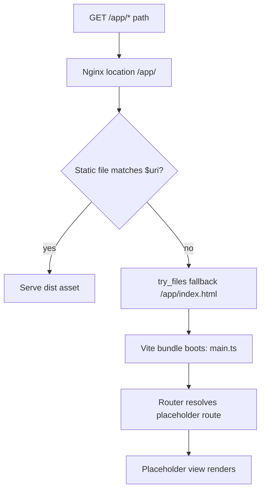
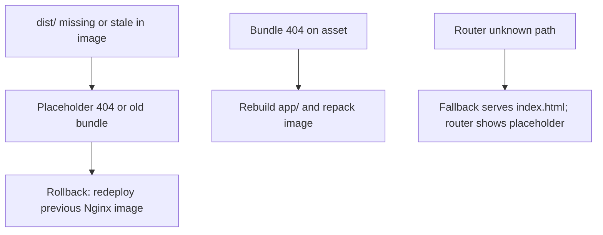
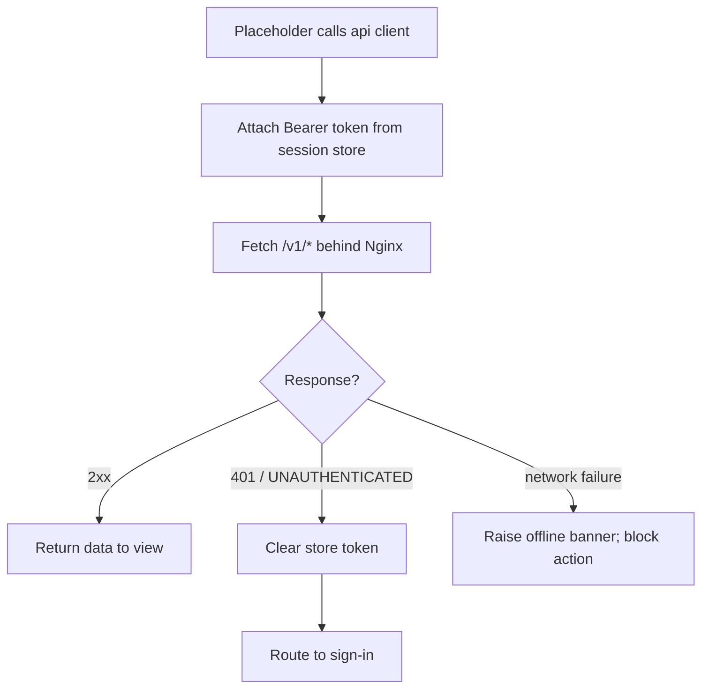
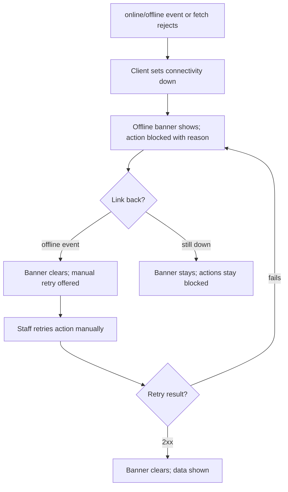

# Low-level design — small-hotel PMS

Status: active (Closes #97). Owned by `architect`. This document is
the build-ready decomposition of the accepted direction
(ADR-0001, accepted 2026-10-23; HLD; system architecture): per-module
responsibilities, interfaces with signatures, internal data flow,
outbox events, and error mapping, plus the monorepo codebase layout.
It adds no product behaviour: every responsibility traces to an FR/NFR
in `docs/requirements/mvp-requirements.md`, every payload field to an
entry in `docs/requirements/data-dictionary.md`, every rule to
`docs/requirements/business-rules.md` (BR-n), and every cross-module
need to `docs/requirements/integration-contract-needs.md` (BA needs,
§n below). Technical encodings decided here (transports, token
mechanics, atomicity mechanisms, delivery guarantees) are the
architect's answers to the BA open questions OQ-C1..OQ-C6; anything
the FRs leave undecided is marked deferred with a reason.

## 0. Cross-cutting decisions (apply to every module)

- Transport: synchronous calls are HTTP/JSON behind Nginx, base path
  `/v1/<contract-lowercase>/<operation>`, POST with a JSON body.
  gRPC stays a later optimisation, never a silent substitution: any
  move needs a versioned contract change (see
  `docs/technical/integration.md`).
- Identity: every call carries an opaque session token issued by
  Admin. Tokens are HMAC-signed by an Admin-held key and validated
  locally by each provider (signature + expiry); revocation is
  re-checked with Admin at least every 5 minutes and always on
  sensitive operations (user/role changes, open-balance approvals,
  day-close). Idle sessions end after 15 minutes without activity
  and identities lock after 5 consecutive wrong secrets
  (`NFR-SEC-2`; enforcement points in
  `docs/technical/security-threat-model.md`). This answers OQ-C4:
  cached-token validation with bounded revalidation, not per-call
  remote validation, so desk steps keep their 3-second bound
  (`NFR-PERF-1`).
- Errors: every refusal uses the envelope in
  `docs/technical/error-handling.md` (`code`, `message`, `details`,
  `traceId`). Session-expiry/locked-session refusals use code
  `UNAUTHENTICATED` (assigned here; the envelope lists
  representative codes and gains this token in the same release
  train). All other codes are the existing ones.
- Time: `timestamptz` everywhere (carries the UTC offset,
  `NFR-TZ-1`); hotel-local rendering is a presentation concern fed
  by the hotel timezone from config.
- Money: BIGINT minor currency units, never floating point
  (`api-spec.md` §1; Billing uses `BigDecimal`/exact decimal in
  memory and persists minor units).
- Audit: every creation, change, state transition, charge, and
  payment persists actor + timestamp on the owning row
  (`NFR-AUD-1`, recording only); each module writes only its own
  audit columns.
- Config: each module reads its §3.1 values at startup via
  `AdminService.GetHotelConfig` and applies `ConfigChangedEvents`
  afterwards; if Admin is unreachable a module serves from its last
  cached values (offline-first, `NFR-AVL-1`) and reconciles on
  reconnect. Delivery is at-least-once, ordered per aggregate, with
  idempotent apply keyed by event id (answers OQ-C2).
- Outbox: every state change that other modules must see is written
  atomically with the change into a per-schema `outbox` table; a
  single dispatcher process relays rows to subscribers (Reporting
  read model, config consumers). No module reads another module's
  tables, ever.
- Reporting lag (answers OQ-C1): the read model trails the owning
  stores by at most 60 seconds in normal operation; every report
  carries its data-as-of timestamp; a stalled feed degrades report
  freshness and raises a monitoring alert but never blocks booking,
  check-in, or check-out.
- Export snapshot (answers OQ-C5): each owning module contributes
  its slice as of a run cut-timestamp recorded in a manifest;
  slices may skew by the run duration. A fully quiesced,
  point-in-time copy is a documented restore-point procedure in the
  runbook, not the daily path.
- Inventory co-editing: room and room-type setup is co-editable by
  the owner (`FR-ADM-3`) and the manager (`FR-RMS-4`) through the
  same `RoomInventoryService` setup operations; there is no primary
  editor and no separate inventory store.

## 1. Reservations (Go)

Responsibilities: direct reservations, modification, cancellation,
walk-in, calendar, no-show (`FR-RES-1..6`; BR-1..BR-8). Owns the
reservation store; emits `ReservationEvents`.

Interfaces (provider: `ReservationService`):

| Operation | Request | Response | Errors |
|---|---|---|---|
| `CreateReservation` | roomType, arrivalDate, departureDate, guestLink, priceBasis, discountName?, idempotencyKey | reservationRef, state=confirmed, quotedTotal | `CONFLICT` (type+dates), `STATE_ILLEGAL` (restriction), `VALIDATION_FAILED` (missing guest field), `NOT_FOUND` (type/rate) |
| `ModifyReservation` | reservationRef, newDates?, newRoomType?, newGuest?, idempotencyKey | reservationRef, recalculatedTotal | as above + `STATE_ILLEGAL` (already checked-in) |
| `CancelReservation` | reservationRef, reason (from hotel list) | state=cancelled | `STATE_ILLEGAL` (already checked-in), `VALIDATION_FAILED` (reason missing) |
| `MarkNoShow` | reservationRef, reason | state=no-show | `STATE_ILLEGAL` (arrival date not passed / already in house) |
| `GetReservation` | reservationRef | full reservation incl. price basis, history | `NOT_FOUND` |
| `CheckInReservation` | reservationRef, stayId, actor | reservation state=checked-in with the stay link | `NOT_FOUND`, `STATE_ILLEGAL` (not confirmed) |
| `QueryCalendar` | dateFrom, dateTo, roomType? | reservations per date/type with state | — |
| `GetDueReservation` | reservationRef (STAY -> RES) | reservation with dates, type, guestLink, priceBasis | `NOT_FOUND`, `STATE_ILLEGAL` (not due/arrivable) |

Outbound calls (consumer): `PricingService.CheckSellableCount`,
`CheckRestrictions`, `QuotePrice`; `RoomInventoryService.
CheckRoomTypeSellability`; `GuestService.IdentifyGuest`,
`GetBookingContext` — all synchronous inside the booking step
(BA needs §1).

Internal data flow (`CreateReservation`): validate token + role ->
load hotel config values (mandatory guest fields, restrictions) ->
call Pricing (sellable count, restrictions, quote) and Rooms
(sellability) and Guests (identify) -> atomically insert the
reservation row guarded by the overbooking check (one transaction:
count overlapping confirmed and checked-in reservation rows for the
type/dates against sellable units — checked-in rows cover the
in-house share, so the guard never reads another store; insert only
if capacity remains —
answers OQ-C3 for `NFR-CON-1`) -> write `ReservationEvents.created`
to outbox in the same transaction -> return ref. `ModifyReservation`
re-runs the guard for the new dates/type and reprices from the rate
plan in force (BR-2, BR-13).

Outbox events (`ReservationEvents`): `created`, `modified`,
`cancelled`, `no-show` — each carrying ref, dates, roomType,
guestLink, priceBasis total, actor, timestamp.

Error mapping: restriction violated -> `STATE_ILLEGAL` naming the
restriction (`FR-RTE-4`); last-unit race lost -> `CONFLICT` naming
type+dates (`NFR-CON-1`); missing mandatory guest field ->
`VALIDATION_FAILED` naming the field (`FR-CUS-1`); unknown type/plan
-> `NOT_FOUND`.

## 2. Stay / front desk (Node.js/TypeScript)

Responsibilities: check-in, check-out, room moves, early/late times,
arrivals/departures (`FR-FDK-1..5`; BR-16..BR-20). Owns the stay
store; emits `StayEvents`.

Interfaces (provider: `StayService`):

| Operation | Request | Response | Errors |
|---|---|---|---|
| `CheckIn` | reservationRef, roomNumber, actualArrivalTime?, idempotencyKey | stayId, roomNumber, state=in-house | `CONFLICT` (room taken), `STATE_ILLEGAL` (room not ready / reservation not due), `VALIDATION_FAILED` (missing check-in field) |
| `GetStay` | stayId or reservationId | stay record | `NOT_FOUND`, `VALIDATION_FAILED` (neither identifier) |
| `QueryStays` | state? | stays, each exactly once | `VALIDATION_FAILED` (unknown state) |
| `CheckOut` | stayId, idempotencyKey | stay closed, invoiceRef | `SETTLEMENT_REQUIRED` (open balance, no approval), `STATE_ILLEGAL` (not in house) |
| `MoveRoom` | stayId, newRoomNumber | stayId, move history entry | `CONFLICT` / `STATE_ILLEGAL` as in check-in |
| `RecordActualTimes` | stayId, actualArrival?, actualDeparture? | stayId, kept times | `VALIDATION_FAILED` (implausible values per hotel times) |
| `ListArrivalsDepartures` | businessDate | arrivals, in-house, departures, each exactly once | — |
| `GetStayRef` | stayId (BIL -> STAY) | stay link: guest, room, in-house state | `NOT_FOUND`, `STATE_ILLEGAL` (closed) |

Outbound calls (consumer): `ReservationService.GetDueReservation`;
`RoomInventoryService.FindReadyRoom`, `AssignRoom`, `ReleaseRoom`,
`RecordActualTimes`(room side release on move/check-out);
`GuestService.GetGuest`; `BillingService.GetFolioBalance`,
`RequestCheckoutGate` — all synchronous inside desk steps (BA
needs §§2–3).

Internal data flow (`CheckIn`): validate token + role -> fetch due
reservation -> fetch guest (mandatory check-in fields) -> find/assign
room via `AssignRoom` (provider-side atomic guard, `NFR-CON-2`) ->
insert stay row + link reservation -> mark reservation checked-in via
own update -> emit `StayEvents.checked-in` via outbox. Check-out
additionally calls the folio gate first and refuses with
`SETTLEMENT_REQUIRED` unless settled or an authorised approval is
recorded (BR-17).

Outbox events (`StayEvents`): `checked-in`, `moved`, `actual-times-
recorded`, `checked-out` — stayId, guestLink, room links, times,
actor, timestamp.

Error mapping: room just taken -> `CONFLICT` naming the room
(`NFR-CON-2`); room not vacant/clean/inspected -> `STATE_ILLEGAL`
naming room+state (BR-16, BR-28); blocked date -> refusal naming the
block (`FR-RMS-3`); open balance without approval ->
`SETTLEMENT_REQUIRED` (`FR-BIL-7`).

## 3. Rooms (Node.js/TypeScript)

Responsibilities: inventory, housekeeping states, out-of-order blocks,
room/room-type setup (`FR-RMS-1..4`; BR-9, BR-12, BR-28, BR-29).
Owns the room store; emits `RoomStateEvents`.

Interfaces (provider: `RoomInventoryService`):

| Operation | Request | Response | Errors |
|---|---|---|---|
| `CheckRoomTypeSellability` | roomType, dateFrom, dateTo | sellable count / boolean | — (`CONFLICT` is raised by the caller on refusal) |
| `FindReadyRoom` | roomType, date | room candidates (number, floor, bed, capacity, features) | `NOT_FOUND` (no ready room) |
| `AssignRoom` | roomNumber, stayLink, idempotencyKey | assignment receipt | `CONFLICT` (just taken), `STATE_ILLEGAL` (not ready / blocked) |
| `ReleaseRoom` | roomNumber, toState, actor | new state | `STATE_ILLEGAL` (illegal transition) |
| `UpdateRoomState` | roomNumber, newState, actor | new state + history entry | `STATE_ILLEGAL` (e.g. dirty straight to inspected) |
| `ListRoomsByState` | stateFilter | rooms in state, each exactly once | — |
| `BlockRoom` / `ReleaseBlock` | roomNumber, dateRange, reason | block record / release | `STATE_ILLEGAL` (block of an occupied room) |
| `UpsertRoom`, `UpsertRoomType` | floor, bed, capacity, features | saved record | `VALIDATION_FAILED` |

Internal data flow (`AssignRoom`): single conditional atomic write —
update the room row to occupied only if its current state is
vacant-inspected and no block covers the date (one statement,
row lock; answers OQ-C3 for `NFR-CON-2`); on zero rows affected
return `CONFLICT`/`STATE_ILLEGAL` with the current state named.
Housekeeping advances dirty -> clean -> inspected, each step a row
update + history row + outbox event, enforced by a transition check
(BR-28).

Outbox events (`RoomStateEvents`): `state-changed`, `blocked`,
`block-released`, `room-upserted` — room number, old/new state,
block range+reason, actor, timestamp.

Error mapping: illegal transition -> `STATE_ILLEGAL` (BR-28);
blocked-date use -> refusal naming the block (`FR-RMS-3`); occupied
block attempt -> `STATE_ILLEGAL` (Seq-13 precondition).

## 4. Rates & Availability (Go)

Responsibilities: rate plans, availability counts, discounts, stay
restrictions, price basis (`FR-RTE-1..5`; BR-9, BR-10, BR-13..BR-15).
Owns the pricing store; emits `RateEvents`.

Interfaces (provider: `PricingService`):

| Operation | Request | Response | Errors |
|---|---|---|---|
| `CheckSellableCount` | roomType, dateFrom, dateTo | count per date | `NOT_FOUND` (unknown type) |
| `CheckRestrictions` | roomType, dateFrom, dateTo | pass/fail + violated restriction | `STATE_ILLEGAL` naming the restriction |
| `QuotePrice` | roomType, dates, discountName? | nightly breakdown, plan ref, total | `NOT_FOUND`, `VALIDATION_FAILED` (unknown discount) |
| `UpsertRatePlan`, `UpsertRatePrice`, `UpsertRestriction`, `UpsertDiscount` | (manager setup payloads: plans, nightly prices per type/date, restrictions, discounts) | saved record | `VALIDATION_FAILED`, `NOT_FOUND` (unknown plan/type) |

Internal data flow (`QuotePrice`): load plan prices for type+dates
-> apply named discount/special price if given (kept by name, BR-15)
-> return breakdown; the quoted basis is stored by Reservations, so
later rate changes never alter it unless explicitly recalculated
(BR-13). Availability counts exclude occupied, blocked, and
already-reserved units (BR-9) and are computed from the pricing
store's cached inventory inputs plus live calls — the authoritative
guard stays in the Reservations store transaction (§1).

Outbox events (`RateEvents`): `rate-plan-changed`,
`restriction-changed`, `discount-changed` — availability-count inputs
per type/date for the Reporting read model.

Error mapping: restriction violated -> `STATE_ILLEGAL` (BR-10); no
sellable unit -> `CONFLICT` (raised by Reservations on the guard,
`NFR-CON-1`); unknown type/plan -> `NOT_FOUND`.

## 5. Guests (Node.js/TypeScript)

Responsibilities: profiles, preferences/notes, repeat-guest flag,
confirmation record (`FR-GST-1..4`). Owns the guest store; emits
`GuestEvents`.

Interfaces (provider: `GuestService`):

| Operation | Request | Response | Errors |
|---|---|---|---|
| `IdentifyGuest` | search keys (name/contact/ref) | profile + stay history + returning flag + past-stay count | `NOT_FOUND` |
| `GetBookingContext` | guestLink | preferences, notes | `NOT_FOUND` |
| `GetGuest` | guestLink | profile + mandatory-field status | `NOT_FOUND` |
| `UpsertGuest` | identifying/contact details, preferences, notes | guestLink | `VALIDATION_FAILED` (missing hotel-mandatory field) |
| `ProduceConfirmation` | reservationRef (record attached from the RES-side guest block) | confirmation record (hotel, guest, dates, type, price) | `NOT_FOUND` (no stored record for the ref) |

Internal data flow: single-guest-record CRUD; stay links appended on
stay lifecycle events consumed from `StayEvents` (link-only, no
stay data duplicated beyond the link + count inputs). Returning flag
derives from completed-stay count (`FR-GST-3`). Mandatory-field
enforcement reads the hotel's `FR-CUS-1` set from cached config.

Outbox events (`GuestEvents`): `profile-created`, `profile-updated`,
`stay-linked` — stay links for history/returning counts in
Reporting.

Error mapping: unknown guest -> `NOT_FOUND`; missing mandatory
field -> `VALIDATION_FAILED` naming the field (`FR-CUS-1`).

## 6. Billing (Java 21, Spring Boot)

Responsibilities: folios, charges, payments, taxes/fees, day-close,
settlement gate (`FR-BIL-1..7`; BR-17, BR-18, BR-21..BR-26). Owns the
folio store; emits `FolioEvents`. The one Spring-context service in
the budget (accepted mapping).

Interfaces (provider: `BillingService`):

| Operation | Request | Response | Errors |
|---|---|---|---|
| `GetFolioBalance` | stayLink | folio with every charge/payment line + running balance | `NOT_FOUND` (must not happen — one folio per stay, BR-21) |
| `RequestCheckoutGate` | — | — | NOT IMPLEMENTED (see D4 below): specified but never built; the settlement gate is enforced stay-side (`StayService.CheckOut` folio gate) fed by `GetFolioBalance` plus recorded approvals |
| `PostCharge` | stayLink, item (nightly room charge or defined charge item), amount, idempotencyKey | folio line + new balance | `VALIDATION_FAILED` naming undefined item (`FR-CUS-3`, BR-22) |
| `RecordPayment` | folioLink, method (cash|card — OQ-1 undecided, fixed until decided), amount, idempotencyKey | payment line + new balance | `VALIDATION_FAILED` (other methods, requirements §3.2) |
| `ProduceInvoice` / `ProduceReceipt` | folioLink / paymentRef | printable record matching folio/payment exactly | `NOT_FOUND` |
| `RunDayClose` | businessDate | totals of charges + payments per method | — (no sign-off step until OQ-3 decided, BR-26) |
| `GetDayClose` | businessDate | stored day-close totals for the date | `NOT_FOUND` (no run for the date) |
| `UpsertChargeItem` | name, priceMinor | named hotel sellable for charge posting | `VALIDATION_FAILED` (blank name, negative price) |
| `UpsertTaxFeeRule` | name, percent (0–100) | named percentage rule applied to posted charges | `VALIDATION_FAILED` (blank name, out-of-range percent) |
| `RecordOpenBalanceApproval` | stayLink, approvedBy, role, reason? | folio with the recorded approval | `VALIDATION_FAILED` (missing approver/role) |

Outbound calls (consumer): `StayService.GetStayRef` (synchronous
read so every line matches its stay exactly, BA needs §3b).

Internal data flow (`PostCharge`): validate token + role ->
`GetStayRef` (stay in house) -> resolve item against hotel charge
items (`FR-CUS-3`) and tax/fee rules (`FR-BIL-5`) -> derive tax/fee
amounts with exact decimal arithmetic -> append line, update running
balance, outbox `FolioEvents.charge-posted` — one transaction.
Folio creation is driven by `StayEvents.checked-in` (one folio per
stay, BR-21). Day-close aggregates posted lines per business date and
must agree with the folios (BR-26).

Outbox events (`FolioEvents`): `folio-opened`, `charge-posted`,
`payment-recorded`, `day-close-run` — posted charges/payments with
methods for revenue Reporting.

Error mapping: undefined charge item -> `VALIDATION_FAILED` naming
the item (assigned here per the BA suggestion); non cash/card
method -> `VALIDATION_FAILED` refusal (requirements §3.2, OQ-1
pending); open balance without approval ->
`SETTLEMENT_REQUIRED` (`FR-BIL-7`).

## 7. Reporting (Go)

Responsibilities: occupancy, revenue, daily sheet, housekeeping
reports over its own read model (`FR-RPT-1..4`). Owns the
reporting read-model store; exposes a read API; emits no domain
events.

Interfaces (provider: `ReportingService`, synchronous read API):

| Operation | Request | Response | Errors |
|---|---|---|---|
| `OccupancyReport` | dateFrom, dateTo | per-date occupied/available counts + as-of timestamp | — |
| `RevenueSummary` | dateFrom, dateTo | room vs extra revenue totals + as-of | — |
| `DailySheet` | businessDate | arrivals, in-house, departures, open balances + as-of | — |
| `HousekeepingReport` | — | rooms needing cleaning/inspection right now + as-of | — |
| `HousekeepingReport` | — | rooms needing cleaning/inspection (inspected + out-of-order excluded) + as-of | — |

Internal data flow: event consumer subscribes to
`ReservationEvents`, `StayEvents`, `RoomStateEvents`,
`RateEvents`, `GuestEvents`, `FolioEvents`,
`ConfigChangedEvents` (hotel identity/times/wording for headers,
`FR-ADM-1`) and upserts read-model tables idempotently by event id;
reads serve from those tables only, never from other modules'
stores (HLD §3). Report targets: 2 years of 50-room data within
5 seconds (`NFR-PERF-2`) via pre-aggregated daily tables.

Outbox: none emitted (consumer only); maintains a consumer-offset
record per subscription for resume after restart.

Error mapping: none refuse at the desk — a lagging feed degrades
freshness (as-of timestamp shows it) but never blocks desk flows
(BA needs §7).

## 8. Admin & Config (Node.js/TypeScript)

Responsibilities: hotel profile, users/roles, room/rate setup entry,
per-hotel customisation values, export/backup assembly
(`FR-ADM-1..5`, `FR-CUS-1..3`; BR-33..BR-42). Owns the config store;
emits `ConfigChangedEvents`; houses the identity component and the
export assembler.

Interfaces (provider: `AdminService`):

| Operation | Request | Response | Errors |
|---|---|---|---|
| `GetHotelConfig` | — (startup read) | full §3.1 settings snapshot + schema version | — |
| `UpdateHotelConfig` | changed §3.1 values | saved values + `ConfigChangedEvents` emitted | `VALIDATION_FAILED`, `FORBIDDEN` (role) |
| `CreateUser`, `UpdateUserRole`, `UnlockIdentity` | name, sign-in identity, role | account record | `FORBIDDEN`, `VALIDATION_FAILED` |
| `SignIn`, `SignOut` | identity, secret | session token / end | `UNAUTHENTICATED` (wrong secret / locked / expired) |
| `ValidateSession` / `CheckRole` | token, required role | valid + role / refuse | `UNAUTHENTICATED` / `FORBIDDEN` |
| `CollectExportSlice` (fan-out to RES, STAY, BIL, GST, ROOM, RATE) | cut-timestamp | per-module slice + manifest entry | reported failure naming missing scope |
| `RunBackup` | — | success/failure report with time (`NFR-BKP-2`) | — (failures reported, never silent) |

Internal data flow (config update): validate role ->
validate against the versioned configuration schema ->
persist + audit (actor, timestamp) -> emit `ConfigChangedEvents`
(describes §3.1 values; §3.2 fixed items are never emitted as
configurable). Sign-in: verify secret (rate-limited, 5-strike
lockout), issue HMAC-signed token. Export: asynchronous job —
request slices from each owning module as of the cut-timestamp,
assemble, write to the on-premise target, report plain
success/failure with time (daily cadence until OQ-5 decided).

Outbox events (`ConfigChangedEvents`): hotel identity/contact,
local settings (timezone, standard times, retention floor),
required-field choices, cancellation wording + reason lists,
no-show rule, approval rule, charge items, tax/fee rules,
restrictions, discounts.

Error mapping: out-of-role -> `FORBIDDEN` (`NFR-SEC-1`); locked or
signed-out session -> `UNAUTHENTICATED` (`NFR-SEC-2`); incomplete
export slice -> reported failure naming the scope (`FR-ADM-5`).

## 9. Codebase layout (monorepo)

One top-level directory per deployable module plus shared contracts;
each module directory carries its own build, test, and run
instructions so one module can be worked without learning all
stacks (ADR-0001 consequences).

```text
services/
  reservations/        Go — module 1 (cmd/server, internal/..., migrations/)
  stay/                Node.js/TS — module 2
  rooms/               Node.js/TS — module 3
  rates/               Go — module 4
  guests/              Node.js/TS — module 5
  billing/             Java 21 Spring Boot — module 6 (src/main/..., flyway migrations)
  reporting/           Go — module 7 (consumer + read API)
  admin/               Node.js/TS — module 8 (incl. identity component)
contracts/             shared contract library (source of truth):
  events/              JSON Schemas for 5 of the 7 domain event families (Guest and Folio schemas pending — code is the source for those two until they land; see `docs/architecture/event-flow.md` §2)
  http/                per-contract operation shapes (requests/responses)
  openapi.yaml         curated desk-loop OpenAPI subset (14 ops transcribed from `http/` shapes; byte-identical mirror at `frontend/docs/openapi.yaml`, checked by `script/openapi-route-check.sh`)
  errors/              the shared error envelope + code catalogue
  config-schema/       not landed as a `contracts/` tree — the versioned per-hotel configuration schema (§3.1) lives as-built at `deploy/config/schema.json`
  messages/            no `contracts/messages/` tree — the catalogue lives as-built as per-service catalogues (`services/*/messages*`, `frontend/messages.js`; NFR-I18N-1, no behaviour in wording)
frontend/              static SPA (framework free choice; served by Nginx, no SSR runtime)
app/                   Vue 3 + Vite CSR shell (ADR-0003, accepted 2026-10-25): Vite `base '/app/'`, static `dist/` into the Nginx image, `location /app/` + `try_files` fallback to `/app/index.html`; scaffold design in §11 (Refs #291)
deploy/ansible/        offline packaging playbooks (release-manager owned; referenced, not added here)
```

Per-module directory (shape per stack, same obligations):

- build entry points: `services/reservations` (`go build ./...`),
  `services/stay|rooms|guests|admin` (`npm run build/test`),
  `services/billing` (`mvn package`), `services/reporting|rates`
  (`go build ./...`); each ships a `Dockerfile` and a README with
  build/test/run commands.
- `migrations/` per module holds that module's schema chain only
  (tools per stack: golang-migrate for Go, node-pg-migrate for
  Node.js, Flyway for Billing — see `docs/technical/schema.md`).
  Accepted exception: Billing's Flyway chain lives at the Spring
  Boot default `services/billing/src/main/resources/db/migration/`
  (`V<n>__` SQL), not `services/billing/migrations/`.
- `contract-tests/` per module holds its consumer/provider checks
  against `contracts/` (see `docs/technical/integration.md`).
- Shared code discipline: cross-cutting helpers (token validation,
  outbox writer, audit columns) are copied per stack, never a
  cross-stack runtime dependency; only `contracts/` is shared, as
  versioned schemas, never as executable business logic.

## 10. Deferred items (explicit, with reason)

- D1 — Conditional RES -> BIL operation for no-show charges (BA
  OQ-C6): no such operation exists in this LLD. Reason: the FRs do
  not decide whether a no-show keeps a charge (requirements OQ-1 /
  no-show rule, §3.1), and one folio per stay is fixed with no stay
  for a no-show. Re-open when the product decision lands.
- D2 — Full OpenAPI (or equivalent) authorship per service
  (api-spec.md §3): still deferred to implementation slices; the
  operation/payload tables here plus `contracts/` schemas are the
  frozen input to it. Landed since: the curated desk-loop subset
  only (`contracts/openapi.yaml`, 14 ops, #240) — not full
  per-service authorship.
- D3 — gRPC adoption per pair: deferred optimisation; HTTP/JSON is
  the MVP transport and any move follows the versioning rules in
  `docs/technical/integration.md`.
- D4 — Billing `RequestCheckoutGate`: specified in §6 above but
  never implemented (no code, no contract manifest as of master).
  Settlement is enforced stay-side instead: Stay `CheckOut` runs
  the folio gate against Billing `GetFolioBalance` plus the
  recorded `RecordOpenBalanceApproval` approval. Re-open only
  with a product decision that needs a provider-side gate op.

Coverage: 8/8 modules with responsibilities, signatures, data flow,
outbox events, and error mapping; every BA contract need (§§1–7, §9
error index) is encoded above or deferred here with reason.

## 11. Desk UI shell (`/app/`) — scaffold design (Refs #291)

Scaffold slice of ADR-0003 (accepted 2026-10-25): the placeholder
shell only. No app routes, no catalogue layer, no backend change.
Subsystem boundary is in `docs/architecture/hld.md` §11; this
section is the build-ready decomposition the implementation PR
must follow, including the per-flow diagrams (happy path +
failure/rollback path) the T3 gate requires.

Intended tree (files the implementation PR must create; edge
traces below cite these intended paths):

```text
app/                     new Vite + Vue 3 + Router (history) + Pinia + TS shell
  package.json           deps: vue, vue-router, pinia; scripts: build, test
  vite.config.ts         `base: '/app/'` so all assets resolve under /app/
  src/main.ts            app bootstrap: pinia install, router mount
  src/router.ts          history router; exactly one placeholder route in this slice
  src/api/client.ts      shared Bearer fetch wrapper (connectivity state, single 401 path)
  src/stores/session.ts  Pinia session store (sessionStorage token, sign-in/out)
  src/views/Placeholder.vue  the one placeholder route view
```

Nginx contract (parallel run; legacy `/` pages untouched):

```text
location /app/ {
  try_files $uri $uri/ /app/index.html;
}
```

Fallback is `/app/index.html`, NOT `/index.html`
(owner-mandated correction). `/docs` Swagger mirror intact.

Shared-client contract (`src/api/client.ts` + `src/stores/session.ts`):

- Every API call carries `Authorization: Bearer <token>` from the
  session store; token persistence is `sessionStorage`
  (threat-model delta in
  `docs/technical/security-threat-model.md` §4).
- Any `401` / `UNAUTHENTICATED` response clears the store token
  and routes to sign-in — the single 401 path, replacing the
  per-page copy-pasted blocks (`frontend/desk.html:83`,
  `book.html:112`, `frontend/admin.html:69`).
- Connectivity state is owned by the client: `online`/`offline`
  events plus failed-fetch detection drive an offline banner with
  safe manual retry. Explicitly NO write queueing: desk actions
  are synchronous authoritative ops (charge, payment, check-in)
  and queueing risks double-charge; disconnect means clearly
  blocked, same as today's static pages.

CI contract: one new job (Node 22 + `npm ci` + build + test,
matching the existing Node matrix) builds `app/`; the
`openapi-route-check.sh` byte-identical mirror
(`contracts/openapi.yaml` vs `frontend/docs/openapi.yaml`) stays
green.

### 11.1 Placeholder-render flowchart

Staff browser loads any `/app/*` path (history-mode deep link or
reload included):



Edge trace (every edge cites the intended file the
implementation PR must create):

- A–B: `deploy/nginx/nginx.conf` gains the `location /app/`
  block; legacy `location /` is untouched.
- C–D: hashed Vite assets under `/app/assets/` served directly
  (`app/dist/` packaged into the Nginx image; `vite.config.ts`
  `base: '/app/'`).
- C–E: non-asset paths fall through to `/app/index.html`
  (`try_files $uri $uri/ /app/index.html;` — NOT `/index.html`).
- F–G: `src/main.ts` installs Pinia and mounts the router;
  `src/router.ts` holds exactly one route (placeholder only).
- G–H: `src/views/Placeholder.vue` renders using the session
  store (`src/stores/session.ts`).

Failure/rollback:



Edge trace:

- P–R: rollback is proxy-only (remove the redirect / redeploy
  the previous Nginx image); old static files at `/` remain in
  place, so no data migration either way.
- S–T: asset miss means the image packed a stale `dist/`;
  rebuild, never hand-edit.
- U–V: history-mode unknown paths still boot the placeholder in
  this slice (no app routes exist yet); real 404 semantics arrive
  with the first screen slice.

### 11.2 Shared-client 401-to-sign-out flowchart

Authenticated call from the placeholder through the shared client:



Edge trace:

- A–B: `src/api/client.ts` reads the token from
  `src/stores/session.ts` (never from page-local state).
- D–E: happy path returns parsed data; the placeholder needs no
  payload shape in this slice.
- D–F–G: single 401 path — clear + sign-in redirect, replacing
  the five per-page handlers (`frontend/desk.html:83`,
  `book.html:112`, `frontend/admin.html:69`); a revoked or
  expired token takes the same path (revocation re-checked per
  LLD §0).
- D–H: fetch rejection (LAN disconnect) is NOT treated as
  sign-out; it drives the §11.3 banner and manual retry instead.

Failure/rollback: no compensation — clearing the store token is
a single local step; refusals precede any mutation, and the
server-side session rules (15-minute idle sign-out, 5-minute
revalidation bound, LLD §0) are unchanged.

### 11.3 Offline banner / manual-retry flowchart

LAN disconnect during a desk session on `/app/`:



Edge trace:

- A–B: `src/api/client.ts` owns connectivity state
  (`online`/`offline` listeners + failed-fetch detection).
- B–C: banner + blocked action with reason; the desk never
  silently drops an op.
- E–G: retry is always staff-initiated (safe manual retry) —
  explicitly no automatic write queueing and no background
  replay, because desk writes are synchronous authoritative ops
  (ADR-0003 criterion 9: queueing risks double-charge).
- H–C: a retry that still fails returns to the blocked banner;
  reconnect alone clears nothing until the staff retries.

Failure/rollback: none compensating — blocked actions mutate
nothing, so there is nothing to roll back; the previous Nginx
image (without `/app/`) restores the legacy pages instantly.

<!-- ao-role: architect -->
Role: architect · AO session hotel-mgmt-137
