# Low-level design — small-hotel PMS

Status: active (Closes #97). Owned by `architect`. This document is
the build-ready decomposition of the accepted direction
(ADR-0001, accepted 2026-10-23; HLD; system architecture): per-module
responsibilities, interfaces with signatures, internal data flow,
outbox events, and error mapping, plus the monorepo codebase layout.
It adds no product behaviour: every responsibility traces to an FR/NFR
in `docs/requirements/mvp-requirements.md`, every payload field to an
entry in `docs/requirements/data-dictionary.md`, every rule to
`docs/requirements/business-rules.md` (BR-n), and every cross-module
need to `docs/requirements/integration-contract-needs.md` (BA needs,
section n below). Technical encodings decided here (transports, token
mechanics, atomicity mechanisms, delivery guarantees) are the
architect's answers to the BA open questions OQ-C1..OQ-C6; anything
the FRs leave undecided is marked deferred with a reason.

## 0. Cross-cutting decisions (apply to every module)

- Transport: synchronous calls are HTTP/JSON behind Nginx, base path
  `/v1/<contract-lowercase>/<operation>`, POST with a JSON body.
  gRPC stays a later optimisation, never a silent substitution: any
  move needs a versioned contract change (see
  `docs/technical/integration.md`).
- Identity: every call carries an opaque session token issued by
  Admin. Tokens are HMAC-signed by an Admin-held key and validated
  locally by each provider (signature + expiry); revocation is
  re-checked with Admin at least every 5 minutes and always on
  sensitive operations (user/role changes, open-balance approvals,
  day-close). Idle sessions end after 15 minutes without activity
  and identities lock after 5 consecutive wrong secrets
  (`NFR-SEC-2`; enforcement points in
  `docs/technical/security-threat-model.md`). This answers OQ-C4:
  cached-token validation with bounded revalidation, not per-call
  remote validation, so desk steps keep their 3-second bound
  (`NFR-PERF-1`).
- Errors: every refusal uses the envelope in
  `docs/technical/error-handling.md` (`code`, `message`, `details`,
  `traceId`). Session-expiry refusals use code `UNAUTHENTICATED`
  and locked-identity refusals use code `IDENTITY_LOCKED` (both
  assigned here and registered in
  `contracts/errors/envelope.json`). A provider that must be read to
  decide an operation but cannot be reached fails the operation closed
  with `UPSTREAM_UNAVAILABLE` (503; registered here, Refs #601 — the
  Reservations -> Rates check already emits it). All other codes are
  the existing ones.
- Time: `timestamptz` everywhere (carries the UTC offset,
  `NFR-TZ-1`); hotel-local rendering is a presentation concern fed
  by the hotel timezone from config.
- Money: BIGINT minor currency units, never floating point
  (`api-spec.md` [section 1](../technical/api-spec.md); Billing uses `BigDecimal`/exact decimal in
  memory and persists minor units).
- Audit: every creation, change, state transition, charge, and
  payment persists actor + timestamp on the owning row
  (`NFR-AUD-1`, recording only); each module writes only its own
  audit columns.
- Config: each module reads its section 3.1 values at startup via
  `AdminService.GetHotelConfig` and applies `ConfigChangedEvents`
  afterwards; if Admin is unreachable a module serves from its last
  cached values (offline-first, `NFR-AVL-1`) and reconciles on
  reconnect. Delivery is at-least-once, ordered per aggregate, with
  idempotent apply keyed by event id (answers OQ-C2).
- Outbox: every state change that other modules must see is written
  atomically with the change into a per-schema `outbox` table; a
  single dispatcher process relays rows to subscribers (Reporting
  read model, config consumers). No module reads another module's
  tables, ever.
- Reporting lag (answers OQ-C1): the read model trails the owning
  stores by at most 60 seconds in normal operation; every report
  carries its data-as-of timestamp; a stalled feed degrades report
  freshness and raises a monitoring alert but never blocks booking,
  check-in, or check-out.
- Export snapshot (answers OQ-C5): each owning module contributes
  its slice as of a run cut-timestamp recorded in a manifest;
  slices may skew by the run duration. A fully quiesced,
  point-in-time copy is a documented restore-point procedure in the
  runbook, not the daily path.
- Inventory co-editing: room and room-type setup is co-editable by
  the owner (`FR-ADM-3`) and the manager (`FR-RMS-4`) through the
  same `RoomInventoryService` setup operations; there is no primary
  editor and no separate inventory store.

## 1. Reservations (Go)

Responsibilities: direct reservations, modification, cancellation,
walk-in, calendar, no-show (`FR-RES-1..6`; BR-1..BR-8). Owns the
reservation store; emits `ReservationEvents`.

Interfaces (provider: `ReservationService`):

| Operation | Request | Response | Errors |
|---|---|---|---|
| `CreateReservation` | roomType, arrivalDate, departureDate, guestLink, priceBasis, discountName?, idempotencyKey | reservationRef, state=confirmed, quotedTotal | `CONFLICT` (type+dates), `STATE_ILLEGAL` (restriction), `VALIDATION_FAILED` (missing guest field), `NOT_FOUND` (type/rate) |
| `ModifyReservation` | reservationRef, newDates?, newRoomType?, newGuest?, idempotencyKey | reservationRef, recalculatedTotal | as above + `STATE_ILLEGAL` (already checked-in) |
| `CancelReservation` | reservationRef, reason (from hotel list) | state=cancelled | `STATE_ILLEGAL` (already checked-in), `VALIDATION_FAILED` (reason missing) |
| `MarkNoShow` | reservationRef, reason | state=no-show | `STATE_ILLEGAL` (arrival date not passed / already in house) |
| `GetReservation` | reservationRef | full reservation incl. price basis, history | `NOT_FOUND` |
| `CheckInReservation` | reservationRef, stayId, actor | reservation state=checked-in with the stay link | `NOT_FOUND`, `STATE_ILLEGAL` (not confirmed) |
| `CheckOutReservation` | stayId, actor (STAY -> RES; resolved by the stay link) | reservationId, reservationRef, state=closed, stayId | `NOT_FOUND` (no booking carries the stay link), `STATE_ILLEGAL` (the booking behind the stay is not checked in) |
| `QueryCalendar` | dateFrom, dateTo, roomType? | reservations per date/type with state | — |
| `GetDueReservation` | reservationRef (STAY -> RES) | reservation with dates, type, guestLink, priceBasis | `NOT_FOUND`, `STATE_ILLEGAL` (not due/arrivable) |

Outbound calls (consumer): `PricingService.CheckSellableCount`,
`CheckRestrictions`, `QuotePrice`; `RoomInventoryService.
CheckRoomTypeSellability`; `GuestService.IdentifyGuest`,
`GetBookingContext` — all synchronous inside the booking step
(BA needs section 1).

Internal data flow (`CreateReservation`): validate token + role ->
load hotel config values (mandatory guest fields, restrictions) ->
call Pricing (sellable count, restrictions, quote) and Rooms
(sellability) and Guests (identify) -> atomically insert the
reservation row guarded by the overbooking check (one transaction:
count overlapping confirmed and checked-in reservation rows for the
type/dates against sellable units — checked-in rows cover the
in-house share, so the guard never reads another store; insert only
if capacity remains —
answers OQ-C3 for `NFR-CON-1`) -> write `ReservationEvents.created`
to outbox in the same transaction -> return ref. `ModifyReservation`
re-runs the guard for the new dates/type and reprices from the rate
plan in force (BR-2, BR-13).

`CheckOutReservation` (Refs #646, flow detail in
[section 22](#22-departure-completes-the-booking-and-releases-availability-refs-646)):
resolve the booking by `stay_id = stayId` (the unique stay link set at
check-in, `migrations/000002_schema.up.sql:33`) -> an already-`closed`
booking returns unchanged (`closed` is its own idempotency guard, so a
replayed close completes once) -> a `checked-in` booking flips to
`closed` in one transaction with its `reservation_changes` row
(`state`, `checked-in` -> `closed`, actor, timestamp, `NFR-AUD-1`) and
`updated_by`/`updated_at` on the row -> any other state is
`STATE_ILLEGAL` naming it, and an unmatched `stay_id` is `NOT_FOUND`.
No outbox row is written by this change (22.5); the dates are kept, so
an early departure releases the remaining nights by state, not by
rewriting the booking.

Outbox events (`ReservationEvents`): `created`, `modified`,
`cancelled`, `no-show` — each carrying ref, dates, roomType,
guestLink, priceBasis total, actor, timestamp.

Error mapping: restriction violated -> `STATE_ILLEGAL` naming the
restriction (`FR-RTE-4`); last-unit race lost -> `CONFLICT` naming
type+dates (`NFR-CON-1`); missing mandatory guest field ->
`VALIDATION_FAILED` naming the field (`FR-CUS-1`); unknown type/plan
-> `NOT_FOUND`.

## 2. Stay / front desk (Node.js/TypeScript)

Responsibilities: check-in, check-out, room moves, early/late times,
arrivals/departures (`FR-FDK-1..5`; BR-16..BR-20). Owns the stay
store; emits `StayEvents`.

Interfaces (provider: `StayService`):

| Operation | Request | Response | Errors |
|---|---|---|---|
| `CheckIn` | reservationRef, roomNumber, actualArrivalTime?, idempotencyKey | stayId, roomNumber, state=in-house | `CONFLICT` (room taken), `STATE_ILLEGAL` (room not ready / reservation not due), `VALIDATION_FAILED` (missing check-in field) |
| `GetStay` | stayId or reservationId | stay record | `NOT_FOUND`, `VALIDATION_FAILED` (neither identifier) |
| `QueryStays` | state? | stays, each exactly once | `VALIDATION_FAILED` (unknown state) |
| `CheckOut` | stayId, folioId, actor, idempotencyKey; `folioBalanceMinor` / `openBalanceApproval` accepted as advisory and ignored (Refs #601) | stay closed, invoiceRef, `bookingCompletion` (completed / not-recorded, Refs #646) | `SETTLEMENT_REQUIRED` (open balance, no provenanced approval), `CONFLICT` (presented folio is not the stay's), `UPSTREAM_UNAVAILABLE` (Billing unreadable), `STATE_ILLEGAL` (not in house) |
| `MoveRoom` | stayId, toRoomId, actor, idempotencyKey (Refs #647: the request shape the contract carries) | stayId, roomId, state=in-house, move (fromRoomId, toRoomId, movedAt) | `STATE_ILLEGAL` (not in house), `NOT_FOUND` (unknown stay), `VALIDATION_FAILED` (the guest is already in that room), `CONFLICT` (target room just taken — raised by `AssignRoom` before the move) |
| `RecordActualTimes` | stayId, actualArrival?, actualDeparture? | stayId, kept times | `VALIDATION_FAILED` (implausible values per hotel times) |
| `ListArrivalsDepartures` | businessDate | arrivals, in-house, departures, each exactly once | — |
| `GetStayRef` | stayId (BIL -> STAY) | stay link: guest, room, in-house state | `NOT_FOUND`, `STATE_ILLEGAL` (closed) |

Outbound calls (consumer): `ReservationService.GetDueReservation`;
`ReservationService.CheckOutReservation` (from #646 on, after the close
commits — LLD [section 22](#22-departure-completes-the-booking-and-releases-availability-refs-646));
`RoomInventoryService.FindReadyRoom`; the desk, not this service, calls
`RoomInventoryService.AssignRoom` and `ReleaseRoom` around check-in,
check-out, and room moves (Refs #647, as built
`app/src/views/StayView.vue:1249-1261`, `:1652-1690`; ownership table in
[section 23.1](#231-which-layer-owns-what)); `GuestService.GetGuest`;
`BillingService.GetFolioBalance` — the last
one is read by the service itself at the check-out gate from #601 on
(LLD [section 21](#21-server-side-check-out-gate-and-approval-provenance-refs-601)),
not only by the desk; `RequestCheckoutGate` stays deferred (F4) — all
synchronous inside desk steps (BA needs sections 2–3).

Internal data flow (`CheckIn`): validate token + role -> fetch due
reservation -> fetch guest (mandatory check-in fields) -> find/assign
room via `AssignRoom` (provider-side atomic guard, `NFR-CON-2`) ->
insert stay row + link reservation -> mark reservation checked-in via
own update -> emit `StayEvents.checked-in` via outbox. Check-out
additionally re-reads the folio through Billing and applies the gate
first, refusing with `SETTLEMENT_REQUIRED` unless settled or a
provenanced approval is recorded (BR-17; server-side read from #601,
LLD [section 21](#21-server-side-check-out-gate-and-approval-provenance-refs-601)),
then flips `in-house -> closed` and, before answering, completes the
booking through `CheckOutReservation` (section 22). A completion that
cannot be recorded does not undo or refuse the committed close: it is
reported in `bookingCompletion` instead (FR-DEP-5).

Outbox events (`StayEvents`): `checked-in`, `moved`, `actual-times-
recorded`, `checked-out` — stayId, guestLink, room links, times,
actor, timestamp.

Error mapping: room just taken -> `CONFLICT` naming the room
(`NFR-CON-2`); room not vacant/clean/inspected -> `STATE_ILLEGAL`
naming room+state (BR-16, BR-28); blocked date -> refusal naming the
block (`FR-RMS-3`); open balance without approval ->
`SETTLEMENT_REQUIRED` (`FR-BIL-7`). A booking completion that cannot be
recorded is not a close refusal: the close stays `200` with
`state: closed` and names the outcome in `bookingCompletion`
(section 22.2, FR-DEP-5).

## 3. Rooms (Node.js/TypeScript)

Responsibilities: inventory, housekeeping states, out-of-order blocks,
room/room-type setup (`FR-RMS-1..4`; BR-9, BR-12, BR-28, BR-29).
Owns the room store; emits `RoomStateEvents`.

Interfaces (provider: `RoomInventoryService`):

| Operation | Request | Response | Errors |
|---|---|---|---|
| `CheckRoomTypeSellability` | roomType, dateFrom, dateTo | sellable count / boolean | — (`CONFLICT` is raised by the caller on refusal) |
| `FindReadyRoom` | roomType, date | room candidates (number, floor, bed, capacity, features) | `NOT_FOUND` (no ready room) |
| `AssignRoom` | roomNumber, stayLink, idempotencyKey | assignment receipt | `CONFLICT` (just taken), `STATE_ILLEGAL` (not ready / blocked) |
| `ReleaseRoom` | roomNumber, toState, actor | new state | `STATE_ILLEGAL` (illegal transition) |
| `UpdateRoomState` | roomNumber, newState, actor | new state + history entry | `STATE_ILLEGAL` (e.g. dirty straight to inspected) |
| `ListRoomsByState` | stateFilter | rooms in state, each exactly once | — |
| `BlockRoom` / `ReleaseBlock` | roomNumber, dateRange, reason | block record / release | `STATE_ILLEGAL` (block of an occupied room) |
| `UpsertRoom`, `UpsertRoomType` | floor, bed, capacity, features | saved record | `VALIDATION_FAILED` |

Internal data flow (`AssignRoom`): single conditional atomic write —
update the room row to occupied only if its current state is
vacant-inspected and no block covers the date (one statement,
row lock; answers OQ-C3 for `NFR-CON-2`); on zero rows affected
return `CONFLICT`/`STATE_ILLEGAL` with the current state named.
Housekeeping advances dirty -> clean -> inspected, each step a row
update + history row + outbox event, enforced by a transition check
(BR-28).

Outbox events (`RoomStateEvents`): `state-changed`, `blocked`,
`block-released`, `room-upserted` — room number, old/new state,
block range+reason, actor, timestamp.

Error mapping: illegal transition -> `STATE_ILLEGAL` (BR-28);
blocked-date use -> refusal naming the block (`FR-RMS-3`); occupied
block attempt -> `STATE_ILLEGAL` (Seq-13 precondition).

## 4. Rates & Availability (Go)

Responsibilities: rate plans, availability counts, discounts, stay
restrictions, price basis (`FR-RTE-1..5`; BR-9, BR-10, BR-13..BR-15).
Owns the pricing store; emits `RateEvents`.

Interfaces (provider: `PricingService`):

| Operation | Request | Response | Errors |
|---|---|---|---|
| `CheckSellableCount` | roomType, dateFrom, dateTo | count per date | `NOT_FOUND` (unknown type) |
| `CheckRestrictions` | roomType, dateFrom, dateTo | pass/fail + violated restriction | `STATE_ILLEGAL` naming the restriction |
| `QuotePrice` | roomType, dates, discountName? | nightly breakdown, plan ref, total | `NOT_FOUND`, `VALIDATION_FAILED` (unknown discount) |
| `UpsertRatePlan`, `UpsertRatePrice`, `UpsertRestriction`, `UpsertDiscount` | (manager setup payloads: plans, nightly prices per type/date, restrictions, discounts) | saved record | `VALIDATION_FAILED`, `NOT_FOUND` (unknown plan/type) |

Internal data flow (`QuotePrice`): load plan prices for type+dates
-> apply named discount/special price if given (kept by name, BR-15)
-> return breakdown; the quoted basis is stored by Reservations, so
later rate changes never alter it unless explicitly recalculated
(BR-13). Availability counts exclude occupied, blocked, and
already-reserved units (BR-9) and are computed from the pricing
store's cached inventory inputs plus live calls — the authoritative
guard stays in the Reservations store transaction (section 1).

Outbox events (`RateEvents`): `rate-plan-changed`,
`restriction-changed`, `discount-changed` — availability-count inputs
per type/date for the Reporting read model.

Error mapping: restriction violated -> `STATE_ILLEGAL` (BR-10); no
sellable unit -> `CONFLICT` (raised by Reservations on the guard,
`NFR-CON-1`); unknown type/plan -> `NOT_FOUND`.

## 5. Guests (Node.js/TypeScript)

Responsibilities: profiles, preferences/notes, repeat-guest flag,
confirmation record (`FR-GST-1..4`). Owns the guest store; emits
`GuestEvents`.

Interfaces (provider: `GuestService`):

| Operation | Request | Response | Errors |
|---|---|---|---|
| `IdentifyGuest` | search keys (name/contact/ref) | profile + stay history + returning flag + past-stay count | `NOT_FOUND` |
| `GetBookingContext` | guestLink | preferences, notes | `NOT_FOUND` |
| `GetGuest` | guestLink | profile + mandatory-field status | `NOT_FOUND` |
| `UpsertGuest` | identifying/contact details, preferences, notes | guestLink | `VALIDATION_FAILED` (missing hotel-mandatory field) |
| `ProduceConfirmation` | reservationRef (record attached from the RES-side guest block) | confirmation record (hotel, guest, dates, type, price) | `NOT_FOUND` (no stored record for the ref) |

Internal data flow: single-guest-record CRUD; stay links appended on
stay lifecycle events consumed from `StayEvents` (link-only, no
stay data duplicated beyond the link + count inputs). Returning flag
derives from completed-stay count (`FR-GST-3`). Mandatory-field
enforcement reads the hotel's `FR-CUS-1` set from cached config.

Outbox events (`GuestEvents`): `profile-created`, `profile-updated`,
`stay-linked` — stay links for history/returning counts in
Reporting.

Error mapping: unknown guest -> `NOT_FOUND`; missing mandatory
field -> `VALIDATION_FAILED` naming the field (`FR-CUS-1`).

## 6. Billing (Java 21, Spring Boot)

Responsibilities: folios, charges, payments, taxes/fees, day-close,
settlement gate (`FR-BIL-1..7`; BR-17, BR-18, BR-21..BR-26). Owns the
folio store; emits `FolioEvents`. The one Spring-context service in
the budget (accepted mapping).

Interfaces (provider: `BillingService`):

| Operation | Request | Response | Errors |
|---|---|---|---|
| `GetFolioBalance` | stayLink | folio with every charge/payment line + running balance | `NOT_FOUND` (must not happen — one folio per stay, BR-21) |
| `RequestCheckoutGate` | — | — | NOT IMPLEMENTED (see D4 below): specified but never built; the settlement gate is enforced stay-side (`StayService.CheckOut` folio gate) fed by `GetFolioBalance` plus recorded approvals |
| `PostCharge` | stayLink, item (nightly room charge or defined charge item), amount, idempotencyKey | folio line + new balance | `VALIDATION_FAILED` naming undefined item (`FR-CUS-3`, BR-22) |
| `RecordPayment` | folioLink, method (cash|card — OQ-1 undecided, fixed until decided), amount, idempotencyKey | payment line + new balance | `VALIDATION_FAILED` (other methods, requirements section 3.2) |
| `ProduceInvoice` / `ProduceReceipt` | folioLink / paymentRef | printable record matching folio/payment exactly | `NOT_FOUND` |
| `RunDayClose` | businessDate | totals of charges + payments per method | — (no sign-off step until OQ-3 decided, BR-26) |
| `GetDayClose` | businessDate | stored day-close totals for the date | `NOT_FOUND` (no run for the date) |
| `UpsertChargeItem` | name, priceMinor | named hotel sellable for charge posting | `VALIDATION_FAILED` (blank name, negative price) |
| `UpsertTaxFeeRule` | name, percent (0–100) | named percentage rule applied to posted charges | `VALIDATION_FAILED` (blank name, out-of-range percent) |
| `RecordOpenBalanceApproval` | stayLink, approvedBy, role, reason? | folio with the recorded approval | `VALIDATION_FAILED` (missing approver/role) |

Outbound calls (consumer): `StayService.GetStayRef` (synchronous
read so every line matches its stay exactly, BA needs section 3b).

Internal data flow (`PostCharge`): validate token + role ->
`GetStayRef` (stay in house) -> resolve item against hotel charge
items (`FR-CUS-3`) and tax/fee rules (`FR-BIL-5`) -> derive tax/fee
amounts with exact decimal arithmetic -> append line, update running
balance, outbox `FolioEvents.charge-posted` — one transaction.
Folio creation is driven by `StayEvents.checked-in` (one folio per
stay, BR-21). Day-close aggregates posted lines per business date and
must agree with the folios (BR-26).

Outbox events (`FolioEvents`): `folio-opened`, `charge-posted`,
`payment-recorded`, `day-close-run` — posted charges/payments with
methods for revenue Reporting.

Error mapping: undefined charge item -> `VALIDATION_FAILED` naming
the item (assigned here per the BA suggestion); non cash/card
method -> `VALIDATION_FAILED` refusal (requirements section 3.2, OQ-1
pending); open balance without approval ->
`SETTLEMENT_REQUIRED` (`FR-BIL-7`).

## 7. Reporting (Go)

Responsibilities: occupancy, revenue, daily sheet, housekeeping
reports over its own read model (`FR-RPT-1..4`). Owns the
reporting read-model store; exposes a read API; emits no domain
events.

Interfaces (provider: `ReportingService`, synchronous read API):

| Operation | Request | Response | Errors |
|---|---|---|---|
| `OccupancyReport` | dateFrom, dateTo | per-date occupied/available counts + as-of timestamp | — |
| `RevenueSummary` | dateFrom, dateTo | room vs extra revenue totals + as-of | — |
| `DailySheet` | businessDate | arrivals, in-house, departures, open balances + as-of | — |
| `HousekeepingReport` | — | rooms needing cleaning/inspection right now + as-of | — |
| `HousekeepingReport` | — | rooms needing cleaning/inspection (inspected + out-of-order excluded) + as-of | — |

Internal data flow: event consumer subscribes to
`ReservationEvents`, `StayEvents`, `RoomStateEvents`,
`RateEvents`, `GuestEvents`, `FolioEvents`,
`ConfigChangedEvents` (hotel identity/times/wording for headers,
`FR-ADM-1`) and upserts read-model tables idempotently by event id;
reads serve from those tables only, never from other modules'
stores (HLD [section 3](hld.md)). Report targets: 2 years of 50-room data within
5 seconds (`NFR-PERF-2`) via pre-aggregated daily tables.

Outbox: none emitted (consumer only); maintains a consumer-offset
record per subscription for resume after restart.

Error mapping: none refuse at the desk — a lagging feed degrades
freshness (as-of timestamp shows it) but never blocks desk flows
(BA needs section 7).

## 8. Admin & Config (Node.js/TypeScript)

Responsibilities: hotel profile, users/roles, room/rate setup entry,
per-hotel customisation values, export/backup assembly
(`FR-ADM-1..5`, `FR-CUS-1..3`; BR-33..BR-42). Owns the config store;
emits `ConfigChangedEvents`; houses the identity component and the
export assembler.

Interfaces (provider: `AdminService`):

| Operation | Request | Response | Errors |
|---|---|---|---|
| `GetHotelConfig` | — (startup read) | full section 3.1 settings snapshot + schema version | — |
| `UpdateHotelConfig` | changed section 3.1 values | saved values + `ConfigChangedEvents` emitted | `VALIDATION_FAILED`, `FORBIDDEN` (role) |
| `CreateUser`, `UpdateUserRole`, `UnlockIdentity` | name, sign-in identity, role | account record | `FORBIDDEN`, `VALIDATION_FAILED` |
| `SignIn`, `SignOut` | identity, secret | session token / end | `UNAUTHENTICATED` (wrong secret / expired), `IDENTITY_LOCKED` (locked) |
| `ValidateSession` / `CheckRole` | token, required role | valid + role / refuse | `UNAUTHENTICATED` / `FORBIDDEN` |
| `CollectExportSlice` (fan-out to RES, STAY, BIL, GST, ROOM, RATE) | cut-timestamp | per-module slice + manifest entry | reported failure naming missing scope |
| `RunBackup` | — | success/failure report with time (`NFR-BKP-2`) | — (failures reported, never silent) |

Internal data flow (config update): validate role ->
validate against the versioned configuration schema ->
persist + audit (actor, timestamp) -> emit `ConfigChangedEvents`
(describes section 3.1 values; section 3.2 fixed items are never emitted as
configurable). Sign-in: verify secret (rate-limited, 5-strike
lockout), issue HMAC-signed token. Export: asynchronous job —
request slices from each owning module as of the cut-timestamp,
assemble, write to the on-premise target, report plain
success/failure with time (daily cadence until OQ-5 decided).

Outbox events (`ConfigChangedEvents`): hotel identity/contact,
local settings (timezone, standard times, retention floor),
required-field choices, cancellation wording + reason lists,
no-show rule, approval rule, charge items, tax/fee rules,
restrictions, discounts.

Error mapping: out-of-role -> `FORBIDDEN` (`NFR-SEC-1`); locked
identity -> `IDENTITY_LOCKED` (`NFR-SEC-2`); expired or signed-out
session -> `UNAUTHENTICATED` (`NFR-SEC-2`); incomplete
export slice -> reported failure naming the scope (`FR-ADM-5`).

## 9. Codebase layout (monorepo)

One top-level directory per deployable module plus shared contracts;
each module directory carries its own build, test, and run
instructions so one module can be worked without learning all
stacks (ADR-0001 consequences).

```text
services/
  reservations/        Go — module 1 (cmd/server, internal/..., migrations/)
  stay/                Node.js/TS — module 2
  rooms/               Node.js/TS — module 3
  rates/               Go — module 4
  guests/              Node.js/TS — module 5
  billing/             Java 21 Spring Boot — module 6 (src/main/..., flyway migrations)
  reporting/           Go — module 7 (consumer + read API)
  admin/               Node.js/TS — module 8 (incl. identity component)
contracts/             shared contract library (source of truth):
  events/              JSON Schemas for 5 of the 7 domain event families (Guest and Folio schemas pending — code is the source for those two until they land; see `docs/architecture/event-flow.md` section 2)
  http/                per-contract operation shapes (requests/responses)
  openapi.yaml         curated desk-loop OpenAPI subset (14 ops transcribed from `http/` shapes; byte-identical mirror at `frontend/docs/openapi.yaml`, checked by `script/openapi-route-check.sh`)
  errors/              the shared error envelope + code catalogue
  config-schema/       not landed as a `contracts/` tree — the versioned per-hotel configuration schema (section 3.1) lives as-built at `deploy/config/schema.json`
  messages/            no `contracts/messages/` tree — the catalogue lives as-built as per-service catalogues (`services/*/messages*`; NFR-I18N-1, no behaviour in wording)
frontend/              remainder static dir: `/docs` Swagger UI + byte-identical `docs/openapi.yaml` mirror (served by Nginx, no SSR runtime)
app/                   Vue 3 + Vite CSR desk UI (ADR-0003, accepted 2026-10-25; legacy static pages decommissioned in #299): Vite `base '/app/'`, static `dist/` into the Nginx image, `location /app/` + `try_files` fallback to `/app/index.html`; old `.html` paths return 301 redirects to the matching `/app/` routes; scaffold design in section 11 (Refs #291)
deploy/ansible/        offline packaging playbooks (release-manager owned; referenced, not added here)
```

Per-module directory (shape per stack, same obligations):

- build entry points: `services/reservations` (`go build ./...`),
  `services/stay|rooms|guests|admin` (`npm run build/test`),
  `services/billing` (`mvn package`), `services/reporting|rates`
  (`go build ./...`); each ships a `Dockerfile` and a README with
  build/test/run commands.
- `migrations/` per module holds that module's schema chain only
  (tools per stack: golang-migrate for Go, node-pg-migrate for
  Node.js, Flyway for Billing — see `docs/technical/schema.md`).
  Accepted exception: Billing's Flyway chain lives at the Spring
  Boot default `services/billing/src/main/resources/db/migration/`
  (`V<n>__` SQL), not `services/billing/migrations/`.
- `contract-tests/` per module holds its consumer/provider checks
  against `contracts/` (see `docs/technical/integration.md`).
- Shared code discipline: cross-cutting helpers (token validation,
  outbox writer, audit columns) are copied per stack, never a
  cross-stack runtime dependency; only `contracts/` is shared, as
  versioned schemas, never as executable business logic.

## 10. Deferred items (explicit, with reason)

- D1 — Conditional RES -> BIL operation for no-show charges (BA
  OQ-C6): no such operation exists in this LLD. Reason: the FRs do
  not decide whether a no-show keeps a charge (requirements OQ-1 /
  no-show rule, section 3.1), and one folio per stay is fixed with no stay
  for a no-show. Re-open when the product decision lands.
- D2 — Full OpenAPI (or equivalent) authorship per service
  (api-spec.md [section 3](../technical/api-spec.md)): still deferred to implementation slices; the
  operation/payload tables here plus `contracts/` schemas are the
  frozen input to it. Landed since: the curated desk-loop subset
  only (`contracts/openapi.yaml`, 14 ops, #240) — not full
  per-service authorship.
- D3 — gRPC adoption per pair: deferred optimisation; HTTP/JSON is
  the MVP transport and any move follows the versioning rules in
  `docs/technical/integration.md`.
- D4 — Billing `RequestCheckoutGate`: specified in section 6 above but
  never implemented (no code, no contract manifest as of master).
  Settlement is enforced stay-side instead: Stay `CheckOut` runs
  the folio gate against Billing `GetFolioBalance` plus the
  recorded `RecordOpenBalanceApproval` approval. Re-open only
  with a product decision that needs a provider-side gate op.
- D5 — `ReservationEvents.completed`: not emitted by the #646
  departure completion (section 22). Reason: no consumer needs the
  booking's completion today — availability is read synchronously from
  the reservations store, and Reporting's current projections take
  occupancy from `stay.*` events (`docs/architecture/event-flow.md`
  section 1) — so no outbox row and no event-schema change is added.
  Re-open with the reporting slice that projects completed bookings;
  it adds the event shape and its projection together.
- D6 — Reconciliation of bookings stranded before #646: the completion
  only runs on a close from this change onward, and no backfill is
  specified (requirements section 23.2). A tool that completes
  `checked-in` bookings whose stay is already `closed` is an operations
  follow-up owned by `release-manager` with the implementation team, not
  a silent data correction.

Coverage: 8/8 modules with responsibilities, signatures, data flow,
outbox events, and error mapping; every BA contract need (sections 1–7, section 9
error index) is encoded above or deferred here with reason.

## 11. Desk UI shell (`/app/`) — scaffold design (Refs #291)

Scaffold slice of ADR-0003 (accepted 2026-10-25): the placeholder
shell only. No app routes, no catalogue layer, no backend change.
Subsystem boundary is in `docs/architecture/hld.md` [section 11](hld.md); this
section is the build-ready decomposition the implementation PR
must follow, including the per-flow diagrams (happy path +
failure/rollback path) the T3 gate requires.

Intended tree (files the implementation PR must create; edge
traces below cite these intended paths):

```text
app/                     new Vite + Vue 3 + Router (history) + Pinia + TS shell
  package.json           deps: vue, vue-router, pinia; scripts: build, test
  vite.config.ts         `base: '/app/'` so all assets resolve under /app/
  src/main.ts            app bootstrap: pinia install, router mount
  src/router.ts          history router; exactly one placeholder route in this slice
  src/api/client.ts      shared Bearer fetch wrapper (connectivity state, single 401 path)
  src/stores/session.ts  Pinia session store (sessionStorage token, sign-in/out)
  src/views/Placeholder.vue  the one placeholder route view
```

Nginx contract (parallel run; legacy `/` pages untouched):

```text
location /app/ {
  try_files $uri $uri/ /app/index.html;
}
```

Fallback is `/app/index.html`, NOT `/index.html`
(owner-mandated correction). `/docs` Swagger mirror intact.

Shared-client contract (`src/api/client.ts` + `src/stores/session.ts`):

- Every API call carries `Authorization: Bearer <token>` from the
  session store; token persistence is `sessionStorage`
  (threat-model delta in
  `docs/technical/security-threat-model.md` [section 4](../technical/security-threat-model.md)).
- Any `401` / `UNAUTHENTICATED` response clears the store token
  and routes to sign-in — the single 401 path, replacing the
  former per-page copy-pasted blocks of the decommissioned
  static pages (#299).
- Connectivity state is owned by the client: `online`/`offline`
  events plus failed-fetch detection drive an offline banner with
  safe manual retry. Explicitly NO write queueing: desk actions
  are synchronous authoritative ops (charge, payment, check-in)
  and queueing risks double-charge; disconnect means clearly
  blocked, as with the former static pages.

CI contract: one new job (Node 22 + `npm ci` + build + test,
matching the existing Node matrix) builds `app/`; the
`openapi-route-check.sh` byte-identical mirror
(`contracts/openapi.yaml` vs `frontend/docs/openapi.yaml`) stays
green.

### 11.1 Placeholder-render flowchart

Staff browser loads any `/app/*` path (history-mode deep link or
reload included):

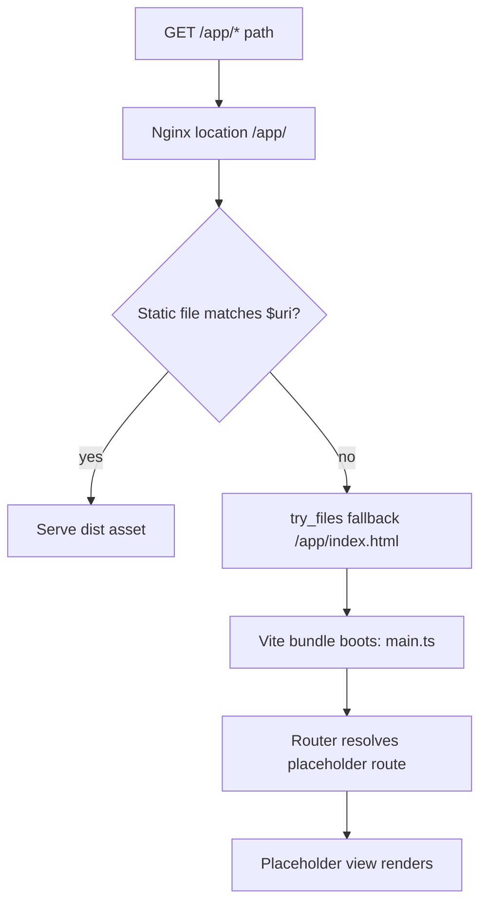

Edge trace (every edge cites the intended file the
implementation PR must create):

- A–B: `deploy/nginx/nginx.conf` gains the `location /app/`
  block; legacy `location /` is untouched.
- C–D: hashed Vite assets under `/app/assets/` served directly
  (`app/dist/` packaged into the Nginx image; `vite.config.ts`
  `base: '/app/'`).
- C–E: non-asset paths fall through to `/app/index.html`
  (`try_files $uri $uri/ /app/index.html;` — NOT `/index.html`).
- F–G: `src/main.ts` installs Pinia and mounts the router;
  `src/router.ts` holds exactly one route (placeholder only).
- G–H: `src/views/Placeholder.vue` renders using the session
  store (`src/stores/session.ts`).

Failure/rollback:

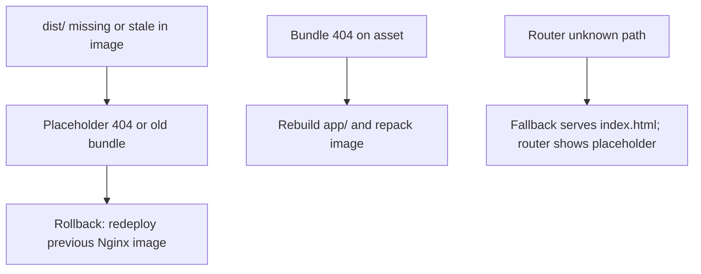

Edge trace:

- P–R: rollback is proxy-only (remove the redirect / redeploy
  the previous Nginx image); the static pages were already
  removed in #299, so no data migration either way.
- S–T: asset miss means the image packed a stale `dist/`;
  rebuild, never hand-edit.
- U–V: history-mode unknown paths still boot the placeholder in
  this slice (no app routes exist yet); real 404 semantics arrive
  with the first screen slice.

### 11.2 Shared-client 401-to-sign-out flowchart

Authenticated call from the placeholder through the shared client:

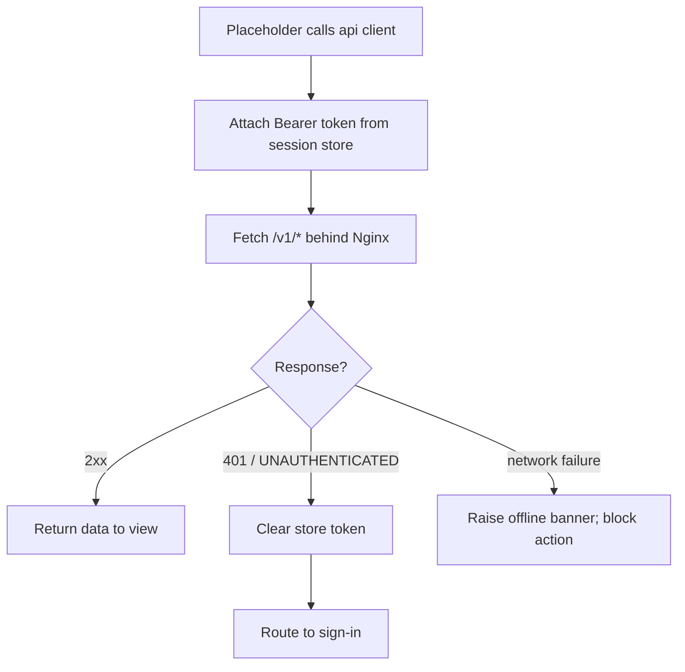

Edge trace:

- A–B: `src/api/client.ts` reads the token from
  `src/stores/session.ts` (never from page-local state).
- D–E: happy path returns parsed data; the placeholder needs no
  payload shape in this slice.
- D–F–G: single 401 path — clear + sign-in redirect, replacing
  the five per-page handlers of the decommissioned static pages
  (#299); a revoked or
  expired token takes the same path (revocation re-checked per
  LLD section 0).
- D–H: fetch rejection (LAN disconnect) is NOT treated as
  sign-out; it drives the section 11.3 banner and manual retry instead.

Failure/rollback: no compensation — clearing the store token is
a single local step; refusals precede any mutation, and the
server-side session rules (15-minute idle sign-out, 5-minute
revalidation bound, LLD section 0) are unchanged.

### 11.3 Offline banner / manual-retry flowchart

LAN disconnect during a desk session on `/app/`:

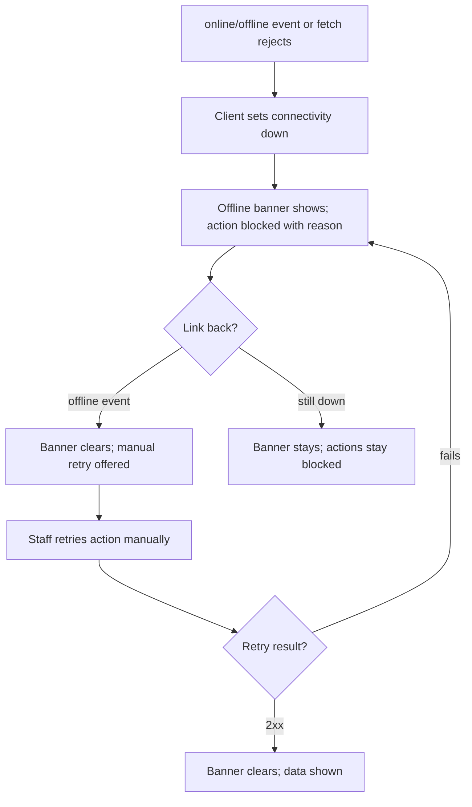

Edge trace:

- A–B: `src/api/client.ts` owns connectivity state
  (`online`/`offline` listeners + failed-fetch detection).
- B–C: banner + blocked action with reason; the desk never
  silently drops an op.
- E–G: retry is always staff-initiated (safe manual retry) —
  explicitly no automatic write queueing and no background
  replay, because desk writes are synchronous authoritative ops
  (ADR-0003 criterion 9: queueing risks double-charge).
- H–C: a retry that still fails returns to the blocked banner;
  reconnect alone clears nothing until the staff retries.

Failure/rollback: none compensating — blocked actions mutate
nothing, so there is nothing to roll back; the previous Nginx
image (without `/app/`) predates the desk UI entirely.

## 12. Desk UI styling design (Refs #338)

Presentation-only slice of the approved Phase 1 UI contract (the
`product-owner` contract comment on #338; proposed tier T2 —
reader-visible UI change, no behaviour change). Subsystem boundary
is in `docs/architecture/hld.md` [section 12](hld.md); requirements delta is in
`docs/requirements/mvp-requirements.md` [section 8](../requirements/mvp-requirements.md) (`FR-DSP-*`,
`NFR-DSP-*`, landed via #344). This section is the build-ready
decomposition the Phase 2 implementation PR must follow, including
the per-flow diagrams (happy path + failure/rollback path) the T2
gate requires. No backend, API, contract, schema, or error-code
change is specified anywhere in this section (see section 12.4).

Intended tree deltas (files the Phase 2 implementation PR must
touch or create; edge traces below cite the existing files):

```text
app/
  package.json           add PrimeVue (+ preset theme) as a dependency; no other new runtime dep
  src/main.ts            install PrimeVue + stock preset theme fed by the section 12.1 tokens (extends :10-20)
  src/App.vue            styled shell: top nav (six destinations + user + sign-out, active highlight),
                         centred content column, shell-owned sign-in gate; offline banner stays as-is (:1-28)
  src/router.ts          unchanged routes (the six paths + placeholder fallback stay exactly as at :24-60)
  src/theme/tokens.ts    NEW: contract section 1 tokens as preset-theme inputs (no custom design system)
  src/views/*.vue        per-screen restyle onto the section 12.2 component mapping; data-testid hooks kept;
                         per-screen sign-in copies removed (moved to the shell gate); print <style> blocks kept
```

### 12.1 Theme inputs (contract section 1 tokens, PrimeVue preset only)

The stock preset theme is fed exactly these values; nothing else
is a styling input. Money and dates render exactly as today
(hotel locale settings govern; presentation never changes values).

- Colours: surface `#FFFFFF`; page `#F4F2ED`; ink `#1F2933`;
  muted `#6B7280`; primary desk blue `#1D4ED8` (actions, active
  nav); success `#15803D`; warning `#B45309`; danger `#B91C1C`;
  borders `#E5E7EB`. One accent only (desk blue); state colours
  are used solely for status, never for branding.
- Type: system font stack; base 16px; headings 20/24/30px;
  tabular numerals for money and balances.
- Spacing/radius: 4px base unit (8/12/16/24px steps); card
  radius 8px; focus ring 2px desk blue on every interactive
  element (keyboard-visible, `NFR-DSP-2`).

### 12.2 PrimeVue component mapping (per pattern, no ad-hoc markup)

| Pattern (contract section 3) | PrimeVue component | Applied to (existing SFCs) |
|---|---|---|
| Forms (book, charge, pay, admin setup) | `InputText`, `Dropdown`/`Select`, `Calendar`/`DatePicker`, `Password` for secrets, `Button` for submits | Book form hooks `book-guest-name` (`BookView.vue:38-48`) through `book-confirm` (`:104-112`); guest lookup via `book-find-guest` / `book-register-guest` (`:49-64`); per-screen sign-in forms (removed to the shell gate, section 12.4) |
| Lists (reservations, stays, folios, rooms, guests) | `DataTable` with `Column`, paginator on long lists | Arrivals table `desk-arrivals-table` (`DeskView.vue:57-59` and siblings per screen) |
| Confirmations and destructive actions (cancel, check-out, day-close) | `Dialog` with explicit confirm/cancel buttons | Existing confirm buttons (e.g. `book-confirm` at `BookView.vue:104-112`) keep their hooks and call order |
| Feedback (success, validation, refusal, error) | `Message`/`Toast` for page-level notes, inline field errors under the field | Existing alert hooks (`book-quote-error`, `book-confirm-error`, `desk-dashboard-error`) keep their hooks; sign-in errors render only in the shell gate (`shell-signin-*` in `App.vue:67-109`); wording becomes plain sentences per `FR-DSP-3` |
| Print (receipt/invoice/confirmation) | existing print CSS preserved; screen shows a print preview card with one Print button | `.print-document` markup (`PrintView.vue:105,219,300`) under `@media print` (`PrintView.vue:1239` within the `:1233-1257` style block, `BookView.vue:1100` within `:1090-1111`) |

### 12.3 Shell navigation flowchart

Signed-in staff move between the six screens through the new top
nav (the nav itself is the only addition; routes are unchanged):

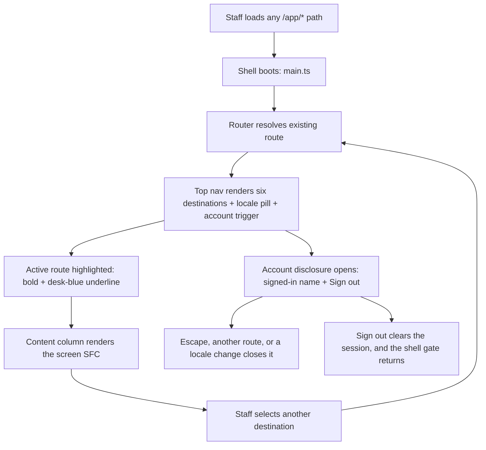

Edge trace (every edge cites code):

- A–B: Nginx `location /app/` fallback serves `/app/index.html`
  (LLD section 11 edge C–E); `src/main.ts:10-20` installs Pinia, the
  router, PrimeVue + preset theme (new), and the `$t` catalogue.
- B–C: `src/router.ts:24-60` — the six paths resolve to their
  existing SFCs; unknown paths fall through to the placeholder
  (`:56-58`); no route is added, removed, or renamed.
- C–D: `src/App.vue` gains the nav (extends the `:1-28` shell
  that today holds the offline banner, the shell gate, and
  `RouterView` at `:189`); each item links its existing path in
  contract section 2 order (Desk · Book · Stay · Folio · Print · Admin).
- D–E: active highlight is bold label + desk-blue underline
  (`#1D4ED8`, section 12.1) driven by the router's current route —
  the stand-in always knows the current screen (`FR-DSP-1`).
- D–H: the account trigger (`data-testid="shell-session-trigger"`,
  `src/App.vue:191-202`) reveals the disclosure
  (`shell-session-menu`, `:203-221`) carrying the signed-in name
  and Sign out. Since #564 the session controls sit behind this
  disclosure instead of inline, which is what lets brand, the seven
  tabs, and the locale pill hold the design's single 60px row.
- H–I: Escape (`src/App.vue:189` `@keydown.escape` →
  `closeSessionMenu`, `:420-430`, which also returns focus to the
  trigger) and a screen or locale change (`:457-461` watcher) close
  the disclosure.
- H–J: Sign out (`src/App.vue:214-220`) clears the session store and
  the shell gate renders again (`FR-DSP-2`).
- F–G: screen SFCs render inside the centred column (max
  1100px, one plain-words page heading each); existing
  `data-testid` hooks (`*-view`, `offline-banner`) are kept so
  characterization tests survive.

  Pointer: desk shell/nav chrome was later restyled pixel-faithful
  to the owner design tokens (1200px column; active-tab inversion
  instead of the desk-blue underline; PrimeVue fills abandoned on
  desk surfaces where they diverge) — the rollout record above is
  history, and the restyle spec
  `docs/product/desk-ui-pixel-faithful-restyle.md` is authoritative
  (Refs #518).

Failure/rollback:

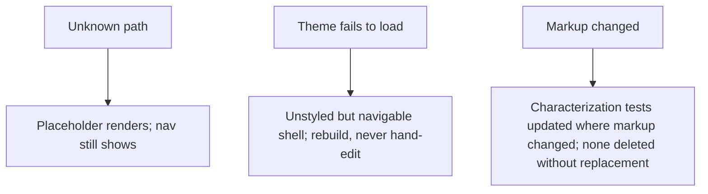

Edge trace:

- P–Q: router fallback (`src/router.ts:56-58`, LLD section 11.1 edge
  U–V); real 404 semantics stay a later screen concern.
- R–S: preset-theme failure is a build/packaging defect —
  rebuild `app/` and repack the image, same as LLD section 11.1 S–T.
- T–U: `FR-DSP-1` handoff (`router.test.ts:16`, per-view render
  suites) extended with nav + active-highlight assertions.

### 12.4 Sign-in gate flowchart

The shell owns the one sign-in form; per-screen sign-in copies
are removed (behaviour — token mechanics, lockout, idle
sign-out — is unchanged, LLD section 0):

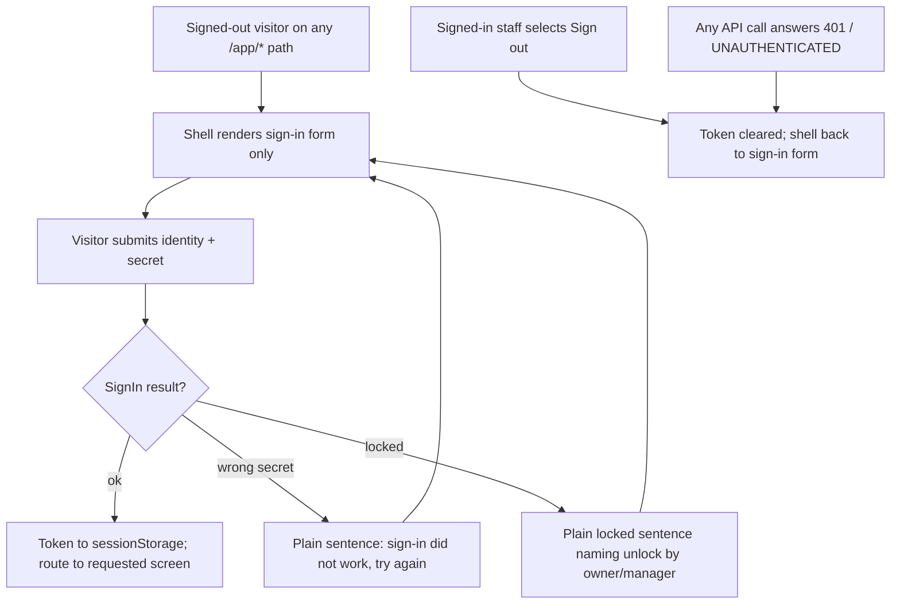

Edge trace:

- A–B: the gate (`App.vue:32` shell-gate, sign-in form at
  `:67-109`) replaces the six per-screen copies, which were
  deleted with the legacy pages in #299 — no per-screen sign-in
  form remains in any view; the per-view sign-in tests moved to
  the gate without deleting coverage (`DeskView.test.ts:143-164`
  dashboard frame with no per-screen sign-in copy).
- C–E: `AdminService.SignIn` contract unchanged
  (`docs/technical/integration.md` [section 6](../technical/integration.md) C10); token persists in
  `sessionStorage` (`src/stores/session.ts:20-60`, key at
  `:20`, survives reload, dies with the tab).
- D–F–G: wrong-secret and locked-identity refusals keep their
  codes (`UNAUTHENTICATED`, `IDENTITY_LOCKED` per LLD section 0);
  only the wording becomes one plain sentence (`FR-DSP-3`).
- H–I: sign-out clears the store token as today
  (`session.test.ts:43` handoff; `NFR-SEC-2` holds).
- J–I: the single 401 path (`src/api/client.ts:89-110` handler
  plus the `:168-183` 401 branch, LLD section 11.2) is untouched —
  clear + route to sign-in; fetch rejection still drives the
  offline banner (section 11.3), never sign-out.

Failure/rollback: no compensation — clearing the store token is
a single local step; refusals precede any mutation; the
server-side session rules (15-minute idle sign-out, 5-minute
revalidation bound, LLD section 0) are unchanged. Rollback is reverting
the Phase 2 PR (per-screen copies return with it).

### 12.5 Representative form flow (book quote-then-confirm)

The book screen is the representative form pattern; charge, pay,
and admin-setup forms follow the same state machine with their
own hooks. Behaviour and call order are unchanged — only
presentation (PrimeVue inputs, plain-words states) changes: the
#421 restyle groups the same hooks into the two-column design
cards (guest card above quote card on the left,
dates/room/discount card on the right) with no hook, field, or
call-order change. The #423 restyle groups the charge/pay hooks
into the folio two-card layout (charges card with the lines
table plus the post-charge form on the left, payments card with
the balance due plus the post-payment form on the right), again
with no hook, field, or call-order change.

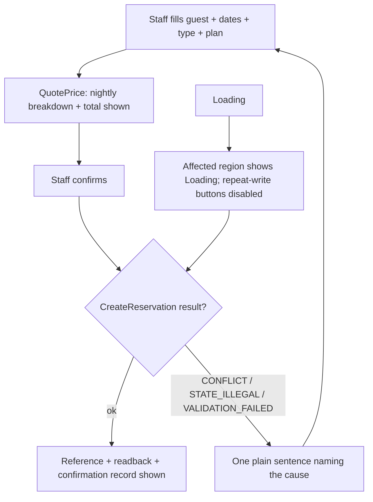

Edge trace:

- A: form hooks `book-guest-name` (`BookView.vue:38-48`)
  through `book-discount-name` (`:214-224`); guest lookup via
  `book-find-guest` / `book-register-guest` (`:49-64`); the
  arrival/departure fields are PrimeVue DatePickers localized from
  the app locale — VI `dd/mm/yyyy`, EN `mm/dd/yyyy`, never the
  browser UI language — and keep the canonical ISO value in the
  form state (Refs #581; `BookView.vue:153-192`, picker locale
  bridge at `app/src/i18n/primevueLocale.ts`, ISO-to-`Date` bridge
  at `app/src/i18n/index.ts:261` / `:265`);
  mandatory-field refusals name the field (`FR-CUS-1`,
  wording only per `FR-DSP-3`).
- B: quote hooks `book-quote` (`:240-249`), breakdown
  `book-quote-nights` (`:94`), total `book-quote-total`
  (`:102`); `PricingService.QuotePrice` contract unchanged
  (integration [section 1](../technical/integration.md) C1); later rate changes still never alter the
  quoted basis (BR-13).
- C–D: confirm `book-confirm` (`:104-112`); `ReservationService.
  CreateReservation` contract unchanged (integration section 1);
  last-unit race still refuses the loser with `CONFLICT`
  (`NFR-CON-1` — condition unchanged, sentence plain).
- D–E: result hooks `book-result` (`:262-265`),
  `book-booking-reference` (`:267`), `book-booking-readback`
  (`:268`); confirmation record `book-confirmation` (`:289-307`)
  per `FR-GST-4`.
- D–F: every refusal keeps its code (`CONFLICT`,
  `STATE_ILLEGAL`, `VALIDATION_FAILED`,
  `SETTLEMENT_REQUIRED` on check-out) per
  `docs/technical/error-handling.md` [sections 1–2](../technical/error-handling.md); only the
  on-screen wording becomes one plain sentence naming the
  cause and the next step (`FR-DSP-3`).
- G–H: loading names the affected region while the rest stays
  visible; write buttons disable until the call returns
  (no double-charge from repeat taps).

Failure/rollback: refusals precede mutation (nothing to
compensate); a LAN disconnect mid-form drives the section 11.3 banner
+ manual retry (no queued writes). Rollback is reverting the
Phase 2 PR; characterization tests are updated where markup
changed, none deleted without replacement.

### 12.6 Technical no-change note (behaviour, APIs, contracts)

Nothing in section 12 changes behaviour, and the Phase 2
implementation PR must not change any of the following; each
item names its guard so drift is reviewable:

- Routes: the six `/app/` paths and the `/app/print/...`
  namespace stay exactly as routed (`src/router.ts:24-60`,
  placeholder catch-all at :56-58);
  Nginx `location /app/` fallback stays `/app/index.html`
  (LLD section 11); legacy redirects and `/docs` Swagger mirror stay
  intact (`FR-SHL-4`, `script/openapi-route-check.sh` green).
- APIs and contracts: every desk call keeps its operation,
  payload, and envelope (`docs/technical/api-spec.md` [sections 1–2](../technical/api-spec.md),
  `docs/technical/integration.md` [sections 1–6](../technical/integration.md) C1–C11,
  `contracts/openapi.yaml` + `frontend/docs/openapi.yaml`
  byte-identical mirror — 14 ops, unchanged).
- Error semantics: all codes and refusal conditions stand
  (`docs/technical/error-handling.md` [sections 1–2](../technical/error-handling.md), LLD sections 1–8 error
  mappings); only on-screen wording becomes plain sentences.
  Session rules (LLD section 0: HMAC token, 5-minute revalidation,
  15-minute idle sign-out, 5-strike lockout) are untouched.
- Catalogue: every new plain-words sentence ships in
  `messages/en.json` (beside the Vietnamese `messages/vi.json`
  for the pilot desk, Refs #356, resolved with English fallback
  through `app/src/i18n/`) and stays covered by
  `script/catalogue-coverage-check.sh` (`NFR-I18N-1` holds).
- Admin gating: the admin console hides every management section
  from front-desk callers (`canManage` in `AdminView.vue:482`,
  restricted notice at :12-18) as a cosmetic layer over the
  unchanged server-side `FORBIDDEN` refusals (Refs #355).
- Print: receipt, invoice, and confirmation output match folio
  lines and balance exactly (`FR-BIL-4` holds); print
  isolation CSS preserved (`PrintView.vue:1233-1257`,
  `BookView.vue:1090-1111` source-pinned by
  `PrintView.test.ts:724-739` and `BookView.test.ts:1322-1332`);
  screen styling must not leak into print.
- Tests: `data-testid` hooks kept; characterization suites
  extended where markup changed; no test deleted without
  replacement (`FR-DSP-1..4` handoffs in
  `mvp-requirements.md` [section 8.4](../requirements/mvp-requirements.md) cite the on-disk guards).

Out of scope (contract section 6, restated as build constraints): no
new screens or flows; no Figma mockups; no marketing-grade
visuals — the bar is MVP-usable, not pixel-perfect.

## 13. Desk UI design-rollout flows (Refs #419)

Build-ready decomposition for the owner-supplied six-screen
Claude desk UI rollout (tier T2; subsystem-boundary position in
`docs/architecture/hld.md` [section 13](hld.md)). The T2 UI
contract lives with `product-owner` (PR #426), the
`FR-DSK-*`/`NFR-DSK-*` delta with `business-analyst`
(`docs/requirements/mvp-requirements.md` [section 10](../requirements/mvp-requirements.md),
PR #427), and guard mapping with `qa-lead` (D1–D9, PR #428).
This section supplies SPEC-GATE FAIL finding 3 on PR #426: one
per-flow diagram (happy path + failure/rollback path) for each
touched flow, with edge traces citing code. All four flows keep
existing operations, payloads, envelopes, and refusal
conditions; only presentation and the narrowly-scoped
screen behaviours in `FR-DSK-2`, `FR-DSK-4`, `FR-DSK-6`, and
`FR-DSK-7` change (see section 13.5).

Intended tree deltas (files the screen implementation PRs must
create or extend; edge traces below cite them as `NEW` where
they do not exist yet on master):

```text
app/
  src/router.ts            extend: add /rooms (Rooms map, #424) and /onboarding (wizard, #425);
                           the 8-route set pinned at router.test.ts:17 grows by exactly one
                           more for the wizard, no rename/removal
  src/App.vue              extend: NAV_ITEMS to canvas-manifest-relative order
                           (Desk, Stay, Rooms, Book, Folio; #425 inserts Onboarding
                           ahead of Rooms to complete the tab order); brand span shows the
                           configured hotel name; locale switcher unchanged
  src/views/DeskView.vue   extend: two housekeeping action buttons on the need-cleaning card (#420)
  src/views/RoomsView.vue   NEW: read-only floor-grouped map with summary chips (#424)
  src/views/OnboardingView.vue NEW: wizard shell with progress + back/continue, step 1 hotel-name form (#425)
  messages/en.json + messages/vi.json  extend: desk.rooms.*, desk.onboarding.*,
                           stay.checkin.* hint, desk.empty.* keys in both locales, placeholders intact
```

### 13.1 Stay explicit empty placeholder blocking check-in (#422)

The shipped Stay check-in flow has three steps. The arrival
pick preloads the booking and its ready-room candidates
(#586, `AC-DSK-17`), so the room select is populated before
any Check in click. The select opens on an explicit empty
option with the pick-a-ready-room hint, and check-in stays
blocked until a ready room of the booked type is chosen: this
resolves the StayView check-in room preselection mismatch
(#411) by making unselected explicit instead of preselecting a
possibly wrong room. One Check in click then commits, reusing
the preloaded candidates (#594); on success the panel reset
invalidates any preload a pick started inside the commit
window (#596, PR #613), and the commit keeps its own in-flight
state when such a preload settles first (#614, fixed by
PR #616). Behaviour and call order are otherwise unchanged
(`StayService.CheckIn` provider-side guards stand). The #422
restyle hooks these steps into the design cards; the later
#541 v2 board renders the same hooks as two panels, check-in
and check-out, with the lists read still running underneath to
feed both selects.

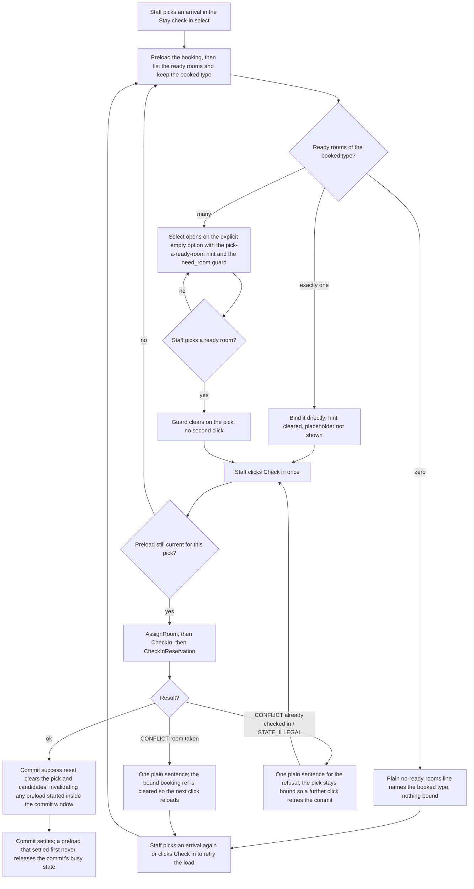

Edge trace (every edge cites code; `StayView` paths are
relative to `app/src/views/`):

- A–B: the arrival pick (`@change="onArrivalChange"`,
  `StayView.vue:30`) starts the preload itself
  (`onArrivalChange`, `StayView.vue:965-990`) — `GetReservation`
  for the picked booking (`:1037-1040`), then `ListRoomsByState`
  for `vacant-inspected` (`:1063-1066`) filtered to the booked
  type (`:1070-1072`). Booked-type status comes from
  `bookedTypeStatus` (`:688-701`), and each pick owns a load
  sequence so an earlier read paints nothing (`:966`, `:1042`,
  `:1060`, `:1067`, `:1104`). The preload is one click-free read
  pair, and the late-read case is pinned by
  `StayView.test.ts:332` and `StayView.test.ts:723`.
- B–C–D: zero candidates of the booked type sets the booked-type
  status and the plain no-ready-rooms line
  (`StayView.vue:1073-1081`) and leaves the explicit empty option
  bound (`StayView.test.ts:538`).
- B–C–E: exactly one candidate binds directly and clears the
  hint (`StayView.vue:1090-1096`); `StayView.test.ts:493`.
- B–C–F: many candidates open on the empty option
  (`StayView.vue:51-53` `<option value="">` with the
  `desk.stay.choose_room` key) with the amber hint (`:66-72`,
  `desk.stay.room_hint`) and `need_room` set (`:1097-1099`);
  `StayView.test.ts:332`.
- F–G–H: the room-pick watch clears the guard as soon as a valid
  candidate id is bound (`StayView.vue:992-1002`), so no second
  click is needed (`StayView.test.ts:402`).
- G–F (no pick): the commit-time guard rejects an empty or
  unknown id with `need_room` and calls no operation
  (`StayView.vue:1148-1152`); a click with no arrival pick keeps
  the `need_arrival` guard (`:1140-1143`). Guards pinned by
  `StayView.test.ts:453` and `StayView.test.ts:435`.
- D–R–B: a retry click reloads the booking and candidates
  instead of committing (`onCheckIn` retries when `checkinRef` no
  longer matches the pick, `StayView.vue:1144-1147`);
  `StayView.test.ts:538` and `StayView.test.ts:607`.
- I–J: the click re-tests that the preload is current for the
  picked arrival (`StayView.vue:1144-1147`) and is a no-op while
  a read or commit is in flight (`:1135-1137`).
- J–K: `AssignRoom` (`StayView.vue:1159-1171`,
  `RoomInventoryService.AssignRoom`, LLD section 3 atomic guard,
  `NFR-CON-2`) with `roomNumber`, the `stayLink` key, and one
  idempotency key, then `CheckIn` with the room id from the
  AssignRoom echo (`:1214-1217`), then `CheckInReservation` in
  legacy op order (`:1235-1238`), one idempotency key per
  contract op (`:1156`, `:1168`); one click commits once
  (`StayView.test.ts:332`, double-click guard `:1772`).
- K–L–M: happy path writes the status line and the stay-id
  reference (`StayView.vue:1247-1252`), then the commit success
  reset bumps the load sequence, drops the pending load, clears
  arrival, room, candidates, and booking ref (`:1260-1266`) and
  reloads the panel (`:1267`); `StayEvents.checked-in` (LLD
  section 2); the folio opens stay-side per BR-21.
- M–O: a pick taken inside the commit window starts a preload
  the reset invalidates, so its late read paints no candidate,
  status, or error and never re-locks the panel
  (`StayView.vue:1253-1266`). `commitInFlight` keeps the commit's
  busy state when that preload settles first
  (`StayView.vue:1154`, `StayView.vue:1116-1123`,
  `StayView.vue:1274-1283`). Both cases are pinned by
  `StayView.test.ts:1909` and `StayView.test.ts:2057`; this is
  the commit-window mirror race as fixed (#614, PR #616), with no
  part left open.
- K–L–N–R: room just taken -> `CONFLICT` naming the room and
  clearing the bound booking ref, so the next click finds the ref
  stale and reloads the booking and candidates instead of
  committing (`StayView.vue:1177-1185`, retry at `:1144-1147`);
  `StayView.test.ts:967`.
- K–L–N2–I: booking already checked in -> `CONFLICT` with its
  own line, and room not ready/blocked -> `STATE_ILLEGAL` naming
  room+state (LLD section 2 error mapping); neither clears the
  bound ref, so the pick stays and a further click retries the
  commit (`StayView.vue:1223-1230`); `StayView.test.ts:997`;
  only wording is new (`FR-DSP-3`).
- A pick cleared mid-load releases only the preload's half and
  never a commit the button owns (`StayView.vue:975-987`;
  `StayView.test.ts:665`).
- Checkout gating (Refs #588, re-pinned for #600; shown for
  completeness): `canCheckOut` gates the button and the dialog
  confirm together (`StayView.vue:668-673`, `:260`, `:282`);
  `GetFolioBalance` on review (`:1382-1387`) with
  `RecordOpenBalanceApproval` (`:1500-1513`); the confirm route
  re-reads the folio (`:1556-1563`) and refuses an unpaid or
  unprovenanced balance before `CheckOut` (`:1575-1590`,
  `:1602-1606`); a server `SETTLEMENT_REQUIRED` still refuses
  (`:1676-1684`) and the landed close releases the departed room
  once (`ReleaseRoom`, `:1622-1634`). `FR-BIL-7` holds; the gate
  pair and the server refusal are pinned by `StayView.test.ts:2213`
  and `StayView.test.ts:1532`. Amendment (Refs #600): the review now
  posts the stay's room charge before that gate reads the balance
  (section 20), so the gate governs a folio that carries the room
  it paid for; the gate conditions themselves are unchanged.

Failure/rollback:

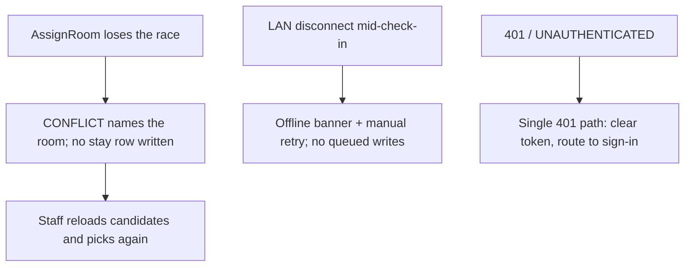

Edge trace:

- P–R: refusals precede mutation — nothing to compensate;
  the provider-side atomic guard (LLD section 3) means the
  loser never holds the room, and the `CONFLICT` branch clears
  the bound booking ref so the next click reloads the
  candidates (`StayView.vue:1177-1185`).
- S–T: a fetch rejection in either half surfaces as the plain
  panel error (`StayView.vue:1103-1112`, `:1268-1273`) and drives
  the section 11.3 banner and safe manual retry, never sign-out.
- U–V: shared-client 401 path (LLD section 11.2) unchanged; every
  catch in this flow routes `isSignedOut` to the one `expireToGate`
  call (`StayView.vue:951-954`, `:1045-1048`, `:1107-1110`,
  `:1173-1176`, `:1199-1202`, `:1219-1222`, `:1240-1243`,
  `:1269-1272`).
- Rollback: revert the #422 placeholder/hint/guard change, or
  the later #586 preload, #594 one-click commit, and
  #596/#614 reset-invalidation changes; each reverts on its own
  with no contract or schema change anywhere in this flow.

### 13.2 Main board housekeeping buttons with count refresh (#420)

Two action buttons on the need-cleaning card drive the
existing dirty-to-clean-to-inspected transitions; the board
counts refresh to match. No transition logic changes — the
buttons are callers of the existing state machine only
(`FR-RMS-2`, `NFR-AUD-1` hold).

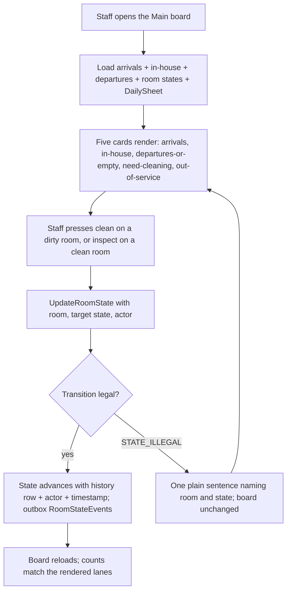

Edge trace (every edge cites code):

- A–B: arrivals/in-house/departures via
  `ListArrivalsDepartures` (`DeskView.vue:744-747`), room
  lanes via `ListRoomsByState` (`DeskView.vue:758-759`),
  checkout dates via `QueryCalendar` (`:660-669`), block notes
  via `CheckRoomTypeSellability` (`:688-713`), cross-check via
  `DailySheet` (`:800-812`).
- B–C: the five design cards render at `DeskView.vue:51`
  (arrivals with room-type labels), `:76` (in-house with
  checkout dates), `:101` (departures), `:126`
  (need-cleaning), `:184` (out-of-service); departures renders
  its explicit empty state when there are no checkouts today;
  out-of-service shows reason plus date (`:184-203`); the
  five-lane board stays below at `:208`.
- D–E: the two buttons on the need-cleaning card call the LLD
  section 3 `UpdateRoomState` operation (`DeskView.vue:149`
  clean, `:170` inspect; call at `:588` with roomNumber,
  newState, actor) — clean maps dirty-to-clean, inspect maps
  clean-to-inspected; one idempotency key per contract op.
- E–G: provider-side transition check (BR-28) plus history
  row and outbox event in one transaction (LLD section 3).
- G–H: `refreshDashboard` (`DeskView.vue:734`,
  manual trigger `desk-refresh` at :24-28 via `onRefresh` at
  :874-877) reloads the same queries, so summary counts
  match the rendered lanes by construction.
- F–I: illegal transition (e.g. dirty straight to
  inspected) refuses `STATE_ILLEGAL` naming room+state;
  wording only is new.

Failure/rollback:

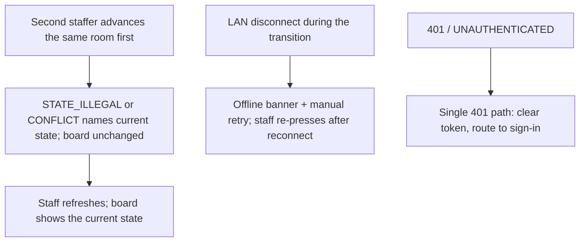

Edge trace:

- P–R: the provider-side guard is the arbiter; the loser
  reloads — no client-side lock is invented.
- S–T: blocked action mutates nothing; retry is
  staff-initiated (no write queueing, LLD section 11.3).
- Rollback: revert the #420 screen PR; the buttons revert
  with it (no contract, transition, or schema change
  anywhere in this flow).

### 13.3 Rooms map counts-match-cards invariant (#424) with per-card housekeeping actions (#435)

Floor-grouped visual map whose summary chips always equal
the rendered room cards. The #424 screen shipped read-only
over existing room state; #435 adds per-card housekeeping
actions on top: dirty cards carry Mark cleaned (vacant-dirty
to vacant-clean) and clean cards carry Mark inspected
(vacant-clean to vacant-inspected) through the existing
`UpdateRoomState` transitions only — no transition logic
changes (`FR-RMS-2`, `NFR-AUD-1` hold). Success re-reads the
map so the chips match the cards again.

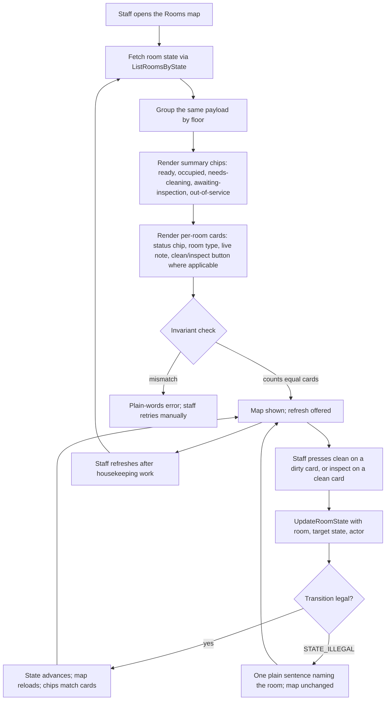

Edge trace (every edge cites code):

- A–B: NEW `RoomsView.vue` reads the existing
  `RoomInventoryService.ListRoomsByState` operation (LLD
  section 3; same read the Main board uses at
  `DeskView.vue:758-759`); no new endpoint, no new store.
- B–D: chips derive from the one fetched payload — the
  invariant holds by construction, never by reconciling two
  sources. New catalogue keys `desk.rooms.*` (chips, card
  notes) land in both locales via the normal catalogue
  process (`NFR-DSK-1`).
- E: each card shows the one chip vocabulary shared with
  the Main board, the room type, and the live note
  (occupant + checkout date, out-of-service reason + date,
  or upcoming arrival) — `FR-DSK-6`. Dirty cards add a Mark
  cleaned button (`RoomsView.vue:96-105`) and clean cards a
  Mark inspected button (`:106-115`); other states carry no
  button (#435).
- A: NEW `/rooms` route in `src/router.ts` (the 8-route set
  pinned at `router.test.ts:17`, plus one more for the wizard in
  section 13.4); unknown
  paths still fall through to the placeholder (LLD
  section 11.1 edge U–V).
- F–H: a fetch failure renders one plain sentence
  (`FR-DSP-3`) with manual retry; the only writes are the
  two card buttons below (J–N), so every other refusal
  condition is untouched.
- J–K: the two card buttons call the LLD section 3
  `UpdateRoomState` operation via `markRoom`
  (`RoomsView.vue:615-656`; call at `:626` with roomNumber,
  newState, actor) — clean maps dirty-to-clean
  (`onMarkCleaned` at `:650-652`), inspect maps
  clean-to-inspected (`onMarkInspected` at `:654-656`); the
  per-room busy guard (`isBusy` at `:605-607`, set at
  `:620-623`) disables the button until the call returns.
- K–M: provider-side transition check (BR-28) plus history
  row and outbox event in one transaction (LLD section 3);
  success re-reads via `refreshMap` (`:634`, manual trigger
  `onRefresh` at `:601-603`), so summary chips match the
  rendered cards by construction.
- L–N: illegal transition (e.g. a room already advanced by
  another staffer) refuses `STATE_ILLEGAL`; one plain
  sentence names the room (`:640-644`) and the map is left
  untouched; a manual refresh clears a resolved banner.

Failure/rollback:

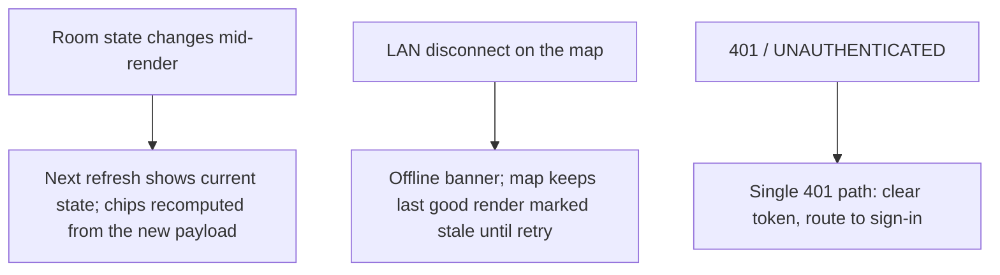

Edge trace:

- P–Q: staleness resolves by re-fetch, never by client
  patching; the Reporting read-model lag bound (LLD
  section 0, 60 s) does not apply here — the map reads the
  owning store directly.
- Rollback: revert the #424 screen PR for the route, view,
  and keys, plus the #435 buttons PR for the card actions
  (additive only — existing screens are untouched).

### 13.4 Onboarding wizard gating with hotel-name persistence (#425) plus steps 2–4 (Refs #438)

New first-run surface: the wizard launches on an empty
database only, walks staff through setup with progress and
back/continue navigation, and persists step 1 (hotel name)
through the existing Admin config surface so the name
appears in the shell header and on printed documents. Steps
2–4 (Refs #438) extend the shipped #425/#437 shell with one
idea per step — step 2 remaining hotel profile
(`FR-DSK-8`), step 3 rooms/room-types seed (`FR-DSK-9`),
step 4 first owner account (`FR-DSK-10`) — each persisted
through its existing operation with no new endpoint, no new
entity, and no new error code. Scope and done-conditions live
with `product-owner`
(`docs/product/desk-ui-design-rollout.md` [section 10](../product/desk-ui-design-rollout.md),
`AC-DSK-9` through `AC-DSK-11`, PR #441); exact fields and
validation live with `business-analyst`
(`docs/requirements/mvp-requirements.md` [section 11](../requirements/mvp-requirements.md),
`FR-DSK-8` through `FR-DSK-10`, PR #442); guard mapping lives
with `qa-lead`. This section supplies the T2 per-flow
implementation diagram (happy path + failure/rollback path)
with edge traces citing code.

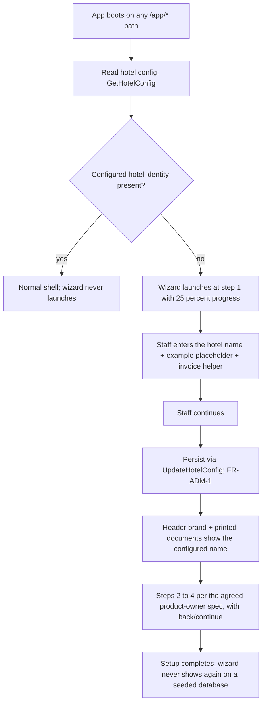

Edge trace (every edge cites code):

- A–B: boot check reuses the existing `GetHotelConfig`
  read (`AdminView.vue:586` call site; `AdminService.
  GetHotelConfig` contract unchanged, LLD section 8). No
  new endpoint decides emptiness; the exact
  empty-predicate (unconfigured hotel identity) is set by
  the #425 screen PR per the `product-owner` spec.
- B–D: seeded databases take the existing shell path
  unchanged (router `src/router.ts:24-60`, shell gate LLD
  section 12.4).
- E–H: NEW `OnboardingView.vue` wizard shell (progress
  indicator, back/continue navigation); step 1 matches the
  design (hotel-name input, example placeholder, helper
  noting the name appears on invoices and receipts, 25
  percent progress, continue action). Persistence goes
  through `UpdateHotelConfig` with actor + timestamp
  (`NFR-AUD-1`); new catalogue keys `desk.onboarding.*` in
  both locales (`NFR-DSK-1`).
- H–I: the shell brand span (`App.vue` `shell-brand`)
  reads the configured name; print output carries it via
  the preserved print isolation (section 13.5). The design
  example content is never hardcoded.
- E: NEW `/onboarding` route in `src/router.ts`
  (section 13.3 router note applies); deep-linking the
  wizard on a seeded database redirects to the shell.
- J: steps 2–4 flow (Refs #438) — the happy path below;
  per-step validation, back edges, and failure/rollback
  edges follow. Client state keeps already-entered values
  across back/continue; a failing step persists nothing.

Steps 2–4 happy path (extends the gate + step 1 diagram
above; node J expanded):

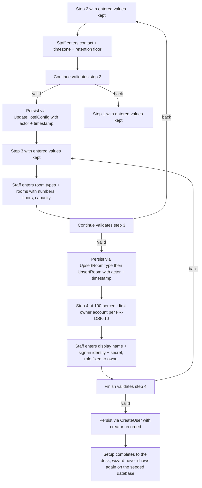

Edge trace (every edge cites code):

- J1–J4: step 2 reuses the existing `UpdateHotelConfig`
  operation (LLD section 8 ops table; same
  `'/v1/admin/UpdateHotelConfig'` call shape the wizard
  already uses at `OnboardingView.vue:203` for step 1,
  mirroring the Admin read at `AdminView.vue:586`). The
  implementation PR extends `OnboardingView.vue` with the
  step-2 fields from `FR-DSK-8` (contact details optional
  verbatim, timezone required, retention floor blank-keeps-
  365 else integer >= 0); no new operation, no schema
  change (`docs/technical/schema.md` unchanged). Saved
  values surface through the existing reads (shell brand
  span at `App.vue:132-134`, fed by the `GetHotelConfig`
  read in `loadHotelName` at `App.vue:256-264`; print
  payloads per section 13.5).
- J5–J8: step 3 introduces the first desk-client calls to
  the existing `UpsertRoomType` / `UpsertRoom` operations
  (LLD section 3 ops table; contracts unchanged,
  `VALIDATION_FAILED` only). Order is types first, then
  rooms linked to the saved types; each room number unique
  within this step's batch — a repeated number is refused
  client-side before anything persists (wizard client-side
  validation: `UpsertRoom` updates on duplicate
  server-side, `services/rooms/src/store.ts:237-260`,
  `services/rooms/src/pgstore.ts:194-213`, and the wizard
  gates to an empty database, so only intra-batch
  duplicates can occur). Provider guards stand
  (`services/rooms/src/server.test.ts:70` type upsert,
  `:79` room upsert, `:137`–`:147` unknown-type
  `NOT_FOUND`). Saved rooms appear via the existing
  inventory, availability, and calendar reads
  (`FR-ADM-3` holds).
- J9–J12: step 4 introduces the first wizard-client call
  to the existing `CreateUser` operation (LLD section 8
  ops table; same `'/v1/admin/CreateUser'` call shape as
  `AdminView.vue:645`), with the role fixed to owner and
  the secret required hashed (`NFR-SEC-2`). Provider
  guards stand (`services/admin/src/server.test.ts:122`
  create, `:132` duplicate identity refused); the
  empty-secret rule is code-enforced at
  `services/admin/src/pgstore.ts:209`
  (`VALIDATION_FAILED` naming `secret`), and the
  front-desk refusal of `CreateUser` is code-enforced at
  `services/admin/src/pgstore.ts:204-205` (`FORBIDDEN`) —
  no on-disk guard test exercises either rule through
  `CreateUser`; the nearest on-disk `FORBIDDEN` guards
  cover the sibling operations (`:177`–`:185` config
  write, `:390`–`:398` role change). Completion
  routes to the desk; the gate predicate (A–B) then reads
  a seeded database, so the wizard never shows again
  (`FR-DSK-7` holds).
- Back edges: client-side only — no persist, no
  compensation; entered values are kept in the wizard
  view state while each completed step's saved values
  stay saved (per-step atomicity, never a cross-step
  transaction).

Failure/rollback:

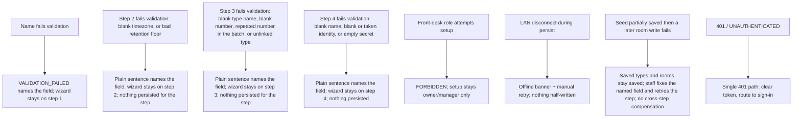

Edge trace:

- P–Q: config-schema validation (LLD section 8) precedes
  persistence — nothing to compensate.
- P2–Q2: step-2 validation restates the server-enforced
  rules named in `FR-DSK-8` (required timezone,
  integer >= 0 retention floor) before the
  `UpdateHotelConfig` call; per-step atomicity means a
  refused step writes nothing.
- P3–Q3: step-3 validation restates the server-enforced
  rules named in `FR-DSK-9` (required type name/number,
  linked type) plus the intra-batch number-uniqueness rule
  (wizard client-side: `UpsertRoom` updates on duplicate
  server-side, `services/rooms/src/store.ts:237-260`,
  `services/rooms/src/pgstore.ts:194-213`) before the
  `UpsertRoomType` / `UpsertRoom` calls; a refused step
  writes nothing, and a mid-step partial save (T3–U3)
  needs no compensation because saved records are valid
  inventory the staff member completes by retrying the
  step — the seed path is retry-safe by number (a repeated
  number re-upserts in place).
- P4–Q4: step-4 validation restates the server-enforced
  rules named in `FR-DSK-10` (required name/identity/
  secret, unique identity, fixed owner role) before the
  `CreateUser` call; a refused finish creates no
  account, and the wizard stays completable — setup
  completes only when a working owner sign-in exists.
- R–S: server-side role enforcement is unchanged
  (`FORBIDDEN` per LLD section 8; the cosmetic admin
  gating note in HLD section 12 stands).
- Rollback: revert the #438 steps 2–4 screen PR; the
  steps are additive to the shipped #437 shell — seeded
  desks never saw them, and the config, seed, and admin
  surfaces are unchanged.

### 13.5 Technical no-change note (behaviour, APIs, contracts)

Nothing in section 13 changes behaviour below the screen
surface, and no screen implementation PR may change any of
the following; each item names its guard so drift is
reviewable. The requirements side of the same statements
lives with `business-analyst`
(`docs/requirements/mvp-requirements.md` [section 10.1](../requirements/mvp-requirements.md),
PR #427); the guard side lives with `qa-lead` (PR #428,
D1–D9):

- Routes: the six existing `/app/` paths stay exactly as
  routed (`src/router.ts:24-60`, placeholder catch-all);
  sections 13.3–13.4 add exactly two routes (`/rooms`,
  `/onboarding`) — no rename, no removal. Nginx
  `location /app/` fallback stays `/app/index.html` (LLD
  section 11); legacy redirects and `/docs` Swagger mirror
  stay intact.
- APIs and contracts: every desk call keeps its operation,
  payload, and envelope
  (`docs/technical/api-spec.md`,
  `docs/technical/integration.md` C1–C11,
  `contracts/openapi.yaml` + `frontend/docs/openapi.yaml`
  byte-identical mirror — 14 ops, unchanged). The map adds
  no operation; the wizard adds no operation.
- Data model and schema: no entity or field is added
  (`docs/technical/schema.md`,
  `docs/requirements/data-dictionary.md` unchanged); the map
  visualises room state, the wizard persists through
  `FR-ADM-1` config.
- Error semantics: all codes and refusal conditions stand
  (`docs/technical/error-handling.md`, LLD sections 1–8
  error mappings); checkout still requires a settled folio
  or a recorded approval (`FR-BIL-7`, `SETTLEMENT_REQUIRED`
  at `StayView.vue:1669`). Session rules (LLD section 0:
  HMAC token, 5-minute revalidation, 15-minute idle
  sign-out, 5-strike lockout) are untouched.
- Catalogue: every new string ships in `messages/en.json`
  beside `messages/vi.json` (both on disk; `desk.stay.
  need_room` precedent at `en.json:450`) and stays covered
  by `script/catalogue-coverage-check.sh`
  (`NFR-I18N-1`, `NFR-DSK-1` hold); the hotel name shown is
  the configured value, never the design example content.
- Print: receipt, invoice, and confirmation output match
  folio lines and balance exactly (`FR-BIL-4` holds);
  print isolation CSS preserved
  (`PrintView.vue:1233-1257`, `BookView.vue:1090-1111`);
  screen styling must not leak into print (`NFR-DSK-2`).
- Tests: `data-testid` hooks kept; the D1–D9 guards (PR
  #428) are created by the screen PRs named there
  (#420–#425); characterization suites are extended where
  markup changed, none deleted without replacement.

Out of scope (restated as build constraints): print, admin,
and gate/sign-in screens (not in this design batch);
catalogue restructuring; backend or API changes beyond what
the screens need (filed as follow-ups if discovered).

## 14. Business-date display-only render mapping (Refs #503)

Build-ready decomposition for the S9 follow-up display-only
business-date change (issue #503, Phase 5 desk UI). Tier T2
(reader-visible UI on three screens, values unchanged). This
section supplies the T2 per-flow implementation diagram
(happy path + failure/rollback path) the spec gate requires
(SPEC-GATE FAIL on #503 routed this gap to `architect`).
The decision and rationale live with `business-analyst`
(`docs/requirements/mvp-requirements.md` [section 12](../requirements/mvp-requirements.md),
`FR-DSK-11`, PR #510); scope, UI contract, and
done-conditions live with `product-owner`
(`docs/product/desk-ui-design-rollout.md` [section 6.7](../product/desk-ui-design-rollout.md),
`AC-DSK-12`, PR #511); guard mapping lives with `qa-lead`.
This section records only the architect-owned flow detail:
the render mapping, its failure/rollback paths, and the
technical no-change boundary. No new subsystem, no boundary
change, no contract change — hence no ADR.

Intended tree deltas (files the downstream `dev`
implementation PR must touch; edge traces below cite the
existing lines):

```text
app/src/views/DeskView.vue    render site: header strong at :9 (data-testid="desk-business-date")
app/src/views/StayView.vue    render site: header strong at :14 (data-testid="stay-business-date")
app/src/views/RoomsView.vue    render site: header strong at :8 (data-testid="rooms-business-date")
```

The canonical `businessDate` ref stays ISO `YYYY-MM-DD`
everywhere (computed by `localBusinessDate()` —
`DeskView.vue:498`, `StayView.vue:640`,
`RoomsView.vue:202` — and sent verbatim as the
`businessDate` request field at `DeskView.vue:1060,1121`,
`StayView.vue:1042`, `RoomsView.vue:549`). The dev PR adds
one pure view-layer derivation per screen (canonical ISO
ref -> `Intl.DateTimeFormat` weekday-long locale form) and
binds the three header strongs to it; the refs themselves
are untouched.

### 14.1 Business-date render flowchart

Staff open any of the three screens; the already-loaded
canonical date renders in the design's locale long-weekday
form while every downstream use keeps ISO:

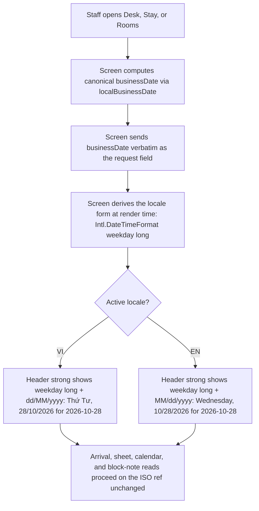

Edge trace (every edge cites code):

- A–B: the canonical ref is client-computed ISO
  (`localBusinessDate()` at `DeskView.vue:498`,
  `StayView.vue:640`, `RoomsView.vue:202`; bound into
  `businessDate` refs at `DeskView.vue:518`,
  `StayView.vue:734`, `RoomsView.vue:222`).
- B–C: the same ref is sent verbatim as the
  `businessDate` request field (`DeskView.vue:1060,1121`
  `ListArrivalsDepartures` / `DailySheet`;
  `StayView.vue:1042`; `RoomsView.vue:549`) — the wire
  stays `{"type": "string", "format": "date"}` per
  `contracts/http/DailySheet.json`,
  `contracts/http/ListArrivalsDepartures.json`,
  `contracts/http/AssignRoom.json`, and
  `contracts/http/RunDayClose.json`.
- C–D: the locale form is a pure derivation of the
  canonical ref at render time (platform locale
  formatter — `weekday: 'long'`, `day: '2-digit'`,
  `month: '2-digit'`, `year: 'numeric'` — not catalogue
  strings, so no new catalogue keys land and
  `script/catalogue-coverage-check.sh` stays green;
  `desk.today.business_date` at `messages/en.json:347`
  keeps its label wording in both locales).
- E–F–G: normative examples for business date
  `2026-10-28` (a Wednesday): VI
  `Thứ Tư, 28/10/2026` (matches
  `docs/design/Main.dc.html` exactly), EN
  `Wednesday, 10/28/2026` (`FR-DSK-11`, `AC-DSK-12`).
- F–H / G–H: every downstream read keeps the ISO ref:
  arrival guest/date pairs (`DeskView.vue:882-883`,
  `RoomsView.vue:338-339` — e.g. `Arriving ${ISO}`),
  calendar maps (`DeskView.vue:1089`,
  `RoomsView.vue:577`), block notes
  (`DeskView.vue:1112`), checkout dates
  (`RoomsView.vue:581`), and expected-arrival fetches
  (`StayView.vue:957-976`); day-close totals still key on
  the ISO business date (`FR-BIL-6`, BR-26 holds).
- Load/error states are the existing `FR-DSP-3` paths
  (loading banners, empty states, refusal sentences,
  offline banner per LLD section 11.3) — unchanged, shown
  for completeness in section 14.2.

Failure/rollback:

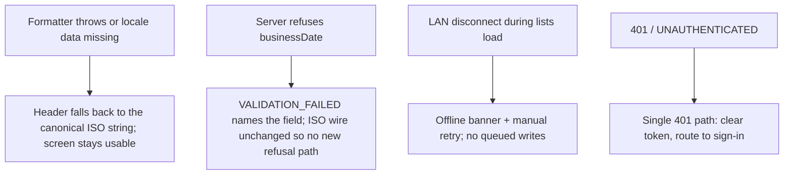

Edge trace:

- P–Q: the derived form must never break the screen —
  on any formatting failure the header renders the
  canonical ISO value (today's rendering), which is
  always a valid date because validation refuses
  anything else (`messages/en.json:39` —
  `error.validation.business_date` pins `YYYY-MM-DD`).
- R–S: refusal semantics stand (`FR-RTE-4`,
  `FR-CUS-1`, `FR-BIL-7` fire on exactly the same
  conditions); the e2e harness keeps building ISO dates
  (`script/e2e-desk-loop.sh:267-270,325-327,337-353`),
  so harness and contract checks stay green by
  construction.
- T–U: blocked loads mutate nothing; retry is
  staff-initiated (no write queueing, LLD section 11.3).
- V–W: shared-client 401 path (LLD section 11.2)
  unchanged.
- Rollback: revert the single downstream `dev` PR; the
  three strongs return to `{{ businessDate }}` ISO with
  it (no contract, schema, validation, catalogue, or
  harness change anywhere in this flow).

### 14.2 Technical no-change note (APIs, contracts, schemas)

Nothing in section 14 changes behaviour below the screen
surface, and the downstream implementation PR must not
change any of the following; each item names its guard so
drift is reviewable. The requirements side of the same
statements lives with `business-analyst`
(`docs/requirements/mvp-requirements.md` [section 12.2](../requirements/mvp-requirements.md),
PR #510); the acceptance side lives with `product-owner`
(`AC-DSK-12`, PR #511):

- Routes and shell: no route, nav, token, or layout
  change (LLD sections 11–12 hold, including the shell
  nav, `FR-DSP-1` destinations, and print isolation).
- APIs and contracts: every desk call keeps its
  operation, payload, and envelope
  (`docs/technical/api-spec.md`,
  `docs/technical/integration.md` C1–C11,
  `contracts/openapi.yaml` + `frontend/docs/openapi.yaml`
  byte-identical mirror — 14 ops, unchanged).
- Data model and schema: no entity or field is added
  (`docs/technical/schema.md`,
  `docs/requirements/data-dictionary.md` Business date
  entry unchanged — canonical ISO stored/transmitted,
  locale form derived at render).
- Error semantics: all codes and refusal conditions stand
  (`docs/technical/error-handling.md`, LLD sections 1–8
  error mappings; canonical-vs-display boundary BR-43
  holds). Session rules (LLD section 0) are untouched.
- Existing ISO pins stay green: the Desk display pin the
  dev PR updates (`DeskView.test.ts:240`) plus the
  standing payload pins it must keep green
  (`DeskView.test.ts:54,513,529,576,760,781,832`;
  `StayView.test.ts:64,142`; contract `format: date`
  guards); API-echoed card-note ISO assertions stay
  untouched (`RoomsView.test.ts:231`). The missing
  formatted-display assertion (fixed date, both locales,
  all three screens) is created by the dev PR per the
  `qa-lead` handoff — it is explicitly declared missing,
  never promised as existing.

Out of scope: implementation of the format change
(downstream `dev` issue/PR); S8 token drift (separate
follow-up); any API, validation, catalogue-key, or
allowlist change.

## 15. Desk UI pixel-faithful restyle decomposition (Refs #517)

Build-ready decomposition for owner decision B (2026-11-07,
Refs #517): the shell (#518) plus the six screens (Main
#519, Book #520, Stay #521, Folio #522, Rooms #523,
Onboarding #524) are rebuilt markup-and-style to the
owner-supplied boards. Subsystem boundary is in
`docs/architecture/hld.md` [section 14](hld.md); the T2 UI
contract, tokens, and per-surface mappings live with
`product-owner` (`docs/product/desk-ui-pixel-faithful-restyle.md`
sections 3–6, PR #525); the `FR-RST-*`/`NFR-RST-*` delta
lives with `business-analyst`
(`docs/requirements/mvp-requirements.md` [section 13](../requirements/mvp-requirements.md),
PR #526); guard mapping lives with `qa-lead`. This section
supplies SPEC-GATE FAIL finding 2 on PR #525 (the
architect-owned half): the ADR-0003 partial-supersession
record (kept in the ADR file itself) plus the flow-detail
refresh the rebuild needs — which is an explicit no-flow-change
statement with standing-diagram pointers, since no flow is
added, removed, or reordered. No backend, API, contract,
schema, catalogue-key, or error-code change is specified
anywhere in this section.

Intended tree deltas (files the seven child implementation
PRs must touch or extend; edge traces below cite the
existing files):

```text
app/
  src/theme/tokens.ts    extend: token values move to the restyle-spec section 3 set
                         (single source; already the mechanism at :22-23 header/primary,
                         :47-50 focus ring; no per-surface forks, NFR-RST-3)
  src/theme/presets      extend: preset scale re-anchored on the section 3 values
                         (same DeskPreset mechanism; no residual stock default,
                         pinned by tokens.test.ts:43-58)
  src/App.vue            rebuild shell chrome to restyle-spec section 4 (teal header,
                         tab inversion, locale pill); router table, NAV_ITEMS visible
                         set (:222-227), session store, 401 path, sign-in gate unchanged
  src/views/*.vue        rebuild per-screen markup/styling to restyle-spec sections 5.1-5.6;
                         hooks, call order, fields, flows, copy, print <style> blocks kept
  src/router.ts          unchanged (the eight paths at :47-96 stay exactly as-is)
  src/api/client.ts      unchanged (shared Bearer client, offline banner, manual retry)
  messages/*.json        unchanged (zero new keys expected; any needed key lands en + vi)
```

Re-skin-vs-rebuild rule (the ADR-0003 partial-supersession
mechanism): a PrimeVue component stays wherever it carries
behaviour (focus management, keyboard operation, ARIA
roles, validation states, dialogs, tables, date pickers)
and is re-skinned through the token-fed preset; where stock
markup cannot reach the board values, the surface is rebuilt
as plain markup carrying the same `data-testid` hooks, call
order, field order, and state semantics. Characterization
suites survive by hook, not by markup.

Standing flows (no new diagram — each flow below keeps its
happy path plus failure/rollback path verbatim):

- Shell boot, 401-to-sign-out, and offline banner/manual
  retry: LLD sections 11.1–11.3 hold (no write queueing —
  desk actions stay synchronous authoritative ops).
- Shell navigation, sign-in gate, and book
  quote-then-confirm: LLD sections 12.3–12.5 hold (routes,
  gate ownership, and call order unchanged).
- Rollout flows (Stay placeholder gate, Main housekeeping
  buttons with count refresh, Rooms counts-match-cards
  invariant with per-card actions, Onboarding gating with
  hotel-name persistence): LLD sections 13.1–13.4 hold
  (refusal conditions, payloads, envelopes unchanged).

Failure/rollback for the restyle work itself:

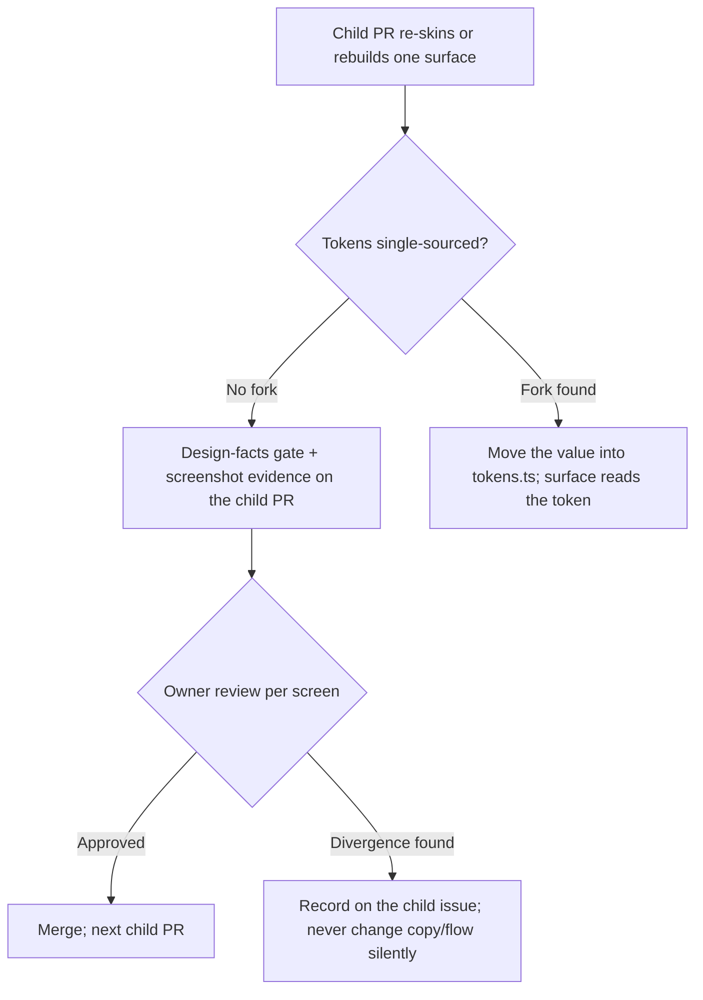

Edge trace (every edge cites code):

- A–B: the child diff touches only `src/theme/tokens.ts`,
  the preset, `src/App.vue`, and its own
  `src/views/<Screen>.vue` (+ tests); `src/router.ts:47-96`,
  `src/api/client.ts`, and `messages/*.json` show no diff.
- B–C/D: `app/src/theme/tokens.test.ts:43-58` pins stay
  green; the no-fork audit (`qa-lead` handoff) resolves
  every rendered colour/radius/spacing through
  `tokens.ts`.
- C–E/F/G: each child issue (#518–#524) and PR carries
  before/after screenshots and the per-screen owner
  review; copy/flow divergences stay REPORTED on the
  issue for an owner decision.

## 16. Book quote and Folio money/date display-only render mapping (Refs #565)

Build-ready decomposition for the T2 display-only money and date
change (issue #565, Phase 5 desk UI; #563 audit gaps `G-BK-2` /
`G-FO-2`). This section supplies the T2 per-flow implementation
diagram (happy path + failure/rollback path) the spec gate
requires; SPEC-GATE FAIL on PR #574 routed this gap to
`architect`, because the "no diagram owed" call in
`docs/requirements/mvp-requirements.md` [section 14.6](../requirements/mvp-requirements.md)
belongs to the flow owner, not to `business-analyst`. Scope,
UI-contract delta, and done-condition live with `product-owner`
(`docs/product/desk-ui-design-rollout.md` [section 6.8](../product/desk-ui-design-rollout.md),
`AC-DSK-13` in
`docs/product/acceptance-criteria.md` [section 11](../product/acceptance-criteria.md));
FR/NFR wording lives with `business-analyst`
(`docs/requirements/mvp-requirements.md` [section 14](../requirements/mvp-requirements.md),
`FR-MNY-1`, `FR-MNY-2`); guard mapping lives with `qa-lead`
(`docs/testing/traceability-matrix.md` [section 5](../testing/traceability-matrix.md),
`docs/testing/desk-ui-rollout-test-traceability.md` [sections 3–4](../testing/desk-ui-rollout-test-traceability.md)).
This section records only the architect-owned flow detail: the
render mapping, its failure/rollback paths, and the technical
no-change boundary. No new subsystem, boundary, or contract —
hence no ADR.

Intended tree deltas (files the downstream `dev` implementation
PR touches; edge traces below cite the existing lines at this
head):

```text
app/src/i18n/index.ts        shared formatters: parseCalendarDate :117,
                             formatVnd :165, formatDeskDate :179
app/src/views/BookView.vue   quote rows and total: computed quoteNights :572,
                             quoteTotal :585 (formatDeskDate :578, formatVnd :579,592)
app/src/views/FolioView.vue  folio amount seam: formatAmount :404 (-> formatVnd :405)
```

### 16.1 Money/date render flowchart

Staff price a quote or open a folio; the already-loaded canonical
minor units and ISO dates render in the design shape, while every
stored, transmitted, and printed value keeps its canonical form:

```mermaid
flowchart TD
    A[Screen holds already-loaded canonical values: integer minor units and ISO YYYY-MM-DD nightDate] --> B{Render site?}
    B -->|Book quote night| C[formatDeskDate nightDate + formatVnd priceMinor]
    B -->|Book quote total| D[formatVnd totalMinor]
    B -->|Folio line, tax, fee, payment, due, balance| E[formatAmount minor delegates to formatVnd]
    C --> F[Label via unchanged catalogue key desk.book.quote_night]
    D --> G[Label via unchanged catalogue key desk.book.quote_total]
    E --> H[Labels via unchanged desk.folio catalogue keys]
    F --> I{Active locale?}
    G --> I
    H --> I
    I -->|VI| J[Grouping by dot, no decimals, dong suffix: 1.200.000 đ; date 08/12/2026]
    I -->|EN| K[Grouping by comma, no decimals, dong suffix: 1,200,000 đ; date 08/12/2026]
    J --> L[Locale switch re-runs the same pure derivation: no new QuotePrice or folio read]
    K --> L
```

Edge trace (every edge cites code):

- A–B: the canonical values are already on screen refs — the
  quote response binds to `quote` (`BookView.vue:744`) and the
  folio response to `folio` (`FolioView.vue:781`). Minor units
  are contract-validated integers (`contracts/http/QuotePrice.json:36`
  `priceMinor`, `:41` `totalMinor`;
  `contracts/http/PostCharge.json:32` `amountMinor`;
  `contracts/http/RecordPayment.json:30` `amountMinor`,
  `:32` `balanceMinor`) and the nightly date is an ISO
  `format: date` (`contracts/http/QuotePrice.json:35`).
- B–C: `quoteNights` is a computed row builder that maps each
  night to `formatDeskDate(night.nightDate)` and
  `formatVnd(night.priceMinor)`
  (`BookView.vue:572-583`; formatters at
  `app/src/i18n/index.ts:165` and `:179`).
- B–D: `quoteTotal` is a computed that maps `totalMinor`
  through `formatVnd` (`BookView.vue:585-594`, call at `:592`).
- B–E: every Folio amount flows through the single
  `formatAmount` seam, which delegates to `formatVnd`
  (`FolioView.vue:404-406`): folded tax/fee parts
  (`:456`, `:465`), charge rows and totals (`:712`, `:906`, `:909`),
  payment rows (`:733`, `:968`, `:971`), the due figure (`:741`), and
  the running-balance sentence (`:660`).
- C–F / D–G / E–H: only the placeholder *values* change; the
  catalogue labels and keys are untouched
  (`desk.book.quote_night` / `desk.book.quote_total` at
  `messages/en.json:399-400` with `messages/vi.json` parity;
  `desk.folio.folio_line` / `desk.folio.folio_balance` at
  `messages/en.json:467-468` with VI parity), so
  `script/catalogue-coverage-check.sh` and `NFR-DSK-1` stay
  green.
- F–I / G–I / H–I: the active locale is the single reactive
  source read at format time
  (`catalogueLocale()` — `app/src/i18n/index.ts:101-103`;
  `t()` re-renders on switch, `:93-99`).
- I–J / I–K: `formatVnd` uses
  `Intl.NumberFormat(catalogueLocale())` with
  `minimumFractionDigits: 0` / `maximumFractionDigits: 0` and
  appends the design `đ` suffix
  (`app/src/i18n/index.ts:165-171`): VI `1.200.000 đ`,
  EN `1,200,000 đ`. `formatDeskDate` zero-pads `dd/mm/yyyy`
  in both desk locales (`app/src/i18n/index.ts:179-187`:
  `08/12/2026` for `2026-12-08`, never a raw ISO string) —
  normative examples per `FR-MNY-1` / `FR-MNY-2` and
  `AC-DSK-13`.
- J–L / K–L: both row lists are `computed` off the `quote` /
  `folio` refs (`BookView.vue:572-594`,
  `FolioView.vue:649-663`, `:741-744`), so a mid-flow locale
  switch re-derives the shape with no new quote or folio read
  (`AC-DSK-8` holds).

Failure/rollback:

```mermaid
flowchart TD
    P[nightDate unparseable: empty, timestamp, or rollover like 2026-02-30] --> Q[formatDeskDate returns the canonical string it received; the line renders instead of blanking]
    R[Locale outside en and vi or non-integer minor units] --> S[Unreachable on the supported inputs: locale is a two-value union and minor units are contract integers, so NumberFormat cannot throw]
    T[Sub-dong minor remainder e.g. 1250] --> U[Display rounds to the nearest dong: 13 đ; stored and transmitted minor value unchanged]
    V[Quote or folio read refuses or drops] --> W[Existing FR-DSP-3 states: plain refusal sentence, offline banner with manual retry, 401 gate; no new failure path]
    X[Rollback: revert the single downstream dev PR] --> Y[Surfaces return to two-decimal figures and raw ISO quote dates; no contract, schema, catalogue, or harness change]
```

Edge trace:

- P–Q: `parseCalendarDate` accepts only the canonical
  `YYYY-MM-DD` shape and rejects rollover dates
  (`app/src/i18n/index.ts:117-135`); `formatDeskDate` returns
  the canonical value when the parse is `null`
  (`app/src/i18n/index.ts:179-187`), so the nightly line stays
  usable (`FR-MNY-2` fallback clause; pinned at
  `app/src/i18n/index.test.ts:203`).
- R–S: `catalogueLocale()` returns only `en` or `vi`
  (`app/src/i18n/index.ts:101-103`), and the money inputs are
  contract integers (A–B citations), so `Intl.NumberFormat`
  cannot receive an unsupported tag or a non-finite amount on
  this path. A future formatter change that introduced a throw
  owes the same canonical/plain fallback so the row never
  blanks.
- T–U: `formatVnd` divides minor units by 100 and formats with
  zero fraction digits (`app/src/i18n/index.ts:165-171`), so a
  sub-dong remainder rounds for display only; the stored and
  transmitted minor value is untouched (`FR-MNY-1` sub-dong
  clause; pinned at `app/src/i18n/index.test.ts:187`).
- V–W: refusals and transport failures keep their existing
  states — quote refusal sentence (`BookView.vue` `quoteError`
  path), folio notice/status (`FolioView.vue:649-663`), the
  shared offline banner and manual retry (LLD section 11.3), and
  the single 401-to-sign-in path (LLD section 11.2); the render
  mapping adds no error path (`FR-DSP-3` holds).
- X–Y: rollback is reverting the single downstream `dev` PR;
  no contract, schema, validation, catalogue, or harness change
  exists to unwind, and the surfaces return to their pre-#565
  render (two-decimal figures, raw ISO quote dates).

### 16.2 Technical no-change note (APIs, contracts, schemas)

Nothing in section 16 changes behaviour below the screen
surface, and the downstream implementation PR must not change
any of the following; each item names its guard so drift is
reviewable. The requirements side of the same statements lives
with `business-analyst`
(`docs/requirements/mvp-requirements.md` [section 14.2](../requirements/mvp-requirements.md));
the acceptance side lives with `product-owner` (`AC-DSK-13`):

- Routes and shell: no route, nav, token, or layout change
  (LLD sections 11–12 hold, including the shell nav,
  `FR-DSP-1` destinations, and print isolation).
- APIs and contracts: every desk call keeps its operation,
  payload, and envelope (`docs/technical/api-spec.md`,
  `contracts/http/QuotePrice.json`,
  `contracts/http/PostCharge.json`,
  `contracts/http/RecordPayment.json`; amounts stay integer
  minor units and dates stay ISO `format: date`; the
  `contracts/openapi.yaml` + `frontend/docs/openapi.yaml`
  byte-identical mirror is unchanged).
- Data model and schema: no entity or field is added
  (`docs/technical/schema.md`,
  `docs/requirements/data-dictionary.md` unchanged — the
  minor-unit amounts and ISO dates already exist).
- Error semantics: all codes and refusal conditions stand
  (`docs/technical/error-handling.md`, LLD sections 1–8 error
  mappings; `FR-RTE-4`, `FR-CUS-1`, `FR-BIL-7` fire on exactly
  the same conditions).
- Billing display invariants: the folio still shows every
  charge and payment with the same amounts and the same
  running balance (`FR-BIL-1`, `FR-BIL-2`, `FR-BIL-3` hold);
  the settlement gate is untouched.
- Print: printed documents keep their current render and still
  match the folio lines and balance exactly (`FR-BIL-4`,
  `FR-DSP-4`, `NFR-RST-2` hold; print isolation CSS preserved).
- Catalogue: zero new keys land — the `đ` suffix and the date
  digits are formatter output, not translatable copy
  (`NFR-I18N-1`, `NFR-DSK-1` hold;
  `script/catalogue-coverage-check.sh` stays green).
- Timezone rendering: the desk date derives from the canonical
  date on the hotel's local calendar day and never shifts a
  night across midnight (`NFR-TZ-1` holds).
- Tests: the guards `qa-lead` mapped stay green
  (`docs/testing/traceability-matrix.md` [section 5](../testing/traceability-matrix.md),
  D13 in
  `docs/testing/desk-ui-rollout-test-traceability.md` [sections 3–4](../testing/desk-ui-rollout-test-traceability.md));
  the change extends display assertions only, never payload,
  contract, or validation behaviour.

Out of scope: implementation of the format change (downstream
`dev` PR); widening the VND shape to the Book confirmation, the
Stay check-out amounts, or the printed documents (separate
decision, recorded as a follow-up in
`docs/requirements/mvp-requirements.md` [section 14.1](../requirements/mvp-requirements.md));
any API, validation, catalogue-key, or allowlist change.

## 17. Folio open-folio guest and room context (Refs #568)

Build-ready flow detail for the T2 reader-visible change (issue
#568): the Folio charges card names the open folio's guest and
room like the board (`Khoản phí · Lê Minh · P.201`,
`docs/design/Folio.dc.html:3`). This section supplies the
architect-owned per-flow implementation diagram (happy path plus
failure/rollback path) the spec gate requires; scope, the
UI-contract delta, and the done-condition live with
`product-owner` (`docs/product/desk-ui-design-rollout.md`
[section 6.9](../product/desk-ui-design-rollout.md), `AC-DSK-14`
in `docs/product/acceptance-criteria.md`
[section 11](../product/acceptance-criteria.md), D-17); the
FR/NFR no-change statement and the traceability inputs live with
`business-analyst`
(`docs/requirements/mvp-requirements.md` [section 15](../requirements/mvp-requirements.md));
guard mapping lives with `qa-lead`. The composition adds no
subsystem, endpoint, contract, schema, or stored value, so no ADR
is owed; this section records only the read path, its fallbacks,
and the technical no-change boundary.

Intended tree deltas (files the implementation commit on this PR
touches; edge traces cite the existing lines at this head):

```text
app/src/views/FolioView.vue  open path and title composition:
                             readFolio :812-819, loadStayContext :797-810,
                             readStayContext :599-615, readGuestName :565-574,
                             readRoomNumber :576-591, ROOM_STATES :549,
                             bestEffortText :554-563, stayContext + request
                             token :672-673, chargesHeading :752-768,
                             title hook :81, typed stay-ID input :33,
                             reference disclosure :783-786 (rendered :109),
                             clear on typed change :821-828, 401 gate :773-778
messages/en.json             one new key desk.folio.charges_context :467
messages/vi.json             the same key in VI :467
```

### 17.1 Open-folio context read flowchart

Staff open a folio; the existing balance read renders the card,
then the screen resolves the stay's guest and room through three
existing reads and the computed title composes
`heading · guest · room`:

```mermaid
flowchart TD
    A[Desk types a stay ID and activates Open] --> B[readFolio: GetFolioBalance with stayId plus actor]
    B --> C[renderFolio: folio ref, status, reference list with raw Stay ID / Folio ID]
    C --> D[loadStayContext bumps the request token]
    D --> E[readStayContext: GetStay for that stayId]
    E --> F[readGuestName: GetGuest for the stay guestId]
    E --> G[readRoomNumber: ListRoomsByState across the five lanes]
    F --> H[stayContext guest half]
    G --> I[stayContext room half]
    H --> J{Request token still the newest?}
    I --> J
    J -->|Yes| K[chargesHeading composes heading · guest · room via desk.folio.charges_context]
    J -->|No| L[Stale result dropped; the title keeps the newer stay]
    K --> M[Charges card title hook renders; a locale switch re-composes with no new read]
```

Edge trace (every edge cites code):

- A–B: the typed stay ID is the screen's existing input
  (`FolioView.vue:33`); `onOpen` calls `readFolio`, which issues
  the existing `GetFolioBalance` with `stayId` and `actor`
  (`FolioView.vue:830-867`, call at `:812-816`).
- B–C: `renderFolio` sets the `folio` ref, clears the notice, and
  fills the reference list with the raw `Stay ID` / `Folio ID`
  pairs (`FolioView.vue:780-787`) that render behind the existing
  disclosure (`:109`) — the #372 rule.
- C–D: `readFolio` then starts `loadStayContext(next.stayId || id)`
  without joining it, so the open / post / payment confirmation
  clears its own busy state on its response (product section 6.9);
  the call increments the `contextRequest` token before the read
  (`FolioView.vue:812-819`, `:797-799`; token declared `:672-673`).
- D–E: `readStayContext` issues the existing `GetStay` with the
  folio's `stayId` (`FolioView.vue:599-605`).
- E–F: the stay record's `guestId` feeds the existing `GetGuest`
  (`FolioView.vue:565-573`, call at `:612`); both fields exist on
  the contracts (`contracts/http/GetStay.json:20-26`,
  `contracts/http/GetGuest.json:20-23`).
- E–G: the stay's current room identifier feeds
  `ListRoomsByState` over the five housekeeping lanes, stopping at
  the first lane that lists the room
  (`FolioView.vue:576-590`, lanes at `:549`, call at `:613`;
  `contracts/http/ListRoomsByState.json:19-33`).
- F–H / G–I: the two halves land in one reactive `stayContext`
  object (`FolioView.vue:672`); both start empty, so neither half
  can fall back to an identifier (`:593-598`).
- H–J / I–J: the resolved result paints only when its request is
  still the newest (`FolioView.vue:799-803`).
- J–K: `chargesHeading` composes the heading through the existing
  `desk.folio.folio_heading`, the guest through
  `desk.today.unknown_guest`, the room through
  `desk.today.room_short`, and the whole title through the one new
  key `desk.folio.charges_context` (`FolioView.vue:752-768`;
  `messages/en.json:354-357`, `:466-467` with VI parity at
  `messages/vi.json:466-467`).
- J–L: a superseded request never assigns
  (`FolioView.vue:801-803`), so a slow read for an earlier stay
  cannot name the wrong guest (pinned at
  `app/src/views/FolioView.test.ts:742-766`).
- K–M: the template binds the computed to the card title hook
  (`FolioView.vue:81`); the title reads `t()` and the locale, so a
  mid-flow locale switch re-composes with no new stay, guest, or
  room read (`:753`, `:758-766`; pinned at
  `app/src/views/FolioView.test.ts:682-724`).

### 17.2 Failure and rollback flowchart

Every partial failure keeps a plain, catalogue-worded title and
never a record ID; the only hard stop is the shared 401 gate:

```mermaid
flowchart TD
    P[GetStay refuses: NOT_FOUND, VALIDATION_FAILED, or transport] --> Q[Context stays empty; the plain Charges title stands]
    R[GetGuest or ListRoomsByState refuses, or no identifier] --> S[That half resolves empty through bestEffortText; the other half still names]
    T[Room not listed in any of the five lanes] --> U[Room half empty: Room number unavailable; the guest half still names]
    V[Would an identifier reach the title or balance line?] --> W[No: the title uses resolved name and number only; raw IDs stay in the reference disclosure]
    X[Desk edits the typed stay ID] --> Y[onStayIdInput clears folio, reference list, and context, and bumps the token]
    Z[401 or UNAUTHENTICATED on any context read] --> AA[isSignedOut rethrows; expireToGate clears the context and signs out]
    AB[Rollback: revert the screen commit on this PR] --> AC[Charges title returns to desk.folio.folio_heading; the key and reads go unused; no contract, schema, or service change to unwind]
```

Edge trace:

- P–Q: a refused stay read returns the empty context
  (`FolioView.vue:606-611`), and the computed returns the plain
  heading while both halves are empty (`:753-757`; pinned at
  `app/src/views/FolioView.test.ts:769-788`). The refusal itself
  never surfaces a new error state: the folio read owns the notice
  (`FolioView.vue:812-819`, `:835-867`).
- R–S: `bestEffortText` swallows signed-in failures and keeps the
  empty half (`FolioView.vue:554-563`, used at `:612-613`); the
  other half still names through the same computed
  (`:758-762`).
- T–U: `readRoomNumber` returns `''` when no lane lists the room
  (`FolioView.vue:580-590`), which renders the existing
  `desk.today.room_unknown` wording (`:760-762`;
  `messages/en.json:354`) while the guest half still names
  (`:758-759`).
- V–W: the title and the balance line receive only resolved text
  (`FolioView.vue:752-768`, `:650-663`, bound at `:216`); raw identifiers exist
  only in the reference list (`:783-786`, rendered at `:109`), and
  the guards assert no stay, folio, guest, or room ID in the title
  or balance line (`app/src/views/FolioView.test.ts:709-713`;
  `app/e2e/folio.spec.ts:121-128`).
- X–Y: `onStayIdInput` clears the folio, the notice, the reference
  list, and the context, and increments the token so any in-flight
  read is stale (`FolioView.vue:821-828`; pinned at
  `app/src/views/FolioView.test.ts:726-738`). Re-reads after a
  post or payment keep the current context steady instead of
  blanking it (`:789-810`).
- Z–AA: `isSignedOut` rethrows the signed-out error from both the
  stay read and the best-effort readers
  (`FolioView.vue:558-559`, `:607-609`); `expireToGate` clears the
  context and token before handing over to the one shared gate
  (`:773-778`, LLD section 11.2).
- AB–AC: rollback is reverting the screen commit on this PR;
  `desk.folio.charges_context` becomes unused, the three reads
  stop being issued by this screen, and the title returns to
  `desk.folio.folio_heading`. No contract, schema, validation,
  service, or harness change exists to unwind.

### 17.3 Technical no-change note (APIs, contracts, schemas)

Nothing in section 17 changes behaviour below the screen surface,
and the implementation commit must not change any of the
following; each item names its guard so drift is reviewable. The
requirements side of the same statements lives with
`business-analyst`
(`docs/requirements/mvp-requirements.md` [section 15](../requirements/mvp-requirements.md));
the acceptance side lives with `product-owner` (`AC-DSK-14`):

- APIs and contracts: the three reads already exist with the
  same operations, payloads, and envelopes — `GetStay`
  (`contracts/http/GetStay.json:20-26`), `GetGuest`
  (`contracts/http/GetGuest.json:20-23`), and `ListRoomsByState`
  (`contracts/http/ListRoomsByState.json:19-33`); no new
  endpoint, and the `contracts/openapi.yaml` +
  `frontend/docs/openapi.yaml` byte-identical mirror is unchanged
  (`script/contract-check.sh` stays green).
- Data model and schema: no entity or field is added
  (`docs/technical/schema.md`,
  `docs/requirements/data-dictionary.md` unchanged — the stay
  already carries its guest and room links).
- Read budget: one `GetStay`, one `GetGuest`, and one to five
  `ListRoomsByState` reads per open (three to seven on top of the
  existing `GetFolioBalance`), repeated per post-charge and
  record-payment refresh (`FolioView.vue:797-819`), with no read
  added to any other screen; `NFR-PERF-1` keeps its folio target.
- Error semantics: all codes and refusal conditions stand
  (`docs/technical/error-handling.md`, LLD sections 1–8; the
  context reads are best effort and add no refusal state —
  `FR-RTE-4`, `FR-CUS-1`, `FR-BIL-7` fire on exactly the same
  conditions), and the 401-to-sign-out path is the unchanged
  section 11.2 flow.
- Catalogue: one new key (`desk.folio.charges_context`) lands in
  both locales; the fallback halves are reused, not reworded
  (`messages/en.json:354-357`, `messages/vi.json:354-357`);
  `script/catalogue-coverage-check.sh` and `NFR-I18N-1` /
  `NFR-DSK-1` stay green, and the runtime mirrors stay
  byte-identical.
- Audit: reads only — opening a folio and resolving its context
  writes nothing and emits no event (`NFR-AUD-1` holds).
- Print: printed documents keep their current render and still
  match the folio lines and balance exactly (`FR-BIL-4`,
  `FR-DSP-4`, `NFR-DSK-2` hold; the title change is screen-only
  and print isolation CSS is preserved).
- Tests: the parity hook pin
  (`app/src/folio-restyle.test.ts:71`), the behaviour block
  (`app/src/views/FolioView.test.ts:644-789`), and the browser
  Folio assertion (`app/e2e/folio.spec.ts:121-128`) guard this
  path; `qa-lead` maps them in the traceability docs.

Out of scope: implementation of the context reads (the `dev`
commit on this PR); a server-side composed folio-context read
(separate follow-up, only if the request count ever matters);
adding the same context to any other screen title; any API,
validation, schema, catalogue-key beyond the one, audit, or
allowlist change.

## 18. Desk list-backed stay picker on the open-folio steps (Refs #582)

Build-ready flow detail for the T2 reader-visible change (issue
#582): the Folio and Print open steps lead with a select of the
business date's in-house stays, and the stay-ID text field stays
visible as the manual fallback. This section supplies the
architect-owned per-flow implementation diagram (happy path plus
failure/rollback path) the spec gate requires; scope, the UI
contract delta, and the done-condition live with `product-owner`
(`docs/product/desk-ui-design-rollout.md`
[section 6.11](../product/desk-ui-design-rollout.md), `AC-DSK-16`
in `docs/product/acceptance-criteria.md`
[section 11](../product/acceptance-criteria.md), D-19); the FR/NFR
delta and traceability inputs live with `business-analyst`
(`docs/requirements/mvp-requirements.md` [section 17](../requirements/mvp-requirements.md));
guard mapping lives with `qa-lead`. No subsystem, endpoint,
contract, schema, or stored value is added, so no ADR is owed; this
section records only the read path, its degradation path, and the
technical no-change boundary.

Intended tree deltas (files the implementation commit touches;
edge traces cite this head):

```text
app/src/stay-options.ts      shared read helper: localBusinessDate :44,
                             readGuestName :60, readOccupiedRoomNumbers :81,
                             loadInHouseStayOptions :121
app/src/views/FolioView.vue  select :31-41, notice :51-58, typed field :59-67,
                             picked/typed state and notice computed :678-700,
                             onPickStay :891, onManualStayInput :896,
                             loadStayOptions :905, onMounted :921-925
app/src/views/PrintView.vue  select :15-25, notice :35-42, typed field :43-51,
                             picked/typed state and notice computed :686-705,
                             onPickStay :1075, onManualStayInput :1080,
                             loadStayOptions :1088, onMounted :1104-1108
app/e2e/design-facts.ts      Folio decided inputs lead with the select :383
messages/en.json             four new desk.stay.* keys and the mirrors
messages/vi.json             the same keys in VI
```

### 18.1 Open-step flowchart

Staff enter Folio or Print; the screen reads the business date's
in-house stays and fills the select, while the typed stay-ID field
stays available. Picking or typing one identifier feeds the
existing open call unchanged.

```mermaid
flowchart TD
    A[Desk opens Folio or Print signed in] --> B[loadStayOptions on mounted]
    B --> C[loadInHouseStayOptions: localBusinessDate]
    C --> D[ListArrivalsDepartures businessDate]
    D -->|ok| E[ListRoomsByState occupied for room numbers]
    E --> F[GetGuest per in-house row]
    F --> G[select options guest · room]
    D -->|failed| H[stayListNotice: stay_list_failed]
    E -->|failed| F
    G --> I{Pick an option or type a stay ID}
    I -->|pick| J[pickedStayId set; typed field cleared]
    I -->|type| K[typedStayId set; select cleared]
    H --> K
    J --> L[Open: GetFolioBalance / PostCharge / RecordPayment carry the same stayId]
    K --> L
    L --> M[Existing folio reads and title context run unchanged]
```

Edge trace (every edge cites code):

- A–B: the shell gates the screens on sign-in; `onMounted` loads
  the list only when the session is signed in (`FolioView.vue:921-925`,
  `PrintView.vue:1104-1108`), the same pattern as the Stay panel.
- B–C: `loadStayOptions` calls the shared helper
  (`FolioView.vue:905-911`, `PrintView.vue:1088-1094`,
  `app/src/stay-options.ts:121`).
- C–D: the helper sends `localBusinessDate()` to the existing
  `ListArrivalsDepartures` (`app/src/stay-options.ts:44`, `:121-129`;
  `contracts/http/ListArrivalsDepartures.json:19-33`).
- D–E / D–H: a successful list read moves on to room numbers; a
  failed read returns `{ options: [], failed: true }`
  (`app/src/stay-options.ts:130-136`), which the view maps to
  `stayListState = 'failed'` and the plain notice
  (`FolioView.vue:686-700`, `:712-718`; `PrintView.vue:694-705`).
- E–F: occupied room numbers resolve through the existing
  `ListRoomsByState` (`app/src/stay-options.ts:81-103`); a failed
  room read keeps the stays pickable with the catalogue
  unavailable-room wording (`:105-111`).
- F–G: each in-house row's guest name comes from the existing
  `GetGuest` (`app/src/stay-options.ts:60-77`), and the option
  label composes `guest · room` through the existing
  `desk.today.name_detail` (`:133-141`).
- G–I: the options render in the select
  (`FolioView.vue:31-41`, `PrintView.vue:15-25`); the typed field
  stays directly below (`FolioView.vue:59-67`,
  `PrintView.vue:43-51`).
- I–J / I–K: the two controls are mutually exclusive
  (`FolioView.vue:891-903`, `PrintView.vue:1075-1086`), so exactly
  one identifier is held; the notice never blocks the typed path
  (`FolioView.vue:51-58`, `PrintView.vue:35-42`).
- J–L / K–L: the existing open, charge, and payment calls read the
  same `stayId` the typed path always sent
  (`FolioView.vue:870-877`, `:929-967`; `PrintView.vue:1016-1058`);
  no payload, contract, validation, print, or refusal shape moves.
- L–M: the existing folio reads and title context run unchanged
  (section 17.1 above).

Failure and rollback: an empty or failed list read is the
degradation path above — the notice shows and the typed stay-ID
field keeps the open action working. Rolling back the single PR
restores the text-input-only open step on both screens; no data
migration is owed because the change adds no stored value.

## 19. Rooms and rates management desk screen (Refs #590)

Build-ready flow detail for the T2 reader-visible change (issue
#590): one new desk route `/manage` reached from an eighth tab,
carrying three card groups that drive the existing rooms and rates
operations. This section supplies the architect-owned per-flow
implementation diagrams the spec gate requires — one diagram per
touched flow, happy path plus failure/rollback path — records the G2
and G6 decisions the gate routed to this role, and states the
technical no-change boundary. Scope, layout, the T2 UI contract and
`AC-MANAGE-1..11` live with `product-owner`
(`docs/product/rooms-rates-management.md`, `docs/design/RoomsRates.dc.md`;
D-22 and D-23); the FR/NFR delta lives with `business-analyst`
(`docs/requirements/mvp-requirements.md` [section 20](../requirements/mvp-requirements.md));
guard mapping lives with `qa-lead`. No subsystem, endpoint, contract,
schema, stored value, event, design token, or pricing semantic is
added, so no ADR is owed and the tier stays **T2** (section 19.8).

Intended tree deltas (files the section PRs create or touch; edge
traces cite this head plus the intended paths):

```text
app/src/views/ManageView.vue   new screen SFC: sections A/B/C, states, refusal path
app/src/router.ts              tenth route: /manage, name manage,
                               docTitleKey desk.shell.doc_title_manage
                               (route-block shape at :86-95, catch-all stays :96-99)
app/src/App.vue                NAV_ITEMS eighth tab after rooms (:261-268),
                               rendered by the shared nav (:125-145)
messages/en.json               desk.shell.nav_manage, desk.shell.doc_title_manage,
messages/vi.json               desk.manage.* — added per section PR, both locales
app/src/router.test.ts         9 -> 10 routes (:19-34), rewritten not deleted
app/src/shell-restyle.test.ts  8-tab EN/VI label arrays (:25-26) and tab position
app/src/shell-titles.test.ts   one title case for manage (:31-54)
app/e2e/design-facts.ts        app-only nav-tab allowance (schema section 8)
app/e2e/design-facts.spec.ts   expected-order comparison (:626-645) reads the allowance
app/src/views/ManageView.test.ts (new) per-section cases the qa-lead slice names
```

### 19.1 Flow A, happy path: one save writes one nightly row per night

The manager prices a room type across an inclusive date range; the
save is a client-side fan-out of the existing single-night write, not
a batch operation (`docs/requirements/mvp-requirements.md` FR-MGMT-7).

```mermaid
flowchart TD
    A[Manager picks type, types plan name, first night, last night, amount] --> B[Pre-send checks: type, plan, date order, at most 31 nights, whole dong amount 0 to 100 000 000]
    B -->|fails| B1[Plain field sentence naming the field, nothing sent]
    B -->|passes| C[Build inclusive night list on the hotel calendar day, amount to minor units]
    C --> D[Send UpsertRatePrice for the first pending night]
    D -->|200| E{More nights pending}
    E -->|yes| D
    E -->|no| F[Re-read visible grid: one QuotePrice per visible night]
    F --> G[Success line names the night count and the room type, grid shows stored rows]
```

Edge trace (every edge cites code):

- A–B: the controls are the section C row of the approved board
  (`docs/design/RoomsRates.dc.md` section 7.1); the 31-night cap and
  the whole-đồng bound are product decisions O-3 and the section 6
  write rules (`docs/product/rooms-rates-management.md`).
- B–B1: validation happens before any `apiFetch`, so an invalid range
  sends nothing (`FR-MGMT-7`).
- C–D: `UpsertRatePrice` carries `ratePlanName`, `roomTypeId`, the ISO
  `nightDate`, and integer `priceMinor`
  (`contracts/http/UpsertRatePrice.json`); the room type travels as
  the uuid from `ListRoomTypes` (`contracts/http/ListRoomTypes.json`),
  never the name, and money converts whole đồng to minor units on the
  `formatVnd` scale (`app/src/i18n/index.ts:165-171`).
- D–E: the write is single-night by contract; the store keys a row by
  plan, room type, and night and upserts on that key
  (`services/rates/internal/store/postgres.go:115-145`, `ON CONFLICT`
  at `:134-135`; in-memory `services/rates/internal/store/store.go:179-195`),
  so a per-night loop is safe to repeat.
- E–F: the read-back is the section C grid; it reads one night at a
  time through `QuotePrice` (`contracts/http/QuotePrice.json`), the G2
  decision in section 19.8.2.
- F–G: each `QuotePrice` reply carries the night's `priceMinor` in its
  `nights` array, which the grid renders in the desk money shape
  (`app/src/views/BookView.vue:609` is the existing formatter call
  site).

### 19.2 Flow A, failure and rollback: partial save, resume, plan creation

A save stops at the first failed night. Written nights stay written,
and the resume action starts at the first unsaved night — never from
the start (`FR-MGMT-10`).

```mermaid
flowchart TD
    A[UpsertRatePrice for night i fails] --> B[Classify the refusal]
    B -->|404 unknown plan: details carries ratePlanName and no reason| C[Stop the loop]
    B -->|other refusal or transport failure| D[Stop the loop]
    C --> E[Plan-missing state: saved of total, first unsaved night, explicit create action]
    E -->|manager chooses create| F[Send UpsertRatePlan with the name only]
    F -->|200| G[Retry the nights still pending, starting at the first unsaved night]
    F -->|fails| H[Plain sentence, nothing retried, form keeps its values]
    E -->|manager declines| I[No plan created, no further night written]
    D --> J[Partial state: saved of total, first unsaved night, resume action]
    J -->|manager resumes| G
    A -->|click replayed while in flight| K[No-op: save and read controls are disabled]
    G --> L[Flow A happy path read-back and success line]
```

Edge trace:

- A–B: the unknown-plan refusal is `NOT_FOUND` with
  `details.ratePlanName` and no `details.reason`
  (`services/rates/internal/store/store.go:188-191`; Postgres
  `services/rates/internal/store/postgres.go:123-126`). The two quote
  reasons are a different shape (`details.reason`), which is what
  keeps this classification unambiguous (section 19.8.2).
- B–E / B–J: already-written nights are in the store, so the screen
  reports the true saved count instead of claiming the whole range
  saved. Nights are written in date order, so "first unsaved night"
  is the failed index and resume is `i` onward.
- E–F: `UpsertRatePlan` carries the name only — no `description`, no
  `defaultUnits` (`contracts/http/UpsertRatePlan.json`) — because a
  name conflict overwrites the stored description
  (`services/rates/internal/store/postgres.go:92-95`); the screen
  therefore never sends it as a precaution and never twice for a plan
  that exists (owner decision O-4).
- F–G: the retry re-sends only the pending nights; a night that was
  actually written before the refusal is not resent, and a resent
  night is idempotent through the upsert key (`:134-135`).
- A–K: the in-flight state disables save and read, so a replayed click
  starts no second round (`FR-MGMT-7`).
- Rollback: none is owed. There is no delete operation for prices
  (G4), already-written rows stay valid, and the table records the
  screen's real end state (saved of total) instead of an implied
  all-or-nothing write. Reverting the prices PR removes the screen;
  the rows it wrote remain valid because they are ordinary
  `UpsertRatePrice` rows (`contracts/http/UpsertRatePrice.json`).

### 19.3 Flow B, happy path: move a room to another floor with read-back

The row save and the list reload are the existing `UpsertRoom` and
`ListRoomsByState` pair; nothing about the room's state moves
(FR-MGMT-5).

```mermaid
flowchart TD
    A[Manager edits a room row: floor text and type select] --> B[Build the payload: number, type name, actor, and floor only when the field is non-blank]
    B --> C[Send UpsertRoom, keyed by room number]
    C -->|200| D[Re-read ListRoomTypes and the five ListRoomsByState reads]
    D --> E[Merge by roomId, resolve type names by id]
    E --> F[Group by floor label, plus a no-floor group]
    F --> G[Room renders under its new floor, success line names the number]
```

Edge trace:

- A–B: the row shape is the approved board's floor-grouped list
  (`docs/design/RoomsRates.dc.md` section 6.2); a blank floor field
  omits the member entirely, the same rule the wizard follows
  (`app/src/views/OnboardingView.vue:928-933`, FR-MGMT-4).
- B–C: `UpsertRoom` requires `number`, `roomType`, `actor` and takes
  an optional `floor` (`contracts/http/UpsertRoom.json`); it is keyed
  by room number, so an existing number is an update
  (`services/rooms/src/store.ts:237-262`; Postgres
  `services/rooms/src/pgstore.ts:194-225`).
- C–D: an update keeps the stored state (`state: existing?.state ??
  "vacant-inspected"`, `services/rooms/src/store.ts:259`) and keeps
  the stored floor when the member is absent
  (`services/rooms/src/store.ts:246`; `COALESCE($3, floor)` at
  `services/rooms/src/pgstore.ts:213`). A setup write never
  transitions a room.
- D–E: five state reads are merged by `roomId`
  (`contracts/http/ListRoomsByState.json`); type names resolve through
  the shared `ListRoomTypes` read exactly as the Rooms map does
  (`app/src/views/RoomsView.vue:341-343`, `:604-613`).
- E–F: the grouping rule is the Rooms map's existing one — floor
  labels ordered, rooms without a floor in the no-floor group
  (`app/src/views/RoomsView.vue:461-495`), so an empty `floor` never
  drops a room.
- F–G: `ListRoomsByState` omits `floor` for a room without one
  (`services/rooms/src/server.ts:112-124`), which is what puts the
  room in the no-floor group until it is given a floor.

### 19.4 Flow B, failure: one unreadable state, an unknown type, a blank floor

```mermaid
flowchart TD
    A[Row save or list load] --> B{Outcome}
    B -->|UpsertRoom 404 unknown room type| C[Plain sentence: the type could not be found; the list is re-read, no state changes]
    B -->|one ListRoomsByState read fails| D[That state's group renders unavailable with a plain sentence and a retry]
    B -->|other reads succeed| E[Their groups render normally, rooms deduplicated by roomId]
    B -->|floor field blank| F[No floor member sent, stored floor kept, row keeps the current floor]
    C --> G[No room is dropped and no state is invented]
    D --> E
```

Edge trace:

- A–C: an unknown room type is refused before any write
  (`resolveRoomType` → `NOT_FOUND`, `services/rooms/src/store.ts:203-212`;
  contract `contracts/http/UpsertRoom.json`).
- A–D: the five reads are independent, so a failed one degrades only
  its own group (`FR-MGMT-5`); the merge is by `roomId` and a room
  appears once.
- A–F: the no-clear-floor rule (G5, section 19.8.5) is enforced at the
  payload: an empty string would be stored as an empty label
  (`services/rooms/src/pgstore.ts:198`, `:213`) and then omitted from
  inventory rows, so the screen never sends one.
- Rollback: none — `UpsertRoom` is a single guarded upsert and the
  read-back is a read; reverting the rooms PR removes the section and
  leaves every stored floor and state as the operation left it.

### 19.5 Flow C, happy path: create or edit a room type

```mermaid
flowchart TD
    A[Section A reads ListRoomTypes] --> B{Create or edit}
    B -->|create| C[Name, optional guests 1 to 20, optional bed type]
    B -->|edit| D[Row action pre-fills the card, name read-only]
    C --> E[Pre-send validation: name required, guest count in range]
    D --> E
    E -->|passes| F[Send UpsertRoomType with name, actor, and only the filled fields]
    F -->|200| G[Card returns to create state, list re-reads, saved row shows the new values]
    G --> H[Success line names the type; Book screen lists the same ListRoomTypes result]
```

Edge trace:

- A–B: the list read is `ListRoomTypes`
  (`contracts/http/ListRoomTypes.json`), the shared read the Book
  screen already uses, which is why a type created or edited here is
  quotable there with no further step (`FR-MGMT-2`).
- B–C: the create card carries name, capacity, bed type (approved
  board section 5.2; `FR-MGMT-3`).
- B–D: the name is read-only while editing because the operation is
  keyed by name (`services/rooms/src/store.ts:217-236`; Postgres
  `services/rooms/src/pgstore.ts:138-172`) — G1, section 19.8.1.
- E–F: `UpsertRoomType` requires `name` and `actor` and takes optional
  `capacity`, `bedType`, `features`
  (`contracts/http/UpsertRoomType.json`). The screen never sends
  `features`, so an edit preserves the stored object
  (`services/rooms/src/pgstore.ts:154-158`; in-memory
  `services/rooms/src/store.ts:226-229`).
- F–G: the contract answers the persisted row
  (`id`, `name`, `capacity`, `bedType`, `features`), so the screen can
  show the stored values instead of the typed ones.

### 19.6 Flow C, failure: invalid input, an existing name, a failed write

```mermaid
flowchart TD
    A[Section A save] --> B{Outcome}
    B -->|blank name or guests outside 1 to 20| C[Plain field sentence, nothing sent]
    B -->|name already exists in create mode| D[The operation updates that type: no duplicate row, the re-read shows one row]
    B -->|service refuses or transport fails| E[Plain sentence, form keeps its values, list unchanged]
    B -->|200| F[Card resets and the re-read shows the stored row]
    C --> G[Nothing is written]
    D --> F
```

Edge trace:

- A–C: the type name is the operation key, so validation happens
  before the call; the contract's only capacity limit is a minimum of
  1 (`contracts/http/UpsertRoomType.json`) and the `1..20` bound is
  the form's sanity range (`FR-MGMT-3`).
- A–D: there is no duplicate-name refusal on `UpsertRoomType`; a
  create whose name already exists is an update
  (`services/rooms/src/store.ts:222-225`). The screen states nothing
  it cannot know and the re-read shows one row, not two. This is the
  G1 constraint seen from the create side, recorded rather than
  papered over.
- A–E: any other refusal renders one plain sentence
  (`FR-MGMT-12`); a `401` follows the shell expiry path instead
  (section 19.7).
- Rollback: none — the operation is a single guarded upsert; reverting
  the room-types PR removes the section and leaves stored types as the
  operation left them.

### 19.7 Flow D: the refusal path for a non-manager role

The gate is the Admin console's cosmetic pattern: the signed-in role
decides what renders, and no role check is claimed at the operations
(G6, section 19.8.6).

```mermaid
flowchart TD
    A[Signed-in session: token, display name, role] --> B[Screen computes canManage from the role]
    B -->|owner or manager| C[Full screen: lists and actions enabled]
    B -->|front-desk| D[Lists render read-only, notice states only the owner or a manager can change rooms and prices]
    D --> E[Create and save actions disabled; a triggered write sends nothing]
    C --> F{Write reply}
    F -->|200| G[Normal success path]
    F -->|401 UNAUTHENTICATED| H[Existing shell expiry path: clear session, return to the gate]
    F -->|other refusal| I[Same plain refusal sentence, no envelope code, field name, or status number]
```

Edge trace:

- A–B: the role is carried by the shared session store
  (`app/src/stores/session.ts:50-75`, persisted beside the token); the
  cosmetic precedent is the Admin console
  (`app/src/views/AdminView.vue:482`).
- B–D / B–E: the read-only render and disabled actions are the product
  spec's refusal path (`docs/product/rooms-rates-management.md`
  section 8; FR-MGMT-11); the guard asserts zero write calls on that
  path, which is the Admin console's existing proof
  (`app/src/views/AdminView.test.ts:487-505`).
- F–H: `apiFetch` owns the single 401 path — expire the session and
  return to the gate (`app/src/api/client.ts:96-110`, `:143`).
- F–I: every other envelope is mapped to catalogue wording at the call
  site, never rendered (`app/src/api/client.ts:186-192`); because the
  rooms and rates operations check the token and no role today (G6),
  this mapping is defensive — it does not claim a server-side refusal
  that does not exist.
- Rollback: none — the refusal path is render-state only and adds no
  stored value or permission.

### 19.8 Decisions routed to this role (G1–G6)

The product spec carries these as gaps for `architect` to confirm or
convert (`docs/product/rooms-rates-management.md` section 14). Each
call below is binding for the implementation PRs; changing one needs a
new owner decision on #590.

**19.8.1 G1 — no rename; confirmed.** `UpsertRoomType` is keyed by
name with no id field (`contracts/http/UpsertRoomType.json`;
`services/rooms/src/store.ts:217-236`), so a rename would create a
second type. The screen locks the name while editing and the create
side shows the operation's real behaviour (section 19.6). A rename
operation is a separate product decision, not part of this change.

**19.8.2 G2 — no list reads for plans or prices; deferred as a
follow-up, keeping the change at T2.** The screen ships with:

- Rate plans as a free-text name created only through the explicit
  action on the first unknown-plan refusal (O-4). No `ListRatePlans`
  is added, and none is required before a save.
- Prices read one night at a time through `QuotePrice` with the plan
  named explicitly, `arrivalDate` = the night and `departureDate` =
  the night plus one day (`contracts/http/QuotePrice.json`), one call
  per visible night and none for nights off the paged window. The
  existing `noRateReason` classifier (`app/src/views/BookView.vue:498-506`)
  is the precedent for reading `details.reason`.

Why per night and not one multi-night quote: `QuotePrice` does return
a `nights` array, so a fully priced range would come back in one call,
but a single unpriced night fails the whole quote
(`services/rates/internal/store/store.go:265-274`) and the caller
cannot then show the other nights — which is exactly the grid's job
(`FR-MGMT-6`, `FR-MGMT-9`). One night per call keeps every column's
state independent: stored price, `no_rate_price`, `no_rate_plan`, plan
missing, or could-not-read. Cost bound: at most seven `QuotePrice`
calls per visible page, sequentially or in a small bounded batch, no
polling (`NFR-PERF-1` statement in requirements section 20.4).

`ListRatePrices` and `ListRatePlans` are additive read surfaces. Adding
either one now is a new operation plus contract, contract fixtures, and
an ADR/HLD delta — that is T3, so it is **not** part of this change.
When an owner request opens it, the grid swaps to one aggregate read
with no product change (the no-price, plan-missing, and per-night
states stay as specified). Until then, no document on this change may
promise either operation.

**19.8.3 G3 — rooms are listed by state; confirmed.** Five
`ListRoomsByState` reads per load, merged by `roomId`, the same shape
the Rooms map uses (`app/src/views/RoomsView.vue:461-495`). No
list-all-rooms operation is added.

**19.8.4 G4 — no deletes; confirmed.** No delete operation exists for
types, rooms, plans, or prices, so the screen offers none. An owner
request for deletion is a separate product and contract decision.

**19.8.5 G5 — no clear-floor action; confirmed.** An absent `floor`
member keeps the stored value (`services/rooms/src/pgstore.ts:213`;
`services/rooms/src/store.ts:246`), while an empty string is stored as
an empty label and then omitted from inventory rows
(`services/rooms/src/server.ts:112-124`). v1 therefore only moves a
room between non-blank floors; clearing a floor would need an explicit
operation and is out of scope.

**19.8.6 G6 — client-side role gate only; confirmed, server-side
enforcement deferred.** The refusal is a product-surface rule on
token-only operations: the role comes from the session store and
decides rendering, not permissions (`NFR-SEC-1` unchanged; threat
model unchanged). The screen and its specs must not claim
server-side role enforcement. When an owner request opens the
enforcement slice it is T3 (permissions/authorisation): ADR, HLD
delta, threat-model delta, and per-operation policy on the
`authed(operation, …)` seam the rates handler already threads
(`services/rates/internal/handler/handler.go:97-116`).

### 19.9 Technical no-change note

- **Route, nav, and shell.** One route is added (`/manage`, name
  `manage`) after the rooms route, and one tab
  (`desk.shell.nav_manage`) after `Rooms` in `NAV_ITEMS`
  (`app/src/App.vue:261-268`), rendered by the unchanged shared nav
  (`:125-145`). The catch-all placeholder, the sign-in gate, the
  session disclosure, the locale pill, and the print routes keep their
  behaviour; the shell's shrink rule still holds with eight tabs
  because the brand stays the only shrinkable item. Existing guards
  are rewritten, never deleted: route count 9 → 10
  (`app/src/router.test.ts:19-34`), the EN/VI tab arrays
  (`app/src/shell-restyle.test.ts:25-26`), and one title case
  (`app/src/shell-titles.test.ts:31-54`).
- **Design-facts contract delta.** The seven owner `.dc.html` boards
  draw seven tabs and must not be edited (`docs/design/README.md`
  rules), so the shared-nav comparison gains a documented app-only tab
  allowance: `docs/technical/desk-ui-fact-schema.md` section 8, with
  `manage` as its only entry (`Quản lý` / `Manage`, design source
  `docs/design/RoomsRates.dc.md`). No fact field is added or retyped,
  so `schemaVersion` stays 1; the assertion sites that read the
  expected order are `app/e2e/design-facts.spec.ts:626-645` and the
  order comparison in `app/e2e/design-facts.ts:964-971`.
- **Operations and contracts.** Seven existing operations, no new
  operation, field, error code, state value, event, or schema change:
  `ListRoomTypes`, `UpsertRoomType`, `UpsertRoom`,
  `ListRoomsByState` (rooms); `UpsertRatePlan`, `UpsertRatePrice`,
  `QuotePrice` (rates). `UpsertRatePrice` takes the room-type uuid, not
  the name, and the rates contracts carry no `actor`; that write is
  attributed to the service, unchanged by this screen (the
  audit-attribution gap that requirements section 20.4 records stays a
  gap).
- **Schema, ERD, state machine.** Unchanged: no table, column, index,
  state, or transition is added. The price row key
  (`rate_plan_id`, `room_type_id`, `night_date`) already exists
  (`services/rates/internal/store/postgres.go:134-135`).
- **Tokens and components.** Zero new design tokens;
  `app/src/theme/tokens.ts` is untouched. Cards, rows, buttons, inputs,
  selects, chips, and the app-locale date picker reuse the existing
  patterns under the PrimeVue-as-logic-carrier rule; the `44px` target
  and the label-above-input pattern hold (product UI contract, section
  10).
- **Localisation.** This change adds no catalogue key; each section PR
  adds only its own keys in both locales and keeps
  `script/catalogue-coverage-check.sh` green. The one shared phrase,
  "not open for booking", is reused, not re-worded
  (`messages/en.json:424-425`, `messages/vi.json:424-425`).
- **Performance and offline.** Entry reads at most one `ListRoomTypes`
  plus five `ListRoomsByState`; a price grid page reads at most seven
  single-night quotes; one save writes at most 31 rows sequentially.
  Nothing polls and no write is queued: a failed read renders the plain
  read-error state with a retry, and a failed write stays visible
  (`NFR-AVL-1`, `NFR-SHL-3`).
- **Rollback.** Revert the four section PRs (entry and refusal, room
  types, rooms and floors, nightly prices). No migration is owed: the
  screen writes through existing operations only, so every type, room,
  floor, plan, and price row it wrote stays valid after the revert, and
  no stored value was introduced by the UI.

<!-- ao-role: architect -->
Role: architect · AO session hotel-mgmt-888

## 20. Desk check-out posts the stay room charge (Refs #600)

Tier T2 (desk-screen behaviour change; no new subsystem, no schema or
data-model change, no contract semantics change, no new route). This
section records the architect-owned flow detail the #600 acceptance
criteria ask for: the chosen posting point and its per-flow diagram.
Scope, acceptance criteria, the FR/NFR delta, and the guard mapping are
the sibling handoffs (`product-owner`, `business-analyst`, `qa-lead`);
this section decides only where the charge posts and how the flow
fails safe.

**Decision — the desk check-out review posts the charge.** The nightly
room charge for a stay the desk checked in is posted by the desk
check-out itself, at its review step, before the folio gate reads the
balance. Not a nightly job (the repo has no scheduler; adding one is a
T3 concern), and not the server-side close (the close stays a desk
orchestration, the same shape as the #588 gate: Billing is told nothing
the desk did not read). The review is on the only route to the close
(`checkoutCtx` gates the Check out button and the dialog confirm), so a
close always presents a folio that carries the room it paid for, and
the existing `BR-17`/`FR-BIL-7` gate then refuses an unpaid close
instead of passing a zero balance the desk never charged.

**Posting inputs.** The stay's booking, resolved through
`ReservationService.QueryCalendar` by the `stayId` the calendar links
(live stay rows carry no booking reference — the #349 pattern), then
`ReservationService.GetReservation` for the frozen quoted total
(`priceBasis.totalMinor`, `FR-RTE-5`). Rates repricing is out of scope:
the desk posts the quote the stay was booked at. Exactly one
`nightly-room-charge` line per stay, posted with the idempotency key
`room-charge:<stayId>`; a folio that already carries a
`nightly-room-charge` line (posted from the Folio screen or by the API
desk loop) is never charged twice; a zero quoted total posts nothing.
A stay whose booking cannot be resolved refuses the review with
`desk.stay.refused_room_charge` rather than closing uncharged.

### 20.1 Review flowchart (happy path plus failure/rollback)

```mermaid
flowchart TD
    A[Staff picks a departing stay and clicks Review folio] --> B[GetFolioBalance]
    B --> C{Folio already carries a nightly-room-charge?}
    C -->|yes| G[Review the read balance and approval]
    C -->|no| D[QueryCalendar by the stay actual arrival day, then GetReservation]
    D --> E{Booking resolved and quoted total known?}
    E -->|no| R[Plain refusal: the room charge could not be posted; no close route exists]
    E -->|yes, total zero| G
    E -->|yes| F[PostCharge nightly-room-charge, amount = frozen quoted total, idempotencyKey room-charge:stayId]
    F -->|refused or failed| R
    F -->|ok| B2[GetFolioBalance again]
    B2 --> G
    G --> H{Balance zero?}
    H -->|yes| I[Check-out clear; the close commits only for this settled folio]
    H -->|no| J{Provenanced recorded approval?}
    J -->|yes| K[Approved exception shown; the close commits]
    J -->|no| L[Open-balance refusal; approval form opens, no close]
```

Edge trace (every edge cites code; `StayView` paths are relative to
`app/src/views/`):

- A–B: the review reads the folio before anything else
  (`onReview`, `StayView.vue:1361`; read helper `:1382-1386`,
  first read `:1387`).
- B–C: the read's charge lines decide whether the room charge is
  already posted (`folioCarriesRoomCharge`, `StayView.vue:860-862`;
  `contracts/http/GetFolioBalance.json` types the `charges` array).
- C–G: a folio that already carries a `nightly-room-charge` line is
  never charged twice — the Folio screen and the API desk loop
  (`script/e2e-desk-loop.sh:365`) post through the same operation.
- C–D: the booking is resolved by the stay the calendar links
  (`resolveStayRoomCharge`, `StayView.vue:834-855`: `QueryCalendar`
  from the stay's actual arrival day (`:837-844`) to tomorrow
  (`nextDay`, `:474-480`), matched on `stayId` (`:845`), then
  `GetReservation` (`:849-852`)). The `stayId` link is emitted by the reservations
  handler (`services/reservations/internal/handler/handler.go:315`) and
  declared in `contracts/http/QueryCalendar.json`.
- D–E: a booking that does not resolve, or a quote that is not a
  non-negative integer, returns `null` (`StayView.vue:846-854`).
- E–R: the null path refuses the review with the folio line and
  reference details left cleared, and no check-out context, so the
  Check out button never renders (`StayView.vue:1393-1398`; wording
  `desk.stay.refused_room_charge`, `messages/en.json`).
- E–G: a zero quoted total posts nothing and the review proceeds on
  the read folio (`StayView.vue:1399`).
- E–F: the charge posts as one `nightly-room-charge` line for the
  frozen quoted total, named for the room the stay held, with the
  per-stay idempotency key (`StayView.vue:1399-1413`;
  `contracts/http/PostCharge.json`; Billing derives tax/fee per
  `BR-25` and moves the balance, `BillingService.postCharge`).
- F–R: a refused or failed `PostCharge` surfaces as the plain panel
  error with no check-out context (`onReview` catch,
  `StayView.vue:1460-1468`), so a charge that did not land never reads
  as reviewed.
- F–B2–G: the review re-reads the folio so the balance it shows
  includes the charge just posted (`StayView.vue:1414`).
- G–H–I: zero balance clears the review
  (`desk.stay.balance_zero`, `StayView.vue:1433-1439`); the close
  re-reads the folio on the confirm route and carries that fresh
  balance and any approval (`onCheckOut`, `StayView.vue:1538`,
  fresh read `:1556-1563`), so `AC-DSK-18` still governs.
- G–J–K–L: the open-balance branches are the #588 gate unchanged
  (`StayView.vue:1440-1459`; `canCheckOut` `:668-673`; every route to
  the close re-reads).

Failure/rollback:

```mermaid
flowchart TD
    P[Booking unresolved for the stay] --> Q[Review refused in plain words; no PostCharge, no close route]
    S[PostCharge refused or transport failure] --> T[Plain panel error; no check-out context, staff retries]
    U[Folio already carries the room charge] --> V[No second post; the review reads the stored lines]
    W[Rollback: revert this single PR] --> X[The desk stops posting; folio lines already written stay valid, no migration]
```

Edge trace:

- P–Q: the refusal names the charge as the blocker and clears the
  review state (`StayView.vue:1393-1398`), and the guard pins it
  (`app/src/views/StayView.test.ts` — "refuses the review when the
  stay booking cannot be resolved for its room charge").
- S–T: writes precede no lock-in — a failed `PostCharge` leaves
  `checkoutCtx` empty, so no close route exists until a review
  succeeds (`onReview` catch); the idempotency key makes the retry a
  replay, not a second line.
- U–V: the existing-line guard is pinned by
  `app/src/views/StayView.test.ts` — "leaves a folio that already
  carries a room charge untouched".
- W–X: the change writes through the existing `PostCharge` operation
  only, so reverting it stops new postings without invalidating the
  lines already stored (rollback note in the issue).

## 21. Server-side check-out gate and approval provenance (Refs #601)

Tier T3 (architectural: the check-out enforcement boundary moves from
the desk client into Stay and adds one synchronous module-to-module
read; no schema or data-model change; the contract change is additive
only). ADR-0005 (`docs/architecture/decisions/adr-0005-server-side-checkout-gate.md`,
proposed) records the decision. The finding this closes is the #588
lab record's symptom 2(d) "Server trust"
(`docs/testing/evidence/588/README.md`). Product acceptance criteria,
the FR/NFR delta, and the guard traceability are sibling handoffs
(`product-owner`, `business-analyst`, `qa-lead`); `BR-17`,
`FR-CKO-4`, `FR-CKO-5`, and `AC-DSK-18` already state the rule and the
desk behaviour, so this section records only the architect-owned delta.

### 21.1 Which service enforces what

| Fact | Authority | Enforced where | May the client assert it? |
|---|---|---|---|
| Folio balance | Billing (`billing.folios.balance_minor`) | Billing writes; Stay re-reads at the close | No — advisory field, ignored |
| Approval record (who, role, when) | Billing (`billing.folios.open_balance_approval`) | Billing refuses an out-of-set role and stamps the time at write; Stay re-validates on read | No — advisory field, ignored |
| Fixed role set | Requirements section 3.2 (`owner`, `manager`, `front-desk`) | Code constant in Billing and Stay; never config | No |
| Which of the three may approve; whether approval is needed | Hotel open-balance rule, requirements section 3.1 | Not enforced yet (config fan-out slice) | No |
| The stay's state transition | Stay (`stay.stays.state`) | Stay conditional write | No |
| Which stay is closing | Client chooses `stayId`; Stay validates it exists | Stay | Yes (`stayId`) |
| Which folio is presented as invoice | Billing returns the stay's folio; Stay binds the presented `folioId` to it | Stay | Yes (`folioId`), must match |
| Actual departure | Client | Stay | Yes (`actualDeparture`) |
| Idempotency key | Client | Stay | Yes (`idempotencyKey`) |
| Session actor | Admin session token | Body `actor` today; token-bound validation is residual risk R6 | Yes (`actor`), today |

### 21.2 Gate algorithm (target)

1. Validate `stayId` / `folioId` UUIDs and `actor` (unchanged,
   `services/stay/src/store.ts:261-264`).
2. Re-read the folio: `POST {BILLING_BASE_URL}/v1/billing/GetFolioBalance`
   with `{stayId, actor}` and the caller's Bearer token forwarded,
   5-second timeout. `BILLING_BASE_URL` defaults to
   `http://billing:8087` (compose service `billing`, `deploy/compose.yaml:113`)
   and is wired on the `stay` service (`deploy/compose.yaml:77`) the way
   Reservations wires `RATES_BASE_URL` (`deploy/compose.yaml:46`).
3. Fail closed on an unread folio: transport error, timeout, 5xx, or an
   unwired client -> `UPSTREAM_UNAVAILABLE` 503
   `{upstream: "billing", operation: "GetFolioBalance"}`, stay in house.
   A 4xx provider envelope is surfaced unchanged (a rejected session
   stays `UNAUTHENTICATED`).
4. Bind the folio: the returned `folioId` must equal the request's
   `folioId`, else `CONFLICT` 409 `{folioId, actualFolioId}`.
5. Use the returned `balanceMinor`. A zero balance passes.
6. A non-zero balance needs the returned `openBalanceApproval` to be a
   provenanced approval: an object with a non-blank string `approvedBy`,
   a `role` in the fixed three (`owner`, `manager`, `front-desk`), and a
   non-blank, parseable ISO-8601 `approvedAt`. Anything else — absent,
   free-form, incomplete, or out-of-set — is refused with
   `SETTLEMENT_REQUIRED` 409 `{folioId, reason}` where `reason` is
   `no_approval` or `approval_incomplete`, and the stay remains in
   house.
7. Ignore the request's `folioBalanceMinor` and `openBalanceApproval`
   entirely (no shape validation, no comparison): the server value is
   the decision.
8. Keep the existing order — gate before the idempotency replay — so
   every close route is gated; a replay still returns the stored close
   after the gate passes. Then the unchanged conditional
   `in-house -> closed` flip and outbox event.

Billing's write-side delta: `RecordOpenBalanceApproval` keeps the
non-blank `approvedBy` check, refuses a `role` outside the fixed three
with `VALIDATION_FAILED` naming `role`, keeps stamping `approvedAt`
server-side (`service/BillingService.java:302-313`), and keeps recording
the session actor as the audit `updated_by`
(`repo/BillingRepository.java:143-146`).

### 21.3 Happy path (settled or provenanced close)

```mermaid
flowchart TD
    A[Bearer token present, body parsed] --> B[Validate stayId folioId actor]
    B --> C[GetFolioBalance stayId with the caller token]
    C -->|read ok| D{Returned folioId equals presented folioId?}
    D -->|yes| E{balanceMinor zero?}
    E -->|yes| H[Gate passes]
    E -->|no| F{Approval has identity, role in the fixed three, recorded time?}
    F -->|yes| H
    H --> I[Conditional in-house to closed flip]
    I --> J[200 closed with invoiceRef]
```

Edge trace:

- A–B: Bearer presence at the transport (`services/stay/src/server.ts:110-112`);
  UUID and actor checks (`services/stay/src/store.ts:261-264` via
  `requireUuid`/`requireString` at :39-51).
- B–C: the gate read (target `services/stay/src/billing.ts`, injected
  into `StayStore`; pattern
  `services/reservations/internal/pricing/client.go:43-87` — POST,
  Bearer forward at :57-59, 5 s timeout at :33).
- C–D: `GetFolioBalance` returns `folioId`, `balanceMinor`,
  `openBalanceApproval` (`contracts/http/GetFolioBalance.json`;
  `services/billing/.../BillingService.java:120-124`).
- D–E: the presented invoice reference must be the folio the balance
  came from (one folio per stay, BR-21).
- E–H: a zero balance passes (BR-17).
- F–H: provenance check on the read object (BR-17; target helper
  alongside `checkFolioGate`, `services/stay/src/store.ts:148-168`).
- H–I–J: unchanged conditional flip, outbox event, and response
  (`services/stay/src/store.ts:272-293`; `src/server.ts:131-135`).

### 21.4 Failure and rollback paths

```mermaid
flowchart TD
    A[Gate read GetFolioBalance] -->|unreachable, timeout, 5xx, unwired| U[503 UPSTREAM_UNAVAILABLE, stay in house]
    A -->|4xx envelope| P[Surface the provider refusal unchanged]
    A -->|ok| B{Folio matches?}
    B -->|no| K[409 CONFLICT naming both folios, stay in house]
    B -->|yes| C{Balance zero?}
    C -->|no, no approval| S[409 SETTLEMENT_REQUIRED, reason no_approval]
    C -->|no, incomplete or out-of-set approval| T[409 SETTLEMENT_REQUIRED, reason approval_incomplete]
    C -->|no, provenanced| G[Gate passes, close commits]
    S --> X[Stay remains in house; no state flip, no event]
    T --> X
    U --> X
    K --> X
```

Edge trace:

- A–U: fail closed on an unread folio (D4 of ADR-0005; the
  Reservations -> Rates precedent returns the same code,
  `services/reservations/internal/pricing/client.go:88-97`). The stay
  remains in house because the gate precedes the state read.
- A–P: a provider refusal keeps its code and details so the desk acts
  on the same envelope (for example `UNAUTHENTICATED`).
- B–K: presented folio is not the stay's current folio.
- C–S/T: `SETTLEMENT_REQUIRED` is the only refusal for an unpaid close,
  whether the approval is missing or malformed (BR-17, `FR-CKO-5`).
- X: no state flip, no `stay.checked-out` event, no idempotency record
  (`services/stay/src/store.ts:272-292` is only reached after the gate).

Rollback: revert the single implementation PR. The desk keeps the #588
client-side gate, the additive contract fields stay valid for the desk
build that still sends them, and no data migration exists in either
direction.

### 21.5 Contract delta

| File | Change | Version effect |
|---|---|---|
| `contracts/http/CheckOut.json` | `folioBalanceMinor` required -> optional and advisory ("ignored; the server re-reads the folio"); `openBalanceApproval` advisory ("ignored; provenance is read from Billing"); errors add `CONFLICT` (folio mismatch) and `UPSTREAM_UNAVAILABLE` (Billing unreadable) | minor (1.0 -> 1.1; relaxed requirement plus new error codes, ADR-0004 D1) |
| `contracts/http/GetFolioBalance.json` | unchanged shape; now also consumed server-side by Stay (C7) | none |
| `contracts/errors/envelope.json` | add `UPSTREAM_UNAVAILABLE` to the enum and `503` to `statusMapping` (already emitted by Reservations; the omission was drift) | minor |
| `contracts/openapi.yaml` + `frontend/docs/openapi.yaml` mirror | mirror the `CheckOut` delta byte-identically (`script/openapi-route-check.sh`) | minor |

No schema, table, migration, or event change. The desk build that still
sends the two advisory fields is unaffected.

### 21.6 Verification plan

Stay service guards (the implementation PR creates them; the existing
check-out block is `services/stay/src/server.test.ts:128-238` and the
Postgres parity block at `:378-460`):

- **Forged balance low** — client sends `folioBalanceMinor: 0` while
  Billing reads `6000` with no approval: 409 `SETTLEMENT_REQUIRED`, stay
  in house, no `stay.checked-out` event.
- **Forged balance high** — client sends `6000` while Billing reads `0`:
  200 closed, proving the client claim is ignored in both directions.
- **Forged approval** — client sends a well-formed approval object while
  Billing holds none: 409 `SETTLEMENT_REQUIRED`.
- **Incomplete approval** — Billing's record has no `approvedBy`, no
  `role`, or no `approvedAt`: 409 `SETTLEMENT_REQUIRED`
  (`approval_incomplete`).
- **Out-of-set role** — Billing's record carries `night-auditor`: 409
  `SETTLEMENT_REQUIRED`.
- **Free-form note** — a string or non-object approval: 409
  `SETTLEMENT_REQUIRED`.
- **Provenanced approval** — identity + `owner`/`manager`/`front-desk` +
  recorded time: 200 closed.
- **Folio mismatch** — Billing returns a different `folioId`: 409
  `CONFLICT`, stay in house.
- **Billing unreachable / timeout / unwired client** — 503
  `UPSTREAM_UNAVAILABLE`, stay in house.
- **Replay** — the same `idempotencyKey` returns the original close and
  the gate is evaluated before the replay (documented order).

Billing guards (unit, no Spring context): an out-of-set `role` returns
400 `VALIDATION_FAILED` naming `role`; `approvedAt` is stamped
server-side and a body-supplied `approvedAt` is ignored.

Desk guards stay green unchanged: `app/src/views/StayView.test.ts`
(#588 gate, approval, role select), `app/e2e/stay.spec.ts`, and the
`CheckOut` step of `script/e2e-desk-loop.sh`, tracing to `AC-DSK-18`,
`FR-CKO-4`, and `FR-CKO-5`.

Stack gates: `cd services/stay && npm ci && npm run build && npm test &&
npm run lint`; `cd services/billing && mvn verify`;
`script/contract-check.sh`; `script/openapi-route-check.sh`;
`script/markdown-link-check.sh`. The qa-lead traceability row for #601
is a sibling handoff and must cite the guards above by `file:line` at
the merged head.

### 21.7 Residual risks

- **R5 — a charge races the close.** The balance is read, then the stay
  flips; a charge that lands in between is not seen. Billing has no
  conditional close operation (`RequestCheckoutGate` stays deferred,
  integration F4) and does not call `GetStayRef` today, so a post-close
  charge is a separate BR-18 gap. Mitigation: read immediately before
  the flip; the #600 review-step charge posting narrows the window;
  single-desk, single-property scale.
- **R6 — the actor is asserted, not token-bound.** `actor` still travels
  in the body until HMAC token validation lands
  (`docs/technical/security-threat-model.md` section 4). Out of scope
  here; recorded so the gate's audit trail is read for what it is.
- **R7 — offline-first does not cover the gate.** Billing unreachable
  means check-out refuses (fail closed). Accepted for a money path; an
  availability alert, not a cached value, is the mitigation
  (`NFR-AVL-1` does not extend to an unverified balance).

## 22. Departure completes the booking and releases availability (Refs #646)

Tier **T2 confirmed** (behaviour change inside existing module
boundaries: one additive provider operation and one additive response
field; no new subsystem, no lifecycle state, no data-model change, no
schema, no migration, no desk flow change). The owner-reported defect
(manual QA 2026-11-10) is the missing terminal effect of check-out on
the booking: the room half already works (`ReleaseRoom` ->
`vacant-dirty`, housekeeping -> inspected, assignment offers inspected
only), and the availability guards already ignore everything except
`confirmed` / `checked-in`; nothing ever wrote the terminal `closed`
state. This section records the architect-owned delta: the lifecycle
shape, the state diagram (maintained in
`docs/architecture/state-machine.md` section 1.1), the per-flow
implementation diagrams (22.3, 22.4), the additive contract delta
(22.5), and the verification plan (22.6). Acceptance criteria, FR/NFR
wording, guard mapping, and the operational note for already-stranded
rows are sibling handoffs.

Explicit no-change statements for this change:

- **Room lifecycle.** `docs/architecture/state-machine.md` section 2
  stands: the close releases `occupied -> vacant-dirty`, housekeeping
  walks dirty -> clean -> inspected, and only inspected vacant rooms are
  assignable (`FR-RMS-2`, `BR-16`, `BR-28`). No room state, transition,
  or control is added.
- **Availability guards.** No guard rewrite: the create and modify
  guards already count only `confirmed` / `checked-in`
  (`services/reservations/internal/store/store.go:194-196`, `:214-227`,
  `:367-380`; Postgres `services/reservations/internal/store/postgres.go:177`,
  `:483`), so a `closed` booking already contributes nothing once it
  exists.
- **Calendar and read-back.** `QueryCalendar` keeps returning every
  overlapping row with its stored state
  (`services/reservations/internal/store/store.go:274-291`; Postgres
  `services/reservations/internal/store/postgres.go:312-318`), so the
  completed booking stays visible in history; the desk's arrival pick
  filters `confirmed` itself (`app/src/views/StayView.vue:928-941`).
  `GetReservation` returns the stored state unchanged.
- **The desk flow.** One confirmation, no second user-facing action and
  no new control. The only desk delta is rendering the split sentence
  when `bookingCompletion.state` is `not-recorded` (product UI contract
  `docs/product/desk-ui-design-rollout.md` section 6.16; a catalogue key
  addition in both locales if the implementation names it).

### 22.1 Which service owns what

| Fact | Owner | Written where | May a caller assert it? |
|---|---|---|---|
| The stay's close | Stay | Conditional `in-house -> closed` flip (`services/stay/src/store.ts:282-290`; Postgres `services/stay/src/pgstore.ts:161-206`) | No — `stayId` selects; the server decides |
| The booking's state | Reservations | Conditional `checked-in -> closed` flip (`services/reservations/internal/store/store.go:297-320` is the check-in shape; `services/reservations/internal/store/postgres.go:344-389`) | No — no request field carries a booking state |
| Which booking belongs to the stay | Reservations | `stay_id` UUID UNIQUE set at check-in (`services/reservations/migrations/000002_schema.up.sql:33`); resolution is by this link, never by guest name or dates | Only `stayId` |
| The active set for availability | Reservations | The existing guard filters (`activeState`, `services/reservations/internal/store/store.go:194-196`) | No |
| Actor and time of the completion | Admin session actor, forwarded by Stay | `updated_by` / `updated_at` plus a `reservation_changes` row | Yes (`actor`), same residual as #601 R6 |
| Whether the close committed | Stay | The conditional flip's outcome | No |

### 22.2 Algorithm (target)

**Stay `CheckOut`** (keeps the as-built order and adds one step at the
end):

1. Validate `stayId` / `folioId` / `actor` and run the folio gate the
   #601 slice installs (as-built shape:
   `services/stay/src/store.ts:148-168`, called at `:263`).
2. Idempotency replay: a seen key returns the stored close.
3. Conditional `in-house -> closed` flip, `actualDeparture` stamp, and
   the `stay.checked-out` outbox row in one transaction
   (`services/stay/src/store.ts:282-290`;
   `services/stay/src/pgstore.ts:161-206`, outbox write at `:201`).
4. After the flip commits and before replying, call
   `POST {RESERVATIONS_BASE_URL}/v1/reservations/CheckOutReservation`
   with `{stayId, actor}` and the caller's Bearer token forwarded,
   2-second timeout. `RESERVATIONS_BASE_URL` defaults to
   `http://reservations:8081` and is wired on the `stay` service
   (`deploy/compose.yaml:77-87`, the way Reservations wires
   `RATES_BASE_URL` at `:37-50`); the client follows the Reservations ->
   Rates pattern (`services/reservations/internal/pricing/client.go:43-97`).
   The bearer is threaded from the transport into the store the way the
   Reservations handler threads it
   (`services/reservations/internal/handler/handler.go:207`, `:235`);
   today the Stay transport only checks presence
   (`services/stay/src/server.ts:110-112`).
5. `200` -> `bookingCompletion: {state: "completed", reservationRef}`.
6. Any outcome that does not record the completion — transport error,
   timeout, 5xx, unwired client, or a provider `4xx` — becomes
   `bookingCompletion: {state: "not-recorded", reason: <observed code>}`.
   The reply stays `200` with `state: closed`: the close committed, and
   the split is reported, never hidden (`FR-DEP-5`).
7. Replay (step 2 hit): return the stored close and re-attempt the
   completion, which is idempotent, so a retry after a split repairs the
   booking instead of stranding it; the booking still transitions once.

**Reservations `CheckOutReservation`** (new provider operation):

1. Require a session token, a non-blank `stayId`, and a non-blank
   `actor` (`VALIDATION_FAILED` naming the field otherwise).
2. Resolve the booking by `stay_id = stayId` — the unique stay link, so
   the booking of the stay that closed is the one completed, never a
   guest-name or date match.
3. `checked-in` -> one conditional write
   (`UPDATE ... SET state = 'closed', updated_by = $actor,
   updated_at = now() WHERE stay_id = $1 AND state = 'checked-in'`) plus
   its `reservation_changes` row (`state`, `checked-in` -> `closed`,
   actor, timestamp) in the same transaction; respond `200` with
   `state: "closed"`. No outbox row (22.5, D5). The dates, room type,
   price basis, and stay link are kept.
4. Already `closed` -> `200` with the same body, no second change and no
   second history row (`closed` is its own exactly-once guard, so a
   replayed close completes once; `FR-DEP-1`).
5. Any other state -> `STATE_ILLEGAL` naming the state, nothing written.
6. No row with that `stay_id` -> `NOT_FOUND` `{stayId}`.
7. No `idempotencyKey` field: the state transition is the guard, the
   `MarkNoShow` precedent (`services/reservations/internal/handler/handler.go:266-284`).

Shapes considered and rejected:

| Shape | Verdict | Reason |
|---|---|---|
| Complete from the `stay.checked-out` outbox event (async consumer) | rejected | Availability would stay blocked until the dispatcher ran, so the desk's very next action could still be refused; the close could not report a completion it never attempted; and no consumer owns reservations writes today (`Reservations` owns its store). |
| The desk sends a second completion call after the close | rejected (FR-DEP-1) | The second call can be skipped or fail after the close stands, with nothing in the close knowing — the split becomes routine instead of exceptional; the close itself must be the trigger. |
| Complete the booking before the stay flip | rejected | A completion that commits and is then followed by a refused close (folio gate, wrong state) would leave the booking `closed` while the guest is still in house — the opposite divergence, on a money path that is already gated before the flip. |
| Store the completion outcome on the stay row | rejected | A new column and migration (T3) for no product gain: the completion is idempotent, so a replay re-derives the truth, and the close response carries it to the desk. |
| The close writes the booking row directly | impossible | Modules never read or write another module's store (HLD section 4); the write must travel the `ReservationService` contract. |

### 22.3 Happy path

```mermaid
flowchart TD
    A[Staff confirm the close in the desk panel  StayView.vue:1538, :1603] --> B[Stay validates stay, folio, actor]
    B --> C{Folio gate passes?}
    C -->|no| Z[Existing refusal: stay in house, booking checked-in, no release  FR-DEP-5]
    C -->|yes| D[Conditional in-house to closed flip and checked-out event  store.ts:282-290]
    D --> E[POST CheckOutReservation stayId, actor, caller token, 2 s]
    E -->|200 closed| F[bookingCompletion completed plus reservationRef]
    F --> G[200 closed; desk says checked out]
    G --> H[Desk releases the room vacant-dirty  StayView.vue:1624-1634]
    H --> I[Housekeeping clean then inspected; assignment offers the room]
    I --> J[Next guest books and checks in the same day]
    G --> K[Availability guard counts the closed booking as nothing  store.go:214-227]
```

Edge trace:

- A–B: the desk confirm calls `CheckOut` with the freshly re-read folio
  and a client idempotency key (`app/src/views/StayView.vue:1538`,
  `:1603`).
- B–C: gate before any state read (as-built `services/stay/src/store.ts:148-168`,
  call site `:263`; the #601 slice replaces the request claim with the
  Billing read, LLD section 21).
- C–Z: a gate refusal never reaches the flip, so the booking keeps
  `checked-in` (`FR-DEP-5`).
- D: conditional flip + `actualDeparture` + outbox row
  (`services/stay/src/store.ts:282-290`;
  `services/stay/src/pgstore.ts:161-206`).
- D–E: target client call after commit, caller token forwarded
  (`services/reservations/internal/pricing/client.go:43-97` is the
  pattern; wiring target `deploy/compose.yaml:77-87`).
- E–F: target `CheckOutReservation` handler beside
  `CheckInReservation` (`services/reservations/internal/handler/handler.go:184-205`)
  and the store transition beside `CheckIn`
  (`services/reservations/internal/store/store.go:297-320`;
  Postgres `services/reservations/internal/store/postgres.go:344-389`);
  response shape in 22.5.
- F–G: the close reply carries `bookingCompletion` (22.5).
- G–H: the desk releases the departed room once the close stands
  (`app/src/views/StayView.vue:1624-1634`; Rooms
  `services/rooms/src/store.ts:407-436`).
- H–I: housekeeping advances dirty -> clean -> inspected
  (`app/src/views/RoomsView.vue:168`, `:182`); the assignment list loads
  `vacant-inspected` (`app/src/views/StayView.vue:1139-1140`).
- I–J: check-in refuses a non-ready room (`FR-RMS-2`, `BR-16`, `BR-28`).
- G–K: the guard sees only `confirmed` / `checked-in`
  (`services/reservations/internal/store/store.go:214-227`), so the
  completed booking consumes nothing; the calendar still returns it with
  state `closed` for history (`:274-291`).

### 22.4 Failure and rollback paths

```mermaid
flowchart TD
    A[Stay close committed: closed, departed, checked-out event written] --> B{CheckOutReservation call}
    B -->|200 closed| C[completed: desk claims the completed booking]
    B -->|already closed| D[Same 200, no second change]
    B -->|transport, timeout, 5xx, unwired| E[not-recorded, reason UPSTREAM_UNAVAILABLE]
    B -->|404 no link| F[not-recorded, reason NOT_FOUND]
    B -->|422 wrong booking state| G[not-recorded, reason STATE_ILLEGAL]
    C --> H[Booking leaves the active set]
    D --> H
    E --> I[Plain split sentence; booking still reads checked-in; no claim]
    F --> I
    G --> I
    I --> J[Replay of the close re-attempts the idempotent completion; manager/operations follow-up repairs the row]
```

Edge trace:

- A: the flip already committed; nothing below can undo it
  (`services/stay/src/store.ts:282-290`).
- B–C / B–D: `200 closed` and the idempotent already-closed return
  (22.2 steps 3–4).
- B–E: fail-soft, not fail-closed — the close is a money-and-stay fact
  that already committed; an unread Reservations must not turn a
  committed close into a client-visible failure. Reason code reused from
  the #601 precedent (`services/reservations/internal/pricing/client.go:88-97`).
- B–F / B–G: provider refusals reported as the split reason; the booking
  is not touched.
- E–I: the desk renders plain words and claims no completion (product UI
  contract section 6.16, `FR-DEP-5`).
- I–J: the technical repair is a replay of the same close — the
  idempotent completion runs again and records the row — or the
  operations follow-up (D6). The desk-generated key differs on a fresh
  click, so staff-facing recovery is the operational note, not a new
  control.

Rollback: revert the single implementation PR. The `closed` state and
the `stay_id` link already exist (`migrations/000002_schema.up.sql:29-33`),
so no migration exists in either direction and no data backfill runs.
Bookings already completed keep reading completed (a valid state the
desk already renders as history); new closes stop completing and return
to the pre-change behaviour until the revert is itself reverted.

### 22.5 Contract delta

| File | Change | Version effect |
|---|---|---|
| `contracts/http/CheckOutReservation.json` | new file: operation `CheckOutReservation`, contract `ReservationService`; request `{stayId, actor}`; response `{reservationId, reservationRef, state: "closed", stayId}`; errors `UNAUTHENTICATED`, `NOT_FOUND`, `STATE_ILLEGAL`, `VALIDATION_FAILED` | new operation -> `1.0` (ADR-0004 D1: new operations are additive/minor) |
| `contracts/http/CheckOut.json` | response gains the required `bookingCompletion` object: `state` (`completed` / `not-recorded`), optional `reservationRef`, optional `reason` (the observed envelope code, for support; the desk never renders it); `traces` gains `FR-DEP-1` and `FR-DEP-5`; request unchanged, no new error code | minor, `1.0` -> `1.1` (additive field) |
| `contracts/events/reservation-events.json` | unchanged — no event in this change (D5) | none |
| `contracts/errors/envelope.json` | unchanged — the completion reuses `NOT_FOUND`, `STATE_ILLEGAL`, `VALIDATION_FAILED`, `UNAUTHENTICATED`, and `UPSTREAM_UNAVAILABLE` for an unread provider | none |
| `contracts/openapi.yaml` + `frontend/docs/openapi.yaml` | mirror the `CheckOut` response delta; add `CheckOutReservation` only if the curated desk-loop subset carries it (`script/openapi-route-check.sh`) | minor |
| `services/reservations/contract-tests/` + `services/stay/contract-tests/` | provider fixture for the new operation and consumer fixtures for the completion outcomes | new fixtures |
| schema and migrations | none: `state` CHECK already includes `closed` (`services/reservations/migrations/000002_schema.up.sql:29-31`), `stay_id` is UUID UNIQUE (`:33`), and the change-history table exists (`:38-45`) | none |
| `docs/architecture/rest-resource-surface.md` | the row for `CheckOutReservation` and the coverage count (61 -> 62 `contracts/http/*.json` files) land in the implementation PR, because that document maps files on disk | docs, with the code |

No new error code, no new state, no new field on any other operation,
and no event-schema change. The `bookingCompletion` field is required in
the response so the contract states the close's full truth; a desk build
that ignores it keeps working (it reads `stayId` / `invoiceRef`).

### 22.6 Verification plan

Reservations guards (the implementation PR creates them; existing
patterns: `services/reservations/internal/store/store_test.go:31-85`,
`internal/handler/handler_test.go:171-257`, Postgres parity
`postgres_test.go:106-138`):

- **Completed on the close** — seed a `checked-in` booking with a
  `stay_id`, call `CheckOutReservation`: `closed`, stay link and dates
  kept, `reservation_changes` row naming `state` with the actor and time;
  the booking read-back returns `closed`.
- **Completed once** — a second call returns `200 closed` with no second
  change row; the idempotent replay of the whole close also completes
  once.
- **Wrong state** — the `stay_id` of a booking not in `checked-in`
  (`confirmed` or `cancelled`) returns `STATE_ILLEGAL` and writes
  nothing; an unknown `stayId` returns `NOT_FOUND`.
- **Availability after completion** — a `closed` booking overlapping a
  new same-type booking does not consume the unit and a same-day booking
  is accepted; the negative case (a `checked-in` booking still consumes
  it) proves the fix is the state and not a wider rule.
- **Early departure** — a booking whose recorded departure is later than
  the close releases the remaining nights with no date rewrite.
- **Terminal reads and refusals** — the calendar row shows `closed`
  while remaining in history; check-in, modify, cancel, and no-show on a
  completed booking are refused by the existing state checks; no reopen
  operation exists.

Stay guards (existing check-out block
`services/stay/src/server.test.ts:128-238`, Postgres parity `:406-460`):

- **Completion is called** — a committed close sends `stayId` and the
  actor to `CheckOutReservation` with the caller token forwarded (stub
  client), and the reply carries `bookingCompletion.state =
  completed`.
- **Split is reported** — each failure mode (transport, timeout, 5xx,
  unwired, `NOT_FOUND`, `STATE_ILLEGAL`) still returns `200`, `state:
  closed`, `bookingCompletion.state = not-recorded`, with the stay
  closed and the `checked-out` event written exactly once, and no
  refusal code invented.
- **Replay repairs** — a replayed key returns the stored close and
  re-attempts the idempotent completion; the booking transitions once.
- **Refusals untouched** — the folio gate, the #588 release, and the
  #600 room charge keep their refusal paths: no flip, no completion
  call, no release.

Desk guards (the implementation PR extends them): the arrival pick never
offers a completed booking (`app/src/views/StayView.test.ts:394-463`
is the ready-room precedent); the split sentence renders plain words and
never the envelope code; the one same-day chain (departed `vacant-dirty`
-> clean -> inspected -> offered -> assigned -> checked in) is pinned
end to end.

Stack gates: `cd services/reservations && go build ./... && go vet ./...
&& go test ./... && test -z "$(gofmt -l .)"`; `cd services/stay && npm ci
&& npm run build && npm run lint && npm test`;
`script/contract-check.sh` (new contract + fixtures);
`script/openapi-route-check.sh`; `script/markdown-link-check.sh`. The
`qa-lead` traceability rows for #646 are a sibling handoff and must cite
these guards by `file:line` at the merged head.

### 22.7 Residual risks and re-tier trigger

- **R8 — the close can commit and the completion fail.** Accepted by
  `FR-DEP-5`/`AC-DEP-5` as a visible split: the reply names it, the desk
  never claims the completion, the replay re-attempts it, and D6 is the
  reconciliation follow-up. Path cost: the call runs synchronously
  before the reply and adds its 2-second cap only when Reservations is
  unreachable; on the normal local-network path it is milliseconds, and
  the #601 gate's own bound (LLD section 21.2) is unchanged.
- **R9 — already-stranded bookings are not repaired.** Bookings whose
  stay closed before this change keep `checked-in` until the D6
  operations follow-up; there is no backfill (requirements section 23.2).
- **R10 — no `reservation.completed` event.** No consumer needs it
  today (D5); the reporting slice that projects completed bookings adds
  the event and projection together.
- **R11 — the actor is forwarded, not token-bound.** Same residual as
  #601 R6 (`docs/technical/security-threat-model.md` section 8), so the
  completion's audit trail is read for what it is until token-bound
  actors land.
- **Re-tier trigger.** A shape that adds a lifecycle state, a stored
  completion-outcome column, or a migration is T3: it would need an ADR,
  the owner's `proposed -> accepted` flip, and its rollback note in the
  implementation PR. The decided shape needs none of these.

<!-- ao-role: architect -->
Role: architect · AO session hotel-mgmt-946

## 23. Desk room reassignment and vacated-room release (Refs #647)

Tier **T2 confirmed** (a reader-visible desk action over room and stay
state, delivered with operations that already exist). The owner-reported
defect (manual QA 2026-11-10) is that a guest expected in room 101 who
checks into 102 leaves room 101 reading occupied with a stale stay link,
and the desk has no action to correct it. Read-only trace: the rooms
half already works (`assignRoom` flips a ready room to `occupied` and
records the stay link; only an explicit `releaseRoom` takes it back,
`services/rooms/src/store.ts:361-405`, `:407-436`), the stay half
already works (`moveRoom` keeps the stay in house with `fromRoomId`,
`toRoomId`, `movedAt`, `services/stay/src/store.ts:332-376`), and the
contract already states that the desk owns the assignment and release
around a move (`contracts/http/MoveRoom.json`). What is missing is the
desk's ordering: the check-in commit assigns first and returns from
every later refusal without releasing the room it assigned
(`app/src/views/StayView.vue:1249-1336`), and nothing under `app/src`
calls `MoveRoom` (`app/src/stay-restyle.test.ts:120-151` records that
absence on purpose). This change therefore adds no capability, no
operation, no state, and no schema: it names the layer that owns the
sequence and the compensation, and it draws the two flows.

This section records the architect-owned delta: which layer owns which
fact (23.1), the rule that decides when a failed action is compensated
(23.2), the two target algorithms (23.3, 23.4), the per-flow
implementation diagrams with their edge traces (23.5, 23.6), the
contract no-change statement (23.7), the verification plan (23.8), and
the residual risks with the re-tier trigger (23.9). Acceptance criteria
are `AC-REA-1`..`AC-REA-5` in `docs/product/acceptance-criteria.md`
[section 16](../product/acceptance-criteria.md); FR/NFR wording is
`docs/requirements/mvp-requirements.md` [section 24](../requirements/mvp-requirements.md);
the UI contract and the EN+VI copy are
`docs/product/desk-ui-design-rollout.md` [section 6.17](../product/desk-ui-design-rollout.md);
guard mapping is the `qa-lead` handoff; the verdict is the
`spec-reviewer` gate.

Explicit no-change statements for this change:

- **Operation surface.** No new operation, path, field, or parameter:
  `AssignRoom` (`roomNumber`, `businessDate`, `stayLink`, `actor`,
  `idempotencyKey`), `MoveRoom` (`stayId`, `toRoomId`, `actor`,
  `idempotencyKey`), and `ReleaseRoom` (`roomNumber`, `toState`,
  `actor`) are used exactly as contracted. No version bump, no new error
  code (`contracts/http/AssignRoom.json`, `MoveRoom.json`,
  `ReleaseRoom.json`, `contracts/errors/envelope.json`).
- **Lifecycle.** No room or stay state is added. Both release targets
  already exist (`vacant-inspected`, `vacant-dirty`), and the move never
  changes the stay's state: it stays in house with its folio link
  (`FR-FDK-3`, `BR-19`). The lifecycle statement for the two release
  targets is maintained in `docs/architecture/state-machine.md`
  [section 2.1](state-machine.md).
- **Schema, events, migrations.** None. `rooms.room_status_history`
  and `stay_moves` already record what this change produces, and the
  existing `room.state-changed` / `stay.moved` outbox events already
  carry the facts, so no consumer contract changes.
- **Services.** Stay and Rooms keep their code. `assignRoom` keeps the
  atomic conditional write and the idempotent receipt
  (`services/rooms/src/store.ts:361-405`), `releaseRoom` keeps its
  occupied-only guard and its explicit `toState`
  (`:407-436`; Postgres parity `services/rooms/src/pgstore.ts:499-544`),
  and `moveRoom` keeps the in-house conditional write, the same-room
  refusal, and the idempotent replay (`services/stay/src/store.ts:332-376`).
- **Booking.** Untouched: no room number, date, price basis, room type,
  or guest field is read or written by a reassignment, and the booking
  keeps its state through the move (booking modification is a separate
  flow).
- **The desk's other flows.** The #586/#596/#614 preload and
  commit-window guards stand and keep running
  (`app/src/views/StayView.vue:1054-1090`, `:1121-1222`, `:1244`,
  `:1369`); #588/#600/#601/#646 check-out behaviour is untouched
  (`:1553-1700`).
- **No service-side rollback and no saga.** The modules never
  compensate for each other
  (`docs/architecture/services/rooms.md` [section 4](services/rooms.md)),
  and this change keeps that: the compensation is the desk's own
  `ReleaseRoom`, there is no distributed transaction, no queue, no retry
  worker, and no state machine spanning two services. Section 23.1
  names the desk as the owner of the sequence, which is the whole
  architectural decision here.
- **No new integration edge.** The desk already calls Stay and Rooms
  directly (`docs/architecture/c4-containers.md`), so no container or
  dependency edge is added.

### 23.1 Which layer owns what

| Fact | Owner | Written where | May a caller assert it? |
|---|---|---|---|
| Which room a check-in names | Desk chooses, Rooms decides | `assignRoom` conditional write, stay id passed as `stayLink` (`services/rooms/src/store.ts:361-405`; `app/src/views/StayView.vue:1246-1261`) | No — the desk names a room; the service decides whether it may be taken |
| A room's occupancy | Rooms | `assignRoom` / `releaseRoom` (`:361-405`, `:407-436`; Postgres `:499-544`) | No — state is derived by the service, never written by a caller |
| The stay's current room | Stay | `moveRoom` conditional in-house write + `stay_moves` row (`services/stay/src/store.ts:332-376`) | Only `stayId`; the target is a room id |
| The from-room of a move | Stay | `move.fromRoomId` in the `MoveRoom` reply (`contracts/http/MoveRoom.json`) | Read it from the echo — never from the panel's remembered row (see below) |
| The sequence and the compensation | Desk | the click handler's ordered calls; no service orchestrates another | Not applicable — this is the layer this delta names |
| Whether a failed action is compensated | Desk | definitive-refusal rule over `apiFetch`'s `status` / `code` (23.2; `app/src/api/client.ts:143-197`) | Not applicable |
| Actor and time of each write | Each owning service | state history / change rows / outbox payloads (`NFR-AUD-1`) | Yes (`actor`), same residual as #601 R6 |

As-built drift corrected in this delta: section 2's `MoveRoom` request
row named `newRoomNumber`, which no contract carries, and its consumer
sentence listed `AssignRoom` / `ReleaseRoom` among Stay's outbound
calls. As built the desk makes those calls and Stay makes neither (the
service stores room ids as logical references); the two rows now say
so.

Two load-bearing consequences of that ownership:

1. **The release follows the echo, not the panel's row.** A move
   releases the room named by `move.fromRoomId` in the `MoveRoom`
   reply, not the room the in-house row showed when the guest was
   picked. If two desks move the same guest at once, each releases
   exactly the room its own move vacated (the second move's from-room
   is the first move's target), so no action frees a room a live stay
   still names and no action strands the room it actually vacated.
2. **An arrival assignment names a stay that does not exist yet.** The
   desk generates the stay id at the start of the commit and passes it
   as `stayLink` (`app/src/views/StayView.vue:1246-1253`); `CheckIn`
   later stores the same id. A room assigned by a commit that never
   becomes a stay therefore holds a link no stay row answers, which is
   exactly the reported stale hold — and the only correct end state for
   it is the compensating release back to ready, which the room history
   keeps (`services/rooms/src/store.ts:398-402`, `:428-432`).

### 23.2 Definitive refusals and unreadable outcomes

One rule decides compensation on both flows, so the two flows cannot
drift apart:

- **A definitive refusal** is a `4xx` envelope answer to the call
  itself: `VALIDATION_FAILED` (400), `NOT_FOUND` (404), `CONFLICT`
  (409), or `STATE_ILLEGAL` (422). Every target operation validates and
  guards before it mutates, so a definitive answer proves this call
  wrote nothing, and the desk may and must take back what it wrote
  earlier in the same action.
- **An unreadable outcome** is every other failure: a transport failure
  or offline state (`apiFetch` throws `code: "OFFLINE"` with no status,
  `app/src/api/client.ts:160-168`), a `5xx` (`UPSTREAM_UNAVAILABLE`
  included), a non-envelope reply, or a `401` (which routes to the
  sign-in gate and is never read as a business outcome,
  `app/src/api/client.ts:108-140`, `:168-172`). The write may have
  landed, so the desk releases nothing and names the rooms to re-read.
- **A refusal speaks only for its own call.** A `NOT_FOUND` from the
  booking read after a successful assignment is definitive for the
  read; it says nothing about the assignment, which is why the
  compensation is chosen by the step that failed, not by the last error
  code the panel saw.
- **One compensation per action.** Each action generates its write keys
  once at the start (`newIdempotencyKey`, `app/src/views/StayView.vue:571`)
  and the in-flight flag makes a second click a no-op
  (`commitInFlight`, `:624-631`, `:1244`, `:1369`), so the
  compensating release is attempted at most once. The shared client's
  manual retry replays the same request body, so a replayed
  `AssignRoom` / `MoveRoom` key returns the stored receipt instead of a
  second write (`services/rooms/src/store.ts:365-369`,
  `services/stay/src/store.ts:337-345`); a release replayed after it
  already ran answers `STATE_ILLEGAL` (not occupied), which the desk
  reads as the room already being free, the #588 precedent
  (`app/src/views/StayView.vue:1674-1685`).
- **The two release targets are not interchangeable.** A room a
  committed stay left goes to `vacant-dirty` (housekeeping, the same
  release a check-out performs). A room this action assigned and nobody
  used goes back to `vacant-inspected`. Sending an unused room to
  housekeeping loses a ready room and misstates what happened; leaving a
  used room reading ready would offer it to the next guest.

### 23.3 Arrival check-in commit (target algorithm)

As built, steps 1-8; the delta is the compensation in step 9 and the
outcome classification that chooses it.

1. The arrival pick preloads the booking and the booked type's ready
   rooms and assigns nothing (`app/src/views/StayView.vue:1121-1222`),
   so a room changed after the preload is the room the commit assigns.
2. `Check in` guards: a commit or read in flight is a no-op
   (`:1224-1247`, `commitInFlight` at `:624-631`).
3. The stay id and the per-write keys are generated once (`:1246`).
4. `AssignRoom {roomNumber: <chosen>, businessDate, stayLink: <stayId>,
   actor, idempotencyKey}` (`:1249-1261`).
5. `GetReservation {reservationRef}` (`:1281-1295`) — `reservationId`,
   `guestId`.
6. `CheckIn {stayId, reservationId, guestId, roomId: <assigned room>,
   actor}` (`:1304-1323`). `CheckIn` is idempotent by `stayId`
   (`services/stay/src/store.ts:223-225`) and refuses an
   already-checked-in reservation before writing (`:217-221`).
7. `CheckInReservation {reservationRef, stayId, actor}` (`:1325-1336`).
8. The success reset clears the picker and reloads the panel
   (`:1337-1368`).
9. **New:** the outcome table below decides the compensation and the
   sentence shown.

| Failure at | Room / stay state | Desk action | Wording |
|---|---|---|---|
| Step 4, `CONFLICT` / `STATE_ILLEGAL` / `VALIDATION_FAILED` | Nothing assigned, nothing written | No release (as built today) | Plain refusal naming the room; picker reloads |
| Step 5 or 6, definitive | Room occupied by this commit, no stay row | One `ReleaseRoom {roomNumber: <chosen>, toState: "vacant-inspected", actor}` in the same commit; a `STATE_ILLEGAL` answer means the room is already free again | Plain refusal plus "the room is free again"; if the release itself fails or is unreadable, name the room that still reads occupied |
| Step 7 after step 6 committed | Room occupied, and a live stay names it | Release nothing — the stay is the truth | Say the guest is in the room and the reservation link is not recorded; name the room; next step is the manager (see 23.9 for the copy gap) |
| Any step, unreadable (offline, `5xx`, non-envelope) | Unknown — possibly assigned and possibly checked in | Release nothing | Name the room and ask staff to reload and check before acting again |
| Any step, `401` | Unknown | Release nothing | The shared client routes to sign-in; the gate owns the rest |

Why the split matters: a definitive `CheckIn` refusal proves no stay was
written, so the assignment must be taken back; an unreadable `CheckIn`
proves nothing, so releasing could free a room the guest is standing in.
A `CheckInReservation` refusal after the stay landed is the case
`FR-REA-1` words as "stay recorded, reservation check-in refused": the
room stays occupied because the stay names it.

### 23.4 Reassignment and mid-stay move (target algorithm)

One path serves the switch after a committed check-in and the mid-stay
move; there is no second mechanic and no separate screen.

1. The card's inputs are the reads the panel already runs: in-house rows
   carry `roomId` (`app/src/views/StayView.vue:981-1002`) and the ready
   pool is the `vacant-inspected` list loaded with the panel
   (`:1004-1042`, `readyRooms` at `:597`). No new read is added.
2. `Move guest` guards: in flight is a no-op, a guest and a room must be
   picked. The guest's own room is not offered, because an
   `occupied` room is never in the ready pool.
3. Keys are generated once (`:571`).
4. `AssignRoom {roomNumber: <target>, businessDate, stayLink: <stayId>,
   actor, idempotencyKey}` — the target is occupied under this stay
   before the stay moves. Assignment first is what makes a target that
   was just taken, is not ready, or is blocked refuse before anything
   moves (`NFR-CON-2`).
5. `MoveRoom {stayId, toRoomId: <assigned room id>, actor,
   idempotencyKey}` (`services/stay/src/store.ts:332-376`); the reply
   carries `move {fromRoomId, toRoomId, movedAt}`. The stay stays in
   house with its folio link and keeps the row in `stay_moves`.
6. `ReleaseRoom {roomNumber: <number of move.fromRoomId>,
   toState: "vacant-dirty", actor}` — last, so the room only becomes
   free once the stay no longer names it.
7. The receipt names the guest, both rooms, and `move.movedAt` in the
   hotel's local time; the panel then reloads so the board and the Rooms
   map agree.

| Failure at | Room / stay state | Desk action | Wording |
|---|---|---|---|
| Step 4, definitive | Target not assigned, stay unchanged | Nothing to release; reload the ready pool | One plain refusal naming the cause |
| Step 5, definitive (`STATE_ILLEGAL` not in house, `VALIDATION_FAILED` same room, `NOT_FOUND`) | Target occupied by this action, stay unchanged | One `ReleaseRoom {target, "vacant-inspected"}`; a `STATE_ILLEGAL` answer means the target is already free | Refusal plus "the target is free again"; if the compensation fails, name the target that still reads occupied |
| Step 5, unreadable | The move may have landed | Release nothing | Name both rooms and ask staff to reload before acting again |
| Step 6, `STATE_ILLEGAL` (old room no longer occupied) | Stay in the new room; the old room is already free | Claim no release; say the old room is free | Reuse the #588 already-free sentence |
| Step 6, unreadable or another refusal | Stay in the new room; the old room may still read occupied | Do not roll the move back (a rollback would need a second stay write and a second assignment — a saga this change rejects); name the old room | Say the guest is in the new room and the old room still reads occupied |
| Any step, `401` | Unknown | Release nothing | The shared client routes to sign-in |

Why the ordering is architectural, not cosmetic: releasing first would
leave the stay naming a free room — sellable to the next guest while
someone is in it — and moving before assigning would let a taken target
refuse after the stay already moved. The chosen order makes every
refusal happen before the guest's record changes, and every remaining
failure visible instead of silent.

### 23.5 Per-flow diagram — arrival check-in commit

```mermaid
flowchart TD
    A[Arrival pick preloads booking and ready rooms; assigns nothing  StayView.vue:1121-1222] --> B[Staff pick the room and click Check in  StayView.vue:1224-1247]
    B --> C[Generate stay id and keys once  StayView.vue:1246]
    C --> D[AssignRoom chosen room, stayLink is the stay id  StayView.vue:1249-1261; store.ts:361-405]
    D -->|definitive refusal| Z1[Nothing assigned; plain refusal; picker reloads  StayView.vue:1262-1280]
    D -->|assigned| E[GetReservation  StayView.vue:1281-1295]
    E -->|definitive refusal| R1[ReleaseRoom to vacant-inspected  store.ts:407-436; FR-REA-1]
    E -->|unreadable| R2[No release; name the room; reload before acting  FR-REA-1]
    E --> F[CheckIn with the assigned room id  StayView.vue:1304-1323; store.ts:210-229]
    F -->|definitive refusal| R1
    F -->|unreadable| R2
    F --> G[CheckInReservation  StayView.vue:1325-1336]
    G -->|refusal after the stay committed| X[Stay in house in the room; say the link is not recorded; release nothing  FR-REA-1]
    G -->|recorded| H[Stay in house; the room reads occupied; panel reloads  StayView.vue:1337-1368]
    R1 --> H1[Room free again, named in plain words  FR-REA-1]
    R1 -->|release fails or is unreadable| R2
```

Edge trace:

- A–B: the preload reads the booking and the booked type's ready rooms
  and assigns nothing (`app/src/views/StayView.vue:1121-1222`); the click
  guard is the in-flight no-op (`:1224-1247`, `commitInFlight` at
  `:624-631`).
- C: one stay id and one key per write (`:1246`, `newIdempotencyKey` at
  `:571`).
- D: `AssignRoom` with `stayLink: stayId` (`:1249-1261`;
  `services/rooms/src/store.ts:361-405`). A `CONFLICT` here means no
  room was taken (`:1272-1278`).
- D–E / E–F: the booking read and the stay write as built (`:1281-1295`,
  `:1304-1323`); `CheckIn` is idempotent by `stayId` and refuses a
  double check-in before writing (`services/stay/src/store.ts:217-225`).
- F–G: the reservation link (`:1325-1336`); this is the step that can
  fail after the stay landed.
- R1: the compensating release with the explicit target
  (`services/rooms/src/store.ts:407-436`), which records the pair in
  `room_status_history` and emits `room.state-changed`.
- R1–R2: a compensation that is itself refused or unreadable is named,
  never hidden; the desk never claims a free room it did not see freed.

### 23.6 Per-flow diagram — reassignment and mid-stay move

```mermaid
flowchart TD
    A[Staff pick a guest in house and a ready room; Move guest  rollout 6.17] --> B[Generate keys once  StayView.vue:571]
    B --> C[AssignRoom target, stayLink is the stay id  store.ts:361-405]
    C -->|just taken, not ready, blocked| Z1[One plain refusal; nothing moved; ready list reloads  FR-REA-3]
    C -->|assigned| D[MoveRoom target room id  stay store.ts:332-376]
    D -->|definitive refusal| Z2[ReleaseRoom target to vacant-inspected  store.ts:407-436; FR-REA-3]
    Z2 -->|release fails or is unreadable| Z3[Name the target that still reads occupied; claim no move  FR-REA-3]
    D -->|unreadable| Z5[Nothing released; name both rooms; reload before acting  FR-REA-3]
    D -->|moved| E[ReleaseRoom echo move.fromRoomId to vacant-dirty  store.ts:407-436; FR-REA-2]
    E -->|old room already free| Z6[Say the old room is free; the stay keeps the new room  FR-REA-2]
    E -->|release fails or is unreadable| Z4[Stay names the new room; name the old room as still occupied  FR-REA-2]
    E -->|released| F[Board and Rooms map show only the new room occupied  FR-REA-2]
    F --> G[Receipt names both rooms and the move time; stay_moves keeps from, to, time  FR-REA-5]
```

Edge trace:

- A–C: the guest and room picks come from the panel's existing reads
  (`app/src/views/StayView.vue:981-1042`); the target is occupied under
  this stay before the move (`services/rooms/src/store.ts:361-405`), so a
  taken target refuses first (`NFR-CON-2`).
- C–Z1: a `CONFLICT` / `STATE_ILLEGAL` answer proves no write, so
  nothing is compensated.
- D: `MoveRoom` keeps the stay in house, refuses a closed stay and a
  same-room move, and records `fromRoomId`, `toRoomId`, `movedAt`
  (`services/stay/src/store.ts:332-376`).
- D–Z2: a definitive lead refusal means the stay did not move, so the
  target is released back to the state it held.
- D–E: the release target is the echo's `move.fromRoomId`, not the
  panel's remembered room (23.1 consequence 1), and it is the last call
  so the guest is recorded in the new room before the old one frees.
- E–Z6: `STATE_ILLEGAL` from the release means the old room is not
  occupied — the intended end state already holds, so the desk says it
  is free and claims no housekeeping state it did not set (the #588
  precedent, `app/src/views/StayView.vue:1674-1685`).
- E–Z4: a release that fails or cannot be read leaves the move standing
  and names the old room; there is no rollback path, by decision.
- F–G: the receipt and the durable row come from the same echo
  (`contracts/http/MoveRoom.json`).

Failure/rollback summary: every refusal before the target assignment
changes nothing; a refusal after it runs exactly one compensating
release back to ready; an unreadable outcome releases nothing and is
reported as an outcome to re-read; a release that fails after the move
committed leaves the stay in the new room and names the old room.
Rolling the change back is the single implementation PR: the desk stops
calling operations that already exist, the two-panel Stay screen and its
guards return as they were, and any room left stranded by a move in the
reverted build is cleared through the existing desk release. No schema
migration and no data backfill exists in either direction.

### 23.7 Contract delta

None. The change uses the three operations in the shapes the contract
already carries:

| File | Change | Version effect |
|---|---|---|
| `contracts/http/AssignRoom.json` | unchanged — `roomNumber`, `businessDate`, `stayLink`, `actor`, `idempotencyKey` as contracted; the desk passes the stay id (arrival) or the in-house stay id (move) as `stayLink` | none |
| `contracts/http/MoveRoom.json` | unchanged — `stayId`, `toRoomId`, `actor`, `idempotencyKey`; the reply's `move {fromRoomId, toRoomId, movedAt}` is the release input | none |
| `contracts/http/ReleaseRoom.json` | unchanged — `toState` already accepts `vacant-inspected` and defaults to `vacant-dirty`; no new field, no new error code | none |
| `contracts/errors/envelope.json` | unchanged — no new code; the desk's definitive/unreadable split reads the existing codes and statuses, not new ones | none |
| `contracts/events/*.json` | unchanged — `room.state-changed` and `stay.moved` already carry room, state, actor, and time | none |
| `contracts/openapi.yaml` + `frontend/docs/openapi.yaml` | unchanged — no operation is added, removed, or reshaped | none |
| schema and migrations | none — `rooms.room_status_history` and `stay_moves` already store what this change emits | none |

If the implementation PR finds the contract lacking anything the desk
needs (for example a client-visible move read), that finding is recorded
and a follow-up is filed instead of widening this change (issue scope,
"Out").

### 23.8 Verification plan

The implementation PR creates the desk guards and re-pins the ones this
change retires; the service tests are unchanged and must stay green.

Desk guards (`app/src/views/StayView.test.ts`; existing patterns:
`:394-463` ready-room load and one-click commit, `:2253-2279`
double-clicked check-in, `:2390-2666` the #586/#596/#614 commit-window
guards):

- **Switch after preload** — the preload calls no `AssignRoom`; a room
  changed after the preload is the room the commit assigns, and exactly
  one `AssignRoom` leaves the panel.
- **Switch after commit (arrival compensation)** — a definitive refusal
  at the booking read, and again at the stay write, issues exactly one
  `ReleaseRoom` with `toState: "vacant-inspected"` and shows the plain
  refusal plus the freed-room sentence; an unreadable failure issues no
  `ReleaseRoom`; a failed compensating release names the room and claims
  no free room; a reservation-link refusal after the stay committed
  issues no release.
- **Reassignment after a committed check-in** — the card assigns the
  target, moves the stay, releases the echo's from-room to
  `vacant-dirty`, in that order, and shows the receipt with both numbers
  and the time.
- **Mid-stay move** — the same path on an earlier-day in-house stay
  keeps the stay's state and folio link, and the release follows the
  echo even when the panel's row is stale.
- **Partial-failure ordering** — a lead refusal changes nothing; a
  stay-side refusal compensates the target once; a release that fails
  after the move names the old room and rolls nothing back; a replayed
  action performs one compensation at most.
- **Retired-pin re-pin** — `app/src/stay-restyle.test.ts:120-151` keeps
  every retired v1 hook absent except the two this change decides
  (`data-testid="stay-move-card"`, `stay-move-room` / the `MoveRoom`
  call), which are re-pinned as decided additions.

Browser/lab guards (existing placement: `app/e2e/stay.spec.ts`,
`app/e2e/design-facts.spec.ts`, the design-facts extractor job and
Playwright step in `.github/workflows/ci.yml`, and
`script/e2e-desk-loop.sh:338-349` for the assign/move/release chain):

- **Arrival commit and compensation** — one switch-after-preload
  scenario and one switch-after-commit scenario in the browser suite,
  asserting the desk board and the Rooms map show only the room the
  guest is in.
- **Isolated-lab reproduction record** — which path leaves the stale
  hold (switch after a preload, switch after a committed check-in, or a
  mid-stay move) recorded in the implementation PR body or an issue
  comment, per the issue's scope.
- **Catalogue coverage** — `script/catalogue-coverage-check.sh` green
  with every new move/check-in string in `messages/en.json` and
  `messages/vi.json`, placeholders intact.
- **Design facts** — the one additive card recorded as a decided fact in
  the design-facts comparison rather than silencing the Stay screen
  (`app/e2e/design-facts.spec.ts`).

Stack and repo gates: `cd app && npm ci && npm run build && npm run lint
&& npm test`; the Playwright E2E job (`npm run test:e2e` in `app`);
`script/contract-check.sh`; `script/openapi-route-check.sh`;
`script/markdown-link-check.sh`. Service suites stay unchanged:
`services/rooms/src/server.test.ts:328-381`, `:455-500` and
`services/stay/src/server.test.ts:240-292` must pass untouched.

### 23.9 Residual risks, gate points closed at the stack base, and re-tier trigger

- **R12 — the compensation lives in the browser.** A desk closed
  between the target assignment and the release leaves the target
  occupied with a stay link that no stay answers (arrival) or a stale
  link (move). Accepted for this change: there is no server-side saga,
  queue, or retry worker, and building one is a different change. The
  next panel load shows the room `occupied`, and the operator clears it
  with the existing desk release; naming the room in the refusal is what
  makes it findable rather than silent.
- **R13 — a reservation link can fail after the stay landed.** The stay
  and the room agree (guest in house, room occupied) but the booking
  keeps `confirmed`. That split is reported, not hidden; the technical
  repair is the same idempotent `CheckInReservation` call, and the #646
  split is the precedent for accepting it as visible.
- **R14 — closed at the stack base: the `AC-REA-1` release list is
  scoped.** The criterion already words the condition as a later step of
  the same commit not landing "while no stay was recorded (the booking
  read or the stay write)", and states the post-stay split explicitly:
  a reservation-link failure after the stay write releases nothing and
  keeps the room occupied
  (`docs/product/acceptance-criteria.md:1229-1247`). This delta adds no
  wording of its own; LLD 23.2, 23.3 (step 7 row), 23.6, and
  `FR-REA-1` follow that text unchanged, so no residual discrepancy
  remains for the implementation to resolve.
- **R15 — closed at the stack base: both copy points are keyed.** The
  UI contract table keys the arrival-compensation sentence
  (`desk.stay.checkin_compensated`) and the post-stay reservation-link
  sentence (`desk.stay.checkin_link_not_recorded`) in both locales with
  matching placeholders (`docs/product/desk-ui-design-rollout.md:2171-2172`).
  No copy work is outstanding for the implementation, which must still
  not invent wording. The move path needs no new key for "the old room
  is already free": `desk.stay.room_already_free` already exists
  (`messages/en.json:472`, `messages/vi.json:472`).
- **R16 — the owner board gains one card.** The additive `Move room`
  card is a decided UI fact beyond `docs/design/Stay.dc.html`; the
  design-facts and dom-diff records must carry it as a decision, not as
  an exemption that hides the screen.
- **Re-tier trigger.** A shape that needs a new operation or field, a
  lifecycle state, a stored compensation record, a server-side saga or
  retry worker, or a migration is T3: it needs an ADR, the owner's
  `proposed -> accepted` flip, and its rollback note in the
  implementation PR. The decided shape needs none of these, which is why
  the tier stays T2 and the risk stays `risk-medium`.

<!-- ao-role: architect -->
Role: architect · AO session hotel-mgmt-961

## 24. Booking register read for the desk (Refs #648)

Tier **T2 confirmed** (a reader-visible desk screen that only reads).
Owner manual QA (2026-11-10) found that the desk has no place to read
existing bookings: `BookView` creates one and shows its confirmation,
and no screen lists bookings across dates
(`app/src/router.ts:49-104`; `app/src/App.vue:255-272`). The data and
the requirement already exist: `QueryCalendar` returns the bookings
overlapping a range (`contracts/http/QueryCalendar.json`),
`GetReservation` the full record with the guest snapshot and the frozen
price basis (`contracts/http/GetReservation.json`), and `ListRoomTypes`,
`ListArrivalsDepartures` and `ListRoomsByState` name the type and the
room (`contracts/http/ListRoomTypes.json`,
`contracts/http/ListArrivalsDepartures.json`,
`contracts/http/ListRoomsByState.json`). Every one of those reads is
already made from another desk screen
(`app/src/views/DeskView.vue:996`, `:1025`, `:1112`, `:1125`;
`app/src/views/BookView.vue:676`, `:948`;
`app/src/views/PrintView.vue:788`, `:1208`;
`app/src/stay-options.ts:88`, `:125`), so no integration edge is new.

This section records the architect-owned delta: the screen boundary and
the route/nav entry (24.1), the load composition, the range mapping and
the cap that bounds it (24.2), the failure classes and what an empty
cell means (24.3), the target algorithm (24.4), the two per-flow
implementation diagrams with their edge traces (24.5, 24.6), the
contract no-change statement plus the G2 decision (24.7), the
verification plan (24.8), and the residual risks, the closed copy gap,
and the re-tier trigger (24.9). Acceptance criteria are
`AC-BMV-1..7` in `docs/product/acceptance-criteria.md`
[section 17](../product/acceptance-criteria.md); FR/NFR wording is
`docs/requirements/mvp-requirements.md` [section 25](../requirements/mvp-requirements.md);
the screen spec and its UI contract are
`docs/product/booking-management-view.md`; the app-only nav allowance is
`docs/technical/desk-ui-fact-schema.md` [section 8](../technical/desk-ui-fact-schema.md);
guard mapping is the `qa-lead` handoff; the verdict is the
`spec-reviewer` gate.

Explicit no-change statements for this change:

- **Route and shell, additive only.** One route (`bookings`, path
  `/bookings`, under the existing `/app/` history base) and one tab
  between `book` and `stay`. The router shape, the document-title meta
  pattern, and the shell's brand-only shrink rule are unchanged
  (`app/src/router.ts:44-112`, the app-only `manage` route at `:85-89`
  is the precedent; `app/src/App.vue:255-272`). Onboarding keeps no
  tab; every other destination, the locale pill, the session control,
  the sign-in gate, and the `1200px` content column keep their
  behaviour.
- **Operation surface.** No new operation, path, field, parameter, or
  error code: the five reads above are used exactly as contracted, and
  the view calls no write operation at all. `ModifyReservation`,
  `CancelReservation`, `MarkNoShow`, check-in/out, and room assignment
  stay with their own flows (issue #648 scope, "Out").
- **Schema, events, migrations.** None. The register persists nothing:
  the range, the selection, and the rows live in the view's own state
  only.
- **Services.** Reservations, Rooms, Stay, and Guests keep their code.
  In particular the calendar read keeps its in-memory iteration and its
  `ORDER BY`-free query (24.2), because ordering is a screen concern.
- **Lifecycle.** No state is added. The register renders the existing
  reservation lifecycle (`confirmed`, `checked-in`, `closed`,
  `cancelled`, `no-show`) plus a catalogue fallback for anything else,
  and it never derives a state from dates
  (`docs/architecture/state-machine.md` [section 1.1](state-machine.md)).
- **The desk's other screens.** No change to the board, Stay, Book,
  Folio, Print, Rooms, or Manage behaviour. The shared helpers the
  register reuses keep their current callers' contracts (24.1).
- **No role gate.** The view writes nothing, so it adds no client-side
  role gate and every signed-in hotel role sees it. That is the opposite
  of the Manage screen's refusal path
  (section 19.7), which exists because Manage writes.

### 24.1 Which layer owns what

| Fact | Owner | Read / written where | May the screen assert it? |
|---|---|---|---|
| The bookings overlapping the range | Reservations | `QueryCalendar`; overlap predicate `arrival < dateTo && departure > dateFrom` (`services/reservations/internal/store/store.go:191-193`; Postgres `services/reservations/internal/store/postgres.go:311-321`) | No — it renders the entries the read returned |
| Row order and the 50-row cap | Desk | sort by `arrivalDate` then `reservationRef`, then slice 50 (`docs/product/booking-management-view.md` sections 3 and 5) | Yes, and it must: the read guarantees no order (map iteration `services/reservations/internal/store/store.go:274-291`; no `ORDER BY` at `services/reservations/internal/store/postgres.go:311-321`) |
| Guest name and quoted total | Reservations (frozen at booking) | `GetReservation` — the stored snapshot `guest.fullName` and `priceBasis.totalMinor` / `discountName` (`services/reservations/internal/handler/handler.go:172-181`; `contracts/http/GetReservation.json`) | Read-back only — never re-derived, never repriced |
| Room-type name | Rooms | `ListRoomTypes` (`contracts/http/ListRoomTypes.json`) | Read only |
| Assigned room | Stay, then Rooms | `ListArrivalsDepartures.inHouse` for `stayId -> roomId` (`services/stay/src/server.ts:42-60`, `services/stay/src/store.ts:432-439`), then `ListRoomsByState("occupied")` for `roomId -> number` | Read only; a row shows a room only when both reads agree (24.3) |
| The business date the in-house read uses | Desk | `localBusinessDate()` (`app/src/stay-options.ts:50-54`), the same value Main and Stay send | Yes — it is the desk business date, never the chosen range |
| The range's inclusive-nights mapping | Desk | `dateFrom` = first night, `dateTo` = last night + 1 day | Yes — the contract window is `[dateFrom, dateTo)` |
| Money and date rendering | Desk i18n | `formatVnd` (`app/src/i18n/index.ts:165-171`), `formatDeskDate` (`:179-187`) | Presentation only; the stored and wire values never change |
| The ninth tab's comparison allowance | This project's contract | `docs/technical/desk-ui-fact-schema.md` section 8 (committed text) | Yes |

Four load-bearing consequences of that ownership:

1. **The range mapping is one-way and must be applied in one place.** In
   product words the range is inclusive of both nights; the calendar
   window is half-open. A screen that sends the last night as `dateTo`
   silently loses that night, and a screen that sends `dateFrom` = first
   night - 1 silently adds the previous one. The view computes the pair
   once per apply from the two picked nights.
2. **The order and the cap are the screen's, and the cap bounds the
   read.** `QueryCalendar` returns every overlapping booking with no
   order guarantee, so the view sorts and slices before it issues the
   per-row reads; slicing after them would leave the fan-out unbounded.
   The same range therefore always reads the same 50 bookings.
3. **The assigned-room resolution is a point-in-time read, not a range
   read.** `inHouse` is the current in-house set for the business date
   (`services/stay/src/store.ts:432-439`), so it answers a booking that
   is in house now. A `closed` booking has no room to show because no
   list read exposes the room a departed guest held (G4), and a
   `confirmed` booking never has one because assignment is the desk's
   room-state write (section 23). Both read `—`.
4. **An empty in-house read is a legitimate answer, not a failure.** The
   calendar may still return `checked-in` rows for a range in the past,
   or for a stay that ended between the two reads. The row reads `—` and
   is not counted as a partial row; only a failed read is a failure
   (24.3).

### 24.2 The load composition, the range mapping, and the cap

- **One apply = one calendar read + one shared-map load + at most 50
  row reads.** The cap is the issue's bound on the per-row fan-out
  (risk register R-12), not pagination.
- **Shared maps, one read each per apply.** `ListRoomTypes` once per
  load (`app/src/views/DeskView.vue:996` is the precedent);
  `ListArrivalsDepartures { businessDate: localBusinessDate() }` and
  `ListRoomsByState { state: "occupied" }` as one pair, ordered stay
  first (the room id comes from the stay row, the number from the room
  read). That pair is the one the Folio/Print stay picker already reads
  (`app/src/stay-options.ts:85-153`), so the register consumes the
  committed path instead of a second copy: extract the pair into one
  exported helper returning the `stayId -> room number` map and the
  failed flag, and have `loadInHouseStayOptions` keep its guest-label
  loop on top of it. The register reads the map only: it must not call
  `loadInHouseStayOptions`, because that helper resolves one `GetGuest`
  per in-house stay (`app/src/stay-options.ts:63-82`, `:144`) for
  labels the register already has from its row reads — a per-stay guest
  fan-out the register would pay for nothing. One read pair, one
  degradation rule, and no new guest read.
- **Default range.** On entry, the business date through six nights
  after it (`localBusinessDate()`, `app/src/stay-options.ts:50-54`), so
  `dateFrom` = business date and `dateTo` = business date + 7 days. The
  screen reads on entry; it never lands on a blank page waiting for
  input.
- **Validation.** Both fields are required and the last night must not
  be before the first; an invalid range sends nothing
  (`desk.bookings.range_invalid`).
- **Order of work.** Validate, clear the selection and the detail (a
  detail read back for a row the new range no longer lists would
  contradict the list), read the calendar, then sort and cap, then issue
  the shared-map reads and the ≤50 row reads in parallel. The calendar
  read decides whether there is a list at all; the remaining reads are
  independent of each other and a failure in one degrades only the
  cells it owns.
- **In-flight.** The apply action and both fields are disabled while a
  list load runs, and a second click is a no-op; a row selection while a
  detail read is in flight is a no-op in the same way.
- **No polling and no queue.** One read per apply and one per row
  selection. Nothing retries in the background: a failed read renders
  the plain read-error state with an explicit retry (FR-DSP-3,
  NFR-SHL-3).

### 24.3 Failure classes and what an empty cell means

Four failure classes, each owned by the read that failed:

| Class | Trigger | Rendering | Does the list survive? |
|---|---|---|---|
| List read failure | `QueryCalendar` fails: transport or offline (`code: "OFFLINE"`, `app/src/api/client.ts:159-168`), `5xx`, or a non-envelope reply | One plain sentence naming what could not be read plus one retry action (`desk.bookings.read_failed`, `desk.bookings.retry`); no row is invented, no zero-filled row is shown | No rows, but the shell and the rest of the desk stay usable |
| Shared-map failure | `ListRoomTypes`, `ListArrivalsDepartures`, or the occupied-room read fails | The affected column reads `cell_unreadable` and one notice above the list names that column (`desk.bookings.column_partial`, `{column}`, filled from the failed read's own heading `desk.bookings.col_room_type` / `desk.bookings.col_room`); every other cell still renders | Yes |
| Row read failure | `GetReservation` for one listed booking fails | The row keeps its calendar fields (reference, type id resolved from the map, dates, nights, state); the guest-name and total cells read `cell_unreadable`; the row is counted in the partial notice (`desk.bookings.row_partial`, `{count}`); the booking is never dropped | Yes |
| Detail read failure | `GetReservation` on selection fails | One sentence naming the booking (`detail_failed`, `{ref}`) plus one retry action; the list stays exactly as it was and the previous detail is not kept as if it were current | Yes |

A `401` is not one of these classes: the shared client signs the session
out and rethrows `UNAUTHENTICATED` (`app/src/api/client.ts:113-140`,
`:169`), the view rethrows instead of degrading
(`app/src/stay-options.ts:40-46` is the pattern), and the sign-in gate
takes over.

**An empty cell has exactly two meanings, and the view must pick one
deliberately:**

- **`—` — absent by rule.** The fact does not exist for this row and the
  screen says so with the plain glyph. `confirmed` (a type, not a room),
  `closed` (G4: no read exposes the departed guest's room), and a
  `checked-in` row whose `stayId` is missing from the in-house read or
  whose `roomId` is missing from the occupied read. Never an invented
  room, never an id.
- **`cell_unreadable` — absent by failure.** The read that owns the cell
  failed. The cell says so, the row stays, and the notice above the list
  states the count.

Two absences that are neither, with their rule:

- A successful row read whose snapshot carries no usable
  `guest.fullName` is a data defect, not a failed read. It renders the
  already catalogue-backed `desk.today.unknown_guest` wording
  (`app/src/stay-options.ts:56-58`) and never the `guestId` (the #372
  rule: no raw record id reaches the desk). It is not counted in the
  partial notice because nothing failed.
- A successful `ListRoomTypes` read that does not contain the row's
  `roomTypeId` cannot happen while room types have no delete (the Manage
  screen offers none, section 19.7), so it is treated as
  `cell_unreadable` rather than printing a UUID.

### 24.4 Target algorithm

1. On entry, default the range from the business date (24.2) and load.
2. Apply: validate the range; on failure show `range_invalid` and send
   nothing.
3. Clear the selection and the detail card.
4. `QueryCalendar { dateFrom: firstNight, dateTo: lastNight + 1 day }`.
   On failure, render the list read-error state with its retry and stop
   this load.
5. Sort the entries by `arrivalDate` then `reservationRef`; slice to 50;
   keep the entry count only to decide the `capped` sentence.
6. In parallel: `ListRoomTypes`; the
   `ListArrivalsDepartures { businessDate: localBusinessDate() }` ->
   `ListRoomsByState { state: "occupied" }` pair; one
   `GetReservation { reservationRef }` per capped entry.
7. Build one row per capped entry: reference from the calendar entry,
   guest and total from its row read, type name from the type map, room
   from the stay/room maps, nights from the dates, state chip from the
   catalogue. Resolve every absent value by 24.3.
8. On row selection, read `GetReservation { reservationRef }` fresh and
   render the detail card under the list. The read-back is authoritative
   over the row it came from; a failure renders the detail-error state
   and leaves the list untouched.
9. Nothing else: no write call, no second range, no refresh timer, no
   re-derivation of price or state.

### 24.5 Per-flow diagram — list read, happy path

```mermaid
flowchart TD
    A[Staff open the bookings screen; range defaults to business date + six nights  stay-options.ts:50-54] --> B[Apply validates the two nights  product spec section 4]
    B -->|missing or inverted| B1[Plain range sentence; nothing sent  desk.bookings.range_invalid]
    B -->|valid| C[QueryCalendar dateFrom first night, dateTo last night + 1  contracts/http/QueryCalendar.json; DeskView.vue:1025-1032]
    C -->|entries| D[Sort by arrival then reference; slice 50  product spec section 5]
    D --> E[ListRoomTypes once  DeskView.vue:996]
    D --> F[ListArrivalsDepartures businessDate, then ListRoomsByState occupied  stay-options.ts:85-153]
    D --> G[One GetReservation per capped row  BookView.vue:948-952]
    E --> H[One row per booking; cells resolved by 24.3]
    F --> H
    G --> H
    H --> I[Row chosen: fresh GetReservation and the detail card  product spec section 6]
```

Edge trace:

- A–B: `localBusinessDate()` is the same desk business date Main and
  Stay send (`app/src/stay-options.ts:50-54`); the pickers carry the
  Book screen's app-localized treatment (`app/src/views/BookView.vue:157-190`,
  `:539-575`).
- B–C: the half-open mapping of 24.2; the calendar read is the one
  `DeskView` already makes (`app/src/views/DeskView.vue:1025-1032`).
- C–D: ordering is mandatory because the read is unordered
  (`services/reservations/internal/store/store.go:274-291`,
  `services/reservations/internal/store/postgres.go:311-321`).
- D–E/F/G: the cap is applied before the reads, so the fan-out is
  bounded (24.2, G2 decision in 24.7).
- E/F–H: the maps are read once per apply, not once per row.
- G–H: the per-row read supplies the guest and the frozen total
  (`services/reservations/internal/handler/handler.go:172-181`).
- H–I: the detail is a second, fresh read of the same operation, never a
  copy of the row.

### 24.6 Per-flow diagram — failure and partial paths

```mermaid
flowchart TD
    A[Apply or entry load] --> B{QueryCalendar readable?}
    B -->|no: offline, 5xx, non-envelope| Z1[Plain read-error sentence with retry; no rows invented  desk.bookings.read_failed; api/client.ts:159-196]
    B -->|yes| C[Sort, cap, then read the maps and the rows]
    C --> D{Shared map readable?}
    D -->|no| E1[Affected column reads cell_unreadable; one notice names that column  desk.bookings.column_partial; product spec section 7]
    D -->|yes| E2[Column resolves from the map]
    C --> F{Row read readable?}
    F -->|no| G1[Row keeps calendar fields; guest and total read cell_unreadable; counted in the notice  desk.bookings.row_partial; product spec section 7]
    F -->|yes| G2[Row completes full]
    E1 --> H[List renders; no booking dropped]
    E2 --> H
    G1 --> H
    G2 --> H
    H --> I{Row chosen and detail read}
    I -->|read fails| J1[Detail-error sentence with retry; list unchanged  desk.bookings.detail_failed; product spec section 6]
    I -->|read succeeds| J2[Detail card renders the read-back]
    Z1 --> K[Retry re-runs the same apply]
```

Edge trace:

- B–Z1: the list failure is one state for the whole list; it never
  produces rows. The classification matches the shell's plain-words rule
  (`app/src/api/client.ts:186-196`).
- D/E1, F/G1: the two partial classes of 24.3. A partial row keeps its
  calendar facts, so the desk can still act on the booking.
- C–H: no booking in the capped set is ever silently dropped.
- H–J1: a detail failure never rewrites the list, and the previous
  detail is cleared rather than left as if current.
- K: the retry re-runs the same apply with the same range; it is a staff
  action, never an automatic poll.

### 24.7 Contract delta and the G2 decision

None. The change reads the five existing operations in the shapes the
contracts already carry:

| File | Change | Version effect |
|---|---|---|
| `contracts/http/QueryCalendar.json` | unchanged — `dateFrom`, `dateTo`, optional `roomTypeId`; the reply's `reservations[]` carries reference, type, dates, state, stay id | none |
| `contracts/http/GetReservation.json` | unchanged — the reply carries `guest`, `priceBasis`, state, `stayId` | none |
| `contracts/http/ListRoomTypes.json` | unchanged | none |
| `contracts/http/ListArrivalsDepartures.json` | unchanged — `inHouse[]` carries `stayId` and `roomId` (`services/stay/src/server.ts:42-60`) | none |
| `contracts/http/ListRoomsByState.json` | unchanged — `state: "occupied"`, `rooms[]` carries `roomId` and `number` | none |
| `contracts/errors/envelope.json` | unchanged — no new code; the view uses the existing statuses and codes | none |
| schema and migrations | none — nothing is persisted | none |

**G2 decision: keep the per-row `GetReservation` fan-out for v1.** The
register completes each row through one row read, bounded by the 50-row
cap (at most 54 reads per apply: one calendar, one type list, the two
calls of the in-house pair, ≤50 row reads). A `ListReservations` read
that returned guest, total, type, and assigned room in one call would
remove the fan-out, but it is a new operation with its own contract,
versioning, service work, and spec — T3, not this change. The trigger
for revisiting it is measured latency on the lab stack: if a full
50-row apply is noticeably slower than the other desk lists, the
follow-up is filed
against the Reservations contract with those measurements, and the
screen's cap stays the interim bound. Nothing in this delta pre-empts
that read: the view consumes the row fields through one small
"reservation summary" seam, so a future single-read backend can replace
the fan-out without touching the row rendering.

### 24.8 Verification plan

The implementation PRs create the register guards and re-pin the shell
guards the ninth tab moves. No service test changes: the five operations
are untouched.

Desk unit guards (`app/src/views/BookingsView.test.ts`, new; patterns:
`app/src/views/ManageView.test.ts` for a read/write screen's state
matrix, `app/src/views/DeskView.test.ts` for calendar reads):

- **Range mapping** — the apply sends `dateFrom` = first night and
  `dateTo` = last night + 1 day; the default range is the business date
  through six nights after it; an inverted or missing range sends no
  request and shows `range_invalid`.
- **One load, bounded reads** — exactly one `QueryCalendar`, one
  `ListRoomTypes`, one in-house pair, and one `GetReservation` per
  capped row; a second click while a read is in flight issues nothing;
  applying a new range clears the selection and the detail.
- **Row fields** — guest, reference, type name, assigned room for an
  in-house row, arrival, departure, nights, quoted total through
  `formatVnd`, and the state chip; a `confirmed` and a `closed` row read
  `—` for the room; a `checked-in` row whose stay is absent from the
  in-house read reads `—`, not a guessed room.
- **Ordering and cap** — rows sort by arrival then reference whatever
  order the read returned; a range with 51+ bookings renders 50 and the
  `capped` sentence; the 51st booking issues no row read.
- **Empty and failures** — the empty sentence names the range; a
  calendar failure renders `read_failed` plus a working retry; a failed
  map read marks the column `cell_unreadable` and counts it; a failed
  row read keeps the calendar cells and counts the row; a failed detail
  read renders `detail_failed {ref}` and leaves the list; a `401`
  rethrows to the gate and renders no local error.
- **Read-only** — the suite's fetch stub accepts only the five read
  paths; any write call fails the test, which is the `AC-BMV-7`
  no-write guard.
- **Catalogue parity** — every visible string resolves from
  `messages/en.json` and `messages/vi.json` with matching placeholders;
  `script/catalogue-coverage-check.sh` is the gate.

Shell and route guards to extend, never delete:

- `app/src/App.test.ts:179-207` — the rendered tab list moves from eight
  to nine with `Bookings` between `Book` and `Stay`, in the same VI and
  EN labels.
- `app/src/shell-restyle.test.ts:26-27` — the `EN_NAV` / `VI_NAV`
  arrays follow the same nine-tab order.
- `app/src/router.test.ts:155-175` — the `bookings` route carries
  `desk.shell.doc_title_bookings` with its fallback, and the route
  registry test sees the new path.
- `docs/product/desk-ui-pixel-faithful-restyle.md`'s 1200px rule — the
  first implementation PR carries the nine-tab measurement in both
  locales (product spec section 3; risk register R-12).

Browser/lab guards (`app/e2e/bookings.spec.ts`, new; the
`app/e2e/manage.spec.ts:73` flow is the shape): a created booking is
found again on `/app/bookings` with its guest, type, dates, and total;
its row opens and the detail re-reads the same booking; an empty range
shows the plain empty sentence; a failed read is triggered by route
interception and renders plain catalogue words; the tab count, label,
and active pill are asserted; VI and EN screenshots of the screen are
recorded against the boards it borrows from
(`docs/product/booking-management-view.md` section 13).

Design facts: the schema entry is committed here; its consumer entry in
`app/e2e/design-facts.ts` (`NAV_TAB_ALLOWANCES`) lands in the
implementation PR that first renders the tab, because the gate diffs
against the running DOM and an allowance for an unrendered tab fails
`nav.order` and `nav.labels.bookings` (`app/e2e/design-facts.spec.ts:643-662`).
That split is the #590 precedent (schema in the spec PR #607, consumer
entry with the screen in #609). Until it lands, the gate keeps
asserting the seven boards and the `manage` allowance unchanged.

Stack and repo gates: `cd app && npm ci && npm run build && npm run lint
&& npm test`; the Playwright browser suite; `script/catalogue-coverage-check.sh`;
`script/markdown-link-check.sh`; `script/harness-conventions-check.sh`;
`git diff --check`.

### 24.9 Residual risks, closed copy gap, and re-tier trigger

- **R15 — the assigned room is a point-in-time reading.** The in-house
  pair is read once per apply, so a move made on another desk after the
  load shows the room the row read, not the room after the move, until
  the range is applied again or the page reloads. Accepted: the view is
  read-only and the next load corrects it; the cell never guesses, and
  the Stay screen remains the place where a move is seen immediately.
- **R16 — the register cannot show a departed guest's room.** No read
  exposes the room a `closed` booking held (G4), so the cell and the
  detail read `—` for it. Adding that fact is a new read and a separate
  change, not a widening of this one.
- **R17 — the fan-out is bounded, not removed.** ≤50 row reads per apply
  is accepted for v1 with the cap as the bound (24.7). The G2 trigger is
  measured latency; a single-read list operation would be T3.
- **R18 — closed: the partial-column notice is worded, and the row
  sentence keeps its scope.** The earlier gap was that the catalogue
  named only `desk.bookings.row_partial` (guest name and total) while
  24.3 asks a failed `ListRoomTypes` / in-house / occupied read to be
  stated in the same notice; using the row sentence there would
  misreport what failed. The copy now landed in
  `docs/product/booking-management-view.md` section 9 as
  `desk.bookings.column_partial` ("The {column} column could not be
  read."), with `{column}` filled from the failed read's own column
  heading (`desk.bookings.col_room_type`, `desk.bookings.col_room`), so
  the two classes stay distinct. The implementation therefore cites
  both keys and never merges them: the row class is one
  `row_partial` count, each failed column is its own `column_partial`
  sentence. The screen's full copy set is 41 new keys: 39
  `desk.bookings.*` plus `desk.shell.nav_bookings` and
  `desk.shell.doc_title_bookings`.
- **R19 — the ninth tab at `1200px`.** The shell keeps the brand-only
  shrink rule and the tab, locale pill, and session control keep their
  size. If the measured nine-tab row overflows, the owner decides
  between a shorter label and a shell rule change (product spec section
  3, decision D-28); the tab never truncates or wraps silently.
- **Re-tier trigger.** A shape that needs a new operation or field, a
  stored register row, a paginated read, a server-side join, a new
  lifecycle state, or a migration is T3: it needs an ADR, the owner's
  `proposed -> accepted` flip, and its rollback note in the
  implementation PR. The decided shape needs none of these, which is why
  the tier stays T2 and the risk stays `risk-medium`.

<!-- ao-role: architect -->
Role: architect · AO session hotel-mgmt-981
