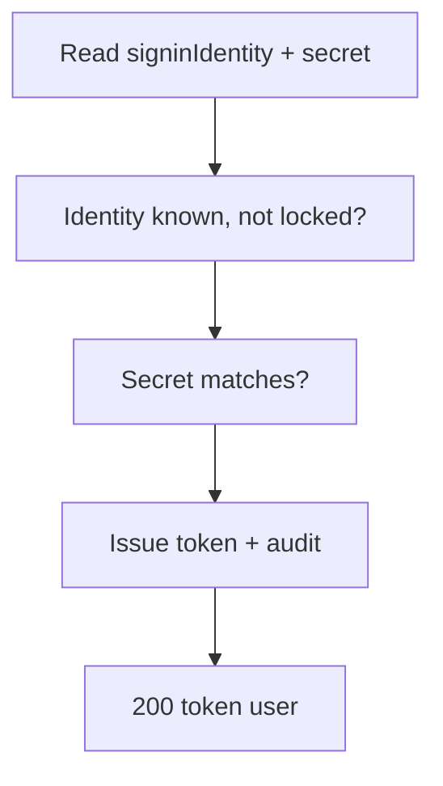
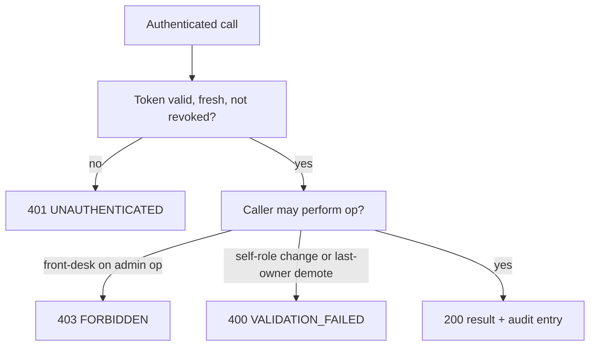

# Admin — as-built design

Status: active. Source page for the admin & config module (single source of truth; `services/admin/README.md` is a thin stub pointing here). Owned by `architect` (Closes #181).

## 1. Purpose

Hotel profile, users and roles, room/rate setup entry, per-hotel customisation values, and export/backup assembly. Issues every module's session token and serves every module's hotel values.

Links: `docs/architecture/lld.md` section 8; `docs/requirements/sequence-diagrams.md` section 14 (per-hotel customisation overlay); LLD section 0 (identity hardening, offline-first config).

## 2. Pattern and layers as-built

Node.js/TypeScript flat `src/` files over raw `node:http`, wired in `services/admin/src/index.ts` — same shape as Stay, Rooms, Guests, plus a startup migration chain.

| Layer | Files | Responsibility |
|---|---|---|
| Transport + routing | `src/server.ts` | `createServiceServer` answers `GET /healthz` (:82); `SignIn` is the one unauthenticated operation (:97); every other `/v1/*` call requires a Bearer token |
| Identity + sessions | `src/store.ts` (`AdminStore`, `AdminStoreAPI` at :114), `src/auth.ts` | `signIn` with failure counting and lockout, `authenticate` with 15-minute idle expiry and revocation checks, role enforcement |
| Hotel config + users | `src/store.ts` | `GetHotelConfig`/`UpdateHotelConfig`, `CreateUser`/`UpdateUserRole`/`UnlockIdentity`/`ChangeSecret`/`ListUsers`, `QueryAuditLog` |
| Row storage | `src/store.ts` (in-memory; lockout counters memory-only by design at :10-16), `src/pgstore.ts` (`PostgresAdminStore implements AdminStoreAPI` at :61) | identical semantics; Postgres selected at boot when `DATABASE_URL` is set |
| Startup migrations | `src/migrate.ts` | `applyAdminMigrations` runs the `migrations/*.sql` chain in name order at startup (:10-17); idempotent (`IF NOT EXISTS` / `ON CONFLICT DO NOTHING`) so the E2E loop can re-apply |
| Errors | `src/errors.ts` | shared `HttpError` envelope (same code set as Stay, plus `FORBIDDEN` for role refusals) |
| Boot | `src/index.ts`, `src/migrate.ts` | migration chain first (schema must exist before sign-in traffic), then store selection, `listen(PORT)` (default `8088`) |

The operation table (`src/server.ts:108-143`): `GetHotelConfig` (:108), `UpdateHotelConfig` (:112), `CreateUser` (:116), `UpdateUserRole` (:120), `UnlockIdentity` (:124), `SignOut` (:128), `ChangeSecret` (self-service rotation, issue #284), `ListUsers`, `QueryAuditLog`; `SignIn` precedes auth at :97.

## 3. Happy-path flowchart

SignIn (`POST /v1/admin/SignIn`) — the token issuer:



Edge trace (every edge cites code):

- A: both fields required (`src/store.ts:204-209`).
- B: unknown identity or wrong secret → `UNAUTHENTICATED` without distinguishing which (:227); an identity locked after repeated failures is refused while the lock holds (:212-214, 5-strike counting via `MAX_FAILURES` at :23).
- C: match path issues the token; D: sign-in audited; E: `{token, user}` returned (`src/store.ts:117,204-238`).
- Boot seed: `ensureBootUser` guarantees the first owner exists before traffic (`src/store.ts:116,183-202`).

## 4. Failure/rollback flowchart

Session and role guards — the enforcement side:



Edge trace:

- S: invalid/expired token, revoked/signed-out session, 15-minute idle expiry, or deleted user → `UNAUTHENTICATED` (`src/store.ts:241-257`); `SignOut` revokes (`src/server.ts:128`).
- P: front-desk accounts are refused admin operations with `FORBIDDEN` (`src/store.ts:177`); unknown roles refused (`:272, :307`); duplicate identities refused (`:276`).
- Self-role change and last-owner demotion are refused (`:315-319`); unlocking a non-locked identity is refused (`:338-341`).

Rollback: none — each admin write is a single guarded step with refusals preceding mutation; sessions carry no compensating state.

## 5. Outbound dependencies

None — Admin is the dependency sink in reverse: every module reads hotel values from `GetHotelConfig` (cached offline-first fallback per LLD section 0) and accepts its session tokens, but Admin calls no sibling at runtime. Deployment values arrive via `UpdateHotelConfig` or the deployment set (`script/apply-hotel-config.sh`) — beyond the minimal boot seed (`deploy/seed/boot.sql`: one hotel profile, one room type, two rooms for the E2E loop; no hotel values, no credentials).

See also: [deployment](../system-architecture.md) (§1), [C4 containers](../c4-containers.md), and [event flow](../event-flow.md) (config distribution; Admin writes no outbox rows in code — see the flagged note there).

## 6. Error mapping

Same shared Node envelope as Stay (`src/errors.ts`; `docs/technical/error-handling.md` section 1). Codes observed in `src/store.ts`:

| Code | Status | Raised when |
|---|---|---|
| `VALIDATION_FAILED` | 400 | missing field, unknown role, duplicate identity, self-role change, last-owner demote, unlock of non-locked identity (:108, :270-341) |
| `UNAUTHENTICATED` | 401 | unknown identity / wrong secret / locked, bad or expired session (:212-257) |
| `FORBIDDEN` | 403 | front-desk account on an admin-only operation (:177) |

## 7. Operations

Run from `services/admin`. Requires Node.js 22+. Build and test:

```sh
npm ci
npm run build
npm test
```

Lint:

```sh
npm run lint
```

Migrate: the module applies its own `migrations/*.sql` chain at startup via `applyAdminMigrations` (`src/migrate.ts`); SQL-first, forward-only in production. Manual runs use node-pg-migrate:

```sh
npm run migrate -- up
```

`DATABASE_URL` must point at the module database (default `postgresql://hotel:change-me@db:5432/hotel` in compose).

Run — production build:

```sh
npm start
```

Local watch (type-checks, runs, and restarts TypeScript directly):

```sh
npm run dev
```

Configuration via environment: `PORT` (default `8088`); hotel values are served from `AdminService.GetHotelConfig` with a cached offline-first fallback (see LLD section 0) and arrive via the deployment set (`script/apply-hotel-config.sh`, issue #158) or `UpdateHotelConfig` — beyond the minimal boot seed (`deploy/seed/boot.sql`), never via value seeds.

Docker:

```sh
docker build -t hotel-admin .
```

Contract tests: `contract-tests/` holds fixtures per provided/consumed operation once the first slice lands (see `contract-tests/README.md`). Run the repo gate from the repo root before opening a PR:

```sh
script/contract-check.sh
```

<!-- ao-role: architect -->
Role: architect · AO session hotel-mgmt-249
