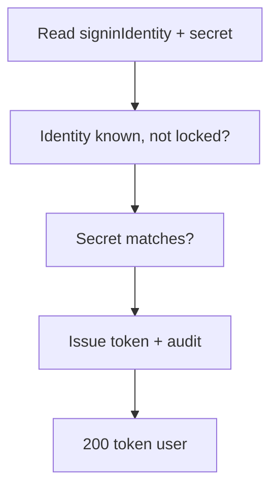
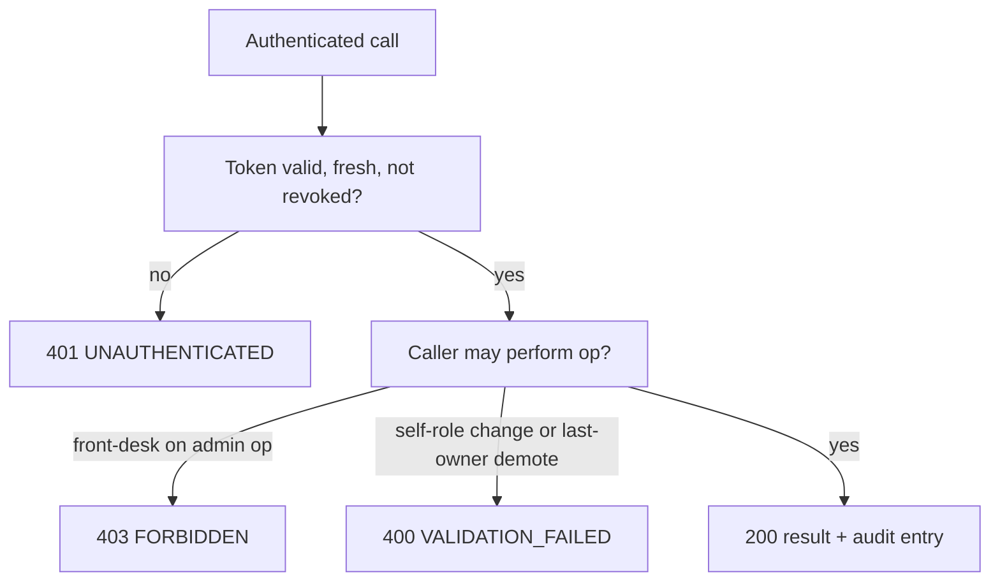
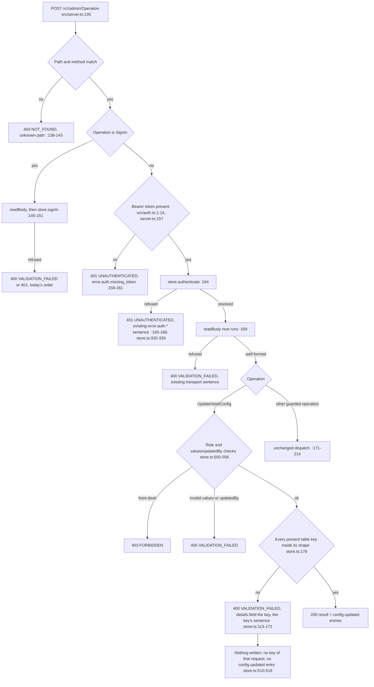

# Admin — as-built design

Status: active. Source page for the admin & config module (single source of truth; `services/admin/README.md` is a thin stub pointing here). Owned by `architect` (Closes #181).

## 1. Purpose

Hotel profile, users and roles, room/rate setup entry, per-hotel customisation values, and export/backup assembly. Issues every module's session token and serves every module's hotel values.

Links: `docs/architecture/lld.md` [section 8](../lld.md); `docs/requirements/sequence-diagrams.md` [section 14](../../requirements/sequence-diagrams.md) (per-hotel customisation overlay); LLD [section 0](../lld.md) (identity hardening, offline-first config).

## 2. Pattern and layers as-built

Node.js/TypeScript flat `src/` files over raw `node:http`, wired in `services/admin/src/index.ts` — same shape as Stay, Rooms, Guests, plus a startup migration chain.

| Layer | Files | Responsibility |
|---|---|---|
| Transport + routing | `src/server.ts` | `createServiceServer` answers `GET /healthz` (:131); `SignIn` is the one unauthenticated operation (:145); every other `/v1/*` call resolves the Bearer session before the body is read (:157-168) |
| Identity + sessions | `src/store.ts` (`AdminStore`, `AdminStoreAPI` at :188-190), `src/auth.ts` | `signIn` with failure counting and lockout, `authenticate` with 15-minute idle expiry and revocation checks, role enforcement; `extractBearer` (:1-14) is the module-local header parse (#639) |
| Hotel config + users | `src/store.ts` | `GetHotelConfig`/`UpdateHotelConfig`, `CreateUser`/`UpdateUserRole`/`UnlockIdentity`/`ChangeSecret`/`ListUsers`, `QueryAuditLog` |
| Row storage | `src/store.ts` (in-memory; lockout counters memory-only by design at :10-16), `src/pgstore.ts` (`PostgresAdminStore implements AdminStoreAPI` at :63) | identical semantics; Postgres selected at boot when `DATABASE_URL` is set |
| Startup migrations | `src/migrate.ts` | `applyAdminMigrations` runs the `migrations/*.sql` chain in name order at startup (:10-17); idempotent (`IF NOT EXISTS` / `ON CONFLICT DO NOTHING`) so the E2E loop can re-apply |
| Errors | `src/errors.ts` | shared `HttpError` envelope (same code set as Stay, plus `FORBIDDEN` for role refusals) |
| Boot | `src/index.ts`, `src/migrate.ts` | migration chain first (schema must exist before sign-in traffic), then store selection, `listen(PORT)` (default `8088`) |

The operation table (`src/server.ts:171-214`): `GetHotelConfig` (:171), `UpdateHotelConfig` (:175), `CreateUser` (:179), `UpdateUserRole` (:183), `UnlockIdentity` (:187), `SignOut` (:191), `ChangeSecret` (self-service rotation, issue #284), `ListUsers`, `QueryAuditLog`; `SignIn` precedes the session check at :145.

Request order (as built, #639). The body is read at
`src/server.ts:169`, after the session is resolved, and the inline
Bearer parse is gone (it lives in `src/auth.ts:1-14`, imported at
`src/server.ts:3`, called at :157). The statement order in
`handleRequest` is: `GET /healthz` (:131-134), the
`POST /v1/admin/<Operation>` match (:135) and its unknown-path 404
(:136-143), the `SignIn` branch with its own body read (:145-151), the
shared bearer helper (:157), the missing-token 401 (:158-161),
`store.authenticate` (:164) with the refused-session 401 (:165-168),
the body read (:169), then the operation switch (:170-214). An
unauthenticated session-guarded request therefore answers one 401
`UNAUTHENTICATED` before any parse, and the connection is told to
close without reading or measuring the pending body (:84-90, :159,
:166); a resolved session with a malformed body still gets today's
400; and the front-desk 403 follows a well-formed body, so the
observed order is 401, then 400, then 403. `SignIn` keeps today's
400-first order and its lockout, and route matching, the unknown-path
404, and the four finite server bounds do not move. Design: LLD
[section 33](../lld.md#33-admin-authenticates-before-parsing-and-refuses-a-malformed-config-write-refs-639).

## 3. Happy-path flowchart

SignIn (`POST /v1/admin/SignIn`) — the token issuer:



Edge trace (every edge cites code):

- A: both fields required (`src/store.ts:284-289`).
- B: unknown identity or wrong secret → `UNAUTHENTICATED` without distinguishing which (:306); an identity locked after repeated failures is refused with `IDENTITY_LOCKED` (401) while the lock holds (:291-296, 5-strike counting via `MAX_FAILURES` at :23).
- C: match path issues the token; D: sign-in audited; E: `{token, user}` returned (`src/store.ts:192,283-318`).
- Boot seed: `ensureBootUser` guarantees the first owner exists before traffic (`src/store.ts:191,262-281`).

## 4. Failure/rollback flowchart

Session and role guards — the enforcement side:



Edge trace:

- S: invalid/expired token, revoked/signed-out session, 15-minute idle expiry, or deleted user → `UNAUTHENTICATED` (`src/store.ts:320-339`); `SignOut` revokes (`src/server.ts:191`).
- P: front-desk accounts are refused admin operations with `FORBIDDEN` (`src/store.ts:256`); unknown roles refused (`:352, :387`); duplicate identities refused (`:354-357`).
- Self-role change and last-owner demotion are refused (`:393-401`); unlocking a non-locked identity is refused (`:419-423`).

Rollback: none — each admin write is a single guarded step with refusals preceding mutation; sessions carry no compensating state.

Delta (#639) — request order and config-write refusal, as built at
this head. The body read sits below the session check for every
operation except `SignIn`; the pins are the as-built `file:line`:



Edge trace for the #639 edges:

- `T`/`A`: the shared bearer helper (`src/auth.ts:1-14`) and
  `store.authenticate` (`src/server.ts:164`); no body byte is read
  before a resolved session, and both the missing-token and the
  refused-session answer set `Connection: close` (`:84-90`) so the
  pending payload is never buffered or measured.
- `A–B`: the moved body read (`:169`); today's ceiling, JSON parse, and
  object check, with today's sentences (`:15-17`, `:61-70`).
- `F–F3/F4`: today's checks keep their code, status, details, and
  sentence; the role check stays after the body read, so 400 precedes
  403.
- `F–K–K4–K5`: the per-key table (`store.ts:113-172`) and validator
  (`:178-186`) shared from `src/store.ts`, called by both
  `updateConfig` implementations before the first write (in memory at
  `:562` before the first `config.set` at `:566`; in Postgres at
  `pgstore.ts:516` before `withTx` opens at `:518`), so the first
  offending key refuses the whole write and no `config.updated` entry
  appears (`store.ts:510-519`).
- Rollback for the new edges: every refusal is decided before the first
  write, so there is no partial row, value, or audit entry to unwind;
  reverting the single implementation PR restores today's order and
  behaviour with no migration.

## 5. Outbound dependencies

None — Admin is the dependency sink in reverse: every module reads hotel values from `GetHotelConfig` (cached offline-first fallback per LLD [section 0](../lld.md)) and accepts its session tokens, but Admin calls no sibling at runtime. Deployment values arrive via `UpdateHotelConfig` or the deployment set (`script/apply-hotel-config.sh`) — beyond the minimal boot seed (`deploy/seed/boot.sql`: one hotel profile, one room type, two rooms for the E2E loop; no hotel values, no credentials).

See also: [deployment](../system-architecture.md) (section 1), [C4 containers](../c4-containers.md), and [event flow](../event-flow.md) (config distribution; Admin writes no outbox rows in code — see the flagged note there).

## 6. Error mapping

Same shared Node envelope as Stay (`src/errors.ts`; `docs/technical/error-handling.md` [section 1](../../technical/error-handling.md)). Codes observed in `src/store.ts`:

| Code | Status | Raised when |
|---|---|---|
| `VALIDATION_FAILED` | 400 | missing field, unknown role, duplicate identity, self-role change, last-owner demote, unlock of non-locked identity (:108, :352-423), and a config value outside its key's shape (:178-186, #639) |
| `UNAUTHENTICATED` | 401 | unknown identity / wrong secret, bad or expired session (:306, :320-339, :463) |
| `IDENTITY_LOCKED` | 401 | identity locked after repeated failures (:291-296) |
| `FORBIDDEN` | 403 | front-desk account on an admin-only operation (:256, :550-552) |

Delta (#639), as built — same envelope and codes, no new row: a
session-guarded request with no token or a refused session answers
`UNAUTHENTICATED` (401) before the body is read, so a malformed body no
longer answers a transport `VALIDATION_FAILED` first; an authenticated
malformed body keeps today's `VALIDATION_FAILED` 400 and its transport
sentence; `FORBIDDEN` (403) follows a well-formed body; and an
`UpdateHotelConfig` value outside its key's declared shape answers
`VALIDATION_FAILED` 400 with `details.field` equal to the offending key
and that key's plain sentence, writing nothing and recording no
`config.updated` entry. `SignIn` keeps today's order. The five new
sentences (`error.validation.config_text`, `config_time`,
`config_required_fields`, `config_list`, `config_optional_text`) reuse
the existing `retention_floor` and `field_required` sentences for their
keys; no enum entry or status mapping is added
(`src/errors.ts:4-29`; `contracts/errors/envelope.json`). Design: LLD
[section 33](../lld.md#33-admin-authenticates-before-parsing-and-refuses-a-malformed-config-write-refs-639)
and `docs/technical/error-handling.md` section 1.5.

## 7. Operations

Run from `services/admin`. Requires Node.js 22+. Build and test:

```sh
npm ci
npm run build
npm test
```

Lint:

```sh
npm run lint
```

Migrate: the module applies its own `migrations/*.sql` chain at startup via `applyAdminMigrations` (`src/migrate.ts`); SQL-first, forward-only in production. Manual runs use node-pg-migrate:

```sh
npm run migrate -- up
```

`DATABASE_URL` must point at the module database (default `postgresql://hotel:change-me@db:5432/hotel` in compose).

Run — production build:

```sh
npm start
```

Local watch (type-checks, runs, and restarts TypeScript directly):

```sh
npm run dev
```

Configuration via environment: `PORT` (default `8088`); hotel values are served from `AdminService.GetHotelConfig` with a cached offline-first fallback (see LLD [section 0](../lld.md)) and arrive via the deployment set (`script/apply-hotel-config.sh`, issue #158) or `UpdateHotelConfig` — beyond the minimal boot seed (`deploy/seed/boot.sql`), never via value seeds.

Docker:

```sh
docker build -t hotel-admin .
```

Contract tests: `contract-tests/` holds fixtures per provided/consumed operation once the first slice lands (see `contract-tests/README.md`). Run the repo gate from the repo root before opening a PR:

```sh
script/contract-check.sh
```

Ingress bounds (Refs #630): `src/server.ts` caps a request body at
65 536 bytes (`MAX_BODY_BYTES`) and refuses an oversized body with the
shared envelope (`VALIDATION_FAILED`, `details` naming `body`) before
parsing; the server it returns carries `headersTimeout` 5 s,
`requestTimeout` 10 s, `timeout` 15 s, and `keepAliveTimeout` 10 s. No
environment variable overrides either value. Details: LLD
[section 29](../lld.md#29-bounded-request-bodies-and-finite-server-timeouts-refs-630).

<!-- ao-role: architect -->
Role: architect · AO session hotel-mgmt-249

<!-- ao-role: architect -->
Role: architect · AO session hotel-mgmt-1164

Secrets at boot (Refs #638), as built. Two secrets used to fall back
to published constants: the signing key to `dev-only-change-me` and the
boot owner secret to `change-me`. From this change the service resolves
both at the top of `main` (`src/index.ts:25`), before the store, the
migrations, the seed, and `listen`, and refuses to boot when either is
unusable outside one explicit dev switch. The resolver is
`resolveBootConfig` (`src/bootConfig.ts:91`), the refusal is one
`BootConfigError` line (`:46`, `:56`), both store constructors take the
key as a required argument (`src/store.ts:233-234`,
`src/pgstore.ts:68-73`), and the seed takes the resolved identity and
secret (`src/server.ts:119-124`). The environment contract:

| Variable | Required | Default | Refused when |
|---|---|---|---|
| `ADMIN_TOKEN_KEY` | yes | none | unset, empty, or exactly `change-me`, `change-me-dev-only`, `password`, `hotel`, `hotel-dev-only` |
| `ADMIN_BOOT_SECRET` | yes | none | the same test |
| `ADMIN_BOOT_IDENTITY` | no | `owner` when undefined | never |
| `ADMIN_DEV_MODE` | no | off | — the switch; only the exact value `1` enables the dev fallbacks |
| `PORT` | no | `8088` | never |
| `DATABASE_URL` | no | in-memory store | never |

A refused boot writes nothing, creates no owner, opens no port, never
answers `/healthz`, exits `1`, and prints one plain English line on
stderr naming the variable and the two ways forward — provision the
per-sale secret, or set `ADMIN_DEV_MODE=1` for dev/test — never a value.
`NODE_ENV` decides nothing. With `ADMIN_DEV_MODE=1`, a missing key uses
`dev-only-change-me`, a missing boot secret uses `change-me`, a provided
value still wins, and the boot logs one warning naming the switch; the
production pre-flight and Ansible pre-check refuse the switch, so it
cannot travel into a sale. Local unit tests need neither variable (every
suite passes an explicit key or seeds the owner directly); a local
`npm run dev` either exports the two values or sets the switch. The
deployment, env-file, runbook, release-note, and rollback documents that
carry the third per-sale secret are `release-manager` work. Design: LLD
[section 39](../lld.md#39-admin-refuses-to-boot-without-its-per-sale-signing-key-and-boot-secret-refs-638);
threat model sections 4, 5, and 8 (R12).

<!-- ao-role: dev -->
Role: dev · AO session hotel-mgmt-1312

<!-- ao-role: architect -->
Role: architect · AO session hotel-mgmt-1279

## 8. As-built delta — session-derived audit actor (Refs #643)

The transport resolves the caller before reading the body
(`src/server.ts:157-169`) and passes it to every write (`:176`); the
account writes already record `caller.signinIdentity`
(`src/store.ts:366-368`, `:403`, `:425`, `:466`). `UpdateHotelConfig`
now records it too: the in-memory store at `src/store.ts:569-571` and
the Postgres store at `src/pgstore.ts:513-514`, `:525-535`. The body
`updatedBy` stays required with today's refusal
(`src/store.ts:560`, `src/pgstore.ts:513`) and is dropped, not
annotated — the config write emits no JSON payload. The
`config.updated` audit entries derive from those rows
(`src/store.ts:510-519`), so the audit view follows without a second
write. The boot seed keeps its server-side `boot` actor
(`src/store.ts:262-281`; `src/pgstore.ts:90-100`), and the account
writes are unchanged. Guards `SEC28`, `SEC31`, `SEC34` live in
`src/server.test.ts` and `src/pgstore.test.ts`; no response, status,
refusal, column, or migration changed (LLD
[section 34](../lld.md#34-the-audit-actor-comes-from-the-session-never-from-the-request-refs-643)).

<!-- ao-role: architect -->
Role: architect · AO session hotel-mgmt-1175
