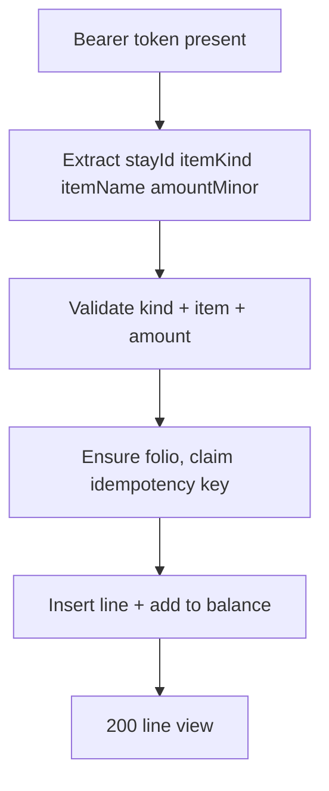
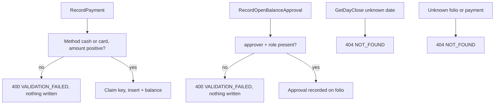

# Billing — as-built design

Status: active. Source page for the billing module (single source of truth; `services/billing/README.md` is a thin stub pointing here). Owned by `architect` (Closes #181).

## 1. Purpose

Folios, charges, payments, taxes/fees, day-close, and the settlement gate. The one Spring-context service in the budget.

Links: `docs/architecture/lld.md` section 6; `docs/requirements/sequence-diagrams.md` sections 9 (check-out), 10 (folio charge posting), 11 (settlement, receipt, approved open balance); FR-BIL-1..7; BR-17, BR-18, BR-21..BR-26.

## 2. Pattern and layers as-built

Java 21 Spring Boot `web / service / repo (+ config)`, the only stack with a framework-managed context.

| Layer | Files | Responsibility |
|---|---|---|
| Transport + auth + body shaping | `src/main/java/com/hotel/billing/web/BillingController.java` | `@RestController` at `/v1/billing`; `requireToken` enforces Bearer presence (:67-72); `required`/`amountOf` extract and validate body fields (:29-55) |
| Envelope | `src/main/java/com/hotel/billing/web/ApiException.java`, `web/ApiExceptionHandler.java` | `ApiException` carries code/status/message/details (:8-42); `@RestControllerAdvice` renders every one with the shared envelope plus `traceId` (:12-23) |
| Validation + step order | `src/main/java/com/hotel/billing/service/BillingService.java` | UUID/actor checks, item-kind rules, amount rules, idempotency claims, folio/payment/invoice/receipt/approval flows |
| Data access | `src/main/java/com/hotel/billing/repo/BillingRepository.java` | `JdbcTemplate` over the billing schema only: `ensureFolio`, charge/payment inserts, `addToBalance`, `recordApproval`, `claimOrWait`, charge-item catalog (:61-171) |
| Wiring | `src/main/java/com/hotel/billing/config/DatabaseConfig.java`, `BillingApplication.java` | datasource and context bootstrap |
| Boot | Flyway + `src/main/resources/application.properties` | versioned `V<n>__` migrations run automatically at startup; `server.port=${PORT:8087}` (:1) |

The operation table (`web/BillingController.java`): `GetFolioBalance` (:74), `PostCharge` (:81), `RecordPayment` (:89), `RunDayClose` (:97), `GetDayClose` (:104), `ProduceInvoice` (:111), `ProduceReceipt` (:118), `UpsertChargeItem` (:125), `UpsertTaxFeeRule` (:134), `RecordOpenBalanceApproval` (:141).

## 3. Happy-path flowchart

PostCharge (`POST /v1/billing/PostCharge`) — the folio write:



Edge trace (every edge cites code):

- A: missing/blank Bearer → `UNAUTHENTICATED` 401 (`web/BillingController.java:67-72`).
- B: `stayId`, `itemKind`, `itemName`, `amountMinor` extracted and required (:81-86 via `:29-55`).
- C: `stayId` must be a UUID, `itemKind` must be `nightly-room-charge` or `charge-item`, `itemName` required, `amountMinor` non-negative, and the charge item must be defined (`service/BillingService.java:126-140`).
- D: folio ensured for the stay (`repo/BillingRepository.java:65`); a supplied idempotency key is claimed — the replay returns the original line (`service/BillingService.java:146` via `repo/BillingRepository.java:220`).
- E: charge line inserted and folio balance updated (`repo/BillingRepository.java:99-135`); F: line view returned to the desk.

## 4. Failure/rollback flowchart

Payment, approval, and day-close guards:



Edge trace:

- M: `method` must be `cash` or `card`, `amountMinor` positive (`service/BillingService.java:170-175`); duplicates collapse on the idempotency claim (`:180-185`).
- W: `approvedBy` and `role` required; approval recorded as JSON on the folio (`:255-277`).
- Y: no day-close run for the date → `NOT_FOUND` (`:206-212`).
- Z: unknown folio/payment (or payment without folio) → `NOT_FOUND` (`:224-243`).
- Setup: `UpsertChargeItem` registers a named sellable (`:298-313`); `UpsertTaxFeeRule` registers a percentage rule capped at 0–100 (`:314-325`); both refuse blank names and out-of-range values with `VALIDATION_FAILED`.
- Settlement: `ApiException.settlementRequired` builds the `SETTLEMENT_REQUIRED` 409 (`web/ApiException.java:41-42`); the stay-side folio gate that consumes approvals lives in Stay `checkFolioGate`.

Rollback: none — each operation is a single validated write with the idempotency claim preceding mutation; refusals precede any insert.

## 5. Outbound dependencies

None at runtime. Consumed by the desk loop: `GetFolioBalance` feeds the Stay check-out folio gate; `RunDayClose`/`GetDayClose` feed Reporting revenue via `folio.charge-posted` / `folio.payment-recorded` events; `ProduceInvoice`/`ProduceReceipt` present the folio/payment the stay close references. Money is exact (`BigDecimal` in memory, BIGINT minor units persisted). Hotel values come from `AdminService.GetHotelConfig` with a cached offline-first fallback (LLD section 0).

See also: [deployment](../system-architecture.md) (§1), [C4 containers](../c4-containers.md), and [event flow](../event-flow.md) (this service's outbox emissions).

## 6. Error mapping

Envelope `{code, message, details, traceId}` (`web/ApiExceptionHandler.java:12-23`) to `docs/technical/error-handling.md` section 1. Constructors (`web/ApiException.java:33-42`):

| Code | Status | Raised when |
|---|---|---|
| `VALIDATION_FAILED` | 400 | missing/blank field, bad UUID/date, bad item kind or method, negative amount, out-of-range percent (`service/BillingService.java:126-193,255-325`) |
| `UNAUTHENTICATED` | 401 | missing session token (`web/BillingController.java:67-72`) |
| `NOT_FOUND` | 404 | unknown day-close, folio, payment, or charge line (`service/BillingService.java:206-243`) |
| `SETTLEMENT_REQUIRED` | 409 | settlement refused without approval (`web/ApiException.java:41-42`) |

## 7. Operations

Run from `services/billing`. Requires Java 21 and Maven 3.9+ (or use the `maven:3.9-eclipse-temurin-21` image). Package (includes unit tests):

```sh
mvn package
```

Test (unit-only: no Spring context, no database, so they run without PostgreSQL):

```sh
mvn test
```

Full verify:

```sh
mvn verify
```

Migrate: Flyway runs versioned `V<n>__` SQL from `src/main/resources/db/migration` automatically at startup (forward-only in production). Ad-hoc runs against a scratch database only:

```sh
mvn flyway:migrate
```

`DATABASE_URL`, `DB_USER`, and `DB_PASSWORD` point at the module database (defaults match `deploy/compose.yaml`).

Run — local:

```sh
mvn spring-boot:run
```

Packaged:

```sh
java -jar target/billing-*.jar
```

Configuration via environment: `PORT` (default `8087`); `DATABASE_URL`/`DB_USER`/`DB_PASSWORD`; hotel values come from `AdminService.GetHotelConfig` with a cached offline-first fallback (see LLD section 0) and land in later slices. Money is exact (`BigDecimal` in memory, BIGINT minor units persisted) from the first charge slice on.

Docker:

```sh
docker build -t hotel-billing .
```

Contract tests: `contract-tests/` holds fixtures per provided/consumed operation once the first slice lands (see `contract-tests/README.md`). Run the repo gate from the repo root before opening a PR:

```sh
script/contract-check.sh
```

<!-- ao-role: architect -->
Role: architect · AO session hotel-mgmt-249
