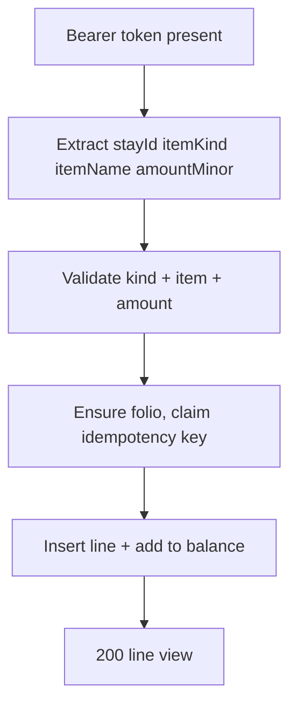
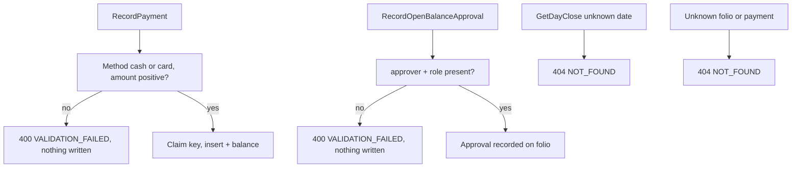

# Billing — as-built design

Status: active. Source page for the billing module (single source of truth; `services/billing/README.md` is a thin stub pointing here). Owned by `architect` (Closes #181).

## 1. Purpose

Folios, charges, payments, taxes/fees, day-close, and the settlement gate. The one Spring-context service in the budget.

Links: `docs/architecture/lld.md` [section 6](../lld.md); `docs/requirements/sequence-diagrams.md` [sections 9](../../requirements/sequence-diagrams.md) (check-out), 10 (folio charge posting), 11 (settlement, receipt, approved open balance); FR-BIL-1..7; BR-17, BR-18, BR-21..BR-26.

## 2. Pattern and layers as-built

Java 21 Spring Boot `web / service / repo (+ config)`, the only stack with a framework-managed context.

| Layer | Files | Responsibility |
|---|---|---|
| Transport + auth + body shaping | `src/main/java/com/hotel/billing/web/BillingController.java` | `@RestController` at `/v1/billing`; `requireToken` enforces Bearer presence (:117-122); `required`/`amountOf` extract and validate body fields (:39-96) |
| Envelope | `src/main/java/com/hotel/billing/web/ApiException.java`, `web/ApiExceptionHandler.java` | `ApiException` carries code/status/message/details (:8-42); `@RestControllerAdvice` renders every failure with the shared envelope plus `traceId` (:22-115): an unreadable body, an unreadable or unanswerable media type, an unknown path, and a wrong method as conformance refusals, any other exception as `INTERNAL_ERROR`, while an `ApiException` keeps its own code and status |
| Validation + step order | `src/main/java/com/hotel/billing/service/BillingService.java` | UUID/actor checks, item-kind rules, amount rules, idempotency claims, folio/payment/invoice/receipt/approval flows |
| Data access | `src/main/java/com/hotel/billing/repo/BillingRepository.java` | `JdbcTemplate` over the billing schema only: `ensureFolio`, charge/payment inserts, `addToBalance`, `recordApproval`, `claimOrWait`, charge-item catalog (:61-171) |
| Wiring | `src/main/java/com/hotel/billing/config/DatabaseConfig.java`, `BillingApplication.java` | datasource and context bootstrap |
| Boot | Flyway + `src/main/resources/application.properties` | versioned `V<n>__` migrations run automatically at startup; `server.port=${PORT:8087}` (:1) |

The operation table (`web/BillingController.java`): `GetFolioBalance` (:74), `PostCharge` (:81), `RecordPayment` (:89), `RunDayClose` (:97), `GetDayClose` (:104), `ProduceInvoice` (:111), `ProduceReceipt` (:118), `UpsertChargeItem` (:125), `UpsertTaxFeeRule` (:134), `RecordOpenBalanceApproval` (:141).

## 3. Happy-path flowchart

PostCharge (`POST /v1/billing/PostCharge`) — the folio write. As built
today; from #634 on the stay is verified between C and D (section 9, LLD
[section 27](../lld.md#27-folio-writes-verify-the-stay-refs-634)):



Edge trace (every edge cites code):

- A: missing/blank Bearer → `UNAUTHENTICATED` 401 (`web/BillingController.java:117-122`).
- B: `stayId`, `itemKind`, `itemName`, `amountMinor` extracted and required (:131-136 via `:39-96`).
- C: `stayId` must be a UUID, `itemKind` must be `nightly-room-charge` or `charge-item`, `itemName` required, `amountMinor` non-negative, and the charge item must be defined (`service/BillingService.java:126-140`).
- D: folio ensured for the stay (`repo/BillingRepository.java:65`); a supplied idempotency key is claimed — the replay returns the original line (`service/BillingService.java:146` via `repo/BillingRepository.java:220`).
- E: charge line inserted and folio balance updated (`repo/BillingRepository.java:99-135`); F: line view returned to the desk.

## 4. Failure/rollback flowchart

Payment, approval, and day-close guards:



Edge trace:

- M: `method` must be `cash` or `card`, `amountMinor` positive (`service/BillingService.java:170-175`); duplicates collapse on the idempotency claim (`:180-185`).
- W: `approvedBy` and `role` required; approval recorded as JSON on the folio (`:255-277`).
- Y: no day-close run for the date → `NOT_FOUND` (`:206-212`).
- Z: unknown folio/payment (or payment without folio) → `NOT_FOUND` (`:224-243`).
- Setup: `UpsertChargeItem` registers a named sellable (`:298-313`); `UpsertTaxFeeRule` registers a percentage rule capped at 0–100 (`:314-325`); both refuse blank names and out-of-range values with `VALIDATION_FAILED`.
- Settlement: `ApiException.settlementRequired` builds the `SETTLEMENT_REQUIRED` 409 (`web/ApiException.java:41-42`); the stay-side folio gate that consumes approvals lives in Stay `checkFolioGate`.

Rollback: none — each operation is a single validated write with the idempotency claim preceding mutation; refusals precede any insert.

## 5. Outbound dependencies

One runtime outbound call from #634 on: `StayService.GetStayRef` (C8),
made before every folio write and before a folio is created on a
read — `STAY_BASE_URL` (default `http://stay:8084`), the caller's
Bearer token forwarded, 2-second timeout, fail-closed on anything
unreadable (section 9; `docs/technical/integration.md` C8). Before that
change this section read "none at runtime".

Consumed by the desk loop: `GetFolioBalance` feeds the Stay check-out folio gate; `RunDayClose`/`GetDayClose` feed Reporting revenue via `folio.charge-posted` / `folio.payment-recorded` events; `ProduceInvoice`/`ProduceReceipt` present the folio/payment the stay close references. Money is exact (`BigDecimal` in memory, BIGINT minor units persisted). Hotel values come from `AdminService.GetHotelConfig` with a cached offline-first fallback (LLD [section 0](../lld.md)).

See also: [deployment](../system-architecture.md) (section 1), [C4 containers](../c4-containers.md), and [event flow](../event-flow.md) (this service's outbox emissions).

## 6. Error mapping

Envelope `{code, message, details, traceId}` (`web/ApiExceptionHandler.java:34-45`) to `docs/technical/error-handling.md` [section 1](../../technical/error-handling.md). Constructors (`web/ApiException.java:33-42`):

| Code | Status | Raised when |
|---|---|---|
| `VALIDATION_FAILED` | 400 | missing/blank field, bad UUID/date, bad item kind or method, negative amount, out-of-range percent (`service/BillingService.java:126-193,255-325`); from #629 a body Spring cannot read — malformed JSON, a missing body, or a JSON value that is not an object (`web/ApiExceptionHandler.java:55-67`); from #629 a caller media type Billing cannot read (`Content-Type: text/plain`, a bare `curl -d` form post) or cannot answer (`Accept` naming no JSON) answers the same code because the contract status mapping has no 415/406 entry (`web/ApiExceptionHandler.java:78-82`); from #635 a money value that is not a whole number of minor units or whose magnitude exceeds the ceiling (`web/BillingController.java:63-96`, section 10) |
| `UNAUTHENTICATED` | 401 | missing session token (`web/BillingController.java:117-122`); a `401` forwarded from Stay is surfaced unchanged |
| `NOT_FOUND` | 404 | unknown day-close, folio, payment, or charge line (`service/BillingService.java:206-243`); from #634 an unknown stay on a folio route; from #629 a path no route claims (`web/ApiExceptionHandler.java:86-89`) |
| `METHOD_NOT_ALLOWED` | 405 | from #629 a known route reached with the wrong method, with the `Allow` header (`web/ApiExceptionHandler.java:94-102`) |
| `SETTLEMENT_REQUIRED` | 409 | settlement refused without approval (`web/ApiException.java:41-42`) |
| `STATE_ILLEGAL` | 422 | from #634 a stay outside `in-house` on a folio route, naming the stay and its state |
| `INTERNAL_ERROR` | 500 | from #629 an unexpected exception, including a stored-row defect's `IllegalStateException`: the plain `error.transport.unexpected` sentence, empty `details`, and a `traceId` logged server-side (`web/ApiExceptionHandler.java:108-114`) |
| `UPSTREAM_UNAVAILABLE` | 503 | from #634 a Stay that cannot be read for a folio route; also planned for the #601 deltas above |

## 7. Operations

Run from `services/billing`. Requires Java 21 and Maven 3.9+ (or use the `maven:3.9-eclipse-temurin-21` image). Package (includes unit tests):

```sh
mvn package
```

Test (unit-only: no Spring context, no database, so they run without PostgreSQL):

```sh
mvn test
```

Full verify:

```sh
mvn verify
```

Migrate: Flyway runs versioned `V<n>__` SQL from `src/main/resources/db/migration` automatically at startup (forward-only in production). Ad-hoc runs against a scratch database only:

```sh
mvn flyway:migrate
```

`DATABASE_URL`, `DB_USER`, and `DB_PASSWORD` point at the module database (defaults match `deploy/compose.yaml`).

Run — local:

```sh
mvn spring-boot:run
```

Packaged:

```sh
java -jar target/billing-*.jar
```

Configuration via environment: `PORT` (default `8087`); `DATABASE_URL`/`DB_USER`/`DB_PASSWORD`; hotel values come from `AdminService.GetHotelConfig` with a cached offline-first fallback (see LLD [section 0](../lld.md)) and land in later slices. Money is exact (`BigDecimal` in memory, BIGINT minor units persisted) from the first charge slice on.

Docker:

```sh
docker build -t hotel-billing .
```

Contract tests: `contract-tests/` holds fixtures per provided/consumed operation once the first slice lands (see `contract-tests/README.md`). Run the repo gate from the repo root before opening a PR:

```sh
script/contract-check.sh
```

Ingress bounds (Refs #630): a body-bounding filter caps a request body at
65 536 bytes (`MAX_BODY_BYTES`) and refuses an oversized body with the
shared envelope (`VALIDATION_FAILED`, `details` naming `body`) before
`@RequestBody` binding; `application.properties` carries
`server.tomcat.connection-timeout=5s`,
`server.tomcat.keep-alive-timeout=10s`, and
`server.tomcat.max-swallow-size=65536`. No environment variable overrides
them. Details: LLD
[section 29](../lld.md#29-bounded-request-bodies-and-finite-server-timeouts-refs-630).

## 8. Planned delta — approval provenance at write (Refs #601, ADR-0005 proposed)

Today `recordOpenBalanceApproval` (section 4 edge W) requires a
non-blank `approvedBy` and `role` but accepts any role string, and it
already stamps `approvedAt` server-side
(`src/main/java/com/hotel/billing/service/BillingService.java:302-313`).
Target: refuse a `role` outside the fixed three (`owner`, `manager`,
`front-desk`) with `VALIDATION_FAILED` naming `role`; keep the
server-side time stamp (a body-supplied time is never used); keep
recording the session actor as the audit `updated_by`
(`repo/BillingRepository.java:143-146`). Authorization — which of the
three may approve, and whether approval is needed — stays the section
3.1 config fan-out and is out of scope. `GetFolioBalance` keeps its
shape and becomes the gate read Stay calls at the close (integration
C7). Design: `docs/architecture/lld.md` section 21.

## 9. Planned delta — folio writes verify the stay (Refs #634, ADR-0008 proposed)

Today `ensureFolio` creates a folio for any UUID `stayId` with no Stay
read (`repo/BillingRepository.java:65-71`), reached from `GetFolioBalance`
(`service/BillingService.java:121`), `PostCharge` (`:142`),
`RecordPayment` (`:176`), and `RecordOpenBalanceApproval` (`:264`), so
money can be written against a stay that does not exist or is already
closed.

Target, from #634 on:

- `PostCharge`, `RecordPayment`, and `RecordOpenBalanceApproval` call
  `StayService.GetStayRef` (C8) on every request before they write,
  whether or not a folio exists; `GetFolioBalance` calls it only when the
  stay has no folio, so a folio Billing already holds stays readable and
  printable in every stay state.
- The call is `POST {STAY_BASE_URL}/v1/stay/GetStayRef` with the caller's
  Bearer token forwarded, a 2-second timeout, and it runs outside the
  route's database transaction (the transactional body moves to a writer
  bean; holding a Hikari connection across the call would starve the
  10-connection pool, `config/DatabaseConfig.java:55`).
- Refusals: unknown stay -> `NOT_FOUND` (404); stay not in house ->
  `STATE_ILLEGAL` (422) naming the state; unreadable Stay -> a new
  `web/ApiException.upstreamUnavailable` builder rendering
  `UPSTREAM_UNAVAILABLE` (503) with
  `{upstream: "stay", operation: "GetStayRef"}`; a `404` that names
  another stay is unreadable, not unknown. `UPSTREAM_UNAVAILABLE` is
  registered in `contracts/errors/envelope.json` in the same change, and
  the four folio contracts bump minor for the new error set.
- Order: validate, verify, claim, write — so a refusal leaves no folio
  row, no line, no balance movement, no approval, and no outbox event.
- No schema, migration, operation, request field, response field, or
  event change; `RunDayClose`, `GetDayClose`, `ProduceInvoice`, and
  `ProduceReceipt` are untouched.

Design: `docs/architecture/lld.md` section 27; decision record
`docs/architecture/decisions/adr-0008-folio-write-stay-verification.md`
(proposed). Rollback: revert the single implementation PR; the previous
ensure-on-first-use behaviour returns and no data migration exists.

<!-- ao-role: architect -->
Role: architect · AO session hotel-mgmt-1046

## 10. Delta — money amounts are whole, bounded, and refused in the adapter (Refs #635)

Before this change `amountOf` took any `Number` and returned
`number.longValue()`
(`src/main/java/com/hotel/billing/web/BillingController.java:47-53` at
the spec head, the conversion at `:50`), so `12.99` posted 12 and no
magnitude was bounded; the one helper serves `PostCharge` (`:136`),
`RecordPayment` (`:143`), and `UpsertChargeItem` (`:179`). The sign rules
one layer below (`service/BillingService.java:134-136`, `:172-174`,
`:321-323`) are correct and are not the gap.

As implemented by #635:

- `amountOf` refuses a value that is not a whole number of minor units
  with `VALIDATION_FAILED` (400), `details` naming the field, and the new
  `error.validation.amount_not_integer` sentence — never a truncation —
  and refuses a magnitude above **1 000 000 000 000** minor units with the
  new `error.validation.amount_above_ceiling` sentence, `{max}` rendered
  through `Messages.formatNumber`. The ceiling is one `static final`
  constant in `BillingController` (`:33`), not configuration.
- Whole-ness is read from the decimal spelling (`BigDecimal` from
  `number.toString()`, the conversion `percentOf` already uses at
  `:111`), so `12.0` stays the whole amount 12 and is accepted exactly as
  `12` is; the bound is on the magnitude, so a huge negative refuses in
  the adapter while an in-range negative keeps the service's sign
  refusal.
- A present money field that is not a JSON number answers
  `error.validation.field_number` naming the field; an absent one keeps
  `error.validation.field_required` (`:65-67`).
- `percentOf` (`:102-115`) gets the same presence-versus-type split, so a
  present non-numeric `percent` names `percent` with `field_number`
  instead of the missing-field sentence. Nothing else about the percent
  adapter moves: a fractional rate such as `8.5` stays accepted and the
  0–100 range stays the service's (`:340-342`).
- Both refusals are raised before the service call (`:142-160`,
  `:176-190`, `:324`), so no folio row, idempotency claim, line, payment,
  balance movement, or outbox event is written, and a refused request
  consumes no idempotency key.
- No schema, migration, operation, request or response field, event, or
  contract file change: `VALIDATION_FAILED` is already the published
  code, and the three request schemas keep their `integer` type and
  `minimum` without a `maximum` (the contract decision is LLD
  [section 30.5](../lld.md#305-contract-decision-the-three-request-schemas-declare-no-maximum)).
  Two catalogue sentences are added to `messages/en.json`.

Design: `docs/architecture/lld.md`
[section 30](../lld.md#30-money-amount-bounds-on-the-billing-folio-write-adapter-refs-635);
product conditions `AC-AMT-1`..`AC-AMT-5` in
`docs/product/acceptance-criteria.md` section 23; business rule BR-61;
the refusal in the taxonomy: `docs/technical/error-handling.md`
section 1.2. Rollback: revert the single implementation PR — `amountOf`
returns to truncating, the two sentences go with the code, and no
migration or data repair exists in either direction.

<!-- ao-role: architect -->
Role: architect · AO session hotel-mgmt-1117
