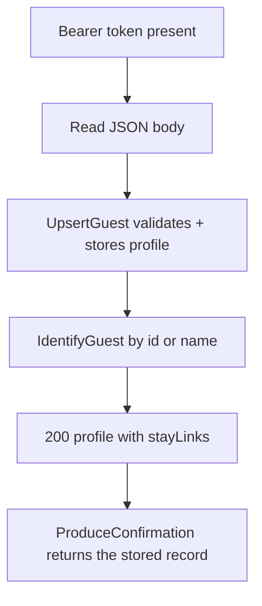
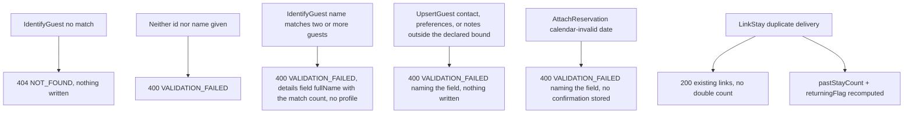

# Guests — as-built design

Status: active. Source page for the guests module (single source of truth; `services/guests/README.md` is a thin stub pointing here). Owned by `architect` (Closes #181).

## 1. Purpose

Guest profiles, preferences and notes, the repeat-guest flag, the confirmation record, and stay-link ingestion from stay events.

Links: `docs/architecture/lld.md` [section 5](../lld.md); `docs/requirements/sequence-diagrams.md` [sections 2](../../requirements/sequence-diagrams.md) (creation carries the guest block), 6 (walk-in), 7 (check-in); FR-GST-1..4.

## 2. Pattern and layers as-built

Node.js/TypeScript flat `src/` files over raw `node:http`, wired in `services/guests/src/index.ts` — same shape as Stay and Rooms.

| Layer | Files | Responsibility |
|---|---|---|
| Transport + routing | `src/server.ts` | `createServiceServer` answers `GET /healthz` (:117), enforces Bearer presence (:130), routes `POST /v1/guests/<Operation>` by case label |
| Identity | `src/auth.ts` | `extractBearer`: Bearer presence check, same skeleton contract as Stay |
| Validation + step order | `src/store.ts` (`GuestStoreAPI` at :138, `GuestStore` at :214) | upsert/identify/context reads, idempotent stay-link ingestion |
| Row storage | `src/store.ts` (in-memory), `src/pgstore.ts` (`PostgresGuestStore implements GuestStoreAPI` at :35) | identical semantics; Postgres selected at boot when `DATABASE_URL` is set |
| Errors | `src/errors.ts` | shared `HttpError` envelope (same code set as Stay) |
| Boot | `src/index.ts` | store selection by `DATABASE_URL`, `listen(PORT)` (default `8086`) |

The operation table (`src/server.ts:136-198`): `UpsertGuest` (:136), `IdentifyGuest` (:149), `GetBookingContext` (:163), `GetGuest` (:167), `AttachReservation` (:182), `ProduceConfirmation` (:186). `LinkStay` is a store-level ingestion entry (`src/store.ts`, `linkStay`), not a separate route.

## 3. Happy-path flowchart

UpsertGuest + IdentifyGuest + ProduceConfirmation — the profile, the desk lookup, and the confirmation read:



Edge trace (every edge cites code):

- A–B: same transport contract as Stay (`src/server.ts:121-133`).
- C: required fields checked (`requireUuid`/`requireString`, `src/store.ts:48-60`); profile validated and stored (`src/store.ts:313-339`; the Postgres twin at `src/pgstore.ts:62-88`).
- D: lookup by `guestId` first, then a counted exact `fullName` match (`src/store.ts:341-344` via `findGuest` at :407-438; the Postgres twin `src/pgstore.ts:91-94` via `findGuest` at :173-206).
- E: profile returned with linked stays and the returning flag derived from the link count (`src/store.ts:341-344`; `src/pgstore.ts:91-94`).
- F: `ProduceConfirmation` reads the stored record by `reservationRef` (`src/server.ts` via `src/store.ts` `produceConfirmation`); unknown refs refuse with `NOT_FOUND`. The key is the RES-side reservation ref (human `RSV-…` or UUID). The desk loop populates the store first through the `AttachReservation` route with the `GetReservation` read-back snapshot (LLD [section 5](../lld.md); issue #323); the hotel block and the price currency ride along only once the Admin-backed hotel values land, so the record may omit them and the desk renders either shape.

## 4. Failure/rollback flowchart

Lookup misses, the #640 refusal edges, and idempotent link ingestion:



Edge trace:

- F: unknown `guestId` or `fullName` → `NOT_FOUND` (`src/store.ts:409-412`, `:429-430`; `src/pgstore.ts:180-181`, `:196-197`).
- G: neither identifier supplied → `VALIDATION_FAILED` (`src/store.ts:437`; `src/pgstore.ts:205`).
- A (from #640, as built): a name that matches two or more guests is refused by the counted branch in `findGuest` (`src/store.ts:415-435`, the count at `:421-428`; `src/pgstore.ts:185-203`, the count query at `:190-195`) before any profile is assembled, with `details` naming `fullName`, the searched name, and the exact match count, and the `guests.validation.ambiguous_name` sentence; a single match is served as today. Details: [section 8](#8-delta--guest-identity-ambiguity-and-payload-bounds-refs-640) and `docs/architecture/lld.md` [section 32](../lld.md#32-guest-identity-lookups-refuse-an-ambiguous-name-and-guest-payloads-carry-declared-bounds-refs-640).
- P (from #640, as built): `contact`, `preferences`, and `notes` are checked in the shared validators (`src/store.ts:183-237`) before the first store access (`:320-322`) and before the Postgres serialisation/insert (`src/pgstore.ts:70-85`), so a shape or length refusal writes no row and no link; the bounds and sentences are in section 8.
- D (from #640, as built): a shape-valid but calendar-invalid date is refused inside `requireDate` (`src/store.ts:248-268`), reached before the confirmation snapshot is stored (`attachReservation` `src/store.ts:386-390`, `src/pgstore.ts:143-147`), with the existing `guests.validation.date_format` sentence naming the field.
- H: the stay link row is unique per (guest, stay): a duplicate delivery of the same stay is skipped, the count derives from linked stays, and the `stay-linked` outbox event carries the recomputed count (`src/store.ts:244-263`).

Rollback: none — reads are pure; upserts and link appends are single guarded steps with refusals preceding mutation.

## 5. Outbound dependencies

None at runtime. Consumes `StayEvents` through `linkStay` ingestion (LLD [section 5](../lld.md); FR-GST-1). The reservation snapshot behind the confirmation arrives over the `AttachReservation` route, sent by the desk loop from its `GetReservation` read-back (the RES-side guest block) — the service keeps no outbound RES reader. Supplies the guest block the desk carries into Reservations `Create`/`Modify` (including the hotel-mandatory `fullName` the reservations service enforces). `ProduceConfirmation` serves the stored confirmation record for a printed/emailed confirmation. Hotel values come from `AdminService.GetHotelConfig` with a cached offline-first fallback (LLD [section 0](../lld.md)).

See also: [deployment](../system-architecture.md) (section 1), [C4 containers](../c4-containers.md), and [event flow](../event-flow.md) (this service's outbox emissions).

## 6. Error mapping

Same shared Node envelope as Stay (`src/errors.ts`; `docs/technical/error-handling.md` [section 1](../../technical/error-handling.md)). Codes observed in `src/store.ts`:

| Code | Status | Raised when |
|---|---|---|
| `VALIDATION_FAILED` | 400 | bad UUID/field, neither identifier given (`src/store.ts:48, :55, :437`); from #640 an ambiguous name naming `fullName` with the match count (`:240-246`, raised at `:432-434` and `src/pgstore.ts:200-202`), a `contact`/`preferences` shape or a `notes` length outside the declared bound naming the field (`src/store.ts:183-237`), and a calendar-invalid confirmation date naming the field (`src/store.ts:248-268`) (section 8) |
| `UNAUTHENTICATED` | 401 | missing session token (`src/server.ts:130-131`) |
| `NOT_FOUND` | 404 | unknown guest by id or name, unknown reservation for confirmation (`src/store.ts:396-398`, `:410-411`, `:429-430`; `src/pgstore.ts:153-155`, `:180-181`, `:196-197`) |

## 7. Operations

Run from `services/guests`. Requires Node.js 22+. Build and test:

```sh
npm ci
npm run build
npm test
```

Lint:

```sh
npm run lint
```

Migrate (node-pg-migrate, SQL-first, forward-only in production):

```sh
npm run migrate -- up
```

`DATABASE_URL` must point at the module database (default `postgresql://hotel:change-me@db:5432/hotel` in compose).

Run — production build:

```sh
npm start
```

Local watch (type-checks, runs, and restarts TypeScript directly):

```sh
npm run dev
```

Configuration via environment: `PORT` (default `8086`); hotel values come from `AdminService.GetHotelConfig` with a cached offline-first fallback (see LLD [section 0](../lld.md)) and land in later slices.

Docker:

```sh
docker build -t hotel-guests .
```

Contract tests: `contract-tests/` holds fixtures per provided/consumed operation once the first slice lands (see `contract-tests/README.md`). Run the repo gate from the repo root before opening a PR:

```sh
script/contract-check.sh
```

Ingress bounds (Refs #630): `src/server.ts` caps a request body at
65 536 bytes (`MAX_BODY_BYTES`) and refuses an oversized body with the
shared envelope (`VALIDATION_FAILED`, `details` naming `body`) before
parsing; the server it returns carries `headersTimeout` 5 s,
`requestTimeout` 10 s, `timeout` 15 s, and `keepAliveTimeout` 10 s. No
environment variable overrides either value. Details: LLD
[section 29](../lld.md#29-bounded-request-bodies-and-finite-server-timeouts-refs-630).

<!-- ao-role: architect -->
Role: architect · AO session hotel-mgmt-249

## 8. Delta — guest identity ambiguity and payload bounds (Refs #640)

At the pre-change head a full-name lookup served the first matching
profile (`findGuest`: `src/store.ts:308-326`, the loop and return at
`:318-322`; `src/pgstore.ts:169-194`, the `LIMIT 1` query at `:183-187`),
so two guests sharing a name returned one guest's profile, contact,
preferences, notes, and stay links with no sign of a choice; the guest
write stored any `contact`/`preferences` object and any `notes` string
with no per-field bound (`asObject` at `src/store.ts:166-168`, the three
fields at `:231-233`; `src/pgstore.ts:70-72`); and `requireDate` tested
only the date's shape (`src/store.ts:170-175`), so `2026-13-45` passed.

As built (this change; pins refreshed to the merged-head `file:line`):

- **The counted name branch** is `findGuest` at `src/store.ts:407-438`
  (the count loop at `:421-428`, the ambiguity throw at `:432-434`) and
  `src/pgstore.ts:173-206` (the `count(*) OVER ()` query at `:190-195`,
  the throw at `:199-202`); the one shared refusal constructor is
  `ambiguousGuestName` at `src/store.ts:240-246`.
- **The declared bounds** are the four constants at
  `src/store.ts:173-176` and the two shared validators at `:183-206`
  (object shape) and `:224-237` (notes); the in-memory write calls them
  before its first store access (`:320-322`, record write at `:334-335`)
  and the Postgres write before serialisation and insert
  (`src/pgstore.ts:70-85`).
- **The calendar round-trip** is in `requireDate` at
  `src/store.ts:248-268` (shape test `:249-251`, UTC round-trip
  `:256-266`), reached from `toConfirmationRecord` (`:301`) before the
  snapshot write (`:386-390`, `src/pgstore.ts:143-147`).
- **The catalogue** carries `guests.validation.ambiguous_name`,
  `guests.validation.contact_shape`, and `guests.validation.notes_length`
  beside the existing guests keys (`services/guests/src/messages.en.json`,
  canonical `messages/en.json`), and the desk's
  `desk.book.guest_ambiguous` branch is in `app/src/views/BookView.vue`
  (`onFindGuest`), switched on the envelope code and `details.field`,
  never on wording.

- **An ambiguous name is refused, never resolved by first match.** A
  name that matches two or more guests answers `VALIDATION_FAILED`, 400,
  with `details` naming `fullName`, the searched name, and the exact
  match count, and the new `guests.validation.ambiguous_name` sentence;
  no profile, contact, preferences, notes, or `stayLinks` come back, and
  no links read is issued. A single match and every `guestId` read answer
  exactly as today; a name with no match keeps `NOT_FOUND` with
  `guests.notfound.guest_by_name`; neither identifier keeps
  `guests.validation.guest_or_name`. Both stores count before they
  answer, and one shared constructor builds the refusal so they cannot
  differ.
- **`contact` and `preferences` carry one declared shape, `notes` one
  declared length.** At most 16 fields, each key non-empty and at most 64
  UTF-16 code units, each value text of at most 256 code units, a finite
  number, or a boolean; `notes` at most 2,000 code units. Anything else
  is refused naming `contact`, `preferences`, or `notes` with
  `guests.validation.contact_shape` or `guests.validation.notes_length`,
  before any row, stay link, or `guest-upserted` event is written. The
  four bounds are code constants, never configuration; reads are
  unchanged, so a stored longer note or another object shape still reads
  as stored and no migration exists.
- **Both confirmation dates must exist on the calendar.** `requireDate`
  keeps its `YYYY-MM-DD` shape test, then requires the year, month, and
  day to round-trip through a UTC date: `2024-02-29` is accepted,
  `2026-13-45`, `2026-02-31`, and `2026-00-10` are refused naming
  `dates.checkIn`/`dates.checkOut` with the existing
  `guests.validation.date_format` sentence, no confirmation is stored,
  and `checkIn` after `checkOut` stays as accepted as today.
- **Nothing else moves.** `GetGuest` and `GetBookingContext` pass
  `guestId` only and are untouched by the ambiguity rule; the stay-link
  ingestion, the confirmation read, and every other refusal keep their
  code, status, details, and sentence.

Design: `docs/architecture/lld.md`
[section 32](../lld.md#32-guest-identity-lookups-refuse-an-ambiguous-name-and-guest-payloads-carry-declared-bounds-refs-640);
product conditions `AC-GID-1`..`AC-GID-7` in
`docs/product/acceptance-criteria.md` section 25; FRs `FR-GID-1`..`FR-GID-3`
in `docs/requirements/mvp-requirements.md` section 33; business rule
BR-63; the refusals in the taxonomy:
`docs/technical/error-handling.md` section 1.4. Rollback: revert the
single implementation PR — the counted branch, the validators, the
calendar round-trip, and the three sentences go together, and every
request the service accepted before is accepted again; no migration,
backfill, or stored-row repair exists in either direction.

<!-- ao-role: architect -->
Role: architect · AO session hotel-mgmt-1141
