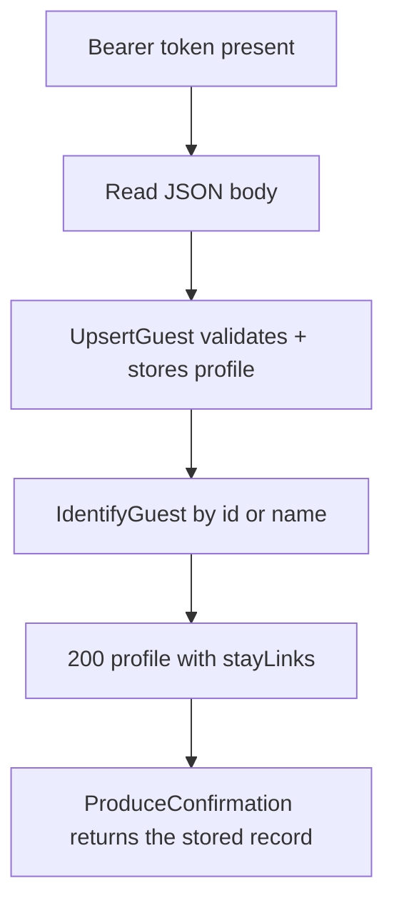
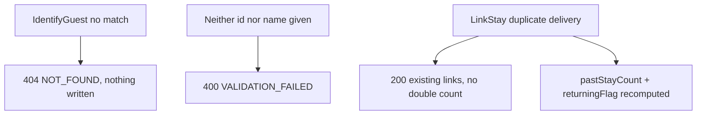

# Guests — as-built design

Status: active. Source page for the guests module (single source of truth; `services/guests/README.md` is a thin stub pointing here). Owned by `architect` (Closes #181).

## 1. Purpose

Guest profiles, preferences and notes, the repeat-guest flag, the confirmation record, and stay-link ingestion from stay events.

Links: `docs/architecture/lld.md` section 5; `docs/requirements/sequence-diagrams.md` sections 2 (creation carries the guest block), 6 (walk-in), 7 (check-in); FR-GST-1..4.

## 2. Pattern and layers as-built

Node.js/TypeScript flat `src/` files over raw `node:http`, wired in `services/guests/src/index.ts` — same shape as Stay and Rooms.

| Layer | Files | Responsibility |
|---|---|---|
| Transport + routing | `src/server.ts` | `createServiceServer` answers `GET /healthz` (:68), enforces Bearer presence (:81), routes `POST /v1/guests/<Operation>` by case label |
| Identity | `src/auth.ts` | `extractBearer`: Bearer presence check, same skeleton contract as Stay |
| Validation + step order | `src/store.ts` (`GuestStore`, `GuestStoreAPI` at :126) | upsert/identify/context reads, idempotent stay-link ingestion |
| Row storage | `src/store.ts` (in-memory), `src/pgstore.ts` (`PostgresGuestStore implements GuestStoreAPI` at :34) | identical semantics; Postgres selected at boot when `DATABASE_URL` is set |
| Errors | `src/errors.ts` | shared `HttpError` envelope (same code set as Stay) |
| Boot | `src/index.ts` | store selection by `DATABASE_URL`, `listen(PORT)` (default `8086`) |

The operation table (`src/server.ts:87-143`): `UpsertGuest` (:87), `IdentifyGuest` (:100), `GetBookingContext` (:114), `GetGuest` (:118), `ProduceConfirmation` (:133). `LinkStay` is a store-level ingestion entry (`src/store.ts:84,244-263`), not a separate route.

## 3. Happy-path flowchart

UpsertGuest + IdentifyGuest + ProduceConfirmation — the profile, the desk lookup, and the confirmation read:



Edge trace (every edge cites code):

- A–B: same transport contract as Stay (`src/server.ts:68-81`).
- C: required fields checked (`requireUuid`/`requireString`, `src/store.ts:48-55`); profile stored and returned (`src/store.ts:198-218`).
- D: lookup by `guestId` first, then exact `fullName` match (`src/store.ts:220-223` via `findGuest` at :286-303).
- E: profile returned with linked stays and the returning flag derived from the link count (`src/store.ts:235-242`).
- F: `ProduceConfirmation` reads the stored record by `reservationRef` (`src/server.ts:133-137` via `src/store.ts:271-280`); unknown refs refuse with `NOT_FOUND`.

## 4. Failure/rollback flowchart

Lookup misses and idempotent link ingestion:



Edge trace:

- F: unknown `guestId` or `fullName` → `NOT_FOUND` (`src/store.ts:286-303`).
- G: neither identifier supplied → `VALIDATION_FAILED` (`:303`).
- H: the stay link row is unique per (guest, stay): a duplicate delivery of the same stay is skipped, the count derives from linked stays, and the `stay-linked` outbox event carries the recomputed count (`src/store.ts:244-263`).

Rollback: none — reads are pure; upserts and link appends are single guarded steps with refusals preceding mutation.

## 5. Outbound dependencies

None at runtime. Consumes `StayEvents` through `linkStay` ingestion (`src/store.ts:84,244-263`; LLD section 5; FR-GST-1). Supplies the guest block the desk carries into Reservations `Create`/`Modify` (including the hotel-mandatory `fullName` the reservations service enforces). `ProduceConfirmation` serves the stored confirmation record for a printed/emailed confirmation (`src/store.ts:265-280`). Hotel values come from `AdminService.GetHotelConfig` with a cached offline-first fallback (LLD section 0).

See also: [deployment](../system-architecture.md) (§1), [C4 containers](../c4-containers.md), and [event flow](../event-flow.md) (this service's outbox emissions).

## 6. Error mapping

Same shared Node envelope as Stay (`src/errors.ts`; `docs/technical/error-handling.md` section 1). Codes observed in `src/store.ts`:

| Code | Status | Raised when |
|---|---|---|
| `VALIDATION_FAILED` | 400 | bad UUID/field, neither identifier given (:48, :55, :303) |
| `UNAUTHENTICATED` | 401 | missing session token (`src/server.ts:81`) |
| `NOT_FOUND` | 404 | unknown guest by id or name, unknown reservation for confirmation (:249, :275, :290, :301) |

## 7. Operations

Run from `services/guests`. Requires Node.js 22+. Build and test:

```sh
npm ci
npm run build
npm test
```

Lint:

```sh
npm run lint
```

Migrate (node-pg-migrate, SQL-first, forward-only in production):

```sh
npm run migrate -- up
```

`DATABASE_URL` must point at the module database (default `postgresql://hotel:change-me@db:5432/hotel` in compose).

Run — production build:

```sh
npm start
```

Local watch (type-checks, runs, and restarts TypeScript directly):

```sh
npm run dev
```

Configuration via environment: `PORT` (default `8086`); hotel values come from `AdminService.GetHotelConfig` with a cached offline-first fallback (see LLD section 0) and land in later slices.

Docker:

```sh
docker build -t hotel-guests .
```

Contract tests: `contract-tests/` holds fixtures per provided/consumed operation once the first slice lands (see `contract-tests/README.md`). Run the repo gate from the repo root before opening a PR:

```sh
script/contract-check.sh
```

<!-- ao-role: architect -->
Role: architect · AO session hotel-mgmt-249
