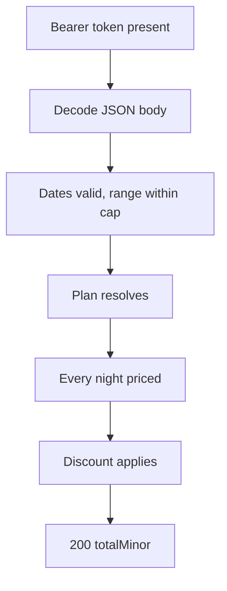
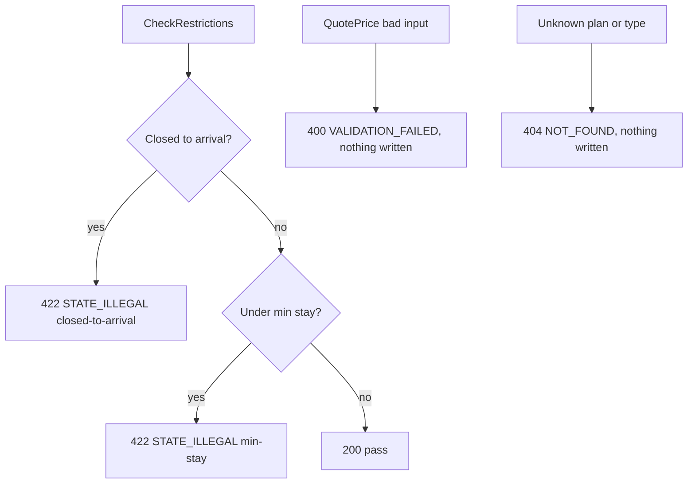

# Rates — as-built design

Status: active. Source page for the rates & availability module (single source of truth; `services/rates/README.md` is a thin stub pointing here). Owned by `architect` (Closes #181).

## 1. Purpose

Rate plans, per-night prices, availability counts, discounts, and stay restrictions; the price basis behind every reservation quote.

Links: `docs/architecture/lld.md` [section 4](../lld.md); `docs/requirements/sequence-diagrams.md` [section 1](../../requirements/sequence-diagrams.md) (availability search) and section 2 (reservation creation, via `QuotePrice`); business rules BR-9, BR-10, BR-13..BR-15.

## 2. Pattern and layers as-built

Go `handler / store` with no service layer — reads and guarded writes go straight from routes to the store, wired in `services/rates/cmd/server/main.go`.

| Layer | Files | Responsibility |
|---|---|---|
| Transport + auth + body decoding | `internal/handler/handler.go` | `NewMux(st)` routes `POST /v1/rates/<Operation>`; the `authed(operation, …)` wrapper enforces Bearer presence per operation (:97-116) |
| Guarded state + storage | `internal/store/store.go` (`Repository`, `Store`), `internal/store/postgres.go` | plan/price/restriction/discount writes, quote math, restriction and sellable-count checks |
| Health | `internal/health/` | `GET /healthz` with the module identity (`cmd/server/main.go:36`) |
| Boot | `cmd/server/main.go` | selects Postgres storage when `DATABASE_URL` is set (:26), mounts health + pricing routes (:36-37) |

The routing table (`internal/handler/handler.go`): `UpsertRatePlan` (:118), `UpsertRatePrice` (:140), `UpsertRestriction` (:169), `UpsertDiscount` (:204), `QuotePrice` (:228), `CheckSellableCount` (:259), `CheckRestrictions` (:297). The operation name is threaded into `authed` for future per-operation policy (`:115`).

## 3. Happy-path flowchart

QuotePrice (`POST /v1/rates/QuotePrice`) — the price basis:



Edge trace (every edge cites code):

- A–B: Bearer presence + JSON decode, same contract as reservations (`internal/handler/handler.go:97-116`).
- C: arrival/departure must be `YYYY-MM-DD` with departure after arrival; ranges over 730 nights are refused (`internal/store/store.go:254`).
- D: plan resolution falls back through the plan chain; an unknown plan/type combination → `NOT_FOUND` (:241-293, :377-408).
- E: each night in the range must carry a price for the type or the quote fails (`:268`).
- F: named discount must exist (:273-276); percent discounts cap at 100 (:224-225).
- G: summed `totalMinor` returned for the desk to carry as the reservation `priceBasis`.

## 4. Failure/rollback flowchart

Restriction and count guards — the stay-refusal side:



Edge trace:

- CA: closed-to-arrival overlap → `STATE_ILLEGAL` with the restriction window in details (`internal/store/store.go:318`).
- MS: minimum-stay violation → `STATE_ILLEGAL` with the required nights (`:320`).
- Q: bad dates, negative `priceMinor` (:179-181), bad restriction range (:206), bad discount kind/value (:218-225) → `VALIDATION_FAILED` 400.
- U: unknown plan (:189), unknown room type (:362), missing inventory input (:365) → `NOT_FOUND` 404 / `VALIDATION_FAILED` 400 respectively.

Rollback: none — quotes and checks are pure reads; upserts are single guarded writes.

## 5. Outbound dependencies

None at runtime. Consumed by the desk loop (availability search, `QuotePrice` totals carried into Reservations `Create`/`Modify` as `priceBasis`) and by the Reservations stay-restriction check wired at boot (issue #361). Hotel values come from `AdminService.GetHotelConfig` with a cached offline-first fallback (LLD [section 0](../lld.md)).

See also: [deployment](../system-architecture.md) (section 1), [C4 containers](../c4-containers.md), and [event flow](../event-flow.md) (this service's outbox emissions).

## 6. Error mapping

Envelope `{code, message, details, traceId}` (same shape as reservations) to `docs/technical/error-handling.md` [section 1](../../technical/error-handling.md). Constructors (`internal/store/store.go:29-37`):

| Code | Status | Raised when |
|---|---|---|
| `VALIDATION_FAILED` | 400 | bad dates, ranges, prices, discount kind/value (:50-56, :179-181, :206, :218-225, :254) |
| `UNAUTHENTICATED` | 401 | missing session token (`internal/handler/handler.go:99-109`) |
| `NOT_FOUND` | 404 | unknown plan, unpriced night, unknown room type (:189, :268, :362) |
| `STATE_ILLEGAL` | 422 | closed-to-arrival, min-stay violation (:37, :318, :320) |

## 7. Operations

Run from `services/rates`. Build and test:

```sh
go build ./...
go test ./...
```

Vet and format (`gofmt -l .` must print nothing):

```sh
go vet ./...
gofmt -l .
```

Migrate (golang-migrate, forward-only in production; `down` files are local-dev only):

```sh
migrate -path migrations -database "$DATABASE_URL" up
```

Run:

```sh
go run ./cmd/server
```

Configuration via environment: `PORT` (default `8082`); hotel values come from `AdminService.GetHotelConfig` with a cached offline-first fallback (see LLD [section 0](../lld.md)) and land in later slices.

Docker:

```sh
docker build -t hotel-rates .
```

Contract tests: `contract-tests/` holds fixtures per provided/consumed operation once the first slice lands (see `contract-tests/README.md`). Run the repo gate from the repo root before opening a PR:

```sh
script/contract-check.sh
```

<!-- ao-role: architect -->
Role: architect · AO session hotel-mgmt-249
