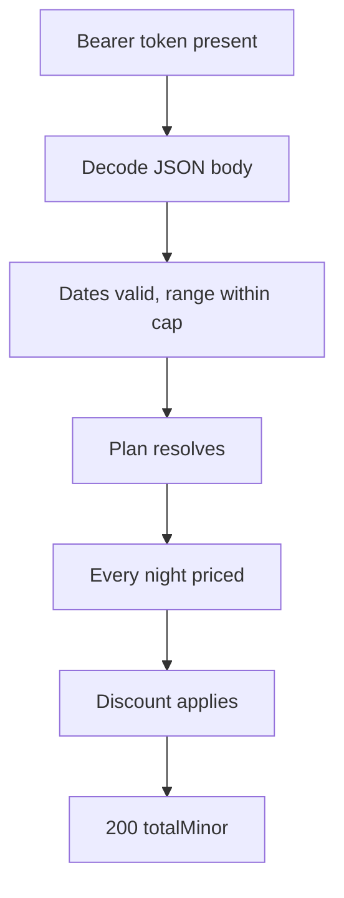
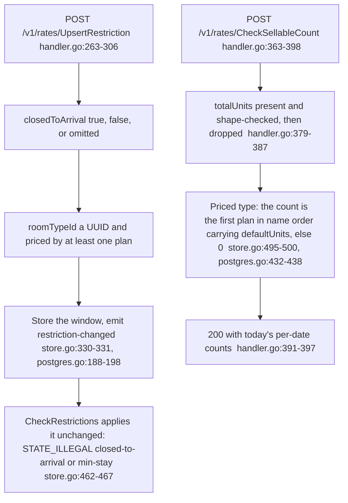
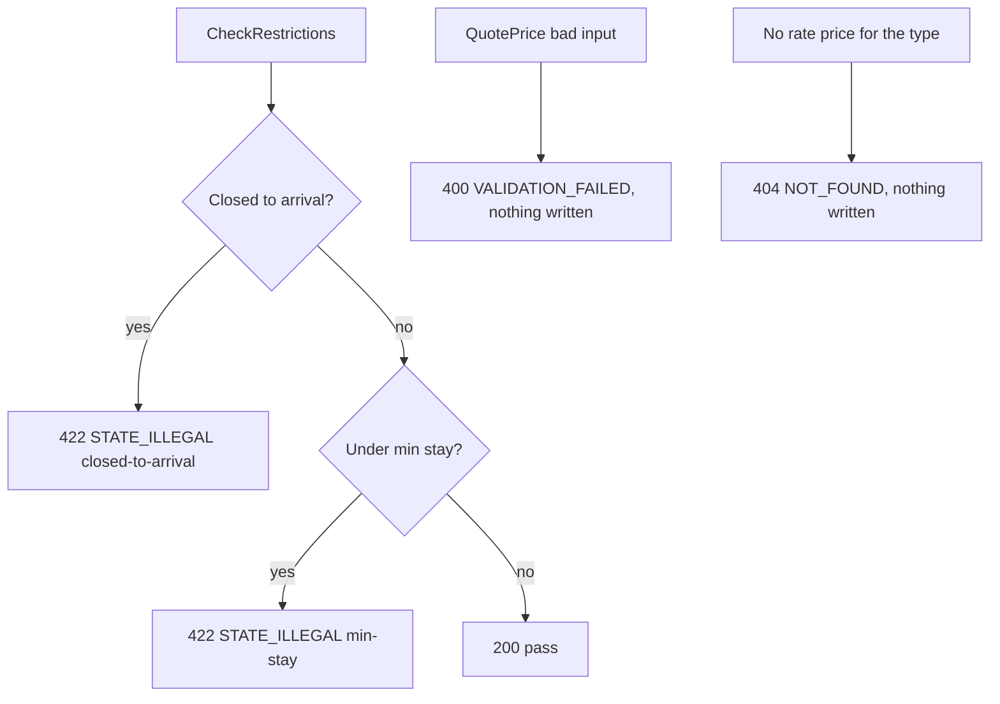
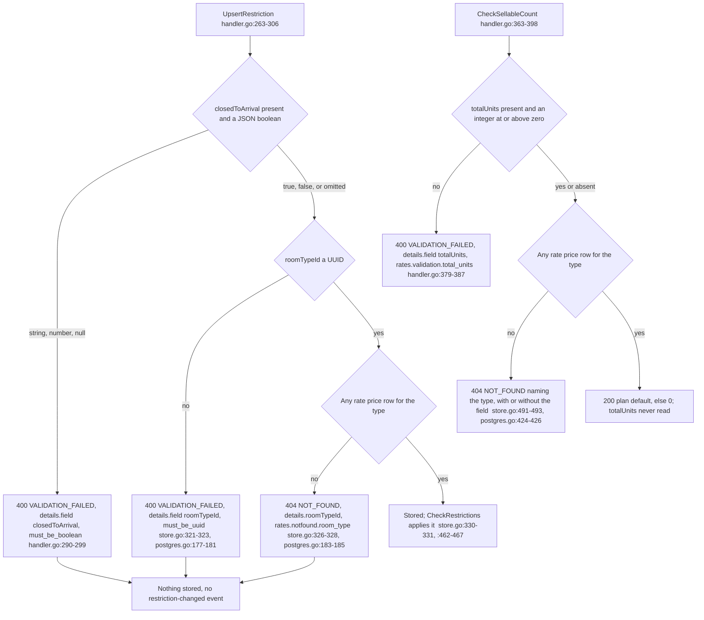
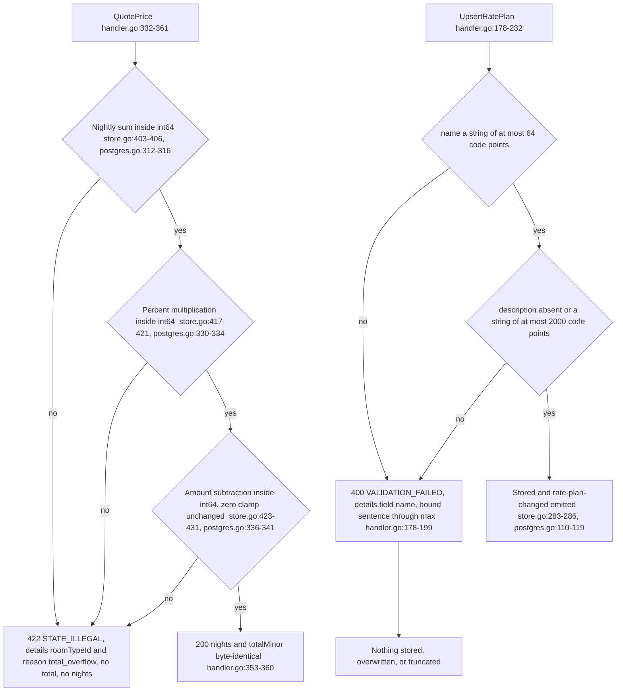
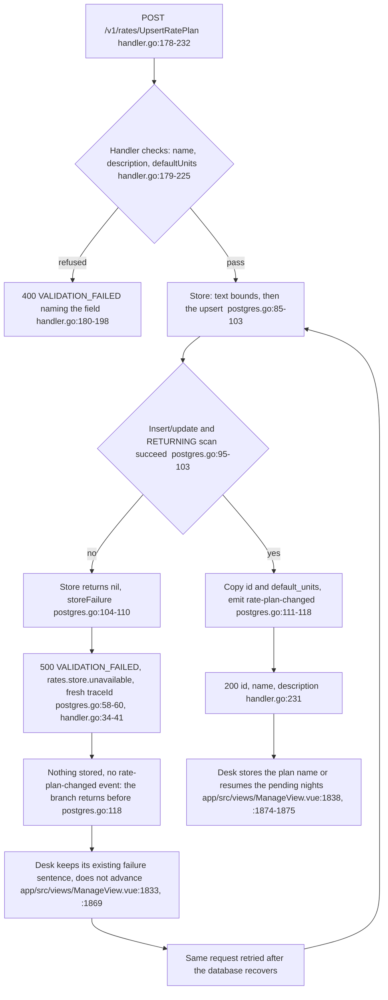

# Rates — as-built design

Status: active. Source page for the rates & availability module (single source of truth; `services/rates/README.md` is a thin stub pointing here). Owned by `architect` (Closes #181).

## 1. Purpose

Rate plans, per-night prices, availability counts, discounts, and stay restrictions; the price basis behind every reservation quote.

Links: `docs/architecture/lld.md` [section 4](../lld.md); `docs/requirements/sequence-diagrams.md` [section 1](../../requirements/sequence-diagrams.md) (availability search) and section 2 (reservation creation, via `QuotePrice`); business rules BR-9, BR-10, BR-13..BR-15.

## 2. Pattern and layers as-built

Go `handler / store` with no service layer — reads and guarded writes go straight from routes to the store, wired in `services/rates/cmd/server/main.go`.

| Layer | Files | Responsibility |
|---|---|---|
| Transport + auth + body decoding | `internal/handler/handler.go` | `NewMux(st)` routes `POST /v1/rates/<Operation>`; the `authed(operation, …)` wrapper enforces Bearer presence per operation (:157-176) |
| Guarded state + storage | `internal/store/store.go` (`Repository`, `Store`), `internal/store/postgres.go` | plan/price/restriction/discount writes, quote math, restriction and sellable-count checks |
| Health | `internal/health/` | `GET /healthz` with the module identity (`cmd/server/main.go:38`) |
| Boot | `cmd/server/main.go` | selects Postgres storage when `DATABASE_URL` is set (:28), mounts health + pricing routes (:38-39) |

The routing table (`internal/handler/handler.go`): `UpsertRatePlan` (:178), `UpsertRatePrice` (:234), `UpsertRestriction` (:263), `UpsertDiscount` (:308), `QuotePrice` (:332), `CheckSellableCount` (:363), `CheckRestrictions` (:400). The operation name is threaded into `authed` for future per-operation policy (`:157-173`).

## 3. Happy-path flowchart

QuotePrice (`POST /v1/rates/QuotePrice`) — the price basis:



Edge trace (every edge cites code):

- A–B: Bearer presence + JSON decode, same contract as reservations (`internal/handler/handler.go:157-176`).
- C: arrival/departure must be `YYYY-MM-DD` with departure after arrival; ranges over 730 nights are refused (`internal/store/store.go:384`).
- D: plan resolution falls back through the plan chain; an unknown named plan → `NOT_FOUND` (:512), and when no plan prices the type the reply carries `details.reason = "no_rate_plan"` (:528).
- E: each night in the range must carry a price for the type or the quote fails with `details.reason = "no_rate_price"` and the missing `nightDate` (`:401`).
- F: named discount must exist (:410-414); percent discounts cap at 100 (:354-355).
- G: summed `totalMinor` returned for the desk to carry as the reservation `priceBasis`.

The two `details.reason` values are the desk's machine-readable basis for the #589 not-operational marking: a room type with no rate price for the selected dates is refused and shown as not open for booking (never silently sold).

### Restriction write and availability read — the accepted answers (Refs #633)

`UpsertRestriction` with a well-formed boolean and a priced type, and
`CheckSellableCount` for a priced type — the two writes and reads this
change constrains, on their accepted path:



Edge trace (as-built pins, refreshed with the implementation per
maintain-with-code, LLD
[section 37](../lld.md#37-rates-refuses-malformed-restriction-and-availability-input-refs-633)):

- A–B: the boolean is read at the field's own position
  (`services/rates/internal/handler/handler.go:290-299`), so a valid `true`
  still means "closed to arrival" and a valid `false` still means open;
  an omitted key keeps the contract default `false`.
- B–C: the shape and priced-type checks run in the store, after the
  existing date and range refusals (`services/rates/internal/store/store.go:312-320`;
  `internal/store/postgres.go:160-168`) and before the append or insert.
  "Priced" is a rate-price row for the type (`store.go:337-344` helper,
  reused; `postgres.go:177` query, reused), never a plan `defaultUnits`.
- C–D–E: an accepted window is stored and applied exactly as today
  (`store.go:330-331`, `:462-467`; `postgres.go:188-198`, `:379-395`).
- F–G: the handler keeps its `totalUnits` shape check
  (`handler.go:379-387`) and does not pass the value on, so the count can
  only come from the store.
- G–H–I: the plan scan that answers today's absent-field read
  (`store.go:495-500`; `postgres.go:432-438`) becomes the only path; the
  response shape and the per-date list do not move
  (`handler.go:391-397`). The booking ceiling #631 derives is untouched
  (section 9, ADR-0006 D2).

### Plan write — the accepted answers (Refs #767)

`UpsertRatePlan` after the #633 text checks, on a healthy database: one
upsert keyed by plan name, the stored row's `id` and `default_units`
copied back onto the answer, one `rate-plan-changed` outbox row, and a
`200` with the stored `id`, `name`, and `description`
(`services/rates/internal/store/postgres.go:95-118`;
`internal/handler/handler.go:226-231`). A create and an update answer
exactly as today — the update keeps the stored `default_units` when the
request omits the field (`postgres.go:96-101`) — and the in-memory
store's create/update answers are untouched. The driver-failure and
retry side of the same flow is the section 4 diagram below.

## 4. Failure/rollback flowchart

Restriction and count guards — the stay-refusal side:



Edge trace:

- CA: closed-to-arrival overlap → `STATE_ILLEGAL` with the restriction window in details (`internal/store/store.go:462-464`).
- MS: minimum-stay violation → `STATE_ILLEGAL` with the required nights (`:465-467`).
- Q: bad dates, negative `priceMinor` (:291-293), bad restriction range (:318-320), bad discount kind/value (:348-356) → `VALIDATION_FAILED` 400.
- U: unknown plan (:512), unknown room type (:492) → `NOT_FOUND` 404. A quote with no rate price refuses `NOT_FOUND` with `details.reason` = `no_rate_plan` (:528, no plan prices the type) or `no_rate_price` (:401, a night has no price row), so the desk marks the type not operational instead of selling an unpriced stay (Refs #589).

Rollback: none — quotes and checks are pure reads; upserts are single guarded writes.

### Restriction and availability refusals — malformed flag, malformed id, unpriced type, unknown type (Refs #633)

The four inputs this change stops coercing or trusting, and the one
answer each gets:



Edge trace:

- B–R1: the coercion at `handler.go:290` is replaced in place by a
  two-value present test plus a type test, so `"true"`, `1`, `"yes"`, and
  `null` each answer one envelope naming `closedToArrival` instead of
  storing `false`; the stored set is unchanged, so a following
  `CheckRestrictions` for those dates still allows
  (`store.go:462-467`).
- C–R2: the in-memory store gains the shape refusal the Postgres store
  already produces from the driver's `22P02` mapping
  (`postgres.go:177-181`), so the two stores stop disagreeing.
- D–R3: a UUID no price row mentions is refused `NOT_FOUND` with the
  existing `rates.notfound.room_type` sentence, so no window can exist
  that matches nothing (audit finding T3).
- G–R4: the existing shape check and sentence are unchanged
  (`handler.go:379-387`; `rates.validation.total_units`).
- H–R5: the unknown-type answer collapses to `NOT_FOUND` for both ways of
  sending the field, replacing today's field-presence split
  (`store.go:491-493`; `postgres.go:424-426`).

### Quote overflow and the plan text bounds (Refs #633)

The money path and the two plan fields:



Edge trace:

- A–B/C/D–R1: the three arithmetic steps share one checked helper set in
  the package, so the two quote bodies cannot drift (`store.go:403-431`;
  `postgres.go:312-341`). The sum and the percent multiplication are
  reachable overflows; the subtraction guard is defensive because both
  operands are non-negative. The refusal is returned before the quote
  value leaves the method, so no wrapped or partial total is served and
  #632 can never freeze one as a price basis.
- D–E: every non-overflowing quote stays byte-identical, including the
  truncated integer percent result and the clamp at zero.
- F–G–R2: the two plan fields are type- and length-checked where they are
  read (`handler.go:178-199`) and re-checked inside both stores with the
  same code constants, which is why `UpsertRatePlan` gains an error
  return; a refused write stores, overwrites, and truncates nothing. The
  bounds are write-time code rules: no migration, no read-time
  re-validation, and no schema keyword.

Section 6 carries the as-built error-mapping rows the implementation
added: `NOT_FOUND` for `UpsertRestriction` (an unpriced room type) and
`STATE_ILLEGAL` for `QuotePrice` with `details.reason` `total_overflow`
beside the existing `no_rate_price` / `no_rate_plan` values.

Rollback for these subsections: every refusal is decided before any write,
so a refused restriction, plan, or quote leaves no row, no event, and no
served total. The whole delta reverts with the single implementation PR —
the boolean check, the two store checks, the inert `totalUnits`, the
overflow helpers, the two bounds, the catalogue sentences, and the guards
disappear together, with no migration, backfill, or data repair in either
direction; a restriction already stored with a coerced `false` and a
price already stored above the guard's range stay exactly as stored
(R-23).

### Plan-write driver failure and retry (Refs #767)

One flow, three outcomes: the healthy write, the driver failure, and the
same request retried after the database recovers.



Edge trace (as-built pins, refreshed with the implementation per
maintain-with-code, LLD
[section 40](../lld.md#40-a-failed-rates-rate-plan-write-is-refused-never-reported-as-success-refs-767)):

- A–B–V: every handler refusal that exists keeps its place
  (`handler.go:179-225`), so the store-failure answer applies only after
  a request has passed the field checks.
- B–C–D: the store re-checks the two plan-text bounds and then runs the
  single upsert (`postgres.go:85-103`); there is no explicit
  transaction, so the statement is its own.
- D–R1–R2: the only edit. `storeFailure()` is the answer the sibling
  writes already give (`postgres.go:135`, `:150`), and the handler
  writes it with a fresh `traceId` (`handler.go:34-41`, `:227-230`)
  instead of falling through to the `200` at `:231`.
- R2–N–E1: the failure branch returns before `p.outbox`
  (`postgres.go:111-118`), so no plan row and no `rate-plan-changed` row
  exist for the request; the desk's catch block renders its existing
  sentence and returns before `writeStoredPlan`/`readPrices`
  (`app/src/views/ManageView.vue:1828-1839`) or keeps `planMissing` set
  (`:1864-1875`).
- D–S–OK–E2: the success path is byte-identical — returned row copied
  (`postgres.go:111-117`), one event (`:118`), the same `200` body
  (`handler.go:231`).
- E1–RT–C: the retry is the ordinary upsert on the plan name
  (`postgres.go:96-101`, `000002_schema.up.sql:19`), so it creates on the
  first success and updates afterwards, with no replay of the failed
  attempt.

Failure/rollback path: a refused plan write leaves the stored plan set,
its prices, and its events exactly as they were, because the branch
returns before the outbox write and before the success response — no
phantom plan can be read, priced, or quoted, and the desk stops on its
existing failure sentence instead of advancing to price writes that
cannot succeed. The whole change reverts with the single implementation
PR, with no migration, backfill, or data repair in either direction.

## 5. Outbound dependencies

None at runtime. Consumed by the desk loop (availability search, `QuotePrice` totals carried into Reservations `Create`/`Modify` as `priceBasis`) and by the Reservations stay-restriction check wired at boot (issue #361). Hotel values come from `AdminService.GetHotelConfig` with a cached offline-first fallback (LLD [section 0](../lld.md)).

See also: [deployment](../system-architecture.md) (section 1), [C4 containers](../c4-containers.md), and [event flow](../event-flow.md) (this service's outbox emissions).

## 6. Error mapping

Envelope `{code, message, details, traceId}` (same shape as reservations) to `docs/technical/error-handling.md` [section 1](../../technical/error-handling.md). Constructors (`internal/store/store.go:31-41`):

| Code | Status | Raised when |
|---|---|---|
| `VALIDATION_FAILED` | 400 | bad dates, ranges, prices, discount kind/value, plan text, and `roomTypeId` shape (:31-33, :92-97, :156-162, :291-293, :318-323, :348-356, :384-386), plus the handler-side `closedToArrival` / `totalUnits` type checks (`internal/handler/handler.go:290-299`, `:379-387`) |
| `VALIDATION_FAILED` | 500 | the store could not perform a write — `storeFailure()` (`internal/store/postgres.go:58-60`) answers the plain `rates.store.unavailable` sentence with empty `details`; used by `UpsertRatePrice` (`:135`, `:150`), `UpsertRestriction` (`:181`, `:196`), `UpsertDiscount` (`:222`), `Quote` (`:286`, `:309`, `:325`), `CheckRestrictions` (`:374`, `:382`, `:395`), `CheckSellableCount` (`:422`, `:430`), and since #767 by `UpsertRatePlan` (`:104-110`); aligning the token with `INTERNAL_ERROR` (`BR-59`) is the separate Rates-wide change recorded in R-26 |
| `UNAUTHENTICATED` | 401 | missing session token (`internal/handler/handler.go:160-166`) |
| `NOT_FOUND` | 404 | unknown plan, unpriced night, unknown room type, a restriction for an unpriced room type (:512, :401, :492, :326-328; `postgres.go:183-185`); quote refusals carry `details.reason` `no_rate_plan` / `no_rate_price` (Refs #589) |
| `STATE_ILLEGAL` | 422 | closed-to-arrival, min-stay violation (:39-41, :462-464, :465-467); a quote total outside `int64` (`details.reason` `total_overflow`, :103-109, :403-431; `postgres.go:312-341`) |

## 7. Operations

Run from `services/rates`. Build and test:

```sh
go build ./...
go test ./...
```

Vet and format (`gofmt -l .` must print nothing):

```sh
go vet ./...
gofmt -l .
```

Migrate (golang-migrate, forward-only in production; `down` files are local-dev only):

```sh
migrate -path migrations -database "$DATABASE_URL" up
```

Run:

```sh
go run ./cmd/server
```

Configuration via environment: `PORT` (default `8082`); hotel values come from `AdminService.GetHotelConfig` with a cached offline-first fallback (see LLD [section 0](../lld.md)) and land in later slices.

Docker:

```sh
docker build -t hotel-rates .
```

Contract tests: `contract-tests/` holds fixtures per provided/consumed operation once the first slice lands (see `contract-tests/README.md`). Run the repo gate from the repo root before opening a PR:

```sh
script/contract-check.sh
```

Ingress bounds (Refs #630): `internal/handler` caps a request body at
65 536 bytes (`maxBodyBytes`) through `http.MaxBytesReader` and refuses an
oversized body with the shared envelope (`VALIDATION_FAILED`, `details`
naming `body`) before parsing; `cmd/server/main.go` runs an `http.Server`
with `ReadHeaderTimeout` 5 s, `ReadTimeout` 10 s, `WriteTimeout` 15 s, and
`IdleTimeout` 60 s. No environment variable overrides either value.
Details: LLD
[section 29](../lld.md#29-bounded-request-bodies-and-finite-server-timeouts-refs-630).

<!-- ao-role: architect -->
Role: architect · AO session hotel-mgmt-249

<!-- ao-role: architect -->
Role: architect · AO session hotel-mgmt-1288
