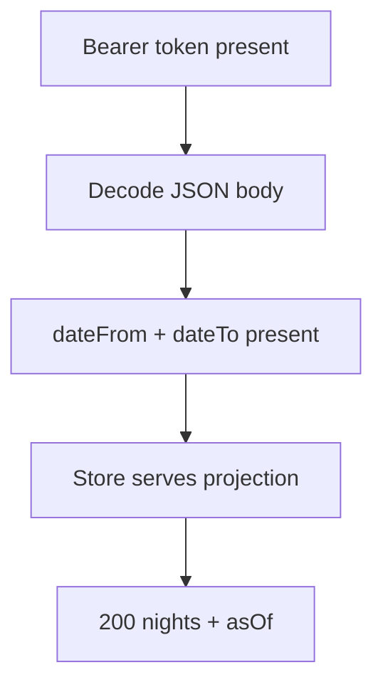
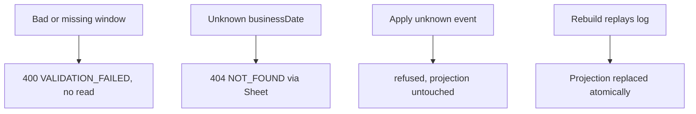

# Reporting — as-built design

Status: active. Source page for the reporting module (single source of truth; `services/reporting/README.md` is a thin stub pointing here). Owned by `architect` (Closes #181).

## 1. Purpose

Occupancy, revenue, and daily-sheet reads over its own rebuilt read model; the housekeeping report (FR-RPT-4) lands with the housekeeping loop.

Links: `docs/architecture/lld.md` section 7; `docs/requirements/sequence-diagrams.md` section 9 (check-out feeds revenue) and section 12 (housekeeping loop, future); FR-RPT-1..3.

## 2. Pattern and layers as-built

Go `handler / service / store`, where the service is a thin validation-and-delegate step and the store owns the event-sourced projections, wired in `services/reporting/cmd/server/main.go`.

| Layer | Files | Responsibility |
|---|---|---|
| Transport + auth + body decoding | `internal/handler/handler.go` | `NewMux(svc)` routes `POST /v1/reporting/<Operation>`; Bearer presence check; date-window required-field checks before delegating |
| Read step order | `internal/service/service.go` | validates nothing itself beyond delegating: `OccupancyReport` (:31), `RevenueSummary` (:37), `DailySheet` (:43) straight to the store; never reads other modules' stores |
| Projections + storage | `internal/store/store.go` (`Store`), `internal/store/postgres.go` | `Apply` ingests one domain event (:172), `Rebuild` replays the log (:198), `project` routes by event type (:217); `Occupancy` (:383), `Revenue` (:438), `Sheet` (:465) serve reads with an as-of timestamp |
| Health | `internal/health/` | `GET /healthz` with the module identity (`cmd/server/main.go:28`) |
| Boot | `cmd/server/main.go` | store wiring exposed for the rebuild job (`service.Store()`), mounts health + read routes (:28-29) |

The routing table (`internal/handler/handler.go`): `OccupancyReport` (:96), `RevenueSummary` (:122), `DailySheet` (:148). Every report carries `asOf` so staleness is visible.

## 3. Happy-path flowchart

OccupancyReport (`POST /v1/reporting/OccupancyReport`):



Edge trace (every edge cites code):

- A–B: Bearer presence + JSON decode (`internal/handler/handler.go:74-95`).
- C: `dateFrom`/`dateTo` required (:96-114); the store validates the window shape (`internal/store/store.go:383`).
- D: per-night, per-type occupied/available counts served from the rebuilt projection — the service never touches another module's rows (`internal/service/service.go:1-11,31-35`).
- E: `nights` plus the read-model `asOf` timestamp returned so freshness is explicit (`internal/handler/handler.go:106-121`).

## 4. Failure/rollback flowchart

Bad windows and event application — the rebuild side:



Edge trace:

- W: missing `dateFrom`/`dateTo`/`businessDate` → `VALIDATION_FAILED` before any store call (`internal/handler/handler.go:96-170`); malformed windows refused in `Occupancy`/`Revenue` (`internal/store/store.go:383-464`).
- V: `Sheet` on an unknown business date surfaces `NOT_FOUND` (`internal/store/store.go:465`).
- J–K: `Apply` ingests one event at a time and `project` routes known types only — `reservation.created` (:223), `reservation.cancelled`/`no-show` (:247), `stay.checked-in` (:255), `stay.checked-out` (:279), `rate.availability-set` (:300), `folio.charge-posted` (:314), `folio.payment-recorded` (:342), `config.changed` (:352); `Rebuild` replays the whole log to replace the projection (:198-216).

Rollback: none needed — reads never mutate, and rebuild replaces rather than patches the projection.

## 5. Outbound dependencies

None — by design the service never reads other modules' stores (`internal/service/service.go:1-11`). Its only input is the domain-event log via `Apply`/`Rebuild`. Hotel values come from `AdminService.GetHotelConfig` with a cached offline-first fallback (LLD section 0).

## 6. Error mapping

Envelope `{code, message, details, traceId}` (same shape as reservations) to `docs/technical/error-handling.md` section 1. Constructor (`internal/store/store.go:28`):

| Code | Status | Raised when |
|---|---|---|
| `VALIDATION_FAILED` | 400 | missing/malformed date window or business date (`internal/handler/handler.go:96-170`; `internal/store/store.go:383-464`) |
| `UNAUTHENTICATED` | 401 | missing session token (`internal/handler/handler.go:78-88`) |
| `NOT_FOUND` | 404 | unknown business date for the daily sheet (`internal/store/store.go:465`) |

## 7. Operations

Run from `services/reporting`. Build and test:

```sh
go build ./...
go test ./...
```

Vet and format (`gofmt -l .` must print nothing):

```sh
go vet ./...
gofmt -l .
```

Migrate (golang-migrate, forward-only in production; `down` files are local-dev only):

```sh
migrate -path migrations -database "$DATABASE_URL" up
```

Run:

```sh
go run ./cmd/server
```

Configuration via environment: `PORT` (default `8083`); hotel values come from `AdminService.GetHotelConfig` with a cached offline-first fallback (see LLD section 0) and land in later slices.

Docker:

```sh
docker build -t hotel-reporting .
```

Contract tests: `contract-tests/` holds fixtures per provided/consumed operation once the first slice lands (see `contract-tests/README.md`). Run the repo gate from the repo root before opening a PR:

```sh
script/contract-check.sh
```

<!-- ao-role: architect -->
Role: architect · AO session hotel-mgmt-249
