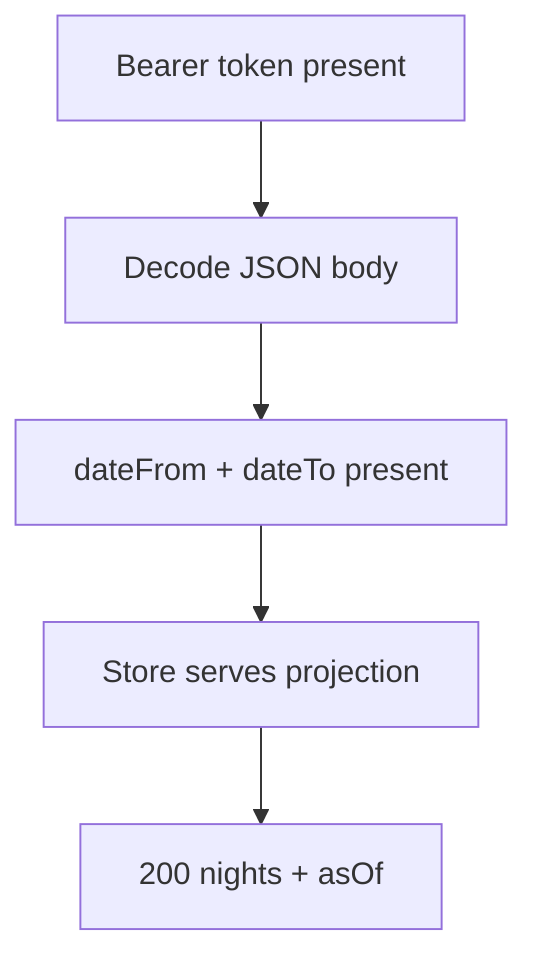
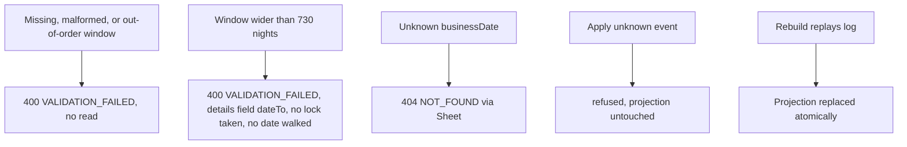

# Reporting — as-built design

Status: active. Source page for the reporting module (single source of truth; `services/reporting/README.md` is a thin stub pointing here). Owned by `architect` (Closes #181).

## 1. Purpose

Occupancy, revenue, daily-sheet, and housekeeping reads over its own rebuilt read model (FR-RPT-1..4).

Links: `docs/architecture/lld.md` [section 7](../lld.md); `docs/requirements/sequence-diagrams.md` [section 9](../../requirements/sequence-diagrams.md) (check-out feeds revenue) and section 12 (housekeeping loop, future); FR-RPT-1..3.

## 2. Pattern and layers as-built

Go `handler / service / store`, where the service is a thin validation-and-delegate step and the store owns the event-sourced projections, wired in `services/reporting/cmd/server/main.go`.

| Layer | Files | Responsibility |
|---|---|---|
| Transport + auth + body decoding | `internal/handler/handler.go` | `NewMux(svc)` routes `POST /v1/reporting/<Operation>`; Bearer presence check; date-window required-field checks before delegating |
| Read step order | `internal/service/service.go` | validates nothing itself beyond delegating: `OccupancyReport` (:31), `RevenueSummary` (:37), `DailySheet` (:43), `HousekeepingReport` (:49) straight to the store; never reads other modules' stores |
| Projections + storage | `internal/store/store.go` (`Store`), `internal/store/postgres.go` | `Apply` ingests one domain event (:191), `Rebuild` replays the log (:217), `project` routes by event type (:237); `Occupancy` (:460), `Revenue` (:515), `Sheet` (:542), `Housekeeping` (:618) serve reads with an as-of timestamp |
| Health | `internal/health/` | `GET /healthz` with the module identity (`cmd/server/main.go:30`) |
| Boot | `cmd/server/main.go` | store wiring exposed for the rebuild job (`service.Store()`), mounts health + read routes (:28-32) |

The routing table (`internal/handler/handler.go`): `OccupancyReport` (:136), `RevenueSummary` (:162), `DailySheet` (:188), `HousekeepingReport` (:218). Every report carries `asOf` so staleness is visible.

## 3. Happy-path flowchart

OccupancyReport (`POST /v1/reporting/OccupancyReport`):



Edge trace (every edge cites code):

- A–B: Bearer presence + JSON decode (`internal/handler/handler.go:114-133`).
- C: `dateFrom`/`dateTo` required (:136-139); the store validates the window shape (`internal/store/store.go:460`).
- D: per-night, per-type occupied/available counts served from the rebuilt projection — the service never touches another module's rows (`internal/service/service.go:31-35`).
- E: `nights` plus the read-model `asOf` timestamp returned so freshness is explicit (`internal/handler/handler.go:147-160`).

## 4. Failure/rollback flowchart

Bad windows and event application — the rebuild side:



Edge trace:

- W: missing `dateFrom`/`dateTo`/`businessDate` → `VALIDATION_FAILED` before any store call (`internal/handler/handler.go:136-229`); malformed windows refused in `Occupancy`/`Revenue`/`Sheet`/`Housekeeping` (`internal/store/store.go:460-618`).
- C (from #641, planned — refreshed to the as-built `file:line` by the implementation PR per maintain-with-code): a window whose `dateTo` is more than 730 nights after `dateFrom` is refused in `parseRange` (`internal/store/store.go:440-453`) before `Occupancy` takes the lock (`:465`) and before either loop runs (`:480`, `:523`), so the refused read holds no mutex and walks no date; details: [section 8](#8-delta--report-date-ranges-carry-a-declared-span-cap-refs-641) and `docs/architecture/lld.md` [section 31](../lld.md#31-reporting-date-ranges-carry-a-declared-span-cap-refs-641).
- V: `Sheet` on an unknown business date surfaces `NOT_FOUND` (`internal/store/store.go:542`).
- J–K: `Apply` ingests one event at a time and `project` routes known types only — `reservation.created` (:243), `reservation.cancelled`/`no-show` (:267), `stay.checked-in` (:275), `stay.checked-out` (:299), `rate.availability-set` (:331), `folio.charge-posted` (:345), `folio.payment-recorded` (:373), `config.changed` (:383); `Rebuild` replays the whole log to replace the projection (:217-235).

Rollback: none needed — reads never mutate, and rebuild replaces rather than patches the projection.

## 5. Outbound dependencies

None — by design the service never reads other modules' stores (`internal/service/service.go:13-51`). Its only input is the domain-event log via `Apply`/`Rebuild`. Hotel values come from `AdminService.GetHotelConfig` with a cached offline-first fallback (LLD [section 0](../lld.md)).

See also: [deployment](../system-architecture.md) (section 1), [C4 containers](../c4-containers.md), and [event flow](../event-flow.md) (this service's event consumption and rebuild).

## 6. Error mapping

Envelope `{code, message, details, traceId}` (same shape as reservations) to `docs/technical/error-handling.md` [section 1](../../technical/error-handling.md). Constructor (`internal/store/store.go:28`):

| Code | Status | Raised when |
|---|---|---|
| `VALIDATION_FAILED` | 400 | missing/malformed date window or business date (`internal/handler/handler.go:136-229`; `internal/store/store.go:460-618`); from #641 a window wider than 730 nights, naming `dateTo` (`internal/store/store.go:440-453`, section 8) |
| `UNAUTHENTICATED` | 401 | missing session token (`internal/handler/handler.go:118-128`) |
| `NOT_FOUND` | 404 | unknown business date for the daily sheet (`internal/store/store.go:542`) |

## 7. Operations

Run from `services/reporting`. Build and test:

```sh
go build ./...
go test ./...
```

Vet and format (`gofmt -l .` must print nothing):

```sh
go vet ./...
gofmt -l .
```

Migrate (golang-migrate, forward-only in production; `down` files are local-dev only):

```sh
migrate -path migrations -database "$DATABASE_URL" up
```

Run:

```sh
go run ./cmd/server
```

Configuration via environment: `PORT` (default `8083`); hotel values come from `AdminService.GetHotelConfig` with a cached offline-first fallback (see LLD [section 0](../lld.md)) and land in later slices.

Docker:

```sh
docker build -t hotel-reporting .
```

Contract tests: `contract-tests/` holds fixtures per provided/consumed operation once the first slice lands (see `contract-tests/README.md`). Run the repo gate from the repo root before opening a PR:

```sh
script/contract-check.sh
```

Ingress bounds (Refs #630): `internal/handler` caps a request body at
65 536 bytes (`maxBodyBytes`) through `http.MaxBytesReader` and refuses an
oversized body with the shared envelope (`VALIDATION_FAILED`, `details`
naming `body`) before parsing; `cmd/server/main.go` runs an `http.Server`
with `ReadHeaderTimeout` 5 s, `ReadTimeout` 10 s, `WriteTimeout` 15 s, and
`IdleTimeout` 60 s. No environment variable overrides either value.
Details: LLD
[section 29](../lld.md#29-bounded-request-bodies-and-finite-server-timeouts-refs-630).

<!-- ao-role: architect -->
Role: architect · AO session hotel-mgmt-249

## 8. Delta — report date ranges carry a declared span cap (Refs #641)

Before this change `parseRange` checked a window's shape and order only:
both ends parsed, a malformed one refused naming the field, and
`dateTo` before `dateFrom` refused naming `dateTo`
(`internal/store/store.go:440-453`). Nothing compared the distance
between the ends, and both range reads then walk every date in the
window inclusively under the store mutex — `Occupancy` locks at `:465`
and loops at `:480`, `Revenue` locks at `:520` and loops at `:523` — so
a `0001-01-01`..`9999-12-31` window runs millions of iterations holding
a lock every other report read needs.

As specified by #641 (the implementation PR lands the guard and then
refreshes these line pins per maintain-with-code):

- **One span cap for both range reports: 730 nights** between `dateFrom`
  and `dateTo`, 731 inclusive dates — the two-year window `NFR-PERF-2`
  documents and the perf guard already drives, and the same bound Rates
  applies to a stay range (`services/rates/internal/store/store.go:254-256`).
  It is one named store constant, not configuration.
- **The refusal is `VALIDATION_FAILED` (400)** with `details` naming
  `dateTo`, a fresh `traceId`, and the new
  `reporting.validation.date_range_span` sentence ("dateTo must be at
  most {max} nights after dateFrom.") with `{max}` rendered from the
  constant through `messages.Num`, raised in `parseRange` as its last
  check — after the format and order refusals, after the handler's
  session and presence checks, and before `s.mu.Lock()` at `:465`/`:520`.
  A refused window therefore takes no lock, walks no date, and reads no
  projection.
- **Nothing inside the cap changes**, and nothing moves for
  `DailySheet` (`:542`) or `HousekeepingReport` (`:618`): same rows, row
  order, zero-filled dates, and `asOf`; same missing, malformed, and
  out-of-order sentences; the catalogue gains one key and no code token,
  operation, request or response field, event, or contract file changes
  (the contract decision is LLD
  [section 31.5](../lld.md#315-contract-decision-no-token-no-schema-no-fixture-no-version-change)).

Design: `docs/architecture/lld.md`
[section 31](../lld.md#31-reporting-date-ranges-carry-a-declared-span-cap-refs-641);
product conditions `AC-RPT-5`..`AC-RPT-7` in
`docs/product/acceptance-criteria.md` section 24; NFR `NFR-RPT-1` in
`docs/requirements/mvp-requirements.md` section 32; business rule BR-62;
the refusal in the taxonomy: `docs/technical/error-handling.md`
section 1.3. Rollback: revert the single implementation PR — the
constant, the comparison, and the sentence go together, and every window
the service accepted before is accepted again; no migration or data
repair exists in either direction.

<!-- ao-role: architect -->
Role: architect · AO session hotel-mgmt-1130
