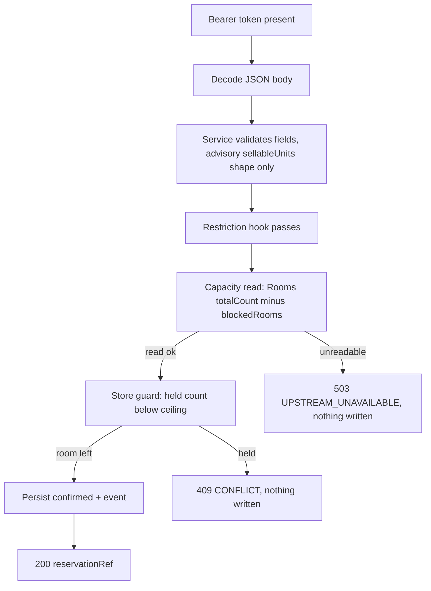
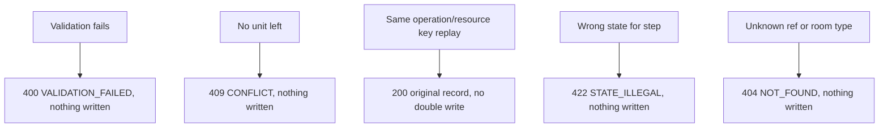

# Reservations — as-built design

Status: active. Source page for the reservations module (single source of truth; `services/reservations/README.md` is a thin stub pointing here). Owned by `architect` (Closes #181).

## 1. Purpose

Direct reservations, modification, cancellation, walk-in, calendar, and no-show marking. Reservation state machine: `confirmed` → `checked-in` / `cancelled` / `no-show`.

Links: `docs/architecture/lld.md` [section 1](../lld.md); `docs/requirements/sequence-diagrams.md` [sections 2](../../requirements/sequence-diagrams.md) (creation), 3 (modification), 4 (cancellation), 5 (no-show), 6 (walk-in); lifecycle states in `docs/architecture/state-machine.md`.

## 2. Pattern and layers as-built

Go `handler / service / store`, wired in `services/reservations/cmd/server/main.go`.

| Layer | Files | Responsibility |
|---|---|---|
| Transport + auth + body decoding | `internal/handler/handler.go` | `NewMux` routes `POST /v1/reservations/<Operation>`; every `/v1/*` call requires a Bearer session token (:140-151); JSON body decoding with `VALIDATION_FAILED` on malformed input (:62-104) |
| Validation + step order | `internal/service/service.go` | field/date/price/guest validation, mandatory-guest-field check, server-side stay-restriction check, server-side capacity read, then the guarded store call |
| Pricing restriction check | `internal/pricing/client.go` | `POST {RATES_BASE_URL}/v1/rates/CheckRestrictions` with the caller Bearer token; rates refusals pass through unchanged, unreachable rates fails closed |
| Availability (capacity) read | `internal/availability/client.go` | `POST {ROOMS_BASE_URL}/v1/rooms/CheckRoomTypeSellability` with the caller Bearer token; the ceiling is `totalCount - len(blockedRooms)`, a rooms 4xx passes through unchanged, and an unreadable reply fails closed (ADR-0006, #631) |
| Guarded state + storage | `internal/store/store.go` (`Repository`, `Store`), `internal/store/postgres.go` | mutex-guarded overbooking check, idempotency replay, state transitions, change history, domain events |
| Health | `internal/health/` | `GET /healthz` with the module identity |
| Boot | `cmd/server/main.go` | selects Postgres storage when `DATABASE_URL` is set, mounts health + booking routes |

The routing table (`internal/handler/handler.go`): `CreateReservation` (:160), `GetReservation` (:204), `CheckInReservation` (:227), `CheckOutReservation` (:250), `ModifyReservation` (:272), `CancelReservation` (:315), `MarkNoShow` (:335), `QueryCalendar` (:354). The body's `sellableUnits` is optional and advisory: it is shape-checked (`advisoryUnits`, :417-438) and never decides the booking. Read-only `GetReservation`/`QueryCalendar` call the store directly; the four booking lifecycle writes go through `service.Service` first, and `CheckOutReservation` — the provider-to-provider completion called by Stay after a committed close (#646, `FR-DEP-1`) — writes through the store's conditional `checked-in -> closed` transition, resolved by the unique stay link.

## 3. Happy-path flowchart

CreateReservation (`POST /v1/reservations/CreateReservation`):



Edge trace (every edge cites code):

- A: missing/empty Bearer → `UNAUTHENTICATED` 401 (`internal/handler/handler.go:140-151`).
- B: malformed JSON → `VALIDATION_FAILED` 400 (`internal/handler/handler.go:62-104`).
- C: `roomTypeId` required (`internal/service/service.go:141-143`), dates must be `YYYY-MM-DD` with departure after arrival (:144-154), `priceBasis.totalMinor` required and non-negative (:155-157), `guest.guestId` required (:158-161), hotel-mandatory fields (default `fullName`) required (:162-167); an optional `sellableUnits` is shape-checked only (:138-140, `:125-132`; handler :417-438) — all in `internal/service/service.go`.
- D: server-side `POST {RATES_BASE_URL}/v1/rates/CheckRestrictions` with the caller Bearer token forwarded (`internal/pricing/client.go:43-87`; POST at :52, Bearer forward at :57-59); an unwired hook fails closed with 503 `UPSTREAM_UNAVAILABLE` (`internal/service/service.go:168-173,283-288` via `restrictionsUnavailable` at :90-101); a rates refusal returns its `OpError` unchanged, so the violated restriction stays named in the 422 `STATE_ILLEGAL` envelope.
- E: the ceiling (`internal/service/service.go:175,289`) is read by `internal/availability/client.go:56-95` for the effective type and dates (`service.go:271-282` on Modify); an unreadable ceiling fails closed 503 `UPSTREAM_UNAVAILABLE` naming rooms and `CheckRoomTypeSellability` (`availability/client.go:99-160`; nil hook `service.go:103-123`), and a rooms 4xx envelope passes through unchanged. The store's overbooking count over same-type active overlapping stays runs under one mutex (`internal/store/store.go:211-233`, Modify `:382-423`), tripping at `booked >= input.Ceiling` (`:228`, `:418`); idempotency-key replay returns the original record (`:215`, `:386`) — the key is namespaced by operation and, for modify/cancel, by the reservation reference, so a key reused across operations or reservations runs the new operation instead of replaying another call's result (issue #644).
- F: record stored `confirmed` with a unique ref, `created` event queued (`internal/store/store.go:234-265`); G: `reservationId`, `reservationRef`, `state`, `quotedTotal` returned (`internal/handler/handler.go:199-201`).

## 4. Failure/rollback flowchart



Edge trace:

- V: any service/handler validation rejects before the store is touched (`internal/service/service.go:137-167`; handler required-field checks, e.g. `internal/handler/handler.go:205-207`).
- O: `booked >= input.Ceiling` → `CONFLICT` "No sellable unit left" (`internal/store/store.go:228`, `:418`); an unreadable capacity is the separate 503 `UPSTREAM_UNAVAILABLE` path, never this 409.
- K: create/modify/cancel replays return the stored record, each keyed by its operation and — for modify/cancel — the reservation reference (`internal/store/store.go:215,386,469`; Create/Modify/Cancel thread the key through `internal/service/service.go:179-189,293-303,313`).
- S: `CheckIn` requires `confirmed`; Modify/Cancel/MarkNoShow on a non-`confirmed` record go through `stateRefusal` → `STATE_ILLEGAL` 422 (`internal/store/store.go`). `CheckOutReservation` requires `checked-in`, returns the already `closed` booking idempotently, and writes one `state` change row with the actor and time (no event, LLD D5).
- N: unknown ref → `NOT_FOUND` 404 (`internal/store/store.go:270-276`); an unknown room type keeps Rooms' `NOT_FOUND` 404 unchanged (`internal/availability/client.go:132-150`).

Rollback: there is none to run — every write is a single mutex-guarded step (`internal/store/store.go:212`); a refusal — including an unreadable capacity read, which precedes the store call — happens before any mutation, so no compensation path exists in code.

## 5. Outbound dependencies

Rates stay-restriction check (`POST {RATES_BASE_URL}/v1/rates/CheckRestrictions`, `RATES_BASE_URL` default `http://rates:8082`, wired at boot in `cmd/server/main.go:45-49`): every `Create`/`Modify` consults Pricing `CheckRestrictions` with the caller Bearer token forwarded and fails closed (503 `UPSTREAM_UNAVAILABLE`) when rates is unreachable (`internal/pricing/client.go`).

Rooms capacity read (`POST {ROOMS_BASE_URL}/v1/rooms/CheckRoomTypeSellability`, `ROOMS_BASE_URL` default `http://rooms:8085`, wired at boot beside the rates client in `cmd/server/main.go:50-54`, compose env `deploy/compose.yaml:50`): every `Create`/`Modify` reads the recorded inventory once per attempt, consumes `totalCount` and `blockedRooms`, and derives the guard's ceiling as `totalCount - len(blockedRooms)` (`internal/availability/client.go:56-95`). The reply's derived `sellableCount` is deliberately not consumed (ADR-0006 D2), and the request's `sellableUnits` is advisory only: a low or absent value refuses nothing and an inflated value buys nothing (`internal/service/service.go:125-140`). An unreadable capacity fails the booking closed with 503 `UPSTREAM_UNAVAILABLE` naming rooms and the operation; a rooms 4xx passes through unchanged; a readable zero capacity is the sold-out `CONFLICT`. Rooms has no outbound dependency, so the seam adds no runtime cycle. Consequence: a Rooms outage refuses new bookings and modifications (product risk R-14, residual risk R-OVB-1; runbook section 11). Hotel values come from `AdminService.GetHotelConfig` with a cached offline-first fallback (LLD [section 0](../lld.md)). Emits `reservation.created` / `reservation.checked-in` domain events (`internal/store/postgres.go:265,382,625,718,795` outbox INSERTs; in-memory `created` queued at `internal/store/store.go:258-266`, `checked-in` at :320-325).

See also: [deployment](../system-architecture.md) (section 1), [C4 containers](../c4-containers.md), and [event flow](../event-flow.md) (this service's outbox emissions).

## 6. Error mapping

Envelope `{code, message, details, traceId}` (`internal/handler/handler.go:30-43`) to `docs/technical/error-handling.md` [section 1](../../technical/error-handling.md).

| Code | Status | Raised when |
|---|---|---|
| `VALIDATION_FAILED` | 400 | missing/malformed fields, bad dates, negative total, or a malformed advisory `sellableUnits` (`internal/store/store.go:32-34`; `internal/service/service.go:137-167`; `internal/handler/handler.go:417-438`) |
| `UNAUTHENTICATED` | 401 | missing session token (`internal/handler/handler.go:141-152`) |
| `NOT_FOUND` | 404 | unknown reservation ref (`internal/store/store.go:40-42,270-276`); on `Create` and `Modify` also an unknown room type, refused by Rooms `CheckRoomTypeSellability` and surfaced unchanged (`internal/availability/client.go:81-82,132-150`) |
| `CONFLICT` | 409 | overbooking guard trips (`internal/store/store.go:36-38,228`); a readable zero capacity is the same sold-out answer |
| `STATE_ILLEGAL` | 422 | step on a wrong-state reservation, or a stay restriction (`internal/store/store.go:310-318,329-336`; `internal/service/service.go:168-173`) |
| `UPSTREAM_UNAVAILABLE` | 503 | rates stay-restriction check or rooms capacity read unreadable; nothing written (`internal/pricing/client.go:88-96`; `internal/availability/client.go:99-160`) |

## 7. Operations

Run from `services/reservations`. Build and test:

```sh
go build ./...
go test ./...
```

Vet and format (`gofmt -l .` must print nothing):

```sh
go vet ./...
gofmt -l .
```

Migrate (golang-migrate, forward-only in production; `down` files are local-dev only):

```sh
migrate -path migrations -database "$DATABASE_URL" up
```

Run:

```sh
go run ./cmd/server
```

Configuration via environment: `PORT` (default `8081`), `RATES_BASE_URL` (default `http://rates:8082`) for the stay-restriction check, and `ROOMS_BASE_URL` (default `http://rooms:8085`) for the capacity read the overbooking guard counts against (Refs #631). Hotel values come from `AdminService.GetHotelConfig` with a cached offline-first fallback (see LLD [section 0](../lld.md)) and land in later slices.

Docker:

```sh
docker build -t hotel-reservations .
```

Contract tests: `contract-tests/` holds fixtures per provided/consumed operation once the first slice lands (see `contract-tests/README.md`). Run the repo gate from the repo root before opening a PR:

```sh
script/contract-check.sh
```

Ingress bounds (Refs #630): `internal/handler` caps a request body at
65 536 bytes (`maxBodyBytes`) through `http.MaxBytesReader` and refuses an
oversized body with the shared envelope (`VALIDATION_FAILED`, `details`
naming `body`) before parsing; `cmd/server/main.go` runs an `http.Server`
with `ReadHeaderTimeout` 5 s, `ReadTimeout` 10 s, `WriteTimeout` 15 s, and
`IdleTimeout` 60 s. No environment variable overrides either value.
Details: LLD
[section 29](../lld.md#29-bounded-request-bodies-and-finite-server-timeouts-refs-630).

## 8. Planned delta — departure completion (Refs #646)

Not as-built yet: the operation surface stops at the seven routes in
section 2 (`internal/handler/handler.go:160-339`), the repository
interface stops at create/get/query/check-in/modify/cancel/no-show
(`internal/store/store.go:109-117`), and nothing writes the terminal
`closed` state, which is why a departed booking keeps counting as
active. This section records the target the implementation PR folds
into sections 2, 3, 4, 5, and 6 in the same change (maintain-with-code).

- New provider operation `CheckOutReservation` (`POST
  /v1/reservations/CheckOutReservation`), called by Stay after its close
  commits: request `{stayId, actor}`, response `{reservationId,
  reservationRef, state: "closed", stayId}`; resolved by the `stay_id`
  link set at check-in (`migrations/000002_schema.up.sql:33`), never by
  guest name or dates. A `checked-in` booking flips to `closed` under a
  conditional write, with the `reservation_changes` row and
  `updated_by`/`updated_at` (NFR-AUD-1); an already-`closed` booking
  returns unchanged (the state is its own exactly-once guard); any other
  state is `STATE_ILLEGAL`, an unmatched link `NOT_FOUND`.
- The purpose line's state machine gains the terminal step
  `checked-in -> closed` on check-out, matching
  `docs/architecture/state-machine.md` section 1.1; it stays
  unreachable from every other route (no reopen, no check-out from
  `confirmed`).
- No guard rewrite: the create/modify guard already counts only
  `confirmed` / `checked-in`, so a completed booking releases its unit
  and its remaining nights on an early departure. No outbox event is
  added by this change (LLD D5).
- The section 2 routing table gains the operation row and section 6 gains
  no new code (the operation reuses `NOT_FOUND`, `STATE_ILLEGAL`, and
  `VALIDATION_FAILED`); those are the maintain-with-code edits.

Design: `docs/architecture/lld.md` section 22; state diagram
`docs/architecture/state-machine.md` section 1.1; contract delta LLD
section 22.5.

## 10. Server-side availability derivation (Refs #631, ADR-0006 accepted)

As built by the #631 implementation PR: the target this section used to
plan is folded into sections 2 (layers), 3 (happy path), 4 (failure and
rollback), 5 (outbound dependencies), 6 (error mapping), and 7
(operations, which now names `ROOMS_BASE_URL`). In short: one Rooms
`CheckRoomTypeSellability` read per booking attempt derives the guard's
ceiling from `totalCount - len(blockedRooms)`; the request's
`sellableUnits` is optional and advisory and never reaches the store;
an unreadable capacity fails the booking closed with 503
`UPSTREAM_UNAVAILABLE` naming rooms and the operation; the store keeps
its one-critical-section count-and-insert shape and the counted states
stay `confirmed` + `checked-in` (`AC-OVB-1`..`AC-OVB-3`,
`FR-OVB-1`..`FR-OVB-4`, `BR-47`..`BR-49`).

Design: `docs/architecture/lld.md` section 26; threat-model B6 and
residual risks R-OVB-1..R-OVB-6 in
`docs/technical/security-threat-model.md`.

<!-- ao-role: architect -->
Role: architect · AO session hotel-mgmt-946

## 9. Planned delta — server-side reservation price basis (Refs #632)

Not as-built yet: `priceBasis.totalMinor` still reaches the store from
the request body after only a presence and `>= 0` check
(`internal/service/service.go:158` on Create, `:250` on Modify), the
store persists it verbatim (`internal/store/store.go:274-275`) and
re-freezes it on Modify (`:472-476`), and the wired Rates client runs
`CheckRestrictions` only (`internal/pricing/client.go:43-85`, wired at
`cmd/server/main.go:45-49`). This section records the target the
implementation PR folds into sections 2, 3, 4, 5, and 6 in the same
change (maintain-with-code).

- Section 2's layer table gains the quote row: the pricing client
  (`internal/pricing/client.go`) provides two operations to the service
  — `CheckRestrictions` (unchanged) and `QuotePrice` (new) — from one
  client instance and the same `RATES_BASE_URL`; the service's
  validation layer gains the quote-and-compare step and a replay
  pre-read; the store's `Repository` interface gains `Replay(key)`.
- Section 3's happy-path flowchart gains the quote branch and the
  comparison: `CheckRestrictions` passes -> replay pre-read misses ->
  `QuotePrice` for the effective type, dates, and discount with the
  caller token forwarded -> the request total equals the quote -> the
  guarded store write stores the quote's total and discount name.
- Section 4's failure flowchart gains three edges: `PRICE_CHANGED`
  (409) when the asserted total disagrees with the quote;
  `UPSTREAM_UNAVAILABLE` (503) `{upstream: rates, operation:
  QuotePrice}` when Pricing cannot be read; and a definitive Rates
  refusal (`NOT_FOUND` `no_rate_price`/`no_rate_plan`,
  `VALIDATION_FAILED` for an unknown discount or an ambiguous plan set)
  surfaced unchanged. Every one of them writes nothing.
- Section 5's outbound list gains the second Rates read:
  `POST {RATES_BASE_URL}/v1/rates/QuotePrice` on every Create and
  Modify, caller Bearer forwarded, 5-second timeout, fail-closed on an
  unreadable answer. The `priceBasis` the desk supplies stops being a
  stored input and becomes an advisory assertion compared against the
  quote.
- Section 6's error table gains `PRICE_CHANGED` (409) and
  `UPSTREAM_UNAVAILABLE` (503), with the 4xx-from-Rates rows kept as
  they are for the definitive refusals.
- Unchanged by this delta: the stored `priceBasis` shape, the schema,
  the overbooking guard, `sellableUnits`, the response fields
  (`quotedTotal` / `recalculatedTotal` keep their names and now report
  the server total), and the #600 check-out room charge, which keeps
  posting the frozen total — now a verified one.

Design: `docs/architecture/decisions/adr-0007-server-side-reservation-price-authority.md`
(accepted 2026-11-24); flow detail, per-flow implementation diagrams, contract
delta, and verification plan: `docs/architecture/lld.md` section 25.

<!-- ao-role: architect -->
Role: architect · AO session hotel-mgmt-990

<!-- ao-role: dev -->
Role: dev · AO session hotel-mgmt-1075

<!-- ao-role: architect -->
Role: architect · AO session hotel-mgmt-941

## 11. As-built delta — session-derived audit actor (Refs #643)

The authed wrapper keeps the caller's raw header
(`internal/handler/handler.go:148-166`), the module helper strips the
`Bearer ` prefix and trims the remainder (`:110-112`), and every write
passes the session actor with the body actor beside it: Create `:200-201`,
CheckIn `:248`, CheckOutReservation `:271`, Modify `:313-314`, Cancel
`:336`, MarkNoShow `:357`. `CheckOutReservation` keeps its required
`actor` field and refusal (`:267-270`); the five writes that accept
`actor` optionally add no refusal. The stores take `Actor` and
`RequestActor` (`internal/store/store.go:80-84`, `:115-117`) and add the
annotation through `actorPayload` (`:154-160`), used by the in-memory
events (`:292-296`, `:354`, `:479-484`, `:521`, `:565`) and the Postgres
outbox writes (`internal/store/postgres.go:259-263`, `:380`,
`:619-623`, `:712`, `:789`); change rows and the reservation row's
`created_by`/`updated_by` record the session. `CheckOutReservation`
writes no outbox row, so its request value is dropped and its change-row
shape is unchanged. Stay's forwarded completion carries the desk bearer
and the request actor as the body annotation, so both rows record the
same session token. Guards `SEC13`-`SEC18`, `SEC29`, `SEC32`, `SEC33`
live in `internal/handler/handler_test.go` and
`internal/store/store_test.go`, where the two request-string assertions
re-pin to `sessionToken` (`:11-17`).

<!-- ao-role: architect -->
Role: architect · AO session hotel-mgmt-1175
