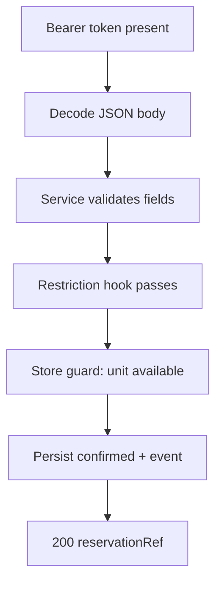
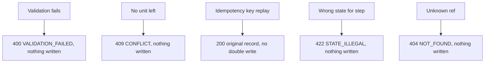

# Reservations — as-built design

Status: active. Source page for the reservations module (single source of truth; `services/reservations/README.md` is a thin stub pointing here). Owned by `architect` (Closes #181).

## 1. Purpose

Direct reservations, modification, cancellation, walk-in, calendar, and no-show marking. Reservation state machine: `confirmed` → `checked-in` / `cancelled` / `no-show`.

Links: `docs/architecture/lld.md` section 1; `docs/requirements/sequence-diagrams.md` sections 2 (creation), 3 (modification), 4 (cancellation), 5 (no-show), 6 (walk-in); lifecycle states in `docs/architecture/state-machine.md`.

## 2. Pattern and layers as-built

Go `handler / service / store`, wired in `services/reservations/cmd/server/main.go`.

| Layer | Files | Responsibility |
|---|---|---|
| Transport + auth + body decoding | `internal/handler/handler.go` | `NewMux` routes `POST /v1/reservations/<Operation>`; every `/v1/*` call requires a Bearer session token; JSON body decoding with `VALIDATION_FAILED` on malformed input |
| Validation + step order | `internal/service/service.go` | field/date/price/guest validation, mandatory-guest-field check, server-side stay-restriction check, then the guarded store call |
| Pricing restriction check | `internal/pricing/client.go` | `POST {RATES_BASE_URL}/v1/rates/CheckRestrictions` with the caller Bearer token; rates refusals pass through unchanged, unreachable rates fails closed |
| Guarded state + storage | `internal/store/store.go` (`Repository`, `Store`), `internal/store/postgres.go` | mutex-guarded overbooking check, idempotency replay, state transitions, change history, domain events |
| Health | `internal/health/` | `GET /healthz` with the module identity |
| Boot | `cmd/server/main.go` | selects Postgres storage when `DATABASE_URL` is set, mounts health + booking routes |

The routing table (`internal/handler/handler.go`): `CreateReservation` (:119), `GetReservation` (:158), `CheckInReservation` (:181), `ModifyReservation` (:204), `CancelReservation` (:242), `MarkNoShow` (:262), `QueryCalendar` (:281). Read-only `GetReservation`/`QueryCalendar` call the store directly; the four lifecycle writes go through `service.Service` first.

## 3. Happy-path flowchart

CreateReservation (`POST /v1/reservations/CreateReservation`):



Edge trace (every edge cites code):

- A: missing/empty Bearer → `UNAUTHENTICATED` 401 (`internal/handler/handler.go:99-117`).
- B: malformed JSON → `VALIDATION_FAILED` 400 (`internal/handler/handler.go:42-53`).
- C: `roomTypeId` required (:63-65), dates must be `YYYY-MM-DD` with departure after arrival (:66-76), `priceBasis.totalMinor` required and non-negative (:77-79), `guest.guestId` required (:80-83), hotel-mandatory fields (default `fullName`) required (:84-89) — all in `internal/service/service.go`.
- D: server-side `POST {RATES_BASE_URL}/v1/rates/CheckRestrictions` with the caller Bearer token forwarded (`internal/pricing/client.go:43-87`); a rates refusal returns its `OpError` unchanged, so the violated restriction stays named in the 422 `STATE_ILLEGAL` envelope (`internal/service/service.go:96-100`); unreachable rates fails closed with 503 `UPSTREAM_UNAVAILABLE`, never a silent allow.
- E: `sellableUnits >= 1` (:201-203), idempotency-key replay returns the original record (:207-210), overbooking count over same-type active overlapping stays under one mutex (:211-225) — `internal/store/store.go`.
- F: record stored `confirmed` with a unique ref, `created` event queued (:246-259); G: `reservationId`, `reservationRef`, `state`, `quotedTotal` returned (`internal/handler/handler.go:153-155`).

## 4. Failure/rollback flowchart



Edge trace:

- V: any service/handler validation rejects before the store is touched (`internal/service/service.go:63-89`; handler required-field checks, e.g. `internal/handler/handler.go:159-161`).
- O: `booked >= SellableUnits` → `CONFLICT` "No sellable unit left" (`internal/store/store.go:221`).
- K: create/modify/cancel replays return the stored record (`internal/store/store.go:208,343,426`; Modify/Cancel thread the key through `internal/service/service.go:105,207,229`).
- S: `CheckIn` requires `confirmed` (:297-311); Modify/Cancel/MarkNoShow on a non-`confirmed` record go through `stateRefusal` → `STATE_ILLEGAL` 422 (`internal/store/store.go:322-329`).
- N: unknown ref → `NOT_FOUND` 404 (`internal/store/store.go:263-268`).

Rollback: there is none to run — every write is a single mutex-guarded step (`internal/store/store.go:205`); a refusal happens before any mutation, so no compensation path exists in code.

## 5. Outbound dependencies

Rates stay-restriction check (`POST {RATES_BASE_URL}/v1/rates/CheckRestrictions`, `RATES_BASE_URL` default `http://rates:8082`, wired at boot in `cmd/server/main.go:42-47`): every `Create`/`Modify` consults Pricing `CheckRestrictions` with the caller Bearer token forwarded and fails closed (503 `UPSTREAM_UNAVAILABLE`) when rates is unreachable (`internal/pricing/client.go`). The Rooms `CheckRoomTypeSellability` outbound call remains a future slice; until then, the desk loop supplies `sellableUnits` and `priceBasis` search outputs in the request (`internal/service/service.go:6-11`). Hotel values come from `AdminService.GetHotelConfig` with a cached offline-first fallback (LLD section 0). Emits `reservation.created` / `reservation.checked-in` domain events (`internal/store/postgres.go:268,385,560,653,730` outbox INSERTs; in-memory `created` queued at `internal/store/store.go:251-259`, `checked-in` at :313-318).

See also: [deployment](../system-architecture.md) (§1), [C4 containers](../c4-containers.md), and [event flow](../event-flow.md) (this service's outbox emissions).

## 6. Error mapping

Envelope `{code, message, details, traceId}` (`internal/handler/handler.go:32-39`) to `docs/technical/error-handling.md` section 1.

| Code | Status | Raised when |
|---|---|---|
| `VALIDATION_FAILED` | 400 | missing/malformed fields, bad dates, negative total (`internal/store/store.go:30`; `internal/service/service.go:54-59`) |
| `UNAUTHENTICATED` | 401 | missing session token (`internal/handler/handler.go:101-112`) |
| `NOT_FOUND` | 404 | unknown reservation ref (`internal/store/store.go:38,263-268`) |
| `CONFLICT` | 409 | overbooking guard trips (`internal/store/store.go:34,221`) |
| `STATE_ILLEGAL` | 422 | step on a wrong-state reservation (`internal/store/store.go:304-311,322-329`) |

## 7. Operations

Run from `services/reservations`. Build and test:

```sh
go build ./...
go test ./...
```

Vet and format (`gofmt -l .` must print nothing):

```sh
go vet ./...
gofmt -l .
```

Migrate (golang-migrate, forward-only in production; `down` files are local-dev only):

```sh
migrate -path migrations -database "$DATABASE_URL" up
```

Run:

```sh
go run ./cmd/server
```

Configuration via environment: `PORT` (default `8081`); hotel values come from `AdminService.GetHotelConfig` with a cached offline-first fallback (see LLD section 0) and land in later slices.

Docker:

```sh
docker build -t hotel-reservations .
```

Contract tests: `contract-tests/` holds fixtures per provided/consumed operation once the first slice lands (see `contract-tests/README.md`). Run the repo gate from the repo root before opening a PR:

```sh
script/contract-check.sh
```

<!-- ao-role: architect -->
Role: architect · AO session hotel-mgmt-249
