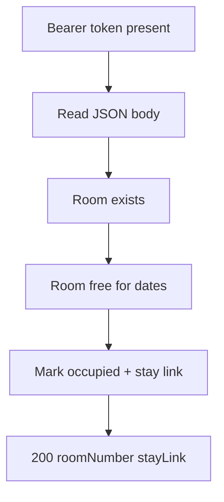
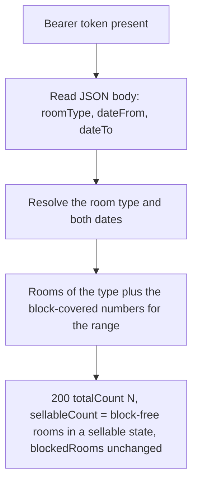
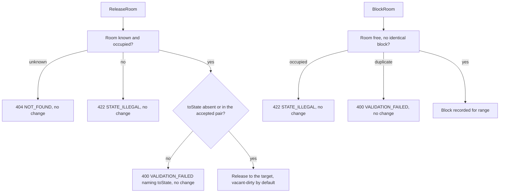
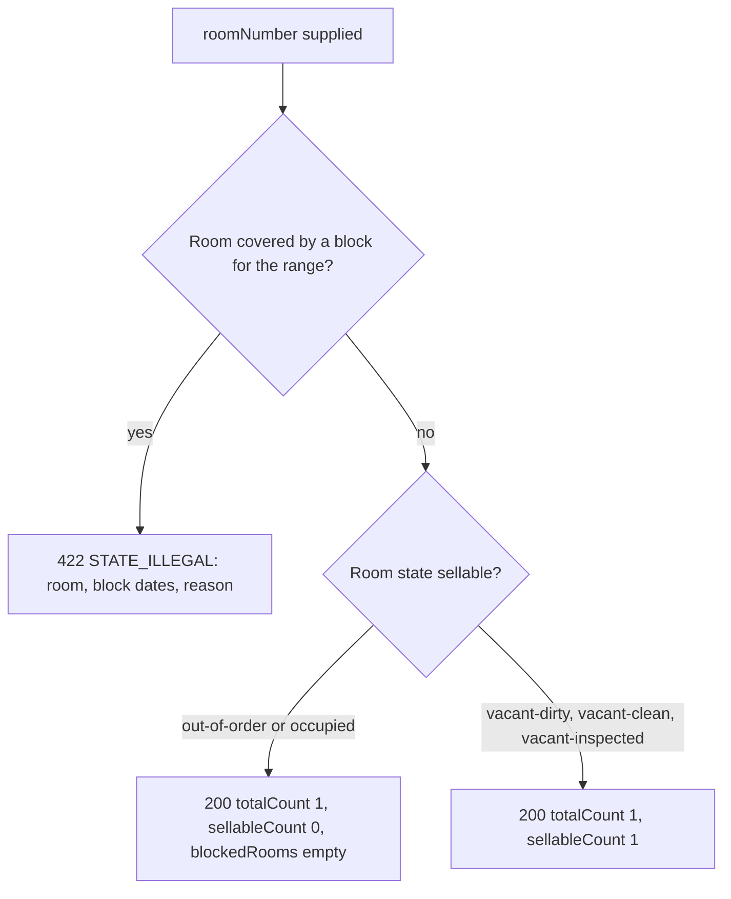
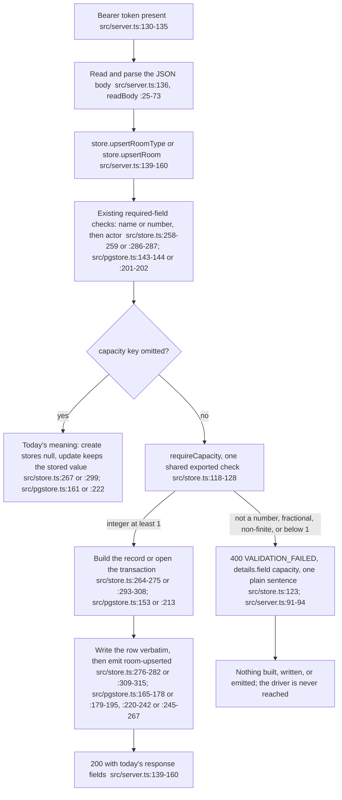
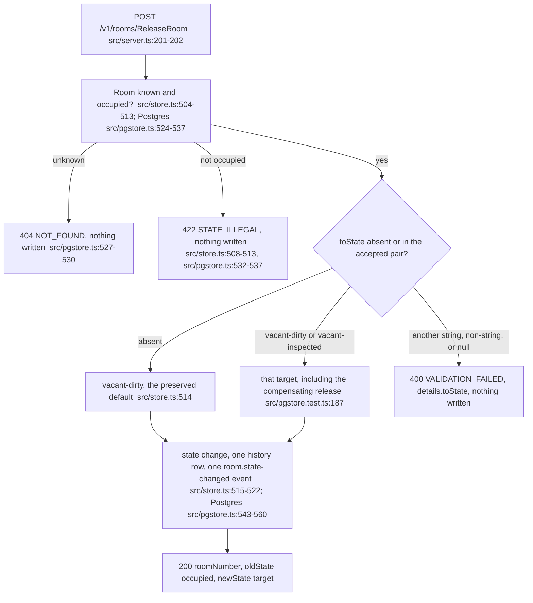

# Rooms — as-built design

Status: active. Source page for the rooms module (single source of truth; `services/rooms/README.md` is a thin stub pointing here). Owned by `architect` (Closes #181; line pins re-verified in the #382 second re-review).

## 1. Purpose

Inventory, housekeeping states, out-of-order blocks, room and room-type setup. Room states are `occupied`, `vacant-dirty`, `vacant-clean`, `vacant-inspected`, and `out-of-order`: housekeeping walks dirty -> clean -> inspected, only `vacant-inspected` rooms are offered for assignment, and out-of-order is a date-ranged block over vacant rooms.

Links: `docs/architecture/lld.md` [section 3](../lld.md); `docs/requirements/sequence-diagrams.md` [sections 8](../../requirements/sequence-diagrams.md) (room move), 12 (housekeeping cleaning loop), 13 (out-of-order block and release); lifecycle states in `docs/architecture/state-machine.md`.

## 2. Pattern and layers as-built

Node.js/TypeScript flat `src/` files over raw `node:http`, wired in `services/rooms/src/index.ts` — same shape as Stay.

| Layer | Files | Responsibility |
|---|---|---|
| Transport + routing | `src/server.ts` | `createServiceServer` answers `GET /healthz` (:117), enforces Bearer presence (:130), routes `POST /v1/rooms/<Operation>` by case label |
| Identity | `src/auth.ts` | `extractBearer`: Bearer presence check, same skeleton contract as Stay |
| Validation + step order | `src/store.ts` (`RoomStore`, `RoomStoreAPI` at :226) | per-operation checks (including the shared `requireCapacity` rule at :118-128 and the shared `releaseTarget` rule at :139-147), sellability math, guarded assign/release/block transitions |
| Row storage | `src/store.ts` (in-memory), `src/pgstore.ts` (`PostgresRoomStore implements RoomStoreAPI` at :40) | identical semantics; Postgres selected at boot when `DATABASE_URL` is set |
| Errors | `src/errors.ts` | shared `HttpError` envelope (same code set as Stay) |
| Boot | `src/index.ts` | store selection by `DATABASE_URL`, `listen(PORT)` (default `8085`) |

The operation table (`src/server.ts:136-212`): `UpsertRoomType` (:139), `UpsertRoom` (:150), `UpdateRoomState` (:160), `ListRoomsByState` (:164), `ListRoomTypes` (:181), `CheckRoomTypeSellability` (:193), `AssignRoom` (:197), `ReleaseRoom` (:201), `BlockRoom` (:205), `ReleaseBlock` (:209).

## 3. Happy-path flowchart

AssignRoom (`POST /v1/rooms/AssignRoom`) — the desk's in-house placement:



Edge trace (every edge cites code):

- A–B: same transport contract as Stay (`src/server.ts:121-133`; body read per-operation from :136).
- C: unknown room key → `NOT_FOUND` (`src/store.ts:271-272`).
- D: block overlap for the dates → `STATE_ILLEGAL` (:404, :468); non-ready room → `STATE_ILLEGAL` (:479); a simultaneous last-room race refuses the loser with `CONFLICT` "was just taken" (:476).
- E: state flips to `occupied` with the stay link kept (`src/store.ts:484-492`); F: `roomNumber`, `stayLink`, `state` returned to the desk, which pairs it with Stay `MoveRoom`.

### Sellability read — aggregate happy path (Refs #636)

`CheckRoomTypeSellability` without `roomNumber`, the desk's availability
figure:



Edge trace (pins refreshed to the as-built head per maintain-with-code, LLD
[section 36](../lld.md#36-room-state-counts-in-sellability-refs-636)):

- A–B–C: one route answers both branches (`src/server.ts:193-196`); the
  type and dates resolve, and a reversed range refuses
  `VALIDATION_FAILED` (`src/store.ts:376-378`; Postgres
  `src/pgstore.ts:355-357`).
- D: `ofType` and `blockedRooms` as today (`src/store.ts:404-414`;
  Postgres `src/pgstore.ts:387-408`).
- E: `sellableCount` counts only the rooms that are block-free **and**
  whose state is neither `out-of-order` nor `occupied`
  (`src/store.ts:420-422` new; Postgres `src/pgstore.ts:387-398` new),
  subtracting each room once, while `totalCount` and `blockedRooms` do
  not move. The value is the desk's availability figure only — the
  booking ceiling stays `totalCount - len(blockedRooms)` (section 9,
  ADR-0006 D2).

## 4. Failure/rollback flowchart

Release and block guards — the desk's turnover and out-of-order paths:



Edge trace:

- Q: releasing a non-occupied room → `STATE_ILLEGAL`
  (`src/store.ts:508-513`; Postgres `src/pgstore.ts:532-537`); an unknown
  room → `NOT_FOUND` (`src/pgstore.ts:527-530`); a present target
  outside `{vacant-dirty, vacant-inspected}` → `VALIDATION_FAILED`
  naming `toState`, before any write (the shared `releaseTarget` check
  at `src/store.ts:139-147`, called at `:514`; the Postgres twin calls
  it at `src/pgstore.ts:542`, after the room checks and before the
  write; LLD [section 41](../lld.md)). An absent target still releases
  to `vacant-dirty` (`src/store.ts:140-142`).
- U: blocking an occupied room → `STATE_ILLEGAL` (`src/store.ts:538`); an identical block already exists → `VALIDATION_FAILED` (:547).
- Reversed ranges are refused up front: `dateTo` before `dateFrom` → `VALIDATION_FAILED` (`src/store.ts:396,535,581`); unknown state values → `VALIDATION_FAILED` (:347, :374).

Rollback: none — each transition is a single guarded in-memory step; refusals precede mutation, and the desk drives multi-step moves (assign/release pairs) rather than the module compensating.

### Sellability read — single room, block refusal, and the unsellable answer (Refs #636)

`CheckRoomTypeSellability` with `roomNumber`:



Edge trace:

- Q–R422: the block test runs before any state test
  (`src/store.ts:381-391`; Postgres `src/pgstore.ts:360-374`), keeping
  `STATE_ILLEGAL` with the block's dates and reason. `RoomsView` renders
  its covering-block note only from that refusal
  (`app/src/views/RoomsView.vue:549-593`) and `DeskView`'s room cards read
  it the same way (`app/src/views/DeskView.vue:1056-1100`), both treating
  any 200 as "no covering block", so the order is a desk-visible
  contract: a block-covered `out-of-order` room still refuses this way
  and a block-free non-sellable room still answers 200 with no note.
- S–T200: a block-free non-sellable room answers success with today's
  fields and `sellableCount: 0` (`src/store.ts:395-402` new; Postgres
  `src/pgstore.ts:376-385` new) — not a refusal. The Book confirm refuses
  the zero count with `desk.book.refused_soldout`
  (`app/src/views/BookView.vue:1004-1011`) and creates no reservation.
- S–U200: a block-free vacant room of any vacant state still answers
  `sellableCount: 1`, exactly as today.

Rollback: none needed — the read mutates no row, emits no event, and
holds no lock across another module, so every refusal and every answer
above writes nothing. The whole change reverts with the single
implementation PR: removing the state predicate and the single-room
state test returns the block-only arithmetic, and no migration, backfill,
or data repair exists in either direction.

## 5. Outbound dependencies

None at runtime. Consumed by the desk loop (Stay `MoveRoom` pairs Rooms `AssignRoom`/`ReleaseRoom`) and by the Reservations booking path, which reads `CheckRoomTypeSellability` (`src/server.ts:193-196`, `src/store.ts:345-405`) once per booking attempt as the overbooking guard's capacity source (ADR-0006, #631). That consumer takes `totalCount` and `blockedRooms` and derives the ceiling as `totalCount - len(blockedRooms)`; it deliberately does not consume the derived `sellableCount`, so #636's room-state accounting changes the desk-facing figure without moving the guard's ceiling, and `blockedRooms` content stays as it is. The edge is fail-closed for booking: while Rooms is unreachable, Reservations refuses creates and modifies with `UPSTREAM_UNAVAILABLE` (product risk R-14; runbook section 11). No new operation, response field, or state was added for the seam. Hotel values come from `AdminService.GetHotelConfig` with a cached offline-first fallback (LLD [section 0](../lld.md)).

See also: [deployment](../system-architecture.md) (section 1), [C4 containers](../c4-containers.md), and [event flow](../event-flow.md) (this service's outbox emissions).

## 6. Error mapping

Same shared Node envelope as Stay (`src/errors.ts`; `docs/technical/error-handling.md` [section 1](../../technical/error-handling.md)). Codes observed in `src/store.ts`:

| Code | Status | Raised when |
|---|---|---|
| `VALIDATION_FAILED` | 400 | bad/unknown field, state, date range, duplicate block, a capacity that is not a whole number of at least 1, or a release target outside `{vacant-dirty, vacant-inspected}` (section 12; :100, :107, :123, :146, :347, :374, :396, :535, :547, :581) |
| `NOT_FOUND` | 404 | unknown room type or room (:262, :271) |
| `CONFLICT` | 409 | room just taken in a race (:476) |
| `STATE_ILLEGAL` | 422 | blocked dates, wrong room state, occupied block target (:404, :468, :479, :509, :538) |
| `UNAUTHENTICATED` | 401 | missing session token (`src/server.ts:130-131`) |

## 7. Operations

Run from `services/rooms`. Requires Node.js 22+. Build and test:

```sh
npm ci
npm run build
npm test
```

Lint:

```sh
npm run lint
```

Migrate (node-pg-migrate, SQL-first, forward-only in production):

```sh
npm run migrate -- up
```

`DATABASE_URL` must point at the module database (default `postgresql://hotel:change-me@db:5432/hotel` in compose).

Run — production build:

```sh
npm start
```

Local watch (type-checks, runs, and restarts TypeScript directly):

```sh
npm run dev
```

Configuration via environment: `PORT` (default `8085`); hotel values come from `AdminService.GetHotelConfig` with a cached offline-first fallback (see LLD [section 0](../lld.md)) and land in later slices.

Docker:

```sh
docker build -t hotel-rooms .
```

Contract tests: `contract-tests/` holds fixtures per provided/consumed operation once the first slice lands (see `contract-tests/README.md`). Run the repo gate from the repo root before opening a PR:

```sh
script/contract-check.sh
```

Ingress bounds (Refs #630): `src/server.ts` caps a request body at
65 536 bytes (`MAX_BODY_BYTES`) and refuses an oversized body with the
shared envelope (`VALIDATION_FAILED`, `details` naming `body`) before
parsing; the server it returns carries `headersTimeout` 5 s,
`requestTimeout` 10 s, `timeout` 15 s, and `keepAliveTimeout` 10 s. No
environment variable overrides either value. Details: LLD
[section 29](../lld.md#29-bounded-request-bodies-and-finite-server-timeouts-refs-630).

<!-- ao-role: architect -->
Role: architect · AO session hotel-mgmt-249

## 8. Desk-driven assignment and release ordering (Refs #647)

No rooms-side change. The reassignment change uses `AssignRoom` and
`ReleaseRoom` in the shapes this module already serves, and this section
records what the desk relies on so the module is not read as
self-compensating:

- `assignRoom` keeps the atomic conditional write: `occupied` only from
  `vacant-inspected` with no covering block, one synchronous section, an
  idempotent receipt, a history row, and a `state-changed` event
  (`src/store.ts:361-405`; Postgres `src/pgstore.ts` same semantics).
- `releaseRoom` accepts an explicit `toState` of `vacant-dirty` or
  `vacant-inspected` and refuses a room that is not occupied
  (`src/store.ts:499-524`; Postgres `src/pgstore.ts:515-562`); every
  other present target is refused `VALIDATION_FAILED` with nothing
  written (section 12, LLD [section 41](../lld.md)). An absent `toState`
  still releases to `vacant-dirty`. The desk uses two targets by
  decision: `vacant-dirty` for a room a committed stay left (check-out,
  move) and `vacant-inspected` for a room an aborted desk action assigned
  and nobody used (`docs/architecture/state-machine.md` section 2.1;
  `FR-REA-1`, `FR-REA-3`).
- Section 4's "the desk drives multi-step moves rather than the module
  compensating" is now the normative split: the desk owns the sequence
  assign, move, release and the compensating release of a target it
  assigned (LLD [section 23](../lld.md), ownership table 23.1). This
  module never orchestrates another service and adds no saga, queue, or
  cross-module rollback.
- An `AssignRoom` made for an arrival carries the stay id the desk
  generated for the commit as `stayLink`; if that commit never becomes a
  stay, the compensating release is the only cure and the room history
  keeps the pair (`src/store.ts:398-402`, `:428-432`).

Design: `docs/architecture/lld.md` section 23; product UI contract
`docs/product/desk-ui-design-rollout.md` section 6.17.

<!-- ao-role: architect -->
Role: architect · AO session hotel-mgmt-961

## 9. Capacity consumer on the booking path (Refs #631, ADR-0006 accepted)

As built by the #631 implementation PR, and recorded in section 5 (which
used to call the consumer a future seam): Reservations reads
`CheckRoomTypeSellability` once per booking attempt with the caller Bearer
token forwarded, consumes `totalCount` and `blockedRooms` for the
effective room type and dates (`src/store.ts:343-356` builds both
date-ranged facts), and derives the guard's ceiling as
`totalCount - len(blockedRooms)`. The derived `sellableCount`
(`src/store.ts:356`) stays the desk-facing availability figure and is not
consumed by the guard, so #636's room-state accounting can move it
without moving the ceiling, and `blockedRooms` content stays as it is.
No new operation, response field, or state was needed, the rooms module
keeps its zero outbound dependencies (section 5), and Rooms becomes a
fail-closed dependency of booking (product risk R-14; the runbook
restart order covers it).

Design: `docs/architecture/lld.md` sections 3 and 26; ADR-0006.

<!-- ao-role: architect -->
Role: architect · AO session hotel-mgmt-941

## 10. As-built delta — session-derived audit actor (Refs #643)

The transport keeps the extracted token after the presence check
(`src/server.ts:130-134`) and hands it beside the body on every write
(`:140`, `:151`, `:161`, `:198`, `:202`, `:206`, `:210`). Each store
keeps today's `requireString(input.actor)` refusal and records the
session: in-memory `src/store.ts:228-249` (UpsertRoomType), `:255-281`
(UpsertRoom), `:287-316` (UpdateRoomState), `:392-431` (AssignRoom),
`:441-468` (ReleaseRoom), `:474-505` (BlockRoom), `:516-546`
(ReleaseBlock), with the state-history `createdBy`, the block row's
`createdBy`, and every outbox `created_by`/payload equal to the token;
the Postgres twin repeats it (`src/pgstore.ts:139-262`, `:269-315`,
`:413-453`, `:508-552`, `:559-609`, `:616-657`, outbox helper
`:57-69`). A differing request actor appears only as `requestActor` via
`requestActorAnnotation`
(`src/store.ts:101-109`); an equal value adds no key and a history-only
row drops it. Guards `SEC6`-`SEC12`, `SEC29`-`SEC31` live in
`src/server.test.ts` and `src/pgstore.test.ts`; no response, status,
refusal, column, or migration changed (LLD
[section 34](../lld.md#34-the-audit-actor-comes-from-the-session-never-from-the-request-refs-643)).

<!-- ao-role: architect -->
Role: architect · AO session hotel-mgmt-1175

## 11. As-built delta — capacity is a whole number of at least 1 (Refs #637)

As built by the #637 implementation PR. The two inventory writes used to
keep a `capacity` only when it was a `number` (`src/store.ts` before this
change in `upsertRoomType` and `upsertRoom`, with the Postgres twins at
`src/pgstore.ts`), so a negative or zero value was stored, `2.5` was
rounded by the Postgres `INT` assignment cast, `1e999` — `Infinity` after
`JSON.parse` (`src/server.ts:63`) — reached the driver and answered the
catch-all `INTERNAL_ERROR` 500 (`src/server.ts:95-101`), and a present
non-number was silently dropped to the stored value. Now one exported
`requireCapacity` helper beside `requireDate`/`requireString`
(`src/store.ts:118-128`) decides the field for both stores, before any
record is built in memory or any transaction opens in Postgres, and every
present value that is not a whole number of at least 1 is refused
`VALIDATION_FAILED` (400) naming `capacity` with nothing written and no
`room-upserted` event. The rule, the value classes, the refusal
contract, and the residual risks are the LLD delta
([section 38](../lld.md#38-room-and-room-type-capacity-is-a-whole-number-of-at-least-1-refs-637));
this section records only the two touched operation flows.



Edge trace (as-built pins at the #637 implementation head):

- A–B–C: one route per operation, both `POST /v1/rooms/<Operation>`
  behind the Bearer check (`src/server.ts:130-135`, operations at
  `:139`, `:150`). `1e999` is already `Infinity` after `JSON.parse`
  (`:63`), so the refusal below sees a non-finite number rather than a
  syntax error.
- D–E: the two existing `requireString` refusals keep today's order and
  messages (`src/store.ts:258-259`, `:286-287`; Postgres
  `src/pgstore.ts:143-144`, `:201-202`); `undefined` means omitted.
  `upsertRoom` resolves the room type before the capacity read
  (`src/store.ts:290`; `src/pgstore.ts:205`), so an unknown type keeps
  answering `NOT_FOUND` exactly as today.
- G–R: the shared helper throws `HttpError("VALIDATION_FAILED", …)`
  with `details.field: "capacity"` and the
  `rooms.validation.capacity` sentence (`src/store.ts:123-127`), the
  same envelope shape as `rooms.validation.date_format` (`:100`); the
  handler's `HttpError` branch answers 400 (`src/server.ts:91-94`), never
  the `INTERNAL_ERROR` catch-all (`:95-101`). The Postgres call sites are
  before `withTx` (`src/pgstore.ts:153`, `:213`), so a refused request
  opens no transaction, takes no lock, issues no write statement, and
  creates no outbox row.
- G–H–I: an accepted capacity is written verbatim by the in-memory
  record (`src/store.ts:267-275`, `:299-308`; Postgres parameter binding
  `src/pgstore.ts:170`, `:186`, `:231`, `:256`), and the
  `room-upserted` emit follows the write exactly as today. A create
  with no capacity still writes `null`; an update with no capacity
  keeps the stored one (`src/store.ts:267`, `:299`; Postgres merge
  `src/pgstore.ts:161`, `COALESCE` `:222`).
- Rollback: none needed — every refusal precedes the first mutation, so a
  refused request writes nothing and emits nothing. The whole delta
  reverts with the single implementation PR: removing the helper and its
  two call sites returns the `typeof` assertion and the old behaviour,
  and no migration, `CHECK`, backfill, or data repair exists in either
  direction.

The `VALIDATION_FAILED` row of section 6's error map and section 2's
validation row carry the capacity case, and every other operation,
guard, and response shape in this document is untouched — in particular
`ReleaseRoom`, `UpdateRoomState`, `ALLOWED_TRANSITIONS`, and the
sellability flows of sections 3 and 4 (LLD section 38's rescope note).

<!-- ao-role: architect -->
Role: architect · AO session hotel-mgmt-1262

## 12. As-built delta — ReleaseRoom accepts only the two release targets (Refs #773)

As built by the #773 implementation PR (LLD [section 41](../lld.md)).
The contract, both stores, the catalogue sentence, and the state machine
now agree: `ReleaseRoom` accepts exactly `vacant-dirty` and
`vacant-inspected`.

As found: the contract admitted four targets, and both stores accepted
any `ROOM_STATES` string, defaulting an absent or unknown `toState` to
`vacant-dirty` (`src/store.ts` and Postgres `src/pgstore.ts` before this
change, pre-change commit `0b602f3`), while the state machine specifies
exactly two (`docs/architecture/state-machine.md` section 2.1). The
Postgres store
also resolved the target before it read the room, so a free room sent
the `occupied` target answered `VALIDATION_FAILED` on Postgres but
`STATE_ILLEGAL` in memory.

As built: one shared `releaseTarget` check beside `requireCapacity`
(`src/store.ts:118-128`), defined at `src/store.ts:139-147` and called
by both stores. `vacant-dirty` and `vacant-inspected` are accepted; an
absent `toState` still resolves to `vacant-dirty`; every other present
value is refused `VALIDATION_FAILED` (400) with `details.toState` and
the `rooms.validation.release_target` sentence naming the pair, writing
nothing (the single-purpose `rooms.validation.release_occupied` key is
retired). The room's own `NOT_FOUND` / `STATE_ILLEGAL` answers run
first in both stores: in memory the check is at `src/store.ts:514`,
after the room read and occupancy test (`:504-513`); in Postgres it is
at `src/pgstore.ts:542`, after `:527-537` and before the `UPDATE` at
`:543-547`, so the stores agree on every request.



Edge trace (as-built):

- A–B: one route answers the operation (`src/server.ts:201-202`); the
  in-memory store reads the room and tests its occupancy at
  `src/store.ts:504-513`, and the Postgres store does the same inside its
  transaction at `src/pgstore.ts:524-537`.
- B–Z1–Z2: the existing `NOT_FOUND` (`src/pgstore.ts:527-530`) and
  `STATE_ILLEGAL` (`src/store.ts:508-513`; Postgres
  `src/pgstore.ts:532-537`) answers are untouched and run before the
  target check, whatever target was sent.
- B–C: the shared `releaseTarget` check (`src/store.ts:139-147`) runs at
  `src/store.ts:514` and at `src/pgstore.ts:542`, after the room answers
  in both stores, so the former Postgres ordering difference is closed.
- C–R: every present value outside the pair is a caller mistake, not a
  state conflict: `VALIDATION_FAILED` with `details.toState`, decided
  before the first mutation (`src/store.ts:514-515`; Postgres before
  `src/pgstore.ts:543-547`), so no state, history row, or event is
  written.
- C–T1–W and C–T2–W: the absent default (`src/store.ts:140-142`, called
  at `:514`) and the two accepted targets keep today's write, history,
  and event (`src/store.ts:515-522`; Postgres
  `src/pgstore.ts:543-560`), including the compensating
  `vacant-inspected` release (`src/pgstore.test.ts:187`).
- Guards: `REL-1`–`REL-4`, `REL-7`, `REL-9`, `REL-12` in
  `src/server.test.ts:1469-1627`; `REL-5`–`REL-8` in
  `src/pgstore.test.ts:536-734`; evidence in
  `docs/testing/evidence/773/README.md`.

Rollback: an out-of-set target is refused before any write, so a refused
request changes nothing; the whole delta reverts with the single
implementation PR, and no migration, backfill, or data repair exists in
either direction. `ALLOWED_TRANSITIONS` (`src/store.ts:45-51`),
`UpdateRoomState`, `assignRoom`, the check-out release, the desk helper,
and the e2e default callers are unchanged; `ReleaseRoom` stays outside
the transition table so the #647 compensating release keeps working.

<!-- ao-role: architect -->
Role: architect · AO session hotel-mgmt-1327
