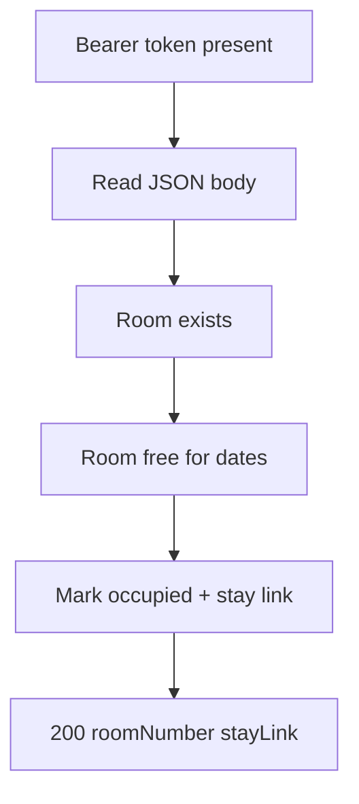
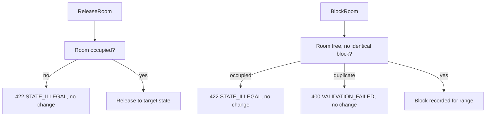

# Rooms — as-built design

Status: active. Source page for the rooms module (single source of truth; `services/rooms/README.md` is a thin stub pointing here). Owned by `architect` (Closes #181; line pins re-verified in the #382 second re-review).

## 1. Purpose

Inventory, housekeeping states, out-of-order blocks, room and room-type setup. Room states are `occupied`, `vacant-dirty`, `vacant-clean`, `vacant-inspected`, and `out-of-order`: housekeeping walks dirty -> clean -> inspected, only `vacant-inspected` rooms are offered for assignment, and out-of-order is a date-ranged block over vacant rooms.

Links: `docs/architecture/lld.md` [section 3](../lld.md); `docs/requirements/sequence-diagrams.md` [sections 8](../../requirements/sequence-diagrams.md) (room move), 12 (housekeeping cleaning loop), 13 (out-of-order block and release); lifecycle states in `docs/architecture/state-machine.md`.

## 2. Pattern and layers as-built

Node.js/TypeScript flat `src/` files over raw `node:http`, wired in `services/rooms/src/index.ts` — same shape as Stay.

| Layer | Files | Responsibility |
|---|---|---|
| Transport + routing | `src/server.ts` | `createServiceServer` answers `GET /healthz` (:68), enforces Bearer presence (:81), routes `POST /v1/rooms/<Operation>` by case label |
| Identity | `src/auth.ts` | `extractBearer`: Bearer presence check, same skeleton contract as Stay |
| Validation + step order | `src/store.ts` (`RoomStore`, `RoomStoreAPI` at :167) | per-operation checks, sellability math, guarded assign/release/block transitions |
| Row storage | `src/store.ts` (in-memory), `src/pgstore.ts` (`PostgresRoomStore implements RoomStoreAPI` at :36) | identical semantics; Postgres selected at boot when `DATABASE_URL` is set |
| Errors | `src/errors.ts` | shared `HttpError` envelope (same code set as Stay) |
| Boot | `src/index.ts` | store selection by `DATABASE_URL`, `listen(PORT)` (default `8085`) |

The operation table (`src/server.ts:87-153`): `UpsertRoomType` (:87), `UpsertRoom` (:98), `UpdateRoomState` (:108), `ListRoomsByState` (:112), `ListRoomTypes` (:125), `CheckRoomTypeSellability` (:137), `AssignRoom` (:141), `ReleaseRoom` (:145), `BlockRoom` (:149), `ReleaseBlock` (:153).

## 3. Happy-path flowchart

AssignRoom (`POST /v1/rooms/AssignRoom`) — the desk's in-house placement:



Edge trace (every edge cites code):

- A–B: same transport contract as Stay (`src/server.ts:68-81`; body read per-operation from :87).
- C: unknown room key → `NOT_FOUND` (`src/store.ts:203-212`).
- D: block overlap for the dates → `STATE_ILLEGAL` (:327, :381); non-ready room → `STATE_ILLEGAL` (:392); a simultaneous last-room race refuses the loser with `CONFLICT` "was just taken" (:389).
- E: state flips to `occupied` with the stay link kept (`src/store.ts:397-400`); F: `roomNumber`, `stayLink`, `state` returned to the desk, which pairs it with Stay `MoveRoom`.

## 4. Failure/rollback flowchart

Release and block guards — the desk's turnover and out-of-order paths:



Edge trace:

- Q: releasing a non-occupied room → `STATE_ILLEGAL` (`src/store.ts:415`); releasing onto an occupied target state is refused (`src/store.ts:425`).
- U: blocking an occupied room → `STATE_ILLEGAL` (`src/store.ts:443`); an identical block already exists → `VALIDATION_FAILED` (:452).
- Reversed ranges are refused up front: `dateTo` before `dateFrom` → `VALIDATION_FAILED` (`src/store.ts:319,440,479`); unknown state values → `VALIDATION_FAILED` (:270, :297).

Rollback: none — each transition is a single guarded in-memory step; refusals precede mutation, and the desk drives multi-step moves (assign/release pairs) rather than the module compensating.

## 5. Outbound dependencies

None at runtime. Consumed by the desk loop (Stay `MoveRoom` pairs Rooms `AssignRoom`/`ReleaseRoom`) and by the future Reservations restriction seam via `CheckRoomTypeSellability` (`src/store.ts:307`). Hotel values come from `AdminService.GetHotelConfig` with a cached offline-first fallback (LLD [section 0](../lld.md)).

See also: [deployment](../system-architecture.md) (section 1), [C4 containers](../c4-containers.md), and [event flow](../event-flow.md) (this service's outbox emissions).

## 6. Error mapping

Same shared Node envelope as Stay (`src/errors.ts`; `docs/technical/error-handling.md` [section 1](../../technical/error-handling.md)). Codes observed in `src/store.ts`:

| Code | Status | Raised when |
|---|---|---|
| `VALIDATION_FAILED` | 400 | bad/unknown field, state, date range, duplicate block (:89, :96, :270, :297, :319, :440, :479, :452) |
| `NOT_FOUND` | 404 | unknown room type or room (:203, :212) |
| `CONFLICT` | 409 | room just taken in a race (:389) |
| `STATE_ILLEGAL` | 422 | blocked dates, wrong room state, occupied block target (:327, :381, :392, :415, :425, :443) |
| `UNAUTHENTICATED` | 401 | missing session token (`src/server.ts:81`) |

## 7. Operations

Run from `services/rooms`. Requires Node.js 22+. Build and test:

```sh
npm ci
npm run build
npm test
```

Lint:

```sh
npm run lint
```

Migrate (node-pg-migrate, SQL-first, forward-only in production):

```sh
npm run migrate -- up
```

`DATABASE_URL` must point at the module database (default `postgresql://hotel:change-me@db:5432/hotel` in compose).

Run — production build:

```sh
npm start
```

Local watch (type-checks, runs, and restarts TypeScript directly):

```sh
npm run dev
```

Configuration via environment: `PORT` (default `8085`); hotel values come from `AdminService.GetHotelConfig` with a cached offline-first fallback (see LLD [section 0](../lld.md)) and land in later slices.

Docker:

```sh
docker build -t hotel-rooms .
```

Contract tests: `contract-tests/` holds fixtures per provided/consumed operation once the first slice lands (see `contract-tests/README.md`). Run the repo gate from the repo root before opening a PR:

```sh
script/contract-check.sh
```

<!-- ao-role: architect -->
Role: architect · AO session hotel-mgmt-249
