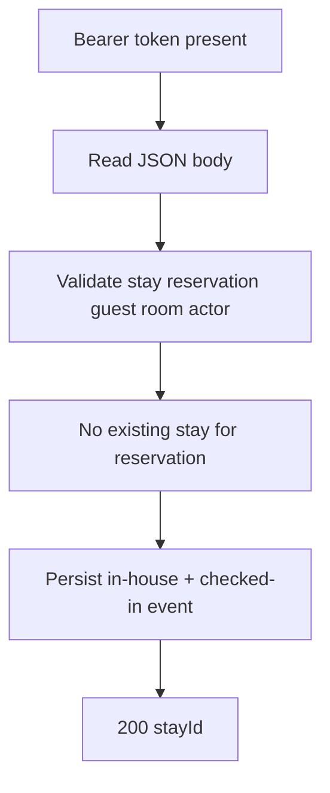
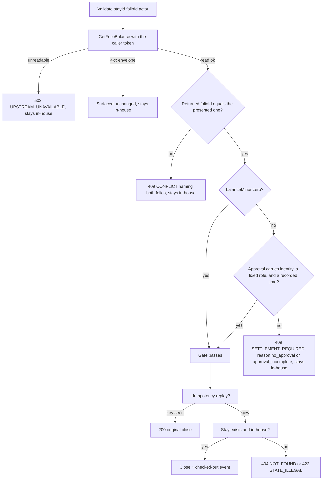

# Stay — as-built design

Status: active. Source page for the stay / front-desk module (single source of truth; `services/stay/README.md` is a thin stub pointing here). Owned by `architect` (Closes #181).

## 1. Purpose

Check-in, check-out with the server-side settlement gate, room moves, early/late actual times, arrivals/departures. Stay state machine: `in-house` → `closed`.
The close re-reads the stay's folio through Billing and validates the recorded approval's provenance before it decides (`BR-17`, `BR-46`, `FR-CKO-4`, `FR-CKO-5`; ADR-0005; LLD [section 21](../lld.md#21-server-side-check-out-gate-and-approval-provenance-refs-601)).

Links: `docs/architecture/lld.md` [section 2](../lld.md); `docs/requirements/sequence-diagrams.md` [sections 7](../../requirements/sequence-diagrams.md) (check-in), 8 (room move), 9 (check-out); lifecycle states in `docs/architecture/state-machine.md`.

## 2. Pattern and layers as-built

Node.js/TypeScript flat `src/` files over raw `node:http` (no web framework), wired in `services/stay/src/index.ts`.

| Layer | Files | Responsibility |
|---|---|---|
| Transport + routing | `src/server.ts` | `createServiceServer` answers `GET /healthz`, matches `POST /v1/stay/<Operation>` by regex, enforces Bearer presence, decodes the body, maps `HttpError` to the envelope |
| Identity | `src/auth.ts` | `extractBearer`: Bearer presence check; the token travels as the audit actor fallback until HMAC validation lands |
| Validation + step order | `src/store.ts` (`StayStore`, `StayStoreAPI`) | per-operation input checks, settlement gate (`requireSettledFolio`, `approvalRefusal`), idempotent in-house/closed transitions, outbox events |
| Outbound Billing read | `src/billing.ts` (`FolioReader`, `BillingClient`) | one `GetFolioBalance` POST per close, caller Bearer token forwarded, 5-second timeout, fail-closed `UPSTREAM_UNAVAILABLE` |
| Row storage | `src/store.ts` (in-memory `Map`s), `src/pgstore.ts` (`PostgresStayStore implements StayStoreAPI`) | identical semantics; Postgres selected at boot when `DATABASE_URL` is set |
| Errors | `src/errors.ts` | `HttpError` code→status map, `errorEnvelope` |
| Boot | `src/index.ts` | store selection by `DATABASE_URL`, `listen(PORT)` |

The operation table (`src/server.ts:116-171`): `CheckIn` (:116), `GetStay` (:121), `QueryStays` (:126), `CheckOut` (:131, which also hands the caller's Bearer token to the gate at :134-136), `MoveRoom` (:140), `RecordActualTimes` (:148), `GetStayRef` (:153), `ListArrivalsDepartures` (:158); unknown operations return `NOT_FOUND` (:164-171).

## 3. Happy-path flowchart

CheckIn (`POST /v1/stay/CheckIn`):



Edge trace (every edge cites code):

- A: `extractBearer` absent → `UNAUTHENTICATED` (`src/server.ts:110-111`; `src/auth.ts`).
- B: empty body → `{}`; non-object or unparsable JSON → `VALIDATION_FAILED` (`src/server.ts:9-33`).
- C: `stayId`/`reservationId`/`guestId`/`roomId` UUID checks, `actor` required (`src/store.ts:189-194` via `requireUuid`/`requireString` at :39-46).
- D: existing stay for the reservation → `CONFLICT` with both ids (`src/store.ts:195-199`); an already-known `stayId` returns the stored record idempotently (:201-202).
- E: record stored `in-house`, `stay.checked-in` outbox event queued (:204-220); F: `stayId`, `roomId`, `state` returned (`src/server.ts:116-119` via `stayPayload` at :42-59).

## 4. Failure/rollback flowchart

CheckOut (`POST /v1/stay/CheckOut`) — the settlement-gated close:



Edge trace:

- A: `stayId` / `folioId` UUID and `actor` checks (`src/store.ts:336-339` via `requireUuid`/`requireString` at :39-51).
- B: the gate read (`requireSettledFolio` at `src/store.ts:205-233`, called at :340 with the caller's Bearer token; `BillingClient.readFolio` at `src/billing.ts:69-117`; the 5-second timeout at `:38` and `:74`). A transport error, timeout, 5xx, unknown provider code, malformed body, or unwired client fails closed with `UPSTREAM_UNAVAILABLE` (503) naming billing/`GetFolioBalance` (`src/billing.ts:50-57`, used at `:71`, `:87`, `:110`); a 4xx envelope keeps its code and status (`:123-147`).
- C: the presented invoice reference must be the folio the balance came from, one folio per stay (BR-21); a different folio returns `CONFLICT` with `{folioId, actualFolioId}` (`src/store.ts:213-218`).
- D–E: a zero balance passes (BR-17). The request's `folioBalanceMinor` / `openBalanceApproval` are ignored entirely, including their shape (ADR-0005 D5).
- F: a non-zero balance needs a provenanced approval — non-blank `approvedBy`, a `role` in the fixed three (`owner`, `manager`, `front-desk`, `src/store.ts:162`), and a non-blank parseable `approvedAt` (`approvalRefusal` at :172-197). Anything absent, free-form, incomplete, or out-of-set returns `SETTLEMENT_REQUIRED` with `reason` `no_approval` or `approval_incomplete` (`src/store.ts:222-232`), and the stay remains in house with no event.
- G: the gate precedes the replay, so every close route is gated; a replay whose folio went open is refused rather than returned. A replayed `idempotencyKey` returns the original close (`src/store.ts:341-347`); paired simultaneous check-outs resolve exactly one winner, the loser is refused below.
- H: unknown stay → `NOT_FOUND` (`src/store.ts:350-351`); already `closed` → `STATE_ILLEGAL` (:352-356).
- J: state flips to `closed`, `actualDeparture` stamped, `stay.checked-out` outbox event queued, key recorded (`src/store.ts:358-367`); the same order holds in `PostgresStayStore.checkOut` (`src/pgstore.ts:164-220`) inside one transaction.
- MoveRoom follows the same shape: in-house conditional write with idempotent key replay (`src/store.ts:376-415`); room assignment/release around it is the desk's Rooms `AssignRoom`/`ReleaseRoom` calls, not a stay-side rollback.

## 5. Outbound dependencies

One synchronous read at runtime: `POST {BILLING_BASE_URL}/v1/billing/GetFolioBalance` on every `CheckOut`, with the caller's Bearer token forwarded and a 5-second timeout (`src/billing.ts:60-118`; integration C7). `BILLING_BASE_URL` defaults to `http://billing:8087` and is wired on the compose `stay` service the way `RATES_BASE_URL` is wired on reservations (`deploy/compose.yaml:77-84`); an unset or blank value builds an unwired client that refuses every close fail-closed (`src/index.ts:13-21`). The request's `folioBalanceMinor` / `openBalanceApproval` are advisory and ignored (ADR-0005 D2/D5). The stay links back to Reservations via `CheckInReservation` (called by the desk with the new stay id). Emits `stay.checked-in` / `stay.checked-out` outbox events (`src/store.ts:288-292,360-364`; Postgres `src/pgstore.ts:99,204,289,352`, helper :463-475) consumed by Reporting and Guests `linkStay`. Hotel values come from `AdminService.GetHotelConfig` with a cached offline-first fallback (LLD [section 0](../lld.md)).

See also: [deployment](../system-architecture.md) (section 1), [C4 containers](../c4-containers.md), and [event flow](../event-flow.md) (this service's outbox emissions).

## 6. Error mapping

Envelope `{code, message, details, traceId}` (`src/errors.ts:36-43`; transport mapping `src/server.ts:76-88`) to `docs/technical/error-handling.md` [section 1](../../technical/error-handling.md). Code→status map (`src/errors.ts:5-24`):

| Code | Status | Raised when |
|---|---|---|
| `VALIDATION_FAILED` | 400 | bad JSON, bad UUID/date/field/actor |
| `UNAUTHENTICATED` | 401 | missing session token |
| `NOT_FOUND` | 404 | unknown stay, reservation, path, or operation |
| `CONFLICT` | 409 | reservation already checked in; presented folio is not the stay's folio |
| `STATE_ILLEGAL` | 422 | step on a wrong-state stay/room |
| `SETTLEMENT_REQUIRED` | 409 | open folio balance without a provenanced recorded approval at check-out (`details.reason`) |
| `UPSTREAM_UNAVAILABLE` | 503 | the folio could not be read from Billing; the close fails closed |
| `FORBIDDEN` | 403 | role-refused admin operation (admin module) |

## 7. Operations

Run from `services/stay`. Requires Node.js 22+. Build and test:

```sh
npm ci
npm run build
npm test
```

Lint:

```sh
npm run lint
```

Migrate (node-pg-migrate, SQL-first, forward-only in production):

```sh
npm run migrate -- up
```

`DATABASE_URL` must point at the module database (default `postgresql://hotel:change-me@db:5432/hotel` in compose). Without `DATABASE_URL` the in-memory store serves with identical check-in semantics (`src/index.ts`); with it, `PostgresStayStore` persists every row.

Run — production build:

```sh
npm start
```

Local watch (type-checks, runs, and restarts TypeScript directly):

```sh
npm run dev
```

Configuration via environment: `PORT` (default `8084`), `DATABASE_URL`, and `BILLING_BASE_URL` (default `http://billing:8087`, the gate read); hotel values come from `AdminService.GetHotelConfig` with a cached offline-first fallback (see LLD [section 0](../lld.md)) and land in later slices.

Docker:

```sh
docker build -t hotel-stay .
```

Contract tests: `contract-tests/` holds fixtures per provided/consumed operation once the first slice lands (see `contract-tests/README.md`). Run the repo gate from the repo root before opening a PR:

```sh
script/contract-check.sh
```

## 8. Landed delta — server-side check-out gate (Refs #601, ADR-0005)

The planned delta this page carried is as-built now and folded into
sections 2, 4, 5, 6, and 7: the gate re-reads the folio through Billing,
binds the presented `folioId` to the folio the balance came from, uses
the read's `balanceMinor` and `openBalanceApproval`, ignores the
request's advisory fields, and fails an unreadable folio closed with
`UPSTREAM_UNAVAILABLE` 503. Billing refuses an approver role outside the
fixed three at write and stamps `approvedAt` server-side
(`services/billing/.../BillingService.java:263-275`), so the record
Stay re-validates can only carry a hotel role and a service time.

Guards: `services/stay/src/server.test.ts` (S1-S10 memory, S12
Postgres), `services/stay/src/billing.test.ts` (transport),
`services/billing/src/test/java/com/hotel/billing/service/BillingServiceTest.java`
(S11); traceability in
`docs/testing/checkout-settlement-test-traceability.md`, lab evidence in
`docs/testing/evidence/601/README.md`.

Design: `docs/architecture/lld.md` section 21; threat-model B5 and
residual risks R5–R7 in `docs/technical/security-threat-model.md`.

<!-- ao-role: architect -->
Role: architect · AO session hotel-mgmt-919
