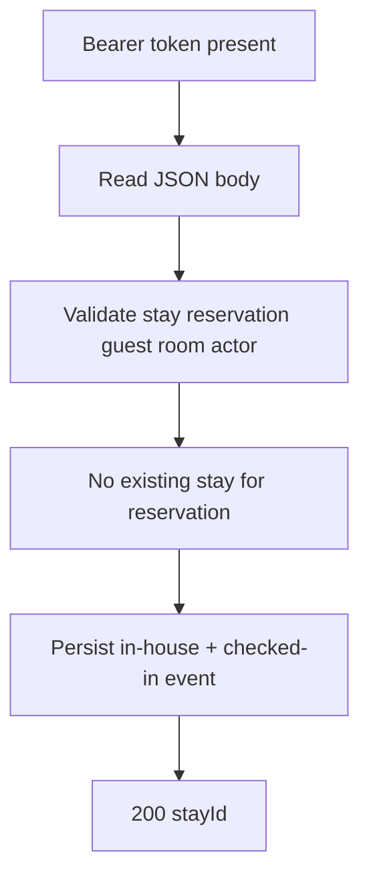
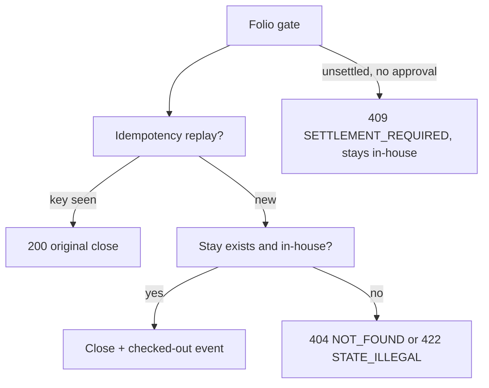

# Stay — as-built design

Status: active. Source page for the stay / front-desk module (single source of truth; `services/stay/README.md` is a thin stub pointing here). Owned by `architect` (Closes #181).

## 1. Purpose

Check-in, check-out with the folio gate, room moves, early/late actual times, arrivals/departures. Stay state machine: `in-house` → `closed`.

Links: `docs/architecture/lld.md` section 2; `docs/requirements/sequence-diagrams.md` sections 7 (check-in), 8 (room move), 9 (check-out); lifecycle states in `docs/architecture/state-machine.md`.

## 2. Pattern and layers as-built

Node.js/TypeScript flat `src/` files over raw `node:http` (no web framework), wired in `services/stay/src/index.ts`.

| Layer | Files | Responsibility |
|---|---|---|
| Transport + routing | `src/server.ts` | `createServiceServer` answers `GET /healthz`, matches `POST /v1/stay/<Operation>` by regex, enforces Bearer presence, decodes the body, maps `HttpError` to the envelope |
| Identity | `src/auth.ts` | `extractBearer`: Bearer presence check; the token travels as the audit actor fallback until HMAC validation lands |
| Validation + step order | `src/store.ts` (`StayStore`, `StayStoreAPI`) | per-operation input checks, folio gate, idempotent in-house/closed transitions, outbox events |
| Row storage | `src/store.ts` (in-memory `Map`s), `src/pgstore.ts` (`PostgresStayStore implements StayStoreAPI`) | identical semantics; Postgres selected at boot when `DATABASE_URL` is set |
| Errors | `src/errors.ts` | `HttpError` code→status map, `errorEnvelope` |
| Boot | `src/index.ts` | store selection by `DATABASE_URL`, `listen(PORT)` |

The operation table (`src/server.ts:114-170`): `CheckIn` (:115), `GetStay` (:120), `QueryStays` (:125), `CheckOut` (:130), `MoveRoom` (:135), `RecordActualTimes` (:143), `GetStayRef` (:148), `ListArrivalsDepartures` (:153); unknown operations return `NOT_FOUND` (:163-169).

## 3. Happy-path flowchart

CheckIn (`POST /v1/stay/CheckIn`):



Edge trace (every edge cites code):

- A: `extractBearer` absent → `UNAUTHENTICATED` (`src/server.ts:109-111`; `src/auth.ts`).
- B: empty body → `{}`; non-object or unparsable JSON → `VALIDATION_FAILED` (`src/server.ts:9-33`).
- C: `stayId`/`reservationId`/`guestId`/`roomId` UUID checks, `actor` required (`src/store.ts:187-193` via `requireUuid`/`requireString` at :38-51).
- D: existing stay for the reservation → `CONFLICT` with both ids (`src/store.ts:194-199`); an already-known `stayId` returns the stored record idempotently (:200-202).
- E: record stored `in-house`, `stay.checked-in` outbox event queued (:203-219); F: `stayId`, `roomId`, `state` returned (`src/server.ts:115-118` via `stayPayload` at :41-59).

## 4. Failure/rollback flowchart

CheckOut (`POST /v1/stay/CheckOut`) — the folio-gated close:



Edge trace:

- G: non-integer balance → `VALIDATION_FAILED`; non-zero balance without a recorded `openBalanceApproval` object → `SETTLEMENT_REQUIRED`, stay remains in house (`src/store.ts:147-168`); gate runs before any state read (`src/store.ts:259-263`).
- H: replayed `idempotencyKey` returns the original close (`src/store.ts:264-270`); paired simultaneous check-outs resolve exactly one winner, the loser is refused below.
- I: unknown stay → `NOT_FOUND` (:271-274); already `closed` → `STATE_ILLEGAL` (:275-280).
- J: state flips to `closed`, `actualDeparture` stamped, `stay.checked-out` outbox event queued, key recorded (:281-291).
- MoveRoom follows the same shape: in-house conditional write with idempotent key replay (`src/store.ts:299-309`); room assignment/release around it is the desk's Rooms `AssignRoom`/`ReleaseRoom` calls, not a stay-side rollback.

## 5. Outbound dependencies

None at runtime. The folio-gate inputs (`folioBalanceMinor`, `openBalanceApproval`) arrive inside the `CheckOut` request — the desk fetches them from Billing `GetFolioBalance` first. The stay links back to Reservations via `CheckInReservation` (called by the desk with the new stay id). Emits `stay.checked-in` / `stay.checked-out` outbox events (`src/store.ts:214-218,283-287`) consumed by Reporting and Guests `linkStay`. Hotel values come from `AdminService.GetHotelConfig` with a cached offline-first fallback (LLD section 0).

## 6. Error mapping

Envelope `{code, message, details, traceId}` (`src/errors.ts:39-45`; transport mapping `src/server.ts:75-87`) to `docs/technical/error-handling.md` section 1. Code→status map (`src/errors.ts:4-25`):

| Code | Status | Raised when |
|---|---|---|
| `VALIDATION_FAILED` | 400 | bad JSON, bad UUID/date/field, bad folio-gate shape |
| `UNAUTHENTICATED` | 401 | missing session token |
| `NOT_FOUND` | 404 | unknown stay, reservation, path, or operation |
| `CONFLICT` | 409 | reservation already checked in; room just taken (rooms) |
| `STATE_ILLEGAL` | 422 | step on a wrong-state stay/room |
| `SETTLEMENT_REQUIRED` | 409 | open folio balance without approval at check-out |
| `FORBIDDEN` | 403 | role-refused admin operation (admin module) |

## 7. Operations

Run from `services/stay`. Requires Node.js 22+. Build and test:

```sh
npm ci
npm run build
npm test
```

Lint:

```sh
npm run lint
```

Migrate (node-pg-migrate, SQL-first, forward-only in production):

```sh
npm run migrate -- up
```

`DATABASE_URL` must point at the module database (default `postgresql://hotel:change-me@db:5432/hotel` in compose). Without `DATABASE_URL` the in-memory store serves with identical check-in semantics (`src/index.ts`); with it, `PostgresStayStore` persists every row.

Run — production build:

```sh
npm start
```

Local watch (type-checks, runs, and restarts TypeScript directly):

```sh
npm run dev
```

Configuration via environment: `PORT` (default `8084`); hotel values come from `AdminService.GetHotelConfig` with a cached offline-first fallback (see LLD section 0) and land in later slices.

Docker:

```sh
docker build -t hotel-stay .
```

Contract tests: `contract-tests/` holds fixtures per provided/consumed operation once the first slice lands (see `contract-tests/README.md`). Run the repo gate from the repo root before opening a PR:

```sh
script/contract-check.sh
```

<!-- ao-role: architect -->
Role: architect · AO session hotel-mgmt-249
