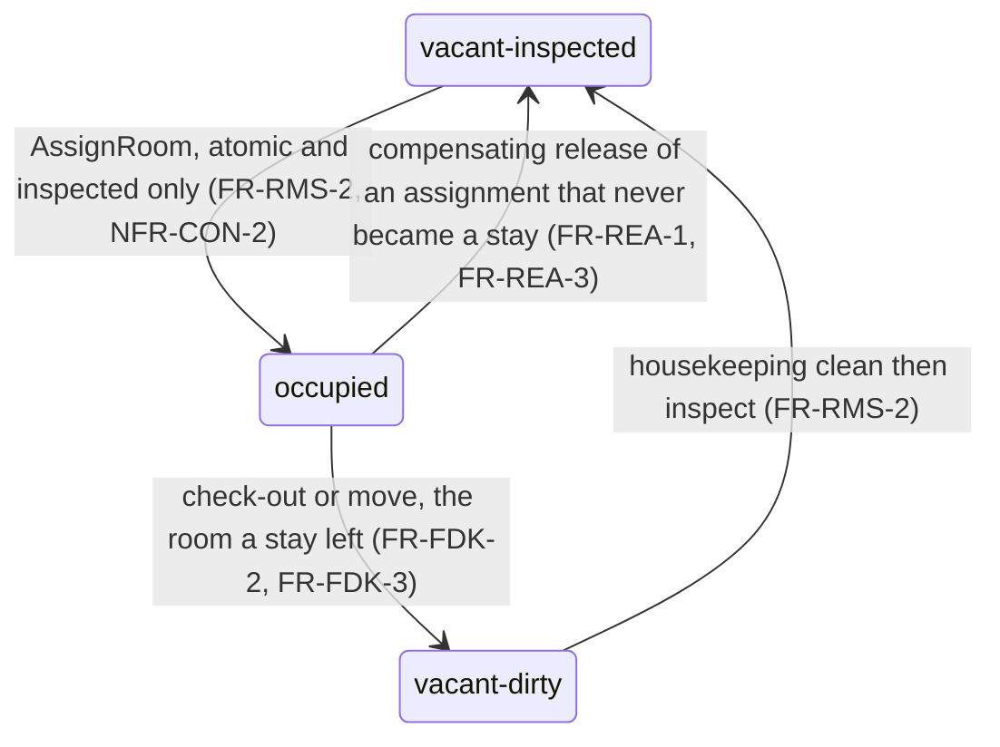

# State machines — booking and room

Status: active (accepted direction per ADR-0001, accepted
2026-10-23). Owned by `architect`. Lifecycle states only; the fixed
lifecycle order is not configurable per hotel (requirements
section 3.2). All transitions record actor and timestamp
(`NFR-AUD-1`).

## 1. Booking (reservation/stay) states

```mermaid
stateDiagram-v2
    [*] --> confirmed : book (FR-RES-1, FR-RES-4)
    confirmed --> checked_in : check in, ready room (FR-FDK-1)
    confirmed --> cancelled : cancel with reason (FR-RES-3)
    confirmed --> no_show : arrival date passed (FR-RES-6)
    checked_in --> closed : check-out commits, booking completed (FR-FDK-2, FR-DEP-1, BR-1)
    state checked_in as "checked-in (in-house)"
    state no_show as "no-show"
    note right of checked_in : room moves keep this state, history kept (FR-FDK-3)
    note right of closed : terminal; contributes nothing to availability (FR-DEP-2)
```

- `confirmed`: reservation recorded with dates, room type, guest,
  price basis (`FR-RES-1`, `FR-RES-4`).
- `checked-in`: arrival registered against a ready room; the stay is
  in house (`FR-FDK-1`). Room moves keep this state with history
  (`FR-FDK-3`).
- `closed`: stay checked out with settled folio or a provenanced
  recorded approval (`FR-FDK-2`, `FR-BIL-7`); the booking is terminal
  and leaves the active set, and the room becomes vacant and dirty
  (`FR-DEP-1`, `FR-DEP-3`).
- `cancelled`: before check-in only, with a reason from the hotel's
  list; held availability released (`FR-RES-3`).
- `no-show`: arrival date passed without check-in; held room released
  and history kept (`FR-RES-6`).

Allowed transitions: confirmed -> checked-in, confirmed ->
cancelled, confirmed -> no-show, checked-in -> closed. No other
transitions exist in the MVP; states are never skipped, reordered, or
renamed per hotel.

### 1.1 The close drives both lifecycles (Refs #646)

The stay's close and the booking's completion are one operator action,
not two independent transitions: the stay state (`in-house -> closed`)
and the reservation state (`checked-in -> closed`) are written by two
owning modules, triggered by the same desk confirmation. The shape adds
no state — both target states already exist — and the booking keeps its
recorded dates, room type, price basis, and stay link.

```mermaid
stateDiagram-v2
    state Stay {
        [*] --> in_house : check in, ready room (FR-FDK-1)
        in_house --> stay_closed : CheckOut gate passes (FR-FDK-2)
    }
    state Reservation {
        [*] --> confirmed : book (FR-RES-1)
        confirmed --> checked_in : check-in links the stay (FR-FDK-1)
        checked_in --> res_closed : CheckOutReservation, same close (FR-DEP-1)
        res_closed --> [*]
    }
    state in_house as "in-house"
    state stay_closed as "closed"
    state res_closed as "closed (completed)"
    note right of stay_closed : room released vacant-dirty, housekeeping makes it reusable (FR-RMS-2)
    note right of res_closed : terminal, not in the active set (FR-DEP-2, FR-DEP-3)
```

- **Trigger.** After Stay's conditional `in-house -> closed` flip commits
  (`services/stay/src/store.ts:282-290`; Postgres
  `services/stay/src/pgstore.ts:161-206`), Stay calls
  `ReservationService.CheckOutReservation` with the closed `stayId` and
  the caller's actor; Reservations resolves the reservation by the stay
  link the row already carries (`stay_id` UUID UNIQUE,
  `services/reservations/migrations/000002_schema.up.sql:33`) and flips
  `checked-in -> closed` under a conditional write. Flow detail:
  `docs/architecture/lld.md` section 22.
- **Attempts are idempotent.** A second completion call for the same stay
  returns the already-`closed` booking without a second change, so a
  replayed or double-confirmed close completes once (FR-DEP-1).
- **Refusals change nothing.** A check-out the folio gate refuses never
  reaches the flip, so the booking stays `checked-in`; a close that
  commits but whose completion cannot be recorded keeps the stay
  `closed` and reports the split instead of inventing a completion
  (`FR-DEP-5`). The readiness release and re-offer path is the room
  machine in section 2, unchanged.
- **Active set.** Only `confirmed` and `checked-in` hold a sellable unit
  or block a new booking; `closed`, `cancelled`, and `no-show`
  contribute nothing (`FR-DEP-2`, `services/reservations/internal/store/store.go:194-196`,
  `:214-227`, `:367-380`). The calendar read still returns every state so
  history keeps the past stay (`:274-291`); the desk's arrival pick
  filters `confirmed` itself (`app/src/views/StayView.vue:928-941`).

## 2. Room states

```mermaid
stateDiagram-v2
    [*] --> vacant_clean : ready room
    vacant_clean --> vacant_inspected : housekeeping clean
    vacant_inspected --> occupied : check-in assignment, inspected only (FR-RMS-2)
    occupied --> vacant_dirty : check-out or room move (FR-FDK-2, FR-FDK-3)
    vacant_dirty --> vacant_clean : housekeeping
    vacant_clean --> out_of_order : date-ranged block (FR-RMS-3)
    vacant_inspected --> out_of_order : date-ranged block (FR-RMS-3)
    out_of_order --> vacant_clean : block ends
    out_of_order --> vacant_inspected : block ends
    state vacant_clean as "vacant-clean"
    state vacant_inspected as "vacant-inspected"
    state vacant_dirty as "vacant-dirty"
    state out_of_order as "out-of-order"
```

- Live states: occupied, vacant, dirty, clean, inspected,
  out of order (`FR-RMS-1`).
- Housekeeping walks dirty -> clean -> inspected; only inspected
  vacant rooms are offered for check-in assignment (`FR-RMS-2`).
- Out-of-order is a date-ranged block with a recorded reason, entered
  only from a vacant state (never from occupied); when the block ends
  the room returns to a vacant state. No new reservation or check-in
  may take the room for a blocked date (`FR-RMS-3`).
- Check-out sets the room to vacant and dirty; a room move sets the
  old room to vacant and dirty (`FR-FDK-2`, `FR-FDK-3`).

<!-- ao-role: architect -->
Role: architect · AO session hotel-mgmt-946

### 2.1 The two release targets (Refs #647)

No state and no transition is added by the desk reassignment change; it
makes one existing operation path normative. `ReleaseRoom` accepts an
explicit `toState` (`vacant-dirty` by default, `vacant-inspected`
allowed, `occupied` refused, `services/rooms/src/store.ts:407-436`), and
that parameter is the only way an `occupied` room can reach
`vacant-inspected` — `UpdateRoomState` cannot make that step
(`ALLOWED_TRANSITIONS`, `:33-40`).

Which target belongs to which flow is decided, not incidental:

- `occupied -> vacant-dirty` — the room a stay really held: a check-out
  or a room move. Housekeeping then walks dirty -> clean -> inspected
  before the room is offered again (`FR-RMS-2`).
- `occupied -> vacant-inspected` — the room an aborted desk action
  assigned and nobody used: the check-in commit (or a reassignment)
  takes back the assignment and returns the room to the ready state it
  held before the attempt (`FR-REA-1`, `FR-REA-3`). A room is never sent
  to housekeeping for a guest who was never in it, and a used room is
  never left reading ready.



- Both transitions are ordinary `ReleaseRoom` calls with an explicit
  `toState`; each records `room_status_history` and emits
  `room.state-changed`, so the pair an aborted action produces (occupied,
  then ready again) is visible in the room's own history
  (`services/rooms/src/store.ts:398-402`, `:428-432`; Postgres parity
  `services/rooms/src/pgstore.ts:499-544`).
- The move itself changes no stay state: the stay stays in house with
  its folio link and keeps the move row (`FR-FDK-3`, `BR-19`).
- Sequence reference: the room states above are unchanged for
  check-out; the ordering that produces them is
  `docs/architecture/lld.md` [section 23](lld.md), and the desk copy for
  the refusal cases is `docs/product/desk-ui-design-rollout.md` section
  6.17.

<!-- ao-role: architect -->
Role: architect · AO session hotel-mgmt-961
