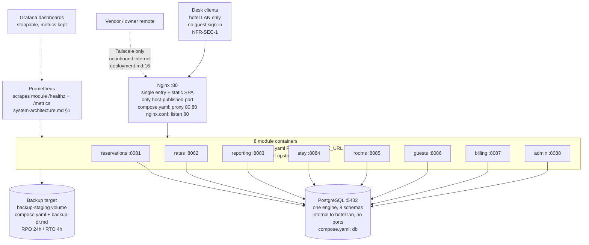

# System architecture — single-property on-premise deployment

Status: active (accepted direction per ADR-0001, accepted
2026-10-23; outlines, not build detail). Owned by `architect`. The
deployable topology for one MVP installation. Module responsibilities
live in `docs/architecture/hld.md`; this document adds the runtime
shape only.

## 1. Deployable topology (one property, one on-premise unit)

One installation serves exactly one hotel property (`NFR-DEP-1`)
from that property's own on-premise unit: a single 2*4*50 host
(2 vCPU / 4 GB RAM / 50 GB disk — owner notation on issue #28,
confirmed by ADR-0001 OQ-A3) by default, with a documented
variant spreading the same containers and the database across
2–3 such hosts on the hotel LAN. Both placements stay on the
premises: no cloud, no traffic across properties. All components
keep working without internet (`NFR-AVL-1`):

- Nginx: the single entry point and reverse proxy for desk
  clients on the hotel LAN; serves the static frontend build and
  routes to the module containers; no external exposure.
- Module containers: one container per HLD module (Reservations,
  Stay, Rooms, Rates & Availability, Guests, Billing, Reporting,
  Admin & Config), each embedding its own
  (proposed) runtime (primary mapping: Node.js × 4, Go × 3,
  Spring Boot Java × 1 on Billing —
  `docs/architecture/candidate-architectures.md` section 8).
- Database host(s): one shared database engine (accepted
  default PostgreSQL per ADR-0001, accepted 2026-10-23; MySQL stays
  the named fallback) holding
  one dedicated schema per module; modules connect only to
  their own schema.
- Monitoring (planned — no as-built counterpart as of master:
  no `/metrics` endpoint in code, no Prometheus/Grafana services
  in `deploy/`): Prometheus (scrapes module `/healthz` +
  `/metrics` and host stats; only `/healthz` exists in code
  today) plus Grafana dashboards, both on-premise with no cloud
  push; Grafana may be stopped to reclaim RAM without losing
  metric retention.
- Backup target: on-premise storage (dedicated disk partition
  or hotel NAS) receiving exports and backups (`FR-ADM-5`);
  every run reports success or failure with its time
  (`NFR-BKP-1`, `NFR-BKP-2`: RPO at most 24 hours, RTO at most
  4 hours on equivalent hardware). Backup media never leaves
  the property.
- Desk clients: staff browsers or terminals on the hotel LAN
  only; guests have no sign-in (`NFR-SEC-1`). Remote access
  (vendor support, owner review) goes over Tailscale; no
  inbound internet exposure, no external callbacks.

Placement variants (one topology, two placements):

- Default: everything on a single 2*4*50 host — simplest
  install, least administration. The section 3 budget shows all
  components fit with headroom.
- Small-cluster variant: the same containers and the database
  spread across 2–3 such hosts on the hotel LAN (proposed
  split: host 1 — Nginx + desk-facing modules + monitoring;
  host 2 — database engine + backup target; optional host 3 —
  remaining modules); same components, same contracts, only
  placement differs. Cluster plumbing is plain containers
  installed via the canonical `script/install.sh` by default (the
  Ansible playbook is the offline-friendly alternative
  implementing the same steps); mini-K8s (k3s-class) only with a
  written reason
  per accepted ADR-0001 (accepted 2026-10-23).

Portability rules (no single-box assumption anywhere):

- No host-specific paths in any component; all persistent state
  lives in the database host(s) and the backup target.
- Every inter-component endpoint (proxy to modules, modules to
  their stores) is reached via configuration/service names, so a
  container can move between hosts without code or image changes.

Conceptual layout (placement differs, components do not) — rendered
below; every node/edge traces to the source in parentheses:

Small-cluster variant (same containers, same contracts, only
placement differs — `system-architecture.md` §1): host 1 carries
Nginx + desk-facing modules + monitoring; host 2 carries the
database engine + backup target; optional host 3 carries remaining
modules; all hosts join the hotel LAN over the same
`hotel-lan` service names (portability rules above).

No component calls outside the property in the MVP; there are no
external integrations (no OTA, no payment provider, no accounting
sync — product scope, out of scope).

## 2. Sizing and performance frame

The topology must hold a 50-room hotel with 5 staff signed in at once
(`NFR-PERF-1`: named views within 2 seconds, named actions within
3 seconds) and two years of operating data for standard reports
(`NFR-PERF-2`: within 5 seconds). Owner answer on issue #28
(2026-10-23) settles ADR-0001 OQ-A3 as 2*4*50 per host
(2 vCPU / 4 GB RAM / 50 GB disk) per host:
the single-host default must hold the section 3 budget, and each
node of the small-cluster variant carries the same minimum.

## 3. Per-module resource budget (single 2*4*50 host)

Planning estimates (to be validated by measurement through the OQ-C12
spike now that the stack direction is chosen). All figures are steady
state per component on the default single host:

| Component | RAM | vCPU share | Disk | Note |
|---|---|---|---|---|
| OS + Ansible-managed baseline | ~512 MB | ~0.2 | ~5 GB | Minimal server OS, container runtime, Tailscale |
| Nginx (entry + static frontend) | ~32 MB | ~0.05 | ~0.2 GB | Static SPA, no SSR runtime |
| Reservations (Go) | ~50 MB | ~0.1 | ~0.1 GB | Static binary |
| Stay (Node.js) | ~150 MB | ~0.1 | ~0.3 GB | Shared runtime image layer with Rooms/Guests/Admin |
| Rooms (Node.js) | ~150 MB | ~0.1 | ~0.1 GB | Shared image layers with Stay |
| Rates & Availability (Go) | ~50 MB | ~0.1 | ~0.1 GB | Static binary |
| Guests (Node.js) | ~150 MB | ~0.1 | ~0.1 GB | Shared image layers with Stay |
| Billing (Java 21 on Spring Boot, JVM mode) | ~350 MB `estimate` | ~0.1 | ~0.5 GB `estimate` | Team main stack; RSS/startup sources + math in `candidate-architectures.md` section 8; Quarkus JVM-slim is the named footprint fallback |
| Reporting (Go) | ~50 MB | ~0.05 | ~0.1 GB | Read API + event consumer |
| Admin & Config (Node.js) | ~150 MB | ~0.05 | ~0.1 GB | Config CRUD + identity sessions |
| Shared database engine (PostgreSQL/MySQL) | ~512 MB | ~0.4 | ~5 GB + data | One engine, 8 schemas; 2-year data ~2–4 GB at 50-room scale |
| Event dispatcher (outbox poller) | ~32 MB | ~0.05 | negligible | Sidecar or in-Reporting; no Kafka (~1 GB+ saved) |
| Prometheus | ~200 MB | ~0.1 | ~2 GB retention | 15-day local retention default |
| Grafana (stoppable) | ~150 MB | ~0.05 | ~0.2 GB | May be stopped to reclaim RAM; metrics kept |
| Backup staging | — | — (scheduled) | ~10 GB | Nightly dumps + exports; rotated per `docs/operations/backup-dr.md` |
| Headroom | ~750+ MB | ~0.45 | ~20 GB free | Burst, day-close, restore drills, log growth |

Totals: ~3.37–3.42 GB of 4 GB RAM, ~1.7 of 2 vCPU, ~23.4 GB of
50 GB disk — inside one host with headroom in every dimension
(~600+ MB RAM, ~0.3 vCPU, ~20 GB disk for burst, day-close,
restore drills, and log growth). Billing-on-Spring adds ~+300 MB
RAM / ~+0.05 vCPU / ~+0.3 GB disk versus the previous all-Go
billing estimate; no compensating trim is taken because the
budget holds — the named trims inside the minimal-subset rule
(Grafana stopped by default to reclaim ~150 MB, narrower
Prometheus retention, Quarkus JVM-slim fallback freeing ~170 MB)
are recorded in `candidate-architectures.md` section 8 and would
each be applied explicitly with numbers, never silently. A second
Spring-context service anywhere else is explicitly excluded by
the minimal-subset rule and NOT in these totals.
Excluded by the minimal-subset rule and NOT in these totals:
Kafka (~1 GB+ RAM — excluded, OQ-C7), Redis (re-opened only on
measured `NFR-PERF-1` miss), mini-K8s control plane (~500 MB+
— cluster variant only, OQ-C6), second database engine (one
shared engine suffices). The fallback mapping (Candidate C,
Node.js throughout) replaces the three Go binaries and the one
Spring Boot service with four more ~150 MB Node.js containers
(+~100–150 MB RAM net versus this primary) and still fits.

## 4. Chain-ready direction (explicitly non-MVP)

Multi-property operation — per-property views plus shared oversight,
shared guest records, central administration — is a later direction,
not MVP. Nothing in this topology delivers it: there is no
cross-property reporting, no shared guest database, no central
service. When chain work starts, it extends or adds modules per the
then-accepted ADR; MVP boundaries must not be bent toward it early.

<!-- ao-role: architect -->
Role: architect · AO session hotel-mgmt-46
