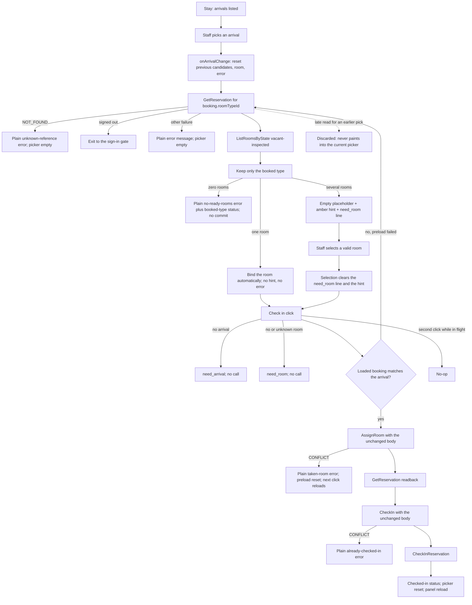
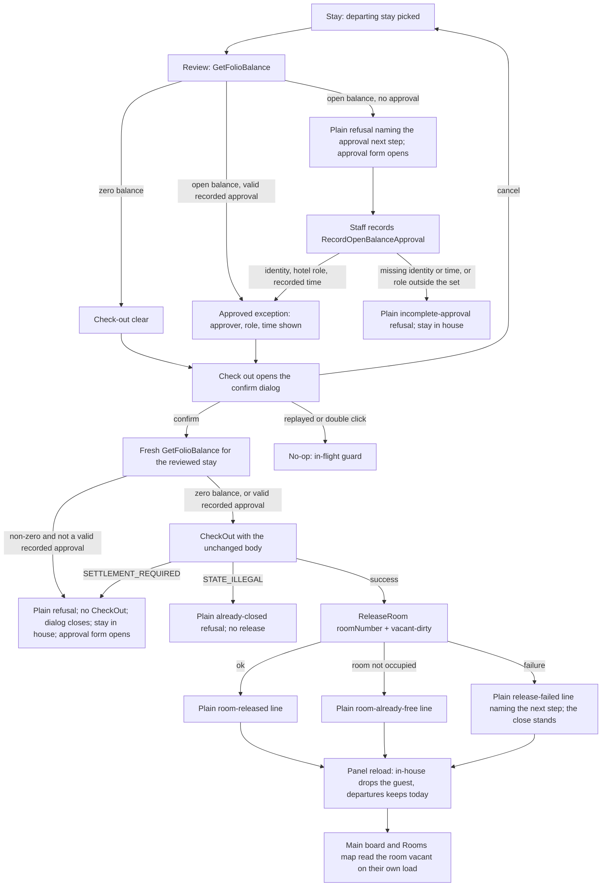

# Desk UI design rollout — six-screen Claude UI (Refs #419)

Status: active. Product-owner rollout spec for the owner-supplied
Claude desk UI design, owned by `product-owner` (Closes #419).
Proposed tier T2 (reader-visible UI change across six screens; no
new subsystem, no data-model change, no refusal-semantics change).
This document sets scope, the per-screen breakdown, the shared
design tokens, the T2 UI contract section, and the acceptance
conditions; the matching Given/When/Then done-conditions live in
`docs/product/acceptance-criteria.md` [section 11](acceptance-criteria.md).
FR/NFR wording is owned by `business-analyst`, flow diagrams and
technical design by `architect`, and guard mapping by `qa-lead`
(section 8 points at each landed handoff without repeating it).

## 1. Scope in / out

In:

- All six screens per the supplied design with the shared tokens
  in section 3: Main desk board, Stay check-in/out, Onboarding
  setup wizard, Rooms visual map, Book, Folio.
- The new VI strings the screens need, added through the normal
  catalogue process with `script/catalogue-coverage-check.sh`
  green (section 7).
- Tracking the six per-screen sub-issues to done
  (#420–#425, section 2).

Out:

- Print, admin, and gate/sign-in screens (not in this design
  batch; they keep their current presentation and stay
  reachable).
- Catalogue restructuring (new keys only, same key shape).
- Backend or API changes beyond what the screens need; anything
  discovered is filed as a follow-up, never snuck into a
  restyle PR.

## 2. Per-screen breakdown

One small task and one PR per screen, in any order except where
noted. The design files below are the owner-supplied static HTML
screens plus the canvas manifest (workspace-local copies from the
owner request); each implementation PR is reviewed against its
design file. Where the design conflicts with the #412 journey
record, the design wins and the conflict is recorded on the
affected sub-issue with the owner decision (section 6).

| # | Screen | Design file | Sub-issue | Size | Risk | Notes |
|---|---|---|---|---|---|---|
| 1 | Main desk board | Main desk board (Bang le tan) | #420 | M | risk-low | Restyle of the existing desk screen, plus the two housekeeping clean/inspect buttons on the rooms-to-clean card (fills the #412 QA housekeeping gap). |
| 2 | Stay check-in/out | Stay check-in/out (Nhan phong) | #422 | M | risk-low | Restyle plus one behaviour-relevant detail: the room select defaults to an explicit empty placeholder with a hint, so staff pick a ready room first (resolves #411; never a phantom selection). Checkout stays gated on a fully-paid folio. |
| 3 | Onboarding setup wizard | 4-step first-run setup (Thiet lap lan dau) | #425 | M | risk-medium | New screen and new feature: a guided first-run wizard addressing the empty-database path from the #412 QA findings. Step 1 (hotel-name input with example placeholder, invoice/receipt helper, 25 percent progress bar, continue action) shipped in PR #437; steps 2–4 are specified in section 10 (Refs #438). Gated to launch on empty database only. |
| 4 | Rooms visual map | Rooms visual map (So do phong) | #424 | M | risk-medium | New screen: floor-grouped visual map (18 rooms across 3 floors in the design) with a status-chip summary row and per-room cards. The static design shows only a refresh action and no per-card buttons, so action placement needs a product-owner decision before building; no actions are invented. |
| 5 | Book | Book screen (Dat phong) | #421 | S | risk-low | Restyle only; the booking flow itself is unchanged. |
| 6 | Folio | Folio screen (Hoa don) | #423 | S | risk-low | Restyle only; folio logic is unchanged. |

Sequencing: the four restyles (#420–#423) are independent of each
other. The Rooms map (#424) should land after the Main board
(#420) so the two housekeeping surfaces agree on status wording.
The Onboarding wizard shipped step 1 first (PR #437) with steps
2–4 explicitly deferred; the steps 2–4 decision is recorded in
section 10 (Refs #438) and the steps 2–4 implementation follows
it in one small task and one PR.

## 3. Shared design tokens

Every screen uses exactly these tokens; a token or layout mistake
propagates into every follow-up, so token changes land in one
place and all six screens pick them up together:

- Header teal `#0F4C47`; primary buttons `#0F766E`.
- Background `#F4F6F5`; ink `#1B2B2A`.
- Minimum touch/keyboard target 44px on every interactive
  element.
- Card radius 12px.
- VI-primary copy throughout (section 7); the hotel name in the
  design is example content and must stay configurable, never
  hardcoded.
- One shared shell owns the top nav tabs plus the locale toggle
  on all six screens (section 4).

## 4. UI contract (T2 reader-visible UI change)

### 4.1 Layout shell and navigation scope

- One shell wraps all six screens: teal header carrying the
  configurable hotel name, top nav tabs, locale toggle
  (EN/VI), and the existing sign-in gate behaviour unchanged.
- Nav tabs follow the canvas-manifest order — Main, Stay,
  Onboarding, Rooms, Book, Folio — with the active screen
  highlighted so staff always know where they are. Print and
  admin destinations stay reachable as today; they are out of
  the restyle batch and keep their current presentation.
- Onboarding is reachable from the nav but launches
  unprompted only on an empty database; it never interrupts a
  seeded desk.

### 4.2 Component mapping per pattern

- Cards: 12px radius, one idea per card matching the design
  groupings (e.g. Book keeps guest card above quote card on the
  left; dates/room/discount card on the right).
- Status chips: one chip vocabulary shared by the Main board
  and the Rooms map — ready, occupied, needs-cleaning,
  awaiting-inspection, out-of-service — with identical wording
  and colour meaning on both surfaces.
- Forms keep their existing fields, order, and actions; only
  presentation changes, except the Stay room-select placeholder
  (section 2, row 2).
- Per-room cards on the Rooms map show status chip, room type,
  and one note line: occupant plus checkout date, out-of-service
  reason plus date, or upcoming arrival.

### 4.3 Design-token scope

Section 3 is the complete token set. No per-screen colour,
radius, or target-size deviations; a screen that needs one
files it as a follow-up instead of forking a token.

### 4.4 States in plain words

Every screen states loading, empty, error, and refusal cases as
non-technical sentences naming what is happening and the next
step, reusing the `FR-DSP-3` plain-words rule from the #338
styling pass:

- Loading names the affected region while the rest stays
  visible; repeat-write buttons stay disabled until the call
  returns.
- Every list has an explicit empty state (e.g. departures
  empty state on the Main board; no-arrivals hint in Stay).
- Errors never surface technical codes.
- Refusals keep their existing conditions — check-in stays
  blocked until a ready room is chosen; checkout stays blocked
  on an unsettled folio without approval — only the wording is
  stand-in readable.

### 4.5 Print rules

Screen styling does not leak into print: receipts, invoices,
and confirmations print exactly as today (the `FR-DSP-4`
preservation rule holds), and the configured hotel name
appears on every printed document.

## 5. Acceptance criteria summary

The binding done-conditions are `AC-DSK-1` through `AC-DSK-18`
in `docs/product/acceptance-criteria.md` [section 11](acceptance-criteria.md)
(`AC-DSK-9`..`AC-DSK-11` cover the steps 2–4 follow-up, Refs
#438; see section 10; `AC-DSK-13` covers the quote/folio
money and date display shape, Refs #565; see section 6.8;
`AC-DSK-14` covers the open folio's guest and room in the
charges-card title, Refs #568; see section 6.9; `AC-DSK-15`
covers the app-localized Book date pickers, Refs #581; see
section 6.10; `AC-DSK-16` covers the list-backed stay picker
on the Folio and Print open steps, Refs #582; see section 6.11;
`AC-DSK-17` covers the Stay arrival-pick candidate preload and
room-error lifecycle, Refs #586; see section 6.12; `AC-DSK-18`
covers the Stay check-out room release and the unpaid-close gate,
Refs #588; see section 6.13).
In short: shared shell/tokens/nav/locale behave identically on
all six screens; each screen matches its design file closely
enough for a reviewer to check it card by card; the Stay
placeholder blocks check-in until a ready room is chosen, and
the arrival pick now preloads the booked-type ready rooms with
the commit still on the Check in button (`AC-DSK-17`);
checkout releases the departed room and requires a settled folio
or a recorded, provenanced approval on every UI route
(`AC-DSK-18`); Rooms summary counts
always match the rendered cards; the wizard launches on empty
database only and the configured hotel name surfaces across
desk and folio; all copy comes from the VI-primary catalogue;
and the business-date lines render the weekday-long locale form
per section 6.7 (`AC-DSK-12`), and the Book quote and Folio
amounts render the design VND shape with the quote nights in the
desk date form per section 6.8 (`AC-DSK-13`), the Folio charges
card names the open folio's guest and room with the raw IDs still
behind the reference disclosure per section 6.9 (`AC-DSK-14`), and
the Book arrival/departure fields are app-localized pickers that keep
the ISO payload per section 6.10 (`AC-DSK-15`).

## 6. Conflict rule with #412

#412 stays the journey/spec record. Where this design conflicts
with it, the design wins, and each conflict found during
implementation is recorded on the affected sub-issue with the
owner decision — never silently, never in a code comment only.
Known candidate touchpoints (not pre-decided conflicts): the Stay
placeholder wording against the J1/S3 wireframe hint text, and
the Rooms-map action placement against the J2 inline-action
rule.

### 6.1 Main parity-sweep resolutions (Refs #495)

The 2026-11-06 full-tree sweep of the Main board vs
`docs/design/Main.dc.html` (253 diffs, isolated lab) closed with
owner-delegated product decisions on every residual diff class;
no design intent was guessed. The desk-side follow-through
(per-route titles S2, dynamic-data allowlist S7) lands in the
#495 PR; S8/S9 file as separate follow-ups.

- S1 tree shape — ACCEPT PrimeVue shell (ADR-0003
  PrimeVue-first stands). The design renders the board in a
  custom `<x-dc>` wrapper with flat markup; the app renders the
  Vue shell plus PrimeVue components. Full-tree literalism is
  rejected: the gates compare facts plus decided content, not
  markup.
- S2 document title — APPROVED per-route titles (Main
  `Bảng lễ tân`, Book `Đặt phòng`, Stay `Nhận phòng`, Folio
  `Hoá đơn`, Rooms `Sơ đồ phòng`, Onboarding `Thiết lập lần
  đầu`); the single static SPA title cannot match six boards.
- S3 refresh copy — KEEP `Tải lại`. The Main board (`Làm
  mới`) is the outlier: the Rooms board agrees with the app,
  and the key is shared across four screens' decided content.
- S5/S6 vocabulary — KEEP app copy (`Ngưng bán`,
  `Sạch nhưng chưa kiểm tra`): consistent across screens and
  pinned by decided content, while the two design files
  disagree with each other. Owner may override both wordings
  in one copy call covering #495 + #499.
- S7 dynamic data — allowlist entries DD-01..DD-07 approved
  as patterns (dates, guest names/codes, counts, hotel name);
  wired into the gate for Main, other screens on their own
  sweeps. Owner veto welcome.
- S8 `tokens.primary` residual and S9 business-date display
  format — separate follow-up issues (button fix #471 landed;
  display formatting touches the shared display+API ref).

### 6.2 Book parity-sweep resolutions (Refs #496)

The 2026-11-06 full-tree sweep of the Book board vs
`docs/design/Book.dc.html` (130 diffs, isolated lab
`hotel-lab-691`, `vi` locale) closed with no code change to the
view itself and gate-harness wiring only; no design intent was
guessed. The served title already matches the board
(`Đặt phòng`, verified live) via the #495 S2 follow-through,
and the fact-level gate passes 2/2 (matching app DOM incl. the
decided headings/buttons/inputs, live shell conformance).

- B1 tree shape — same accepted S1 as Main: 59 design-side
  `x-dc` subtree nodes plus 71 app-side shell/PrimeVue/head
  extras, zero text/colour/font/visibility diffs on shared
  paths. Full-tree literalism stays rejected.
- B2 document title — already closed (#495 S2), verified live
  on `/app/book`.
- B3 quote copy — RESOLVED (#565), superseding the earlier
  REPORTED disposition. The design shows a quoted state
  (`Số đêm 2`, `Tổng tiền 1.800.000 đ`); the app renders
  `Số đêm: {count}` / `Tổng cộng: {amount}` only after a quote,
  and an empty state before. Product decision (section 6.8):
  the app labels stay, the empty-vs-quoted presentation stays,
  and the quote money and nightly dates render the design
  shape. Labels do not change.
- B4 app extras — KEPT with justification (same precedent as
  the Main deliberately kept extras): the walk-in actor note,
  guest-status line, room-type loading/empty states, and the
  post-booking result/confirmation panels are flow states the
  static board cannot show. The fact-level decided content
  pins the static copy; extras render no decided copy.
- B5 dynamic data — allowlist entries DD-08 (shared shell
  hotel name, same paths as Main DD-02) and DD-09 (room-type
  option subtrees, design illustration vs API catalogue)
  wired as `BOOK_SCREEN_ALLOWLIST`: 130 → 122 residual diffs,
  all `node` presence mismatches, zero stale entries. The
  design quote rows carry no entry (fresh-lab empty state is
  flow-state, not dynamic data). Owner veto welcome.
- B6 select placeholder — no diff: both sides render
  `Chọn hạng phòng…`; the placeholder stays pinned by the
  fact-level decided input.
- B7 arrival/departure date fields — RESOLVED (#581), superseding
  the board's plain text inputs on this surface only. The design
  draws both fields as text inputs; the owner decision
  (section 6.10) makes them app-localized PrimeVue `DatePicker`
  controls so the field follows the app locale, not the browser
  UI language (#566). The board files stay read-only
  (`docs/design/README.md`), the deliberate divergence is
  recorded here and in the #563 audit, and the design-facts gate
  keeps `kind: 'text'` (the picker's inner input) with the
  locale-shaped placeholder.

### 6.3 Stay parity-sweep resolutions (Refs #497)

The 2026-11-06 full-tree sweep of the Stay board vs
`docs/design/Stay.dc.html` (243 diffs, isolated lab
`hotel-lab-693`, `vi` locale) closed with no code change to the
view itself and gate-harness wiring only; no design intent was
guessed. The served title already matches the board
(`Nhận phòng`, verified live) via the #495 S2 follow-through,
and the fact-level gate passes (matching app DOM incl. the
decided headings/buttons/inputs, live shell conformance).

- T1 tree shape — same accepted S1 as Main: 69 design-side
  `x-dc` subtree nodes plus 174 app-side shell/PrimeVue/head
  extras, zero text/colour/font/visibility diffs. Full-tree
  literalism stays rejected.
- T2 document title — already closed (#495 S2), verified live
  on `/app/stay`.
- T3 check-in flow — RESOLVED on its load half (#586). The
  design shows a single-step form (reference + arrival + room +
  one button) with no separate load step; the app used to run a
  two-step flow (first Check in click loads the booking and the
  ready rooms of the booked type, second click commits). Per the
  owner request the arrival pick now loads the booking and the
  booked-type ready rooms into the picker
  (`onArrivalChange` → `loadCandidates`), so the room select is
  populated right after the guest pick like the board; the commit
  deliberately stays on the Check in button — a room pick never
  commits. Section 6.12 is the binding delta; `AC-DSK-17` is the
  done-condition and `AC-RST-4` is reworded to this timing.
- T4 app extras — KEPT with justification (same precedent as
  the Main deliberately kept extras and Book B4): the h1+intro,
  the lists DataTables with empty states and per-row pick
  buttons, the move/times/checkout status lines and reference
  details, the folio approval section, and the checkout
  confirmation dialog are flow states the static board cannot
  show. The fact-level decided content pins the static copy;
  extras render no decided copy.
- T5 dynamic data — allowlist entries DD-10 (shared shell
  hotel name, same paths as Main DD-02 and Book DD-08), DD-11
  (business-date strongs, design snapshot vs live clock),
  DD-12 (three design-side example list rows), and DD-13
  (check-in + move room-option select subtrees, design
  illustration vs API catalogue) wired as
  `STAY_SCREEN_ALLOWLIST`: 243 → 225 residual diffs, all
  `node` presence mismatches, zero stale entries. The design
  list headings carry no entry (no counts — static copy pinned
  by the fact-level decided headings); app-side list rows
  carry no entry yet (fresh-lab empty tables are flow-state,
  rows proposed when a run with stay data shows them). Owner
  veto welcome.
- T6 refresh copy — no diff: both sides render `Tải lại`; the
  Stay board agrees with the app (unlike the Main-board
  outlier in #495 S3).

### 6.4 Folio parity-sweep resolutions (Refs #498)

The 2026-11-06 full-tree sweep of the Folio board vs
`docs/design/Folio.dc.html` (137 diffs, isolated lab
`hotel-lab-695`, `vi` locale) closed with no code change to the
view itself and gate-harness wiring only; no design intent was
guessed. The served title already matches the board
(`Hoá đơn`, verified live in both locales) via the #495 S2
follow-through, and the fact-level gate passes (matching app DOM
incl. tokens, tab labels, and active state; the Folio screen
carries no decided content, so the decided block is skipped by
design — live shell conformance).

- F1 tree shape — same accepted S1 as Main: 36 design-side
  `x-dc` subtree nodes plus 101 app-side shell/PrimeVue/head
  extras, zero text/colour/font/visibility diffs. Full-tree
  literalism stays rejected.
- F2 document title — already closed (#495 S2), verified live
  on `/app/folio` (`Hoá đơn` in `vi`, `Folio` fallback in `en`).
- F3 open-folio flow — REPORTED, not changed. The design shows a
  folio already open for guest Lê Minh in P.201 (two charge
  lines, one payment, balance due); the app opens with an
  explicit stay-ID form (open card, folio table with the empty
  state, post-charge and record-payment forms) because the folio
  is per-stay data the static board cannot pre-select. The entry
  step is user-visible flow: product call. The #568 fix (section
  6.9) names the open folio's guest and room in the charges-card
  title from the stay the folio belongs to; it does not pre-select
  a stay, so this F3 item stays REPORTED.
- F4 app extras — KEPT with justification (same precedent as
  the Main deliberately kept extras, Book B4, and Stay T4): the
  h1+intro, the open-folio card with the stay-ID input, the
  folio-lines DataTable with the empty state, the charge-kind
  select plus name/amount inputs with status lines, the
  payment-method select plus amount input with status lines,
  and the reference details are flow states the static board
  cannot show. Extras render no decided copy (no Folio decided
  content exists).
- F5 dynamic data — allowlist entries DD-14 (shared shell
  hotel name, same paths as Main DD-02, Book DD-08, and Stay
  DD-10), DD-15 (design-side charge heading plus both charge
  rows with their `span`/`strong` children, guest + amounts),
  and DD-16 (design-side balance-due value plus the payment row
  with its children) wired as `FOLIO_SCREEN_ALLOWLIST`:
  137 → 124 residual diffs, all `node` presence mismatches,
  zero stale entries. The static board copy around the exempted
  values (both card headings, the `Còn phải trả` due label, all
  four input labels, both buttons) carries no entry — S1
  residuals; app-side folio lines carry no entry yet (fresh-lab
  empty folio state is flow-state, rows proposed when a run with
  folio data shows them). Owner veto welcome.
- F6 payment-method options — no diff vs the board: the design
  carries no method picker (its `Tiền mặt` line is an example
  payment row, exempted under DD-16), so the app's `cash` /
  `card` select stays an F4 flow extra, not a parity gap.

### 6.5 Rooms parity-sweep resolutions (Refs #499)

The 2026-11-06 full-tree sweep of the Rooms board vs
`docs/design/Rooms.dc.html` (222 diffs, isolated lab
`hotel-lab-697`, `vi` locale) closed with no code change to the
view itself and gate-harness wiring only; no design intent was
guessed. The served title already matches the board
(`Sơ đồ phòng`, verified live) via the #495 S2 follow-through,
and the fact-level gate passes 2/2 (matching app DOM incl. the
decided heading prefix/required labels/buttons, live shell
conformance).

- R1 tree shape — same accepted S1 as Main: 147 design-side
  `x-dc` subtree nodes plus 75 app-side shell/PrimeVue/head
  extras, zero text/colour/font/visibility diffs. Full-tree
  literalism stays rejected.
- R2 document title — already closed (#495 S2), verified live
  on `/app/rooms` (`Sơ đồ phòng`).
- R3 chip vocabulary — REPORTED, not changed. The design
  carries bare labels (`Sẵn sàng`, `Có khách`, `Cần dọn`,
  `Chờ kiểm tra`, `Ngừng sử dụng`); the app shares the
  qualified Rooms/Main vocabulary (`Sẵn sàng (đã kiểm tra)`,
  `Đang có khách`, `Phòng bẩn`, `Sạch, chờ kiểm tra`,
  `Ngưng bán`) pinned by the fact-level decided room map
  (Refs #491) and the #495 S5/S6 resolutions. User-visible
  copy: product call.
- R4 app extras — KEPT with justification (same precedent as
  the Main deliberately kept extras, Book B4, Stay T4, and
  Folio F4): the h1+intro, the business-date line, the empty
  state, the per-card PrimeVue Card/Tag structure with type
  and note lines, the housekeeping buttons, and the
  unknown-floor section are flow states the static board
  cannot show. The fact-level decided content pins the static
  copy; extras render no decided copy.
- R5 dynamic data — allowlist entries DD-17 (shared shell
  hotel name, same paths as Main DD-02, Book DD-08, Stay DD-10,
  and Folio DD-14), DD-18 (design-side summary line with counts
  plus frozen date, app-side business-date strong),
  DD-19 (all five design-side chip spans plus all five
  app-side chip lis, count-bearing nodes exempted wholesale,
  same note as Main DD-07), and DD-20 (all three design-side
  floor card grids with their children) wired as
  `ROOMS_SCREEN_ALLOWLIST`: 222 → 82 residual diffs, all
  `node` presence mismatches, zero stale entries. The static
  board copy around the exempted values (the h1, both h2s, the
  `Tải lại` button) carries no entry — S1 residuals; app-side
  room cards carry no entry yet (fresh-lab cards for seed rooms
  101/102 are flow-state, rows proposed when a run with richer
  room data shows them). Owner veto welcome.
- R6 refresh copy — no diff: both sides render `Tải lại`; the
  Rooms board agrees with the app (unlike the Main-board
  outlier in #495 S3).

### 6.6 Onboarding parity-sweep resolutions (Refs #500)

The 2026-11-06 full-tree sweep of the Onboarding board vs
`docs/design/Onboarding.dc.html` (54 diffs, isolated lab
`hotel-lab-699`, `vi` locale) closed with no code change to the
view itself and no allowlist wiring; no design intent was
guessed. The served title already matches the board
(`Thiết lập lần đầu`, verified live) via the #495 S2
follow-through — byte-identical to the design `<title>`, so no
title diff surfaces — and the fact-level gate passes 2/2
(matching app DOM, live shell conformance; the Onboarding
screen carries no decided content, so the decided block is
skipped by design — live shell conformance, same note as
Folio F4).

- O1 tree shape — same accepted S1 as Main: 13 design-side
  `x-dc` subtree nodes plus 41 app-side extras (the 2 SPA head
  tags plus 39 shell/PrimeVue nodes), zero text/colour/font/
  visibility diffs on shared paths. Full-tree literalism stays
  rejected.
- O2 document title — already closed (#495 S2), verified live
  on `/app/onboarding` (`Thiết lập lần đầu`).
- O3 wizard scope — REPORTED, not changed. The design shows
  step 1 as `Thông tin khách sạn` under the header
  `Thiết lập khách sạn` with the progress line
  `Bước 1 / 4 · Thông tin khách sạn`; the app runs step 1 as
  `Đặt tên khách sạn` (step 2 carries `Thông tin khách sạn`)
  under the h1 `Thiết lập lần đầu` — which matches the
  design's own `<title>` — with the progress line
  `Bước {current} trên {total}` (Refs #425 step 1, #438 steps
  2–4). Step naming, header, and progress format are
  user-visible copy/flow: product call.
- O4 helper and placeholder copy — REPORTED, not changed. The
  design helper reads `Tên này hiện trên hoá đơn và biên nhận.`
  while the app renders
  `Tên này sẽ hiển thị trên hóa đơn và biên lai.`; the design
  placeholder example is `Ví dụ: Khách sạn Hoa Mai` while the
  app renders `Ví dụ: Khách sạn Sunrise Riverside`. The app
  wording is consistent catalogue-wide (`hóa đơn` / `biên lai`
  across print, stay, billing, and onboarding keys — the
  design's `hoá đơn` / `biên nhận` is the outlier, same
  rationale as #495 S3), and the app cannot reuse the
  design's example name (the boot-seed `Hoa Mai` placeholder
  is reserved, Refs #456). User-visible copy: product call.
- O5 app extras — KEPT with justification (same precedent as
  the Main deliberately kept extras, Book B4, Stay T4, Folio
  F4, and Rooms R4): the h1+intro, the shell nav, the progress
  bar widget, the disabled step-1 Back button, steps 2–4 with
  their forms, and the loading/error/retry/noscript states are
  flow states the static step-1 board cannot show. Extras
  render no decided copy (no Onboarding decided content
  exists).
- O6 dynamic data — no entries. No dynamic-data nodes surface
  on either side: every one of the 54 diffs is a `node`
  presence mismatch, the only example name lives in the input
  `placeholder` attribute (which the gate never extracts —
  text content only), and the step counter is flow-state plus
  the O3 format divergence, reported rather than exempted
  (same rule as the Book quote rows in #496 B5). Onboarding
  keeps `EMPTY_ALLOWLIST` with zero stale entries trivially;
  entries are proposed only if a future run with wizard
  actions shows value-bearing dynamic nodes (section 5 of
  the allowlist doc).

### 6.7 Business-date display format (Refs #503)

Status: product-owner scope decision for the S9 follow-up from the
#495 Main parity sweep. Tier T2 (reader-visible UI change on three
screens; no data-model, API, or refusal-semantics change). No
implementation in this change; the binding done-condition is
`AC-DSK-12` in
`docs/product/acceptance-criteria.md` [section 11](acceptance-criteria.md).
FR/NFR wording is owned by `business-analyst`, flow detail by
`architect`, and guard mapping by `qa-lead`; the downstream
implementation issue references this section plus those handoffs.

Decision: display-only. The rendered business-date lines switch
from raw ISO (`YYYY-MM-DD`) to a locale weekday-long form at
render time; every API and request payload keeps ISO `YYYY-MM-DD`
unchanged.

Rationale: the Main design shows weekday long form
(`Thứ Tư, 28/10/2026`); the app renders the client-computed ISO
date (pinned by `DeskView.test.ts:240`) through a ref that is
also sent verbatim as the `businessDate` request field on desk,
stay, and rooms reads. Changing the wire format would move
validation (`error.validation.business_date` pins `YYYY-MM-DD`),
day-close lookups, and every consumer of the shared ref for a
purely presentational gain. Display-only keeps the contract
stable and confines the change to three render sites.

Affected screens and keys:

- Main board — `DeskView.vue`
  `[data-testid="desk-business-date"]`.
- Rooms map — `RoomsView.vue`
  `[data-testid="rooms-business-date"]`.
- Stay check-in/out — `StayView.vue`
  `[data-testid="stay-business-date"]`.
- The label key `desk.today.business_date` (`Ngày làm việc: ` /
  `Business date: `) is unchanged: the label stays, only the
  date value reformats. No new catalogue key is added.
- Out of the render path: all `businessDate` request fields,
  the `YYYY-MM-DD` validation messages, and the allowlist
  date entries (Stay DD-11, Rooms DD-18) stay valid — they
  exempt the value-bearing nodes regardless of format.

Locale format: format the ISO business date with
`Intl.DateTimeFormat` per active locale — `weekday: 'long'`,
`day: '2-digit'`, `month: '2-digit'`, `year: 'numeric'`.
Normative examples for business date `2026-10-28` (a Wednesday):

- VI: `Thứ Tư, 28/10/2026` (matches the Main design).
- EN: `Wednesday, 10/28/2026`.

The short-form snapshots in the Stay and Rooms design boards
(`28/10/2026` without weekday) are superseded by the Main
design's weekday long form, so all three lines read identically;
the Main design wins per the section 6 conflict rule. The
surrounding line (label, `Tải lại` button) is untouched.

UI-contract delta (T2): nil — the rollout-wide contract in
section 4 holds verbatim (same shell, nav, tokens, plain-words
states, and print rules; formatting the date value adds no
layout, component, or token change).

Out: implementation of the format change (downstream `dev`
issue/PR, which updates the three render sites plus the ISO
display assertions such as `DeskView.test.ts:240`); S8 token
drift (separate follow-up); any API, validation, or catalogue
key change.

### 6.8 Book quote presentation and money/date display shape (Refs #565)

Status: product-owner scope decision for the B3 quote-presentation
item from the #496 Book parity sweep (section 6.2) and for the
`G-BK-2` / `G-FO-2` gaps recorded in the #563 desk UI audit. Tier
T2 (reader-visible UI change on the Book quote and the Folio
board; no data-model, API, validation, print, or
refusal-semantics change). The binding done-condition is
`AC-DSK-13` in
`docs/product/acceptance-criteria.md` [section 11](acceptance-criteria.md);
`AC-DSK-3` and `AC-DSK-5` keep their existing flow conditions and
now point at it. FR/NFR wording is owned by `business-analyst`
(`docs/requirements/mvp-requirements.md` [section 14](../requirements/mvp-requirements.md):
`FR-MNY-1`, `FR-MNY-2`), guard mapping by `qa-lead`, and the gate
verdict by `spec-reviewer`. Recorded as D-16 in
`docs/project/decision-log.md`.

Decision (four parts):

1. **Quote labels stay the app wording.** The quoted state keeps
   `Số đêm: {count}` and `Tổng cộng: {amount}`. The board's
   `Số đêm` / `Tổng tiền` pair (`docs/design/Book.dc.html:3`) is
   superseded as a label: the app wording is the
   catalogue-pinned copy used throughout the desk flow, and the
   #544 Book implementation shipped it as the accepted
   app-specific row label (recorded in the #563 audit under
   `G-BK-2`). Same precedent as the #495 S3/S5/S6 vocabulary
   calls — the app copy wins where the boards diverge from it or
   from each other.
2. **Empty-vs-quoted presentation is unchanged.** The quote rows
   render only after a successful get-quote read, with the
   pre-quote empty state before it. The board draws a single
   static quoted state and cannot show the contrast, so the app
   flow and its empty state stand; no copy, flow, or refusal
   condition moves.
3. **Money renders in the design VND shape.** Every quoted and
   folio amount renders with the active locale's grouping, no
   decimals, and the `đ` suffix — VI `1.800.000 đ`, `60.000 đ`,
   `960.000 đ` (`docs/design/Folio.dc.html:3`,
   `docs/design/Book.dc.html:3`) and EN `1,800,000 đ`,
   `60,000 đ`. The EN suffix decision is explicit: EN keeps the
   same `đ` as the design, because the `đ` is formatter output,
   not catalogue copy (`Intl` currency style would emit `₫`), so
   no catalogue key lands and `NFR-DSK-1` coverage is untouched.
   An amount whose minor units leave a sub-dong remainder rounds
   to the nearest dong for display only; the stored minor value
   never changes.
4. **Quote dates render in the desk date form.** A nightly quote
   line renders its canonical `YYYY-MM-DD` date as `dd/mm/yyyy`
   in both desk locales (`08/12/2026` for 2026-12-08), never a
   raw ISO string; an unparseable date ref falls back to the
   canonical value instead of blanking the line.

Values stay identical: amounts still cross every REST contract
in minor units (`priceMinor`, `amountMinor`, `balanceMinor`),
dates stay ISO on the wire, and printed documents keep their
current render (`FR-BIL-4`, `FR-DSP-4`, and `NFR-RST-2` hold).
This is a presentation change only.

Affected surfaces and keys (labels unchanged in both locales;
only the formatted placeholder values change):

- Book quote nightly line — `desk.book.quote_night`
  (`messages/en.json:399`, `messages/vi.json` parity):
  `nightDate` renders the desk date form and `amount` the VND
  shape.
- Book quote total — `desk.book.quote_total`
  (`messages/en.json:400`): `amount` renders the VND shape.
- Folio board — charge lines, folded tax/fee parts, payment
  lines, the due figure, and the running-balance sentences
  (`desk.folio.folio_line`, `desk.folio.folio_balance`, and the
  posting status lines; `messages/en.json:467`–`:468`):
  `amount` and `balance` render the VND shape.

Out of the display change, kept on purpose (separate follow-ups,
not an accepted end state): the Book booking read-back sentence
and the currency-less confirmation fallback (plain decimal
figures), the confirmation price when the server supplies a
currency code, the printed documents (`PrintView`), and the Stay
check-out amounts. Widening the VND shape to those surfaces is a
separate decision.

UI-contract delta (T2): nil — the rollout-wide contract in
section 4 and the restyle UI contract in
`docs/product/desk-ui-pixel-faithful-restyle.md` sections 6.1–6.5
(layout shell and navigation scope, component mapping, token
scope, plain-words states, print rules) already cover both
surfaces; reformatting a placeholder value adds no layout,
component, token, or state change.

Out: implementation of the format change (downstream `dev`
issue/PR, which updates the Book and Folio render sites plus
their guards); the out-of-scope money surfaces above; and any
API, validation, catalogue-key, or print change.

### 6.9 Folio open-folio guest and room context (Refs #568)

Status: product-owner scope decision for the Folio charges-card
title. The v2 board (Refs #545) titles the card with the live folio context
(`Khoản phí · Lê Minh · P.201`, `docs/design/Folio.dc.html:3` — guest
name plus room), while the live screen keeps a static `Khoản phí` /
`Charges` title and names the stay only through opaque IDs in the
closed reference disclosure (`app/src/views/FolioView.vue:784-785`,
the #372 rule). Tier T2 (reader-visible UI change on the Folio board
with new client-side reads; no data-model, API-contract, schema,
validation, print, or refusal-semantics change). The binding
done-condition is `AC-DSK-14` in
`docs/product/acceptance-criteria.md` [section 11](acceptance-criteria.md);
`AC-DSK-5` keeps its existing posting/payment condition. FR/NFR
wording stays with `business-analyst` (a no-change statement over the
existing folio, guest, and room-inventory requirements: `FR-BIL-1`,
`FR-GST-1`, `FR-RMS-1`), guard mapping with `qa-lead`, the per-flow
implementation diagram with the diagram owner, and the gate verdict
with `spec-reviewer`. Recorded as D-17 in
`docs/project/decision-log.md`.

Decision (four parts):

1. **The charges card names the open folio.** With a folio open, the
   charges-card title composes `heading · guest · room` from the stay
   the folio belongs to: VI `Khoản phí · Lê Minh · P.201`, EN
   `Charges · Lê Minh · Room 201`. The heading keeps the existing
   `desk.folio.folio_heading` copy, the guest is the stay guest's full
   name, and the room is the stay's current room number in the
   existing locale short form (`desk.today.room_short` — VI
   `P.{room}`, EN `Room {room}`). One new catalogue key
   `desk.folio.charges_context` with the `{heading} · {guest} · {room}`
   shape ships in both locales; no other copy changes.
2. **Raw IDs stay behind the reference disclosure.** The title and the
   balance line never show a stay, folio, guest, or room UUID (the
   #372 owner amendment); the raw `Stay ID` / `Folio ID` entries stay
   in the existing reference disclosure.
3. **The context follows the open folio, never a stale one.** The
   context clears the moment the typed stay ID changes, and it
   re-resolves for the folio just rendered (open, post-charge, and
   record-payment refreshes). A request token drops a slow read so a
   previous folio's guest and room never paint over a newer stay;
   re-reads for the same open folio keep the title steady instead of
   blanking it.
4. **Best effort, plain words, no guessing.** A refused stay read
   keeps the plain `Khoản phí` / `Charges` title. When only one half
   resolves, the other takes the existing catalogue wording
   (`desk.today.unknown_guest` — `Khách chưa rõ` / `Unknown guest`;
   `desk.today.room_unknown` — `Không rõ số phòng` /
   `Room number unavailable`), never an ID. A signed-out response
   still reaches the one 401 gate; the title never surfaces an error
   or a technical code.

Request-count note. Resolving the context adds client-side reads to
the Folio open path: one `GetStay` for the folio's stay, one
`GetGuest` for that stay's guest, and one to five `ListRoomsByState`
reads (the five housekeeping lanes in order, stopping at the first
lane that lists the room) — three to seven reads on top of the one
`GetFolioBalance` read the screen already performs per open. The same
context reads repeat on each post-charge and record-payment refresh.
No new endpoint, no payload or contract change, and no read on any
other screen. The desk-local cost is accepted for a low-traffic
per-folio open; a server-side composed read stays a separate
follow-up decision if the count ever matters.

UI-contract delta (T2):

- Layout and navigation scope: unchanged — the composition is the
  charges card's existing `h3` title (restyle spec section 5.4 and
  this spec's Folio card mapping); no new region, control, route, or
  navigation scope. The title wraps at the card width and never
  truncates the guest or room to an ID.
- Component mapping: the existing `Card` title slot only; no new
  component or pattern, and the reference disclosure keeps its
  current component and placement.
- Design tokens: unchanged — the title keeps the card-heading token
  (restyle spec section 3); no new colour, radius, spacing, or target
  size.
- States in plain words: before the context resolves the plain
  heading shows (no spinner, no blank title, and the rest of the card
  stays usable); a failed stay, guest, or room read leaves the plain
  heading or the catalogue fallback half; a typed stay-ID change
  clears the context immediately; a slow read for an earlier stay
  never shows. Refusals and errors keep their existing conditions and
  wording.
- Print rules: unchanged — receipts and invoices print from their own
  view (`FR-BIL-4`, `FR-DSP-4`); the screen title composition does
  not reach print.
- Catalogue: every new string resolves through `t()`; the one new
  key ships in both locales with `{param}` placeholders intact and
  `script/catalogue-coverage-check.sh` green (section 7).

Out: implementation (the downstream `dev` issue/PR on the Folio view
and its guards, plus the #563 evidence refresh for the Folio
`side-by-side-Folio-vi.png` pair); FR/NFR wording
(`business-analyst`); guard mapping and traceability (`qa-lead`); any
API, contract, schema, backend, validation, print, or
refusal-semantics change; and the F3 stay-ID open step, which stays
the REPORTED #498 item — this change names the open folio, it does
not pre-select a stay.

### 6.10 Book arrival/departure date pickers (Refs #581)

Status: product-owner scope decision for the Book date fields
(`G-BK-1` in the #563 desk UI audit). Owner request of 2026-11-09
(issue #581): the Book arrival and departure fields use the PrimeVue
`DatePicker` and follow the **app** locale — VI `dd/mm/yyyy`, EN
`mm/dd/yyyy` — never the browser UI language, because the native
`<input type="date">` control rendered in the browser UI language
(Chromium ignores the page `lang`), which is why it was removed in
#566. Tier T2 (reader-visible UI change on the Book screen with a
new input mechanism; payload values, validation, print, and refusal
semantics unchanged). The binding done-condition is `AC-DSK-15` in
`docs/product/acceptance-criteria.md` [section 11](acceptance-criteria.md).
FR/NFR wording is owned by `business-analyst`
(`docs/requirements/mvp-requirements.md` [section 16](../requirements/mvp-requirements.md):
`FR-BDP-1`..`FR-BDP-3`), the per-flow implementation diagram by
`architect` (LLD section 12.5 edge A, refreshed with the code),
guard mapping by `qa-lead`, and the gate verdict by `spec-reviewer`.
Recorded as D-18 in `docs/project/decision-log.md`.

Decision (four parts):

1. **Both Book date fields are app-localized pickers.** The field
   text, the placeholder, the typed/parsed form, and the opened
   calendar all follow the active app locale through one source:
   `localeTag` / `catalogueLocale()` feed `primeVueDateFormat` and
   the generated day/month wording
   (`app/src/i18n/primevueLocale.ts:51`, `:55`), and
   `installPrimeVueLocale` mirrors the active tag into the shared
   PrimeVue config once from `app/src/main.ts:22`. VI reads
   `dd/mm/yyyy` with `Tháng 12 2026` / `T2`…`CN`; EN reads
   `mm/dd/yyyy` with `December 2026` / `S`…`S`. Nothing reads
   `navigator.language` or the `<html lang>` attribute, and a VI/EN
   switch re-renders the same calendar day in the new form without
   losing or shifting it.
2. **The board's text fields are deliberately superseded on this
   surface only.** `docs/design/Book.dc.html` draws both date fields
   as plain text inputs; the owner decision of 2026-11-09, not the
   board, sets the control here. The board files stay owner-supplied
   and read-only (`docs/design/README.md`), so the divergence is
   recorded in this section and in the #563 audit record, never by
   editing the board. The design-facts gate keeps `kind: 'text'`
   (schema v1 describes the picker's inner input, so no schema
   change and no `architect` schema route) and pins the locale-shaped
   placeholder (`app/e2e/design-facts.ts:347-350`).
3. **The ISO payload and the quote path are unchanged.** The picker
   models a local calendar `Date`; `arrivalDate` / `departureDate`
   stay canonical ISO through the single bridge
   (`app/src/views/BookView.vue:527-545` →
   `app/src/i18n/index.ts:261`, `:265`), so every quote and booking
   payload keeps `yyyy-mm-dd`. A real calendar-day change runs the
   existing `onStayInput` path (`app/src/views/BookView.vue:653`)
   exactly like a typed change did; a locale switch fires no read,
   leaves the quote as it was, and keeps the selected day. No
   endpoint, contract, stored value, validation message, error code,
   or print output moves.
4. **Malformed entry never becomes a date; the text form is the
   rollback.** An impossible, rolled-over, incomplete, or non-date
   entry (`02/31/2026`, `31/02/2026`, partial text, a raw ISO
   string) leaves the canonical value empty or at the last valid day
   and the picker display reverts or clears, so no quote or confirm
   request carries a malformed or shifted date; a blank field stays
   empty and the existing submission validation decides the request,
   so the picker never invents a date. The #566
   `formatDateField` / `parseDateField` binding remains the
   documented rollback path and stays test-pinned; it is not
   deleted.

Affected surfaces and keys:

- Book arrival/departure fields,
  `app/src/views/BookView.vue:163-192` (`book-arrival-date` /
  `book-departure-date`, now on the picker's inner input); the field
  labels reuse `desk.book.arrival` and `desk.book.departure`.
- One new visible catalogue key `desk.book.date_placeholder`
  (`messages/en.json:399` = `mm/dd/yyyy`, `messages/vi.json:399` =
  `dd/mm/yyyy`) plus the eight byte-identical runtime mirrors under
  `services/*`; `script/catalogue-coverage-check.sh` stays green.
- Calendar month and weekday wording is `Intl` output for the app
  locale (`app/src/i18n/primevueLocale.ts:34-45`), not a second
  catalogue, so no further key lands.
- The Book pair and the opened-calendar images in
  `docs/testing/evidence/563/README.md`, refreshed in the same
  change under the opposite browser UI locale, plus the `G-BK-1`
  row and dated change-log line in the #563 audit comment.

UI-contract delta (T2):

- Layout and navigation scope: unchanged — the two fields keep their
  existing grid cells, label position, and two-column Book layout;
  no new region, control, route, tab, or navigation scope. The
  picker's input icon sits inside the existing field width.
- Component mapping: the existing date-field pattern now maps to the
  PrimeVue `DatePicker` (one per field) inside the existing `label`;
  no other Book card, field, or grouping changes. The board's plain
  text inputs are the superseded mapping per decision 2.
- Design tokens: unchanged — the field keeps the restyle form tokens
  (`docs/product/desk-ui-pixel-faithful-restyle.md` section 3) and
  the desk preset styles the stock control; no new colour, radius,
  spacing, or target size. The 44px target rule holds on the input
  and on the calendar day cells.
- States in plain words: blank — the localized placeholder shows and
  the canonical value stays empty, never an invented date; typed
  invalid or incomplete — the field keeps the last valid day (or
  clears) and never commits a malformed value, with no technical
  code shown; selected — the field shows the locale form of the
  chosen day and the quote clears and re-renders through the
  existing `onStayInput` path; locale switch — the same day
  re-renders in the new form and the quote is untouched; loading and
  refusal — the existing quote and confirm states stand, and the
  picker adds no new message. The calendar overlay's screen-reader
  labels (`Choose date`, `Previous month`, …) stay PrimeVue's
  English defaults in VI for now: every visible string on the field
  is catalogue-owned, while mapping those attributes needs catalogue
  keys of their own — a spec-owned follow-up recorded as the #581
  boundary, not invented in this change.
- Print rules: unchanged — print views render from their own
  components (`FR-BIL-4`, `FR-DSP-4`); the picker never reaches a
  printed document.
- Catalogue: the one new key ships in both locales with placeholder
  parity and all mirrors byte-identical, so the VI-primary rule
  (section 7) and `AC-DSK-8` hold.

Out: implementation (the downstream `dev` issue/PR on the Book view
and its guards, plus the #563 evidence refresh); every other date
surface (business-date display, quote/Folio desk dates, Stay/Folio
fields); localized calendar accessibility strings (the spec-owned
follow-up above); FR/NFR wording (`business-analyst`); guard mapping
and traceability (`qa-lead`); and any API, contract, schema, backend,
validation, print, or refusal-semantics change.

### 6.11 List-backed stay picker on the Folio and Print open steps (Refs #582)

Status: product-owner scope decision for the desk open-folio steps
(#582; owner request 2026-11-09: the desk offers a list wherever a
list API exists and keeps manual entry only as the fallback). Tier
T2 (reader-visible UI change on the Folio and Print screens with two
existing list reads; identifiers, payloads, validation, print, and
refusal semantics unchanged). The binding done-condition is
`AC-DSK-16` in `docs/product/acceptance-criteria.md`
[section 11](acceptance-criteria.md). FR/NFR wording is owned by
`business-analyst` (`docs/requirements/mvp-requirements.md`
[section 17](../requirements/mvp-requirements.md):
`FR-LSP-1`..`FR-LSP-3`), the per-flow diagram by `architect`
(refreshed with the code), guard mapping by `qa-lead`, and the gate
verdict by `spec-reviewer`. Recorded as D-19 in
`docs/project/decision-log.md`.

Decision (three parts):

1. **The open step leads with a list-backed select.** Folio
   (`folio-stay-select`) and Print (`print-stay-select`) offer the
   business date's in-house stays from the existing
   `ListArrivalsDepartures` read (`localBusinessDate()`), labelled
   `guest · room` so staff recognise the stay from the human facts
   the board already shows. Room numbers resolve through the
   existing `ListRoomsByState` read (the in-house room state), never
   a raw room UUID. No new endpoint, contract, schema, backend, or
   stored value.
2. **Manual stay-ID entry stays visible as the fallback.** The
   in-house list covers only the business date's
   arrivals/in-house/departures, so both screens keep their stay-ID
   text field beside the select. The two controls are mutually
   exclusive: picking or typing clears the other, and the open
   action sends the same identifier the typed path always sent.
   A failed or empty list read shows a plain catalogue notice
   (`desk.stay.stay_list_failed` / `desk.stay.stay_list_empty`) and
   leaves the manual field working, so the screen never breaks.
3. **Only list-backed fields convert; the rest stay manual.** Room
   numbers that refer to an existing room use the room selects/reads
   already in place (the Stay panel; the new in-house option
   labels). The Onboarding room-creation field keeps manual entry
   because no room list can exist during first-run setup, and the
   Print booking-reference field keeps manual entry because no list
   API exists for booking references. The audit found no other desk
   ref/ID/code text input with a list API; issue #582 records
   "none left" for the audited screens.

Affected surfaces and keys:

- Folio open step `app/src/views/FolioView.vue` (`folio-stay-select`,
  `folio-stay-id`, `folio-stay-list-notice`) and Print open step
  `app/src/views/PrintView.vue` (`print-stay-select`,
  `print-stay-id`, `print-stay-list-notice`).
- Shared read helper `app/src/stay-options.ts`: the business date,
  the `ListArrivalsDepartures` in-house rows, per-row guest names
  through `GetGuest`, and room numbers through `ListRoomsByState`.
- Four new visible catalogue keys: `desk.stay.pick_stay_label`,
  `desk.stay.pick_stay_prompt`, `desk.stay.stay_list_empty`, and
  `desk.stay.stay_list_failed` — shipped in
  `messages/en.json` + `messages/vi.json` plus the eight
  byte-identical runtime mirrors; the manual field labels reuse
  `desk.folio.stay_id` and `desk.print.stay_id`; the option label
  reuses `desk.today.name_detail`, `desk.today.room_short`,
  `desk.today.not_assigned`, and `desk.today.room_unknown` (no new
  room/guest key).
- The Folio VI + EN side-by-side pairs in
  `docs/testing/evidence/563/README.md`, refreshed in the same
  change (the open step is flow state, so the board half is
  unchanged); the design-facts decided inputs for Folio now lead
  with the select and keep the text field
  (`app/e2e/design-facts.ts`, Folio entry).

UI-contract delta (T2):

- Layout and navigation scope: unchanged — the open card keeps its
  position above the two board cards; the picker occupies the
  existing field width and the manual field stays directly below it.
  No new route, tab, navigation scope, or screen.
- Component mapping: the existing flow-state input pattern now maps
  to a native `select` of in-house stays (the same control the Stay
  panel uses for its stay picks) plus the existing `InputText` for
  the manual fallback; no other card, field, or grouping changes.
- Design tokens: unchanged — the select and text field keep the
  restyle form tokens
  (`docs/product/desk-ui-pixel-faithful-restyle.md` section 3); no
  new colour, radius, spacing, or target size.
- States in plain words: loading — the select shows its prompt and
  the existing open action stays available; empty — the select keeps
  the prompt, the plain `desk.stay.stay_list_empty` notice shows, and
  manual entry stays; failed — the plain
  `desk.stay.stay_list_failed` notice shows and manual entry stays,
  with no technical code; picked or typed — exactly one identifier is
  held (the other control clears); refusal — the existing
  `desk.folio.refused_unknown_folio` / `desk.print.refused_unknown_folio`
  wording stands, unchanged. No new error code or technical wording.
- Print rules: unchanged — the Print screen's documents still render
  from their own sections (`FR-BIL-4`, `FR-DSP-4`); the picker never
  reaches a printed document.
- Catalogue: every new key ships in both locales with placeholder
  parity and all mirrors byte-identical, so the VI-primary rule
  (section 7) and `AC-DSK-8` hold.

Out: implementation (the downstream `dev` issue/PR and the #563
evidence refresh); the booking-reference field (no list API);
Onboarding room creation (no room list during first-run setup);
Admin data-entry fields; any API, contract, schema, backend,
validation, print, or refusal-semantics change; and screens outside
the desk shell.

### 6.12 Stay arrival-pick candidate preload and room-error lifecycle (Refs #586)

Status: product-owner scope decision for the Stay check-in panel
(#586; owner manual QA 2026-11-09 on `/app/stay`). Tier T2
(reader-visible UI flow change in one view; no new endpoint,
contract, schema, backend, stored value, validation message, or
catalogue key). The binding done-condition is `AC-DSK-17` in
`docs/product/acceptance-criteria.md` [section 11](acceptance-criteria.md);
`AC-DSK-4` keeps the placeholder/guard/auto-select rule and
`AC-RST-4` is reworded to this load timing. FR/NFR wording is
owned by `business-analyst` (`docs/requirements/mvp-requirements.md`:
`FR-DSK-4` stays the placeholder rule; any load-timing delta lands
as an FR-RST/FR-DSK note), the per-flow implementation diagram is
refreshed by `architect` in the LLD with the code, guard mapping by
`qa-lead` (`docs/testing/desk-restyle-test-traceability.md` R4 row,
`docs/testing/traceability-matrix.md`, and
`docs/testing/desk-ui-rollout-test-traceability.md`), and the gate
verdict by `spec-reviewer`. Recorded as D-20 in
`docs/project/decision-log.md`.

The board draws the check-in card as one form — arrival select,
room select, one action button — with no separate load step
(`docs/design/Stay.dc.html`, board 2 of
`docs/design/manifest.json`; the T3 item in section 6.3). The app
reached that panel state only after a first Check in click. This
decision closes the load half of T3; the commit stays on the
button, per the owner request.

Decision (four parts):

1. **The arrival pick loads the candidates.** When the arrival
   select changes, the panel resets the previous booking's state
   (candidate list, room map, bound room id, status, error, and
   details — the existing `onArrivalChange` reset,
   `app/src/views/StayView.vue:832-861`) and then runs the existing
   candidate load: `GetReservation` for the booking's `roomTypeId`,
   then `ListRoomsByState` with `state: 'vacant-inspected'`, keeping
   only the rooms whose `roomTypeId` matches the booking
   (`StayView.vue:895-983`). The same read pair, the same
   booked-type filter, and the same request bodies as today's
   first-click load; only the trigger moves from the button to the
   pick. A read for an earlier pick that returns late never paints
   into the current picker: the latest arrival selection owns the
   candidate list.
2. **The picker states stay exactly as today.** With exactly one
   ready room of the booked type, the candidate binds
   automatically, no hint and no error render, and a Check in click
   commits (`StayView.vue:958-960`). With several, the select opens
   on the explicit empty placeholder (`Choose a room...`) with the
   amber `Choose a ready room first.` hint
   (`data-testid="stay-checkin-room-hint"`, `StayView.vue:63-71`),
   and the existing `Pick a ready room first.` guard message shows
   as today's loaded state does (`StayView.vue:963`). Zero ready
   rooms of the booked type keeps the plain `No ready rooms of the
   booked type right now.` error with the booked-type status line;
   an unknown reference keeps `Unknown booking reference. Check the
   reference and try again.`; a signed-out read keeps the existing
   one-way exit to the sign-in gate; any other failure keeps the
   plain error message. No catalogue key is added, removed, or
   reworded, and both locales render the same strings in the same
   states (`NFR-DSK-1`, `AC-DSK-8`). While the arrival-pick read
   runs, the panel keeps today's loading behaviour — the
   `stay-checking-in` line and the disabled Check in button cover
   the read exactly as the first-click load did (`StayView.vue:82-87`,
   `:79`) — so repeat clicks during the read stay a no-op.
3. **A valid room selection clears the room error.** Selecting a
   room that is in the candidate map clears `checkinError`
   immediately (a watcher on `checkinRoomId` or an `@change` on the
   room select, `StayView.vue:46-52`), including the
   multi-candidate path, so `Pick a ready room first.` never
   survives a valid selection; the amber hint is bound to the empty
   room id and therefore disappears with the selection. A valid
   selection renders no error. Selecting a value that is not in the
   candidate map (or clearing the picker back to the placeholder)
   leaves the guard in place at commit time.
4. **The commit stays on the Check in button, once.** A Check in
   click after a successful preload reuses the loaded booking (the
   existing `checkinRef` guard, `StayView.vue:1001-1004`): no second
   candidate read, no double load. The click still runs the existing
   validation first — `need_arrival` with no arrival,
   `need_room` with no or unknown room, and the preload-time
   unknown-reference / no-ready-rooms errors — before
   `AssignRoom` → `CheckIn` → `CheckInReservation` with unchanged
   request bodies (`StayView.vue:1010-1113`). A second click while
   in flight stays a no-op (`checkingIn` guard,
   `StayView.vue:992-994`). The `CONFLICT` paths are unchanged:
   an `AssignRoom` conflict resets the loaded booking to null and
   names the taken room, so the next click reloads the candidates;
   a `CheckIn` conflict keeps the already-checked-in message. A
   failed preload (unknown reference, no ready rooms, read failure)
   leaves `checkinRef` null, so a Check in click retries the load
   instead of committing a stale selection.

Affected surfaces and keys:

- `app/src/views/StayView.vue` check-in panel only: the arrival
  select's change handler (`:30`, `onArrivalChange` at `:832-861`),
  the room select (`:44-62`), the hint (`:63-71`), the Check in
  button and status/error lines (`:73-106`), and the existing
  `loadCandidates` / `onCheckIn` functions (`:895-983`, `:991-1124`).
- No new catalogue key: every visible string is an existing
  `desk.stay.*` key — `choose_arrival`, `choose_room`, `room_hint`,
  `checking_in`, `need_arrival`, `need_room`, `no_ready_rooms`,
  `refused_unknown_ref`, `refused_taken`, `refused_checked_in`,
  the booked-type status, and the checked-in status — with both
  locales intact and `script/catalogue-coverage-check.sh` green.
- Request bodies unchanged: `GetReservation`, `ListRoomsByState`
  (`vacant-inspected`), `AssignRoom`, `CheckIn`,
  `CheckInReservation`. No endpoint, field, or backend change.
- Guards that move with the change: `app/src/views/StayView.test.ts`
  (the arrival flow `:314-379` — now arrival pick loads, room pick
  clears, one button click commits; the `need_room` guard
  `:435-468`; the single-candidate auto-select `:475-513`),
  `app/src/views/desk-edge-guards.test.ts` (`:1183-1220`, the
  placeholder/back-forward gate now asserts the arrival-pick load),
  and `app/e2e/stay.spec.ts` (`:65-73`, one commit click after the
  arrival pick). No existing guard is deleted; each is rewritten to
  the new timing with a note, and the e2e evidence carries the
  before/after flow.
- Evidence in the implementation PR: before/after side-by-side
  screenshots of the populated room dropdown right after the guest
  pick and of the cleared error after the room pick, refreshed under
  `docs/testing/evidence/563/README.md` (the restyle evidence rule,
  `AC-RST-8`; the screenshots are flow state, so the board half stays
  unchanged).
- Design-facts surfaces: the decided Stay input stays the same
  `select` with the `Chọn phòng...` placeholder
  (`app/e2e/design-facts.ts` Stay entry; schema
  `docs/technical/desk-ui-fact-schema.md` section 5), because the
  populated options are the DD-13 catalogue allowance
  (`docs/testing/dom-diff-allowlist.md` DD-13), so no schema change
  and no new allowlist entry — the implementation PR re-runs the
  fact-level gate and notes that the option subtrees stay exempt
  wholesale, while the source pins in
  `app/src/stay-restyle.test.ts` (`:55-100` testids and logic
  carriers) hold unchanged.

UI-contract delta (T2):

- Layout and navigation scope: unchanged — the same two-panel Stay
  grid, the same check-in card, the same two selects, hint, button,
  status, error, and reference details; no new region, route, tab,
  or navigation scope.
- Component mapping: unchanged patterns — the arrival select keeps
  its existing options and gains the load trigger (flow state, not a
  new control); the room select keeps the native select of the
  booked-type ready rooms; the Check in button keeps the commit
  action. The board's one-form check-in card (section 6.3 T3) is
  matched on the load side, and the commit deliberately stays on the
  button rather than on the room pick, per the owner request.
- Design tokens: unchanged — the panel keeps the restyle form tokens
  (`docs/product/desk-ui-pixel-faithful-restyle.md` section 3) and
  the amber hint colour `#8A4B08`; no new colour, radius, spacing,
  or target size.
- States in plain words: no arrival picked — the picker is empty
  with the prompt and a Check in click names the missing arrival;
  loading the picked arrival — the existing `Checking the guest
  in…` line shows and the button stays disabled, so a repeat click
  is a no-op; one ready room — bound automatically, no hint, no
  error; several ready rooms — the empty placeholder plus the amber
  `Choose a ready room first.` hint and the plain
  `Pick a ready room first.` guard line, both of which disappear the
  moment a valid room is selected; zero ready rooms — the plain
  no-ready-rooms error and the booked-type status, with nothing to
  commit; unknown reference — the plain refusal; signed out — the
  existing one-way exit; committing — the existing progress line and
  the one-click `Checked in for booking … in room …` status; in
  flight — a second click is a no-op; conflict — the existing plain
  taken / already-checked-in refusals. No technical code is ever
  shown and no new wording lands.
- Print rules: unchanged — print views render from their own
  components (`FR-BIL-4`, `FR-DSP-4`); the check-in panel never
  reaches a printed document.

Per-flow implementation diagram (T2; the implementation PR refreshes
the code pointers in the same change):

Failure/rollback path: a failed preload leaves nothing bound and no
commit path, so a Check in click retries the load; a conflict resets
the preload and the next click reloads; the whole change reverts with
the single PR (view, tests, and the doc/gate pins) because it carries
no data migration and no service deploy.

Out: implementation (the downstream `dev` issue/PR on the Stay view,
its guards, the e2e flow, and the design-facts re-run); backend or
service changes (Reservations, Rooms, Stay) and request-field changes;
panel markup, token, or step-structure redesign beyond the load move
— the commit stays on the Check in button; room-pick-commits or
auto-commit behaviour; move/times/checkout flows; a design-facts
schema or allowlist change (none is needed); FR/NFR wording
(`business-analyst`); guard mapping and traceability (`qa-lead`); the
architect LLD diagram refresh and the #563 evidence refresh, both in
the same implementation change.

### 6.13 Stay check-out room release and unpaid-close gate (Refs #588)

Status: product-owner scope decision for the Stay check-out panel
(#588; owner manual QA 2026-11-09 on `/app/stay`). Tier T2
confirmed (reader-visible desk flow plus an enforcement change
inside one view; no endpoint, contract, schema, stored-value,
backend, print, or charging-policy change on the decided path).
The binding done-condition is `AC-DSK-18` in
`docs/product/acceptance-criteria.md` [section 11](acceptance-criteria.md);
`AC-FDK-2` keeps the MVP done-condition and gains the `AC-DSK-18`
pointer, `AC-RST-4` is re-baselined, and section 12's restyle note
carries the second rebaseline. FR/NFR wording is owned by
`business-analyst` (`FR-FDK-2`, `FR-BIL-7`, `BR-17`, `BR-18`), the
per-flow diagram refresh in the LLD by `architect` with the
implementation change, guard mapping and traceability rows by
`qa-lead` (`docs/testing/desk-ui-rollout-test-traceability.md`,
`docs/testing/traceability-matrix.md`,
`docs/testing/manual-qa-testsuite.md` QA-EDGE-8), and the gate
verdict by `spec-reviewer`. Recorded as D-21 in
`docs/project/decision-log.md`.

The owner's QA pass on the check-out panel found two desk-close
gaps. The panel posted `/v1/stay/CheckOut` and reloaded its lists
(`onCheckOut`, `app/src/views/StayView.vue:1395-1558`), and no
screen action ever released the room (`app/e2e/stay.spec.ts` on
`master` recorded exactly that; the pre-fix reproduction lives in
`docs/testing/evidence/588/README.md`, and
`script/e2e-desk-loop.sh:422-423` shows the API loop releasing
explicitly), so the rooms service kept the room
`occupied` after a successful close and the Main board and Rooms
map kept showing it occupied. Separately, the close gate was
review-time state only: the Check out button carried the gate
(`:254-262`, `canCheckOut` `:643-648`) but the confirm button in
the dialog (`:264-287`) did not, and `onCheckOut` fell back to
the review-time approval object when the fresh read had none,
while the approval that stood in for payment was
recorded with `approvedBy` from the reviewer select and `role`
from a free-text field (`:201-252`). The contract already supports
the room half: `ReleaseRoom` traces `FR-FDK-2`, defaults
`toState` to `vacant-dirty`, and needs only a room number and an
actor.

Decision (five parts):

1. **The close releases the room it just vacated.** After a
   committed `CheckOut`, the panel releases the departed room
   through `ReleaseRoom` with the number of the room the stay
   held and the signed-in staff name as `actor`, asking for
   `vacant-dirty` per `BR-18` (the contract default, sent
   explicitly). The room number comes from the departing row the
   staff picked, resolved through the panel's already-loaded room
   state map (`roomNumbers`, `:568`, filled in `loadPanelData`), so staff never retype or
   guess a room number, and the panel never releases a room the
   stay did not hold. Release runs only after a close this panel
   committed — a refused close, an already-closed `STATE_ILLEGAL`
   reply, or a replayed click releases nothing, so a room a new
   guest may occupy is never freed by mistake.
2. **A failed release never fakes either end.** If the release
   call fails, the close stands and is reported as closed; the
   panel then says in plain catalogue words that the guest is
   checked out while the room still reads occupied, and names the
   next step (reload the desk; tell the manager if it persists).
   A reply saying the room is not occupied (`STATE_ILLEGAL`) means
   the intended end state already holds, and the panel says the
   room is free without claiming a housekeeping state it did not
   set. Nothing is reported released before the rooms service
   confirms it, and the close is never reported failed because
   the release failed.
3. **The panel refreshes once, after the release attempt.** The
   existing panel reload (`loadPanelData`, `:908-950`) runs after
   the release attempt, so the in-house list drops the guest and
   the departing list keeps today's checkout (expected: a closed
   stay moves into `departures`). The Main board and Rooms map
   need no manual reload: they read room state on their own load,
   and the fix corrects the state at source rather than repairing
   a cached view.
4. **Every UI route to the close is gated on the freshly read
   folio.** The confirm button carries the same gate as the Check
   out button (`!canCheckOut || checkingOut`), and `onCheckOut`
   decides on the `GetFolioBalance` read it performs itself: a
   zero balance, or an approval recorded for this stay, passes;
   anything else refuses, sends no `CheckOut`, closes the dialog,
   keeps the stay in house, and shows the plain refusal naming
   the approval next step with the approval form open. The
   review-time approval fallback is removed: a
   charge added between review and confirm now refuses instead of
   closing on stale state. The in-flight guard keeps a replayed or
   double click a no-op.
5. **The only allowed exception is a recorded, provenanced
   approval, and it is visible.** An approval counts only as the
   object `GetFolioBalance` returns after
   `RecordOpenBalanceApproval`: non-blank approver identity, a
   role among the hotel's three defined roles
   (requirements section 3.2, the same fixed role set the
   reviewer select offers), and a recorded time. A free-form
   string cannot stand in for it: the approver-role field becomes
   a select over that role set, and an object missing the identity
   or the time, or carrying a role outside the set, is not an
   approval — it refuses in a plain incomplete-approval sentence
   and the stay remains in house. When an approval does stand, the
   panel shows the approver identity, role, and recorded time in
   the desk time form (`formatAuditTime`,
   `app/src/i18n/index.ts:228-253`) so the exception is visible
   where staff confirm it. An approval covers the open balance as
   it stands at close (`BR-17`: the approval is for the exception,
   not a fixed amount).

Symptom-2 classification rule (the implementation reproduction
record states which one the lab shows, with the screen, steps, and
observed payloads):

| Candidate | Classification | Consequence for this change |
|---|---|---|
| The desk never posts a room charge, so a fresh folio reads zero and the close passes with nothing paid | **missing** (charge posting), not a gate bypass | The gate fix still lands — a zero balance correctly passes `BR-17`. The charge-posting obligation is filed as a follow-up; charging policy is out of scope here. |
| The panel records any reviewer/role text, so an open balance closes without an authorised approver | **bypassed** | Decision 5 closes it: role select, provenance check, visible approver. |
| The gate reads review-time state, so a balance that changed afterwards closes | **stale state** | Decision 4 closes it: fresh read at confirm, fallback removed. |
| The gate input and approval provenance are client-supplied and Stay trusts them | **server trust** (defence in depth) | Out of scope here by the owner's UI-first constraint; filed as a follow-up instead of widening this change. |

UI contract delta (T2, reader-visible):

- Layout and navigation scope: unchanged. The same five stacked
  cards, the same check-out card and dialog, no new screen, route
  or nav entry; only the check-out card's states and one control
  change.
- Component mapping: the approver-role field
  (`stay-approval-role`, `:210-220`) becomes a Select over the
  same fixed role catalogue the reviewer field already uses
  (`reviewerRoleOptions`, `:617-621`), with labels resolved
  through the catalogue (`desk.admin.role_*`). The approval block
  and the confirm dialog carry no board counterpart (the board
  draws only the reviewer field in its check-out card,
  `docs/design/Stay.dc.html`), so this adds no new board
  divergence; it extends the #567 `G-ST-1` decision to the second
  free-text field.
- Design-token scope: unchanged — no new colour, radius, spacing,
  or target size; the release/refusal lines reuse the existing
  status, hint, and error rows of the card.
- States in plain words:
  - Loading: the existing `Checking the guest out…` line covers
    the close, the release, and the reload, with both buttons
    disabled until the calls return.
  - Success: the existing checked-out line with the invoice
    balance, plus a plain line naming the room released to
    vacant-dirty.
  - Already free: a plain line saying the room is free, with no
    housekeeping state claimed.
  - Refusal: the existing open-balance sentence naming the
    approval next step, unchanged; a new plain sentence for an
    incomplete approval naming the next step (record the approval
    again).
  - Partial: a plain line leading with the successful close and
    naming the release next step, so it never reads as a failed
    close.
  - Error: any other write failure keeps the existing plain error
    sentence; no technical code and no raw envelope is shown.
- Print rules: unchanged — the review-to-close flow never reaches
  a printed document; the invoice a staff member prints comes from
  the Folio and Print surfaces (`FR-BIL-4`, `FR-DSP-4`).

Catalogue keys (EN and VI keys plus the runtime mirrors, per
section 7; the English lines below are the stand-ins, VI-primary per
the catalogue rule):

- `desk.stay.room_released` — "Room {roomNumber} is now vacant and
  dirty."
- `desk.stay.room_already_free` — "Room {roomNumber} is already
  free."
- `desk.stay.room_release_failed` — "The guest is checked out, but
  room {roomNumber} still reads occupied. Reload the desk, and tell
  the manager if it still shows occupied."
- `desk.stay.approval_recorded_by` — "Approved by {approvedBy}
  ({role}) at {time}."
- `desk.stay.refused_approval_incomplete` — "The recorded approval
  has no approver or no recorded time, so check-out is refused and
  the stay remains in house. Record the approval again."

Vietnamese stand-ins for the same five keys (placeholders intact; the
`dev` change lands the final VI wording under the catalogue process):
`Phòng {roomNumber} đã chuyển sang trống, cần dọn.` ·
`Phòng {roomNumber} đang trống.` ·
`Khách đã trả phòng nhưng phòng {roomNumber} vẫn hiển thị có khách. Hãy tải lại màn hình, và báo quản lý nếu vẫn như vậy.` ·
`Người duyệt {approvedBy} ({role}) lúc {time}.` ·
`Bản ghi duyệt thiếu người duyệt hoặc thiếu thời điểm, nên trả phòng bị từ chối và khách vẫn đang lưu trú. Hãy ghi lại phê duyệt.`

The recorded-approval status line becomes
`desk.stay.approval_recorded_by`; a key the view no longer renders
(`approval_recorded_brief`) is removed from both catalogues in the
same change rather than left EN-only, so
`script/catalogue-coverage-check.sh` stays green on key parity.

Affected surfaces and request bodies:

- `app/src/views/StayView.vue` check-out card only: the gate note
  (`:163-168`), the approval block (`:201-252`), the Check out
  button (`:254-262`), the confirm dialog (`:264-287`), the
  status/release/error rows (`:289-318`), `canCheckOut`
  (`:643-648`), `onReview` (`:1253-1326`), `onApprove`
  (`:1328-1393`), `onCheckOut` (`:1395-1558`), and `loadPanelData`
  (`:908-950`).
- Requests: `GetFolioBalance` twice (review, then the fresh read
  at confirm) with the unchanged body; `RecordOpenBalanceApproval`
  with the unchanged body (`approvedBy` from the reviewer select,
  `role` now from the role select); `CheckOut` with the unchanged
  body; then one `ReleaseRoom` with `{roomNumber, toState:
  "vacant-dirty", actor}` after the committed close, then the
  existing list and room-state reads of the panel reload. No new
  endpoint, field, or `toState` value; no backend change.
- Guards that move (rewritten with a note, never deleted):
  `app/src/views/StayView.test.ts` check-out family — settled
  close with the release, the reload, and the refreshed list rows
  `:1024-1139`, approval gate `:1141-1189`,
  `SETTLEMENT_REQUIRED` `:1531-1564`, already-closed
  `:1643-1684`, stringified approval `:1686-1731`, confirm dialog
  `:1733-1769`, the double-click family
  `app/src/views/desk-edge-guards.test.ts:1131-1192`, and the
  QA-EDGE-8 case `app/src/views/desk-edge-guards.test.ts:919-973`
  whose comment block (`:848-860`) replaces the earlier claim that
  the vacant-dirty turn "happens server-side on `CheckOut`" — that
  claim is contradicted by the live desk loop
  (`script/e2e-desk-loop.sh:422` releases explicitly) and by this
  issue — with a #588 note: "closes once, releases the departed
  room once, writes no other room state, re-reads the lists".
- `app/e2e/stay.spec.ts` (`:112-146`): the "no screen action can
  produce it" comment and the API-only release coverage became the
  browser assertion that the room reads `vacant-dirty`, the board
  lane shows it vacant after the dialog close, the closed stay has
  left the in-house list while the departing list keeps today's
  checkout, and the departing select still offers it exactly once.

Design-facts and the #563 living record:

- The approval block, the confirm dialog, and the check-out status
  rows are flow state outside the fact schema
  (`app/e2e/design-facts.ts:129-135`, `:257-266`), so no decided
  UI fact changes and `app/e2e/design-facts.spec.ts` must stay
  green with **no** fact edit. A fact change would mean the
  implementation drifted into the resting render and is a review
  finding.
- The panel's resting render is unchanged (the new lines and the
  role select live in the no-board-counterpart flow state), so
  `docs/testing/evidence/563/README.md` needs no refreshed
  side-by-side pair; the #588 evidence (occupied → vacant board,
  refused unpaid close) lives in its own evidence directory with
  the implementation PR.

Per-flow implementation diagram (T2; the implementation PR
refreshes the code pointers in the same change):

Failure/rollback path: a refused close writes nothing and leaves
the stay in house with the approval form open; a close that
succeeds keeps the closed state even when the release fails, and
the panel names the release next step instead of reopening or
retrying the close; the release is never attempted for a close
this panel did not commit. The whole change reverts with the
single implementation PR (view, guards, e2e flow, catalogue keys,
and evidence) because it carries no data migration, no contract
change, and no service deploy.

Out: implementation (the downstream `dev` issue/PR on the Stay
view, its guards, the e2e flow, the catalogue keys, and the
evidence); backend, Stay/Rooms/Billing service, or contract
changes — including re-deriving the balance or the approval
provenance server-side, which stays a defence-in-depth follow-up;
adding a release action to the Rooms map (a follow-up candidate
if the operational gap matters); the charge/payment posting
economics (nightly charge job, rates, payment capture) — a
"missing charge" finding is a follow-up, not this change; a
redesign of the Stay panel or new screens; rewritten open-balance
policy wording beyond the sentences above; the retired legacy
static pages and other stacks; FR/NFR wording (`business-analyst`);
guard mapping and traceability (`qa-lead`); the architect LLD
diagram refresh. The charge-posting follow-up that entry names
landed as section 6.14 (#600).

### 6.14 Stay check-out posts the stay room charge (Refs #600)

Status: product-owner scope decision and UI contract for the desk
check-out charge posting (#600; follow-up to the #588 record,
symptom 2c "missing (charge posting)"). Tier T2 confirmed
(reader-visible desk behaviour inside one view: the review step
gains one write and one refusal state; no endpoint, contract
semantics, schema, stored-value, backend, print, or gate change on
the decided path). The binding done-condition is `AC-DSK-19` in
`docs/product/acceptance-criteria.md` [section 11](acceptance-criteria.md);
`AC-FDK-2` gains the `AC-DSK-19` pointer and the rollout
done-when text names the posting. The per-flow diagram and the
technical posting detail are the architect-owned LLD section 20
(`docs/architecture/lld.md`, refreshed with the implementation
PR); FR/NFR wording is owned by `business-analyst` (`FR-BIL-2`,
`FR-RTE-5`, `FR-BIL-7`, `BR-17`), guard mapping and traceability
rows by `qa-lead`, and the gate verdict by `spec-reviewer`.
Recorded as D-24 in `docs/project/decision-log.md`.

The #588 lab record (`docs/testing/evidence/588/README.md`,
symptom 2c) found that a stay checked in and out through
`/app/stay` ends with a folio that never carried the room: the
desk posted charges only on the Folio screen, and the API desk
loop posts one by hand, so a fresh folio read `0.00` and `BR-17`
correctly let that zero balance pass with nothing paid for the
room. The gate cannot see an unpaid room the desk never charged —
this change closes the charge-posting obligation, not the gate.

Decision (five parts):

1. **The desk check-out review posts the charge.** The nightly
   room charge for a stay the desk checked in is posted by the
   desk check-out itself, at its review step, before the folio
   balance is presented. Not a nightly job (the repo has no
   scheduler, and adding one is a T3 subsystem) and not the
   server-side close (the close stays the desk orchestration the
   #588 gate shaped: Billing is told nothing the desk did not
   read). The review is on the only route to the close, so a
   close always presents a folio that carries the room it paid
   for, and the `AC-DSK-18` gate then refuses an unpaid close.
2. **The amount is the stay's own frozen quote.** The charge
   amount is the booking's quoted total (`priceBasis.totalMinor`,
   `FR-RTE-5`), resolved through the reservation calendar entry
   the stay was checked in against and the booking read back from
   it — live stay rows carry no booking reference (the #349
   pattern). Rates repricing stays out of scope: the desk posts
   the price the stay was booked at, never today's price and never
   a recomputed figure.
3. **Exactly one room-charge line per stay.** The line is posted
   as one `nightly-room-charge` line for the stay, named for the
   room the stay held, under one key per stay, so a repeated
   review replays rather than charging again. A folio that
   already carries a room-charge line (posted from the Folio
   screen or by the API desk loop) is left untouched — the desk
   never posts a second room charge. A stay whose quoted total is
   zero posts nothing and reviews the folio as read, so a free
   stay still closes on the zero balance `BR-17` allows.
4. **An unpostable charge refuses the review.** A stay whose
   booking cannot be resolved refuses the review in one plain
   catalogue sentence naming the room charge and the next step
   (`desk.stay.refused_room_charge`); a room-charge post that is
   refused or fails ends the review in the plain panel error
   sentence for that refusal. Either way no balance and no
   check-out route are presented and the stay remains in house, so
   a charge that did not land never reads as a reviewed folio and
   no folio closes uncharged.
5. **The #588 gate is unchanged and now meaningful.** After the
   post, `AC-DSK-18` governs exactly as written: a settled folio
   or a provenanced recorded approval passes, an open balance
   without one refuses on every UI route, and the confirm route
   still re-reads the balance. The lab case that opened #588 — a
   fresh folio reading zero and closing — now carries the room
   charge and refuses until it is settled or approved.

One line for the whole stay, not one line per night, is the
decided shape: the folio keeps a single room-charge line at the
quoted total, which is the amount the guest was quoted and the
amount the balance, print, and day-close totals already read
(`FR-BIL-2` fixes the item, amount, posting time, and balance
movement, not a line-per-night split). A per-night breakdown of
the stay's room charge is a separate folio-presentation decision
and is not made here.

UI contract delta (T2, reader-visible):

- **Layout and navigation scope.** Unchanged. The same stacked
  cards, the same `Review folio` button, the reviewing line, the
  balance status line, the reference disclosure, and the #588
  approval/check-out flow state; no new screen, route, nav entry,
  card, or control.
- **Component mapping.** Unchanged. The review button keeps its
  disabled-while-reviewing behaviour (a replayed click is a
  no-op), and the existing `Reviewing the folio…` line covers the
  extra reads and the post, so the operator sees one review
  action, never a second button.
- **Design-token scope.** Unchanged — no new colour, radius,
  spacing, or target size; the refusal reuses the existing error
  row of the check-out card.
- **States in plain words:**
  - Loading: `Reviewing the folio…` with `Review folio`
    disabled while the folio is read, the booking resolved, the
    charge posted when the folio carries none, and the folio
    re-read.
  - Settled: the balance line shows the balance that includes the
    posted room charge, followed by the existing zero-balance
    clear line.
  - Open: the balance line, then the unchanged `AC-DSK-18`
    open-balance refusal naming the approval next step.
  - Already charged: nothing is posted and nothing extra is
    shown; the review reads the stored charge lines.
  - Zero quote: nothing is posted; the review proceeds as if the
    folio were settled.
  - Refused (booking not resolvable): one plain sentence naming
    the room charge and the next step (check the booking, try
    again), with no technical code and no raw envelope, and no
    check-out button or dialog.
  - Error (a refused or failed post): the existing plain panel
    error sentence for that refusal, with no balance and no
    check-out button or dialog; the raw envelope is never shown.
- **Print rules.** Unchanged. The posting adds no print surface
  or route; a printed invoice now shows the room line it was
  always meant to show, in the existing layout (`FR-BIL-4`).

Catalogue keys (EN and VI plus the runtime mirrors, per section 7;
the English line is the stand-in, VI-primary per the catalogue
rule):

- `desk.stay.refused_room_charge` — "The room charge could not be
  posted for this stay, so check-out is refused and the stay
  remains in house. Check the booking and try again."
  Vietnamese stand-in: `Không thể ghi tiền phòng cho kỳ lưu trú
  này nên chưa thể trả phòng, khách vẫn đang lưu trú. Hãy kiểm tra
  lại đặt phòng và thử lại.`

Affected surface and request bodies (implementation detail, for
review against the decision, not a new spec obligation):

- `app/src/views/StayView.vue` check-out review only: one
  `GetFolioBalance`, then — only when the folio carries no room
  charge — `QueryCalendar` and `GetReservation` for the frozen
  quoted total, then one `PostCharge`
  (`{stayId, itemKind: "nightly-room-charge", itemName, amountMinor,
  actor, idempotencyKey}`) and one more `GetFolioBalance`; the #588
  approval and close calls are unchanged.
- Guards that move: the check-out family in
  `app/src/views/StayView.test.ts` gains the posting, no-double-post,
  and unresolved-booking refusals, and `app/e2e/stay.spec.ts` stops
  posting a charge through the API so the browser flow proves the
  desk posts it.
- No fact or board change: the review state is flow state outside
  the fact schema, so `app/e2e/design-facts.spec.ts` stays green
  with no fact edit.

Out: implementation (the downstream `dev` PR on the Stay view, its
guards, the e2e flow, and the catalogue keys); a nightly scheduler
or any background job (T3); rates repricing, proration for early
departure or extension, and price re-derivation; payment capture;
a per-night breakdown of the folio's room-charge line; posting or
trusting the charge server-side; the #588 release and unpaid-close
gate (`AC-DSK-18`); FR/NFR wording (`business-analyst`); guard
mapping and traceability (`qa-lead`); the LLD section 20 diagram
and pointers (`architect`); the retired legacy pages and other
stacks.

Rollback: revert the single implementation PR. The posting path
reuses the existing `PostCharge` operation and its folio lines, so
no data migration is owed and lines already written stay valid;
reverting stops new desk postings and leaves the #588 gate exactly
as it stands today.

### 6.15 Stay check-out settlement enforcement, server-side (Refs #601)

Status: product-owner scope decision and UI contract delta for the
server-side check-out settlement gate (#601; the follow-up the
#588 record filed as symptom 2(d), "server trust", and section 6.13
named in its Out list). Tier T3 confirmed: the change gives the
stay service a fail-closed read of Billing on the close path, and
its decision record is ADR-0005
(`docs/architecture/decisions/adr-0005-server-side-checkout-gate.md`,
proposed; the owner accepts it before the implementation PR merges).
The binding done-conditions are `AC-CKO-1` and `AC-CKO-2` in
`docs/product/acceptance-criteria.md`
[section 14](acceptance-criteria.md); `AC-FDK-2` gains the pointer
beside its `AC-DSK-18` and `AC-DSK-19` ones. FR/NFR wording is
owned by `business-analyst`, the gate algorithm and the per-flow
diagrams by `architect` (`docs/architecture/lld.md` section 21),
guard mapping and traceability by `qa-lead`, release notes and the
rollback note by `release-manager`, and the gate verdict by
`spec-reviewer`. Recorded as D-25 in
`docs/project/decision-log.md`.

The #588 lab record (`docs/testing/evidence/588/README.md`,
symptom 2(d) "Server trust") found that the desk gate was the only
gate. The check-out gate read the balance the request carried and
accepted any approval object that travelled with it
(`services/stay/src/store.ts:148-168`, called at `:263`), and
`RecordOpenBalanceApproval` accepted any non-blank approver and role
(`services/billing/src/main/java/com/hotel/billing/service/BillingService.java:255-262`),
so the lab recorded an open balance closing through an approval
whose role was the free-form string `night-auditor`. #588 closed the
desk half (fresh folio read on every route, fixed role select,
provenanced approval shown to staff) and left this half open: a
caller that bypasses the desk could still send a matching balance
plus an arbitrary approval object. This section closes that half;
the desk surface is not the change.

Decision (six parts):

1. **Billing owns the folio facts, Stay owns the close.** Billing is
   the only authority for a folio's balance and for the approval
   recorded against it; Stay is the only authority for the
   `in-house -> closed` transition. The desk may say which stay and
   which folio it is closing, when the guest left, and an
   idempotency key; it does not assert the balance or the approval.
2. **The close re-reads the folio on every route.** The close asks
   Billing for the stay's folio and decides on that balance and that
   approval, including when the same close request is replayed.
   The folio the caller presents must be the folio the balance came
   from; a different folio refuses with `CONFLICT` and the stay
   remains in house, rather than closing against a folio the balance
   did not come from.
3. **The request's values are advisory.** `folioBalanceMinor` and
   `openBalanceApproval` stay accepted for the deprecation window so
   the #588 desk build keeps working, but the server ignores them: a
   request that claims zero for a folio that still owes money
   refuses, and a request that claims a balance for a settled folio
   still closes. Which value wins is never the caller's choice.
4. **An approval counts only when it is provenanced.** The record
   Billing holds must carry an approver identity, a role from the
   hotel's fixed three (`owner`, `manager`, `front-desk`), and a
   recorded time; an absent, free-form, incomplete, or out-of-set
   record is not an approval, the close refuses with
   `SETTLEMENT_REQUIRED`, and the stay remains in house. Billing
   enforces the same three at write (a role outside the set is
   refused and the recorded time is stamped by the service, never
   taken from the request body), and Stay re-checks them on the read
   as defence in depth. Which of the three may approve, and whether
   an approval is needed at all, stays the hotel open-balance rule
   and is not decided here.
5. **An unreadable folio refuses the close.** If Billing cannot be
   read — transport failure, timeout, a 5xx, or an unwired client —
   the close is refused with `UPSTREAM_UNAVAILABLE` (503) naming the
   upstream and the operation, and the stay remains in house. A
   money fact never rides on cached or assumed state: a close never
   proceeds on a balance nobody verified. A Billing refusal carrying
   a 4xx envelope is surfaced unchanged, so a rejected session still
   refuses as `UNAUTHENTICATED`.
6. **The desk workflow is unchanged.** The #588 panel already
   re-reads the folio on every route, offers the fixed role set, and
   sends the fresh balance plus the recorded approval. No desk code,
   copy, control, or design fact changes: the same request simply
   stops being trusted, and a refused close leaves staff where they
   are today — record the approval, or settle the folio.

UI contract delta (T3, reader-visible refusal states on an
unchanged surface):

- **Layout and navigation scope.** Unchanged. Same stacked cards,
  same check-out heading, same departure select, review button,
  balance and status lines, approval block, check-out button and
  confirm dialog; no new screen, route, nav entry, card, or
  control.
- **Component mapping.** Unchanged. The review and check-out
  controls keep their disabled-while-in-flight behaviour, so a
  replayed click stays a no-op; the refusal rows reuse the existing
  error row of the check-out card.
- **Design-token scope.** Unchanged — no new colour, radius,
  spacing, or target size.
- **States in plain words:**
  - Settled close: unchanged; the panel says the guest is checked
    out and releases the departed room.
  - Open balance the service re-read (the desk read and the service
    read disagree): the close refuses, the dialog closes, the stay
    stays in house, and the existing plain open-balance sentence
    names the approval next step with the approval form open.
  - Approval the service re-read and rejected: the same plain
    open-balance refusal, naming the approval next step; no
    technical code and no raw envelope.
  - Folio the service cannot read (fail-closed 503): the close
    refuses, the stay stays in house, and the panel's existing plain
    "that did not work, try again, tell the manager if it keeps
    failing" sentence carries the state; nothing is reported
    checked out and no room is released.
  - Already closed, or replaced folio: the close refuses in plain
    words; nothing is released and no invoice is presented as a
    closed stay.
- **Catalogue keys.** No new key and no copy change: every state
  above resolves through a key the panel already renders
  (`desk.stay.refused_open_balance`, `desk.stay.refused_already_closed`,
  and the `desk.shell.request_failed` fallback), so the desk keeps
  its #588 wording and `script/catalogue-coverage-check.sh` stays
  green with no catalogue edit. A check-out-specific sentence for
  the unreadable-folio case would be a desk copy change, which is
  out of scope here and a candidate follow-up.
- **Print rules.** Unchanged. No print surface or route is touched,
  and the invoice a settled close presents is the same one.

Desk guards stay green unchanged: the #588 gate, approval, release,
and charge-posting cases in `app/src/views/StayView.test.ts` and
`app/src/views/desk-edge-guards.test.ts`, `app/e2e/stay.spec.ts`,
and the `CheckOut` step of `script/e2e-desk-loop.sh`, tracing to
`AC-DSK-18`, `AC-DSK-19`, `FR-CKO-4`, and `FR-CKO-5`. The service
guards this change adds (forged balance both directions, forged,
incomplete, out-of-set-role, and free-form approvals, folio
mismatch, Billing unreachable, replay, and Billing's role-set
refusal with the server-side time stamp) are listed in the LLD
section 21.6 verification plan; the `qa-lead` traceability rows for
#601 are a sibling handoff.

Cross-references: the #588 evidence record
(`docs/testing/evidence/588/README.md`, symptom 2(d)) is the finding
this change closes; ADR-0005 is the decision record; the
architect-owned deltas are HLD section 15, LLD section 21 (gate
algorithm, per-flow happy and failure/rollback diagrams, contract
delta, verification plan, residual risks), integration C7/F4, and
the threat-model entries B5 and R5–R7. The tier, the product delta,
and the evidence record are also cross-referenced from the issue
#601 acceptance criteria via `AC-CKO-1` and `AC-CKO-2`.

Out: implementation (the downstream `dev` PR on Stay and Billing,
its service guards, the contract bump, and the compose wiring); any
desk panel change — the #588 panel, its copy, its guards, and its
design facts stay as they are, and a check-out-specific
unreadable-folio sentence is a follow-up, not this change; which
role may approve an open balance and whether an approval is needed
at all (the hotel open-balance rule); binding the asserted actor to
the session token; charging policy and the room-charge posting
(section 6.14, `AC-DSK-19`); payment capture; rewriting `BR-17` or
the `FR-CKO-*` wording (`business-analyst`); guard mapping and
traceability (`qa-lead`); the LLD diagrams and pointers
(`architect`).

Rollback: revert the single implementation PR. The desk keeps the
#588 client-side gate, the advisory request fields stay valid for
the desk build that still sends them, and no schema or data
migration exists in either direction.

### 6.16 Departure release and same-day reuse after check-out (Refs #646)

Status: product-owner scope decision and UI contract delta for the
owner-reported defect from manual QA on 2026-11-10 (#646): after a
guest checks out, the booking still reads booked/checked-in, keeps
counting as an active booking for availability, and the departed room
is therefore not reusable the same day. Tier T2 (proposed; `architect`
confirms and re-tiers if the chosen shape adds a lifecycle state the
accepted state machine does not already carry — the terminal `closed`
booking state is already normative in `BR-1` and the state machine,
so the decided path adds no state). The binding done-conditions are
`AC-DEP-1`..`AC-DEP-5` in `docs/product/acceptance-criteria.md`
[section 15](acceptance-criteria.md); `AC-FDK-2` gains the pointer
beside its `AC-DSK-18`, `AC-DSK-19`, and `AC-CKO-1`/`AC-CKO-2` ones;
`AC-DSK-18` and `AC-DSK-19` stand as written. FR/NFR wording
(including the active-reservation set and the `FR-FDK-2` amendment)
is owned by `business-analyst`, the lifecycle shape, the
reservation/stay state diagram, and the per-flow diagrams by
`architect` (`docs/architecture/state-machine.md`, LLD), guard
mapping and traceability by `qa-lead`, and the gate verdict by
`spec-reviewer`. Recorded as D-26 in `docs/project/decision-log.md`.

The as-built trace that confirms the report — and the layer that
holds the stale state — is in `docs/product/acceptance-criteria.md`
[section 15](acceptance-criteria.md) ("As-built validation"): only
`confirmed` and `checked-in` count as active
(`services/reservations/internal/store/store.go:194-196`), nothing
closes a booking on check-out
(`services/reservations/internal/handler/handler.go:121-285`;
`services/stay/src/store.ts:260-292`), and the room and housekeeping
half already works (`services/rooms/src/store.ts:407-436`,
`app/src/views/RoomsView.vue:162-183`, `:695-741`). The desk is
therefore not the layer to repair; it is the surface where the
missing truth is visible.

Decision (five parts):

1. **A check-out completes the booking.** The terminal effect of the
   close is the `closed` (completed) booking state the lifecycle
   already names, not a second desk action and not a new state: after
   the close the booking no longer counts as active for availability,
   the calendar, or the overbooking guard, and its past stay stays in
   history (`AC-DEP-1`, `AC-DEP-2`).
2. **Early departure releases the remaining nights.** A booking whose
   recorded departure is later than the actual check-out stops
   blocking availability from the moment it is completed, so a
   booking B that already exists for today is not blocked by A and
   needs no edit (`AC-DEP-2`). The stayed nights remain history; the
   booking is not rewritten to shorter dates.
3. **Completion is terminal.** A completed booking never returns to
   an active state and cannot be checked in, modified, cancelled, or
   marked no-show afterwards; a returning guest is a new booking
   (`AC-DEP-4`). No reopen control, route, or operation is in scope.
4. **Same-day turnover uses the desk path that already exists.**
   After the close the room reads `vacant-dirty` (`AC-DSK-18`), the
   Rooms surface advances it to clean and then inspected, and the Stay
   assignment list offers it, so B checks in the same day with no
   manual state edit behind the UI and no new control (`AC-DEP-3`).
   The inspected-only assignment rule (`BR-16`, `BR-28`) is unchanged.
5. **Every refusal completes and releases nothing.** A refused close
   — open balance without a provenanced approval, unreadable folio,
   already-closed stay — leaves the stay in house and the booking
   active, exactly as the #588/#600/#601 gates already behave; a
   committed close keeps the release and the room-charge review
   working, and a completion that cannot be recorded is reported in
   plain words rather than presented as done (`AC-DEP-5`).

UI contract delta (T2):

- **Layout and navigation scope.** Unchanged. No new screen, route,
  nav entry, card, dialog, or control: the Stay panel keeps its
  check-out review and confirm flow, the Rooms surface keeps its
  Mark cleaned / Mark inspected buttons, and the Stay assignment list
  keeps its ready-room select.
- **Component mapping.** Unchanged. The existing room-state map and
  housekeeping buttons provide the turnover step; no component is
  added, moved, or restyled.
- **Design-token scope.** Unchanged — no new colour, radius, spacing,
  or target size.
- **States in plain words:**
  - Completed close: the panel says the guest is checked out, the
    departed room reads dirty, and the booking reads completed on the
    next booking read; the guest's history keeps the stay.
  - Turnover: the room reads dirty, then clean, then ready
    (inspected) as housekeeping marks it; only the ready state is
    offered for assignment.
  - Same-day arrival: B's booking is accepted and B checks in against
    the ready room with the existing check-in flow.
  - Any refused close: the existing plain refusal sentence, the stay
    stays in house, the booking stays active, and nothing is released
    or completed.
  - Committed close whose booking completion cannot be recorded: a
    plain sentence reports the check-out outcome and does not claim
    the booking is completed; no technical code and no raw envelope.
- **Catalogue keys.** No new key on the decided path: the desk
  already speaks the checked-out, release-failed, and room-state
  vocabulary it needs (`desk.stay.checked_out*`,
  `desk.stay.room_release_failed`, `desk.rooms.*`), and no surface
  renders a booking-state label today, so a completed booking needs
  no new copy. If the implementation chooses to name the completed
  state on screen, the key is a small addition through the normal
  catalogue process (`script/catalogue-coverage-check.sh` green in
  both locales) — a copy addition, not a layout change.
- **Print rules.** Unchanged. No print surface or route is touched;
  the invoice a settled close presents is the same one.

Cross-references: the lifecycle states are
`docs/architecture/state-machine.md` (architect; the
`checked_in -> closed` transition already exists), the rules are
`BR-1`, `BR-8`, `BR-9`, `BR-16`, `BR-17`, `BR-18`, `BR-28`, and
`BR-46` (`business-analyst`), the event and per-flow diagrams are the
LLD's, and the reproduction record belongs in the implementation PR
body or an issue comment.

Out: implementation; any new desk screen, control, or route; a reopen
or "undo check-out" path; reporting/analytics changes on top of the
completed state; backend contract additions the reproduction does not
require (a follow-up if the architect's shape needs one); and a data
backfill for bookings already stranded in a live install — the
decided path adds no migration, and the operational note for existing
stale rows is a `release-manager` handoff.

Rollback: revert the single implementation PR. No schema migration and
no data backfill exist on the decided path; if the chosen shape adds
one, `architect` re-tiers to T3, the migration is forward-only, and
the rollback note moves into the implementation PR.

### 6.17 Arrival room reassignment and stale-hold release (Refs #647)

Status: product-owner scope decision and UI contract delta for the
owner-reported defect from manual QA on 2026-11-10 (#647): a guest
expected in room 101 is checked into 102 instead and room 101 keeps
reading occupied with a stale stay link, with no desk action to
correct it. Tier T2 (proposed; `architect` confirms — the move
semantics are already normative in `AC-FDK-3`, `FR-FDK-3`, `BR-19`,
and the contract `MoveRoom` operation, so the decided path adds no
state, no operation, and no schema). The binding done-conditions are
`AC-REA-1`..`AC-REA-5` in `docs/product/acceptance-criteria.md`
[section 16](acceptance-criteria.md); `AC-FDK-1` and `AC-FDK-3` gain
the pointers and stand as written otherwise, while `AC-DSK-17` and
`AC-DSK-18` are untouched. FR/NFR wording is owned by `business-analyst`,
the per-flow implementation diagram (happy path plus failure/rollback
path) by `architect`, guard mapping and traceability by `qa-lead`, and
the gate verdict by `spec-reviewer`. Recorded as D-27 in
`docs/project/decision-log.md`.

The as-built trace that confirms the report — the commit that assigns
a room and never takes it back, and the panel that has no move
control — is in `docs/product/acceptance-criteria.md`
[section 16](acceptance-criteria.md) ("As-built validation"):
`assignRoom` flips the room to `occupied` and only an explicit
`ReleaseRoom` clears it (`services/rooms/src/store.ts:365-405`,
`:407-436`), the check-in commit assigns first and returns from every
later refusal without releasing
(`app/src/views/StayView.vue:1249-1336`), and nothing under `app/src`
calls `MoveRoom` (`app/src/stay-restyle.test.ts:136-142`) even though
the stay operation and its history already work
(`services/stay/src/store.ts:327-373`). The desk is therefore the layer
to repair, and the operation the desk needs already exists.

Decision (five parts):

1. **A check-in commits only the room the guest is in.** The arrival
   preload never assigns (as built), so switching rooms after a preload
   assigns nothing until the commit, and the commit assigns the chosen
   room only. A room the commit assigned is released back to the ready
   state it held when a later step of that same commit does not land,
   so an aborted check-in leaves no room occupied with no stay behind
   it (`AC-REA-1`). The #586/#596/#614 preload and commit-window guards
   stay in place; this change adds the release ordering they left out.
2. **One reassignment affordance, one path.** The Stay screen gains a
   `Move room` card that performs the move the desk already had no
   control for: the arrival-time swap (switch after a committed
   check-in) and the mid-stay move are the same path, so the desk does
   not learn two mechanics for one correction (`AC-REA-2`,
   `AC-REA-4`). It uses only the existing operations (`AssignRoom`,
   `MoveRoom`, `ReleaseRoom`) and the reads the panel already loads.
3. **Order: assign the target, move the stay, release the vacated
   room.** Assignment first so a taken or blocked target refuses before
   anything moves; the stay write second so the guest is recorded in
   the new room before the old room stops naming them; the release
   last so the vacated room only becomes free once the stay no longer
   holds it. A refusal after the target assignment releases that target
   back to ready; an unreadable outcome releases nothing and is
   reported as an outcome to re-read (`AC-REA-3`).
4. **Release targets follow what actually happened.** A room a
   committed stay left goes to housekeeping (`vacant-dirty`, the same
   release the check-out already performs), while a room assigned by a
   commit that never landed goes back to ready (`vacant-inspected`,
   the state it held before the attempt) because nobody used it. A
   room is never sent to housekeeping for a guest who was never in it,
   and a used room is never left reading ready.
5. **The move is recorded and visible.** The stay history keeps the
   move with both rooms and its time (`moves`/`stay_moves`), and the
   panel names both room numbers and the time in plain words when the
   move commits. A dedicated move-history read surface is out of scope:
   no operation exposes the stay's move rows today (the admin audit log
   covers account, config, and backup actions only,
   `contracts/http/QueryAuditLog.json`), so the durable record plus the
   desk receipt is the decided visibility, and a history list is a
   follow-up issue if the owner wants one.

UI contract delta (T2):

- **Layout and navigation scope.** One additive card, nothing else. The
  Stay screen keeps its two-panel `1fr 1fr` grid exactly as built
  (`AC-RST-4`), and the `Move room` card sits as a third row of the
  same grid, spanning both columns below the check-in and check-out
  cards. No new screen, route, nav entry, dialog, or print surface; the
  two existing panels are not restyled, reordered, or re-labelled.
- **Component mapping.** The card follows the check-in panel's existing
  pattern: a `Card` with the 16px `h3` title (the catalogue
  `Move room`), a `Select` of guests in house (fed by the
  `ListArrivalsDepartures` in-house list the check-out panel already
  loads, labelled `guest · room` per the D-19 precedent), a `Select` of
  ready rooms (fed by the same `vacant-inspected` read the panel
  already runs), a `Button` (`Move guest`), and the plain status and
  error paragraphs. PrimeVue stays the logic carrier only, the same as
  the other two cards. The move itself is driven by the existing
  `AssignRoom` -> `MoveRoom` -> `ReleaseRoom` calls; no new read or
  write operation is introduced.
- **Ready-room scope on a move.** The picker offers every
  `vacant-inspected` room, without the booked-type filter the check-in
  panel applies: `FR-FDK-3` and `BR-19` name any vacant, clean,
  inspected room, and the reported case (a guest expected in 101
  actually in 102) and routine upgrades are cross-type by nature. The
  booked-type rule stays a check-in rule (`BR-16`) and is not widened.
- **Design-token scope.** Unchanged — the card reuses the existing card,
  title, spacing, and 44px target tokens. No new colour, radius,
  spacing, or target size.
- **States in plain words:**
  - Empty: both selects show their placeholders and the hint sentence
    asks for a guest and a ready room; the button commits nothing until
    both are picked.
  - Working: the panel says the guest is being moved and a second click
    is a no-op.
  - Moved: the panel names the guest, room 101, room 102, and the time;
    the old room reads vacant and dirty and the new one occupied on the
    next board and Rooms-map load; the receipt stays until the next
    pick.
  - Refused before the target was assigned (room just taken, room not
    ready or blocked, guest no longer in house, missing pick): one
    plain sentence, nothing changed, both rooms keep the state they
    had, and the ready-room list reloads so a taken room leaves the
    picker.
  - Refused after the target was assigned (the stay-side move is
    refused): the panel says the move was refused and that the target
    room is free again, because the compensating release ran.
  - Compensating release failed: the panel says the move was refused
    and names the room that still reads occupied, with the reload and
    tell-the-manager next step; it never claims the move happened.
  - Unreadable outcome (transport failure, timeout, server error, on
    either the move or the check-in commit): the panel names both rooms
    and asks staff to reload and check them before acting again; it
    guesses neither way.
  - Check-in commit refused after the assignment: the check-in panel
    says the check-in was refused and that the room is free again; if
    the compensating release failed it names the room that still reads
    occupied.
- **Catalogue keys.** This is the one place this change adds copy; the
  desk is VI-primary, so every key below lands in `messages/vi.json`
  and `messages/en.json` in the implementation PR with `{param}`
  placeholders intact and `script/catalogue-coverage-check.sh` green.
  The room guard reuses the existing `desk.stay.need_room`:

  | Key | English | Vietnamese (primary) |
  |---|---|---|
  | `desk.stay.move_heading` | Move room | Chuyển phòng |
  | `desk.stay.move_guest_label` | Guest in house | Khách đang lưu trú |
  | `desk.stay.move_choose_guest` | Choose a guest in house... | Chọn khách đang lưu trú... |
  | `desk.stay.move_room_label` | New room | Phòng mới |
  | `desk.stay.move_choose_room` | Choose a ready room... | Chọn phòng sẵn sàng... |
  | `desk.stay.move_hint` | Pick a guest in house and a ready room first. | Chọn khách đang lưu trú và phòng sẵn sàng trước. |
  | `desk.stay.move_button` | Move guest | Chuyển khách |
  | `desk.stay.moving` | Moving the guest… | Đang chuyển khách… |
  | `desk.stay.move_need_guest` | Choose a guest in house first. | Chọn khách đang lưu trú trước. |
  | `desk.stay.moved_named` | Moved {guest} from room {fromRoom} to room {toRoom} at {time}. | Đã chuyển {guest} từ phòng {fromRoom} sang phòng {toRoom} lúc {time}. |
  | `desk.stay.move_refused_taken` | That room was just taken. Pick another ready room. | Phòng đó vừa có người nhận. Chọn phòng sẵn sàng khác. |
  | `desk.stay.move_refused_stay` | That guest is no longer in house, so the move is refused. | Khách này không còn lưu trú nên không chuyển phòng được. |
  | `desk.stay.move_compensated` | The move was refused and room {toRoom} is free again. | Không chuyển được phòng và phòng {toRoom} đã trống trở lại. |
  | `desk.stay.move_release_failed` | The guest is now in room {toRoom}, but room {fromRoom} still reads occupied. Reload the desk, and tell the manager if it still shows occupied. | Khách đã ở phòng {toRoom}, nhưng phòng {fromRoom} vẫn hiện đang có khách. Tải lại bàn lễ tân và báo quản lý nếu phòng vẫn hiện đang có khách. |
  | `desk.stay.move_target_stuck` | The move was refused, but room {toRoom} still reads occupied. Reload the desk, and tell the manager if it still shows occupied. | Không chuyển được phòng, nhưng phòng {toRoom} vẫn hiện đang có khách. Tải lại bàn lễ tân và báo quản lý nếu phòng vẫn hiện đang có khách. |
  | `desk.stay.move_outcome_unknown` | The move result could not be read. Reload the desk and check rooms {fromRoom} and {toRoom} before acting again. | Không đọc được kết quả chuyển phòng. Tải lại bàn lễ tân và kiểm tra phòng {fromRoom} và {toRoom} trước khi làm tiếp. |
  | `desk.stay.checkin_release_failed` | The check-in was refused, but room {roomNumber} still reads occupied. Reload the desk, and tell the manager if it still shows occupied. | Không nhận phòng được, nhưng phòng {roomNumber} vẫn hiện đang có khách. Tải lại bàn lễ tân và báo quản lý nếu phòng vẫn hiện đang có khách. |
  | `desk.stay.checkin_outcome_unknown` | The check-in result could not be read. Reload the desk and check room {roomNumber} before acting again. | Không đọc được kết quả nhận phòng. Tải lại bàn lễ tân và kiểm tra phòng {roomNumber} trước khi làm tiếp. |

- **Design facts.** One decided UI fact changes: the owner board
  (`docs/design/Stay.dc.html`) carries the two panels and no move
  affordance, and this owner-reported defect authorizes exactly one
  additive card beyond it (owner decision on #647; `docs/design/README.md`
  keeps the board authoritative otherwise). The implementation records
  that addition as a decided fact in the design-facts gate and the
  dom-diff exemption record rather than removing the Stay screen from
  the comparison, and re-pins the retired-section list in
  `app/src/stay-restyle.test.ts:136-142` — the `stay-move-card` and
  `MoveRoom` pins — since those two hooks now exist by decision; every
  other retired hook in that list stays.
- **Print rules.** Unchanged. No print surface or route is touched.

Cross-references: the move rule is `BR-19` and `BR-16`/`BR-28` for the
ready-room requirement (`docs/requirements/business-rules.md`), the FRs
are `FR-FDK-1`/`FR-FDK-3`
(`docs/requirements/mvp-requirements.md`), the operations are
`contracts/http/AssignRoom.json`, `contracts/http/MoveRoom.json`, and
`contracts/http/ReleaseRoom.json` (owned by `architect`), and the
per-flow diagram plus the as-built service note are the LLD's and
`docs/architecture/services/stay.md`'s. The isolated-lab reproduction
record belongs in the implementation PR body or an issue comment.

Out: implementation; the check-in panel's preload/commit mechanics
beyond the release ordering in `AC-REA-1`; changing booking dates,
price, room type, or guest data (booking modification is a separate
flow); a drag-and-drop, swap-with-another-guest, or multi-room move; a
move-history list view (no read operation exposes it); any new backend
operation or contract change; and a data backfill for rooms already
stranded in a live install — the decided path adds no migration, and
the operational clearance for existing stale rooms is a
`release-manager` handoff.

Rollback: revert the single implementation PR. No schema migration and
no new operation exist on the decided path — the desk simply stops
calling operations that already exist — so the old two-panel Stay
screen and its guards return as they were, and rooms stranded by a
move in the reverted build are cleared through the existing desk
release.

## 7. Catalogue and locale rule

- Single source of truth stays `messages/` (`messages/README.md`):
  every user-visible string resolves through `t()`; behaviour
  switches on envelope codes, never on wording.
- The pilot desk is VI-primary: new or changed copy ships in
  both `messages/vi.json` and `messages/en.json` with
  `{param}` placeholders intact, and
  `script/catalogue-coverage-check.sh` is green on every
  screen PR.
- New keys this rollout implies (land through the normal
  catalogue process, none added here):
  `desk.rooms.*` (map summary chips and card notes),
  `desk.onboarding.*` (wizard steps, placeholders, helper
  text), `stay.checkin.room_placeholder` and hint (already
  named in the #412 record), `desk.empty.*` per-list empty
  states where the design needs one with no key yet,
  `desk.stay.move_*` plus `desk.stay.moving`,
  `desk.stay.moved_named`, and the two aborted-commit lines
  (#647, section 6.17, with both locales listed there).
- The hotel name is configuration (persisted through the
  existing hotel-configuration surface, `FR-ADM-1`), shown in
  the shell header and on printed documents; the design's hotel
  name is example content only.

## 8. Spec handoffs (landed)

Each owning role's slice has landed on `master` and is referenced
here by section, not repeated:

- `business-analyst`: FR/NFR delta in
  `docs/requirements/mvp-requirements.md` section 10 ("Desk UI
  design rollout (Refs #419)"): `FR-DSK-1`..`FR-DSK-7` plus
  `NFR-DSK-1`..`NFR-DSK-3` — a no-change statement for the four
  restyles plus narrow presentation-scoped items for the Stay
  room-select placeholder (#422), the Rooms map live-state
  rendering (#424), and the wizard gating plus hotel-name
  persistence (#425) — merged via PR #427.
- `architect`: subsystem-boundary note in
  `docs/architecture/hld.md` section 13 ("Desk UI design rollout
  (Refs #419) — six-screen Claude UI"; map and wizard as
  presentation over existing rooms/admin-config surfaces, no new
  subsystem or contract), plus the four per-flow diagrams with
  happy path and failure/rollback path in
  `docs/architecture/lld.md` section 13 ("Desk UI
  design-rollout flows (Refs #419)") — 13.1 Stay explicit empty
  placeholder blocking check-in (#422), 13.2 Main housekeeping buttons with
  count refresh (#420), 13.3 Rooms counts-match-cards invariant
  (#424), 13.4 Onboarding gating with hotel-name persistence
  (#425) — merged via PR #429.
- `qa-lead`: test strategy and guard mapping in
  `docs/testing/desk-ui-rollout-test-traceability.md` (parity
  guards by `file:line` for all six screens plus new guards
  D1–D9 created by the screen PRs #420–#425), with the
  AC-DSK-1..8 rollout slice in
  `docs/testing/traceability-matrix.md` section 4 ("Desk UI
  rollout slice (Refs #419)") — merged via PR #428.
- `spec-reviewer`: gates each screen on the tier minimum set
  before its implementation PR opens.

## 9. Acceptance mapping (issue #419)

| Criterion | Evidence in this spec |
|---|---|
| Six per-screen sub-issues filed, linked, each closing with its implementation PR | Section 2 table (#420–#425); each closes with its own merged PR |
| Every screen matches tokens and layout; reviewer can check against the design file | Sections 3–4; AC-DSK-1..7 |
| All new/changed copy from the VI-primary catalogue; hotel name configurable example content | Section 7; AC-DSK-8 |
| #412 conflicts recorded on the affected sub-issue with the owner decision | Section 6 |
| Shared top nav and locale toggle consistent across all six screens | Section 4.1; AC-DSK-1 |
| Onboarding steps 2–4 scope decided; each step maps to an existing FR path with no new capability | Section 10 (Refs #438); AC-DSK-9..11 |

## 10. Onboarding steps 2–4 scope (Refs #438)

Status: product-owner scope decision for the deferred wizard steps.
Step 1 shipped in PR #437; this section specifies steps 2–4 per the
owner UI design (4-step first-run setup) so the steps 2–4
implementation runs as one small task in one PR. Tier T2
(reader-visible UI change): the binding done-conditions are
`AC-DSK-9` through `AC-DSK-11` in
`docs/product/acceptance-criteria.md` [section 11](acceptance-criteria.md).
This section sets scope, priority, and the wizard UI-contract
extension; the three companion handoffs have landed: exact fields
plus validation per step in `FR-DSK-8` through `FR-DSK-10` with the
NFR no-change statement in
`docs/requirements/mvp-requirements.md` [section 11](../requirements/mvp-requirements.md)
(PR #442), the steps 2–4 flow (happy path + failure/rollback path)
in LLD section 13.4 nodes J1–J12 (PR #443), and the guard
assertions D10–D12 (section 10.6).

Priority P1 (next); Size M (one worker session, one PR).

### 10.1 Scope in / out

In:

- Step 2 (hotel config details) per the owner UI design,
  persisted through the existing hotel-configuration path
  (`FR-ADM-1`): the remaining hotel identity, contact
  details, and local settings not collected in step 1.
- Step 3 (rooms/room-types seed) per the owner UI design,
  persisted through the existing seed path (`FR-ADM-3`):
  rooms with numbers, room types, floors, and capacity.
- Step 4 (users/admin setup) per the owner UI design,
  persisted through the existing admin user path
  (`FR-ADM-2`): the first owner account, so the hotel ends
  setup with a working owner sign-in.
- Wiring all four steps into the shipped wizard shell:
  progress indicator at 25/50/75/100 percent, back/continue
  navigation on every step, per-step validation that keeps
  staff on the failing step and names the missing field.
- The new VI strings steps 2–4 need, added through the
  normal catalogue process (`desk.onboarding.*`, en + vi,
  coverage check green).

Out:

- Changes to the shipped gate + step 1 behaviour (empty-database
  launch gating, hotel-name persistence, seeded-database
  redirect) — unchanged.
- Rate-plan and stay-policy setup (`FR-ADM-4`): after the
  wizard completes, the manager enters rate plans, standard
  times, and stay policies in Admin as today; the wizard
  does not collect them.
- Changes to existing screens beyond surfacing configured
  values (shell header brand, printed documents); other
  screens are untouched.

### 10.2 Step definitions (existing capabilities only)

No step adds an MVP capability and no step invents an FR:
each step operationalises first-run entry of an existing
admin capability, and the referenced FR acceptance criteria
govern field meaning and persistence.

- Step 1 (shipped, unchanged): hotel name via
  `UpdateHotelConfig` (`FR-ADM-1`, actor + timestamp);
  the name appears in the shell header and on printed
  documents.
- Step 2: the remaining `FR-ADM-1` hotel profile —
  identity, contact details, and local settings, with exact
  fields plus validation per `FR-DSK-8` (PR #442): contact
  details optional and stored verbatim, timezone required,
  retention floor defaulting to 365 days. Saved details
  appear on confirmations, invoices, and receipts, and the
  local settings govern dates, times, and stay policies
  hotel-wide. The wizard collects exactly what the FRs
  define, nothing assumed.
- Step 3: the `FR-ADM-3` room and room-type setup — rooms
  with numbers, room types, floors, and capacity, with exact
  fields plus validation per `FR-DSK-9` (PR #442). Saved
  rooms appear in the inventory, availability, and
  calendar with the defined capacity and type. The
  implementation seeds through the existing seed path;
  no new endpoint decides seed shape.
- Step 4: the `FR-ADM-2` first owner account — name,
  sign-in identity, and the owner role, with exact fields
  plus validation per `FR-DSK-10` (PR #442), created through
  the existing admin user surface. The wizard completes
  only when a working owner sign-in exists; the owner
  then reaches exactly the owner-permitted functions
  (users and hotel setup) with manager and front-desk
  accounts creatable in Admin afterwards.

### 10.3 Navigation and progress

- Four steps, one idea per step, in fixed order 1–4 with
  the progress indicator showing 25/50/75/100 percent.
- Back and continue actions on every step: back returns
  to the previous step with already-entered values kept;
  continue validates the current step first.
- Validation failure keeps staff on the failing step and
  names the missing or invalid field in plain words;
  nothing persists for a failing step.
- Completion routes to the desk; the wizard never shows
  again on the now-seeded database.

### 10.4 Gate (unchanged from #425)

- The wizard launches on an empty database only: the
  unconfigured-hotel-identity predicate over
  `GetHotelConfig` is unchanged, and seeded desks never
  see the wizard.
- Deep-linking `/onboarding` on a seeded database
  redirects to the shell, as today.
- Setup stays owner-or-manager pathing with server-side
  role enforcement unchanged; a front-desk attempt reads
  as the existing refusal.

### 10.5 UI-contract extension (T2 wizard steps)

Section 4 stays the rollout-wide contract; for steps 2–4:

- Layout: the shipped wizard shell owns the progress
  indicator plus back/continue navigation; each step
  renders one card matching the design grouping, reusing
  the Admin field order where the step reuses an Admin
  surface.
- Component mapping: inputs, selects, and buttons follow
  the section 4.2 patterns (12px cards, 44px targets);
  no per-step token deviations (section 4.3 holds).
- States in plain words: loading names the wizard region
  while the shell stays visible; each step carries an
  explicit empty-state hint; errors never surface
  technical codes; refusals keep existing conditions
  with stand-in readable wording.
- Print: section 4.5 holds — configured values collected
  in the wizard (hotel identity, room inventory) surface
  on prints through the existing print paths; styling
  does not leak into print.

### 10.6 Spec handoffs (landed)

- `business-analyst` (PR #442): exact fields plus validation
  per step in `FR-DSK-8` through `FR-DSK-10` with the NFR
  no-change statement in
  `docs/requirements/mvp-requirements.md` [section 11](../requirements/mvp-requirements.md) —
  steps reuse `FR-ADM-1`, `FR-ADM-3`, `FR-ADM-2` with no new
  MVP capability.
- `architect` (PR #443): steps 2–4 flow in LLD section 13.4
  nodes J1–J12 (happy path + failure/rollback path) with the
  edge trace to the config/seed/admin call sites.
- `qa-lead` (PR #444): steps 2–4 guard assertions D10–D12 in
  `docs/testing/desk-ui-rollout-test-traceability.md`
  ([section 3](../testing/desk-ui-rollout-test-traceability.md)),
  plus the AC-DSK-9..11 rows in
  `docs/testing/traceability-matrix.md`.
- `spec-reviewer`: gates the steps 2–4 implementation PR
  on this section plus the three handoffs above.

## 11. Acceptance mapping (issue #438)

| Criterion | Evidence in this spec |
|---|---|
| Step 2 matches the design and persists via the existing config path | Sections 10.1–10.2; AC-DSK-9 |
| Step 3 matches the design and persists via the existing seed path | Sections 10.1–10.2; AC-DSK-10 |
| Step 4 matches the design and persists via the existing admin path | Sections 10.1–10.2; AC-DSK-11 |
| Progress indicator and continue/back navigation work across all four steps | Section 10.3; AC-DSK-9..11 (navigation half) |
| Wizard still launches on empty database only and does not interrupt existing data | Section 10.4; AC-DSK-7 (gate half, unchanged) |
| All new copy from the VI-primary catalogue with the coverage check green | Section 10.1; AC-DSK-8 (unchanged) |

## 12. Acceptance mapping (issue #503)

| Criterion | Evidence in this spec |
|---|---|
| Business-date lines render the weekday-long locale form on Main, Rooms, and Stay with ISO kept on the wire | Section 6.7; AC-DSK-12 |
| No API, validation, or catalogue key change ships with the format change | Section 6.7 (out-of-render-path list); AC-DSK-12 |

## 13. Acceptance mapping (issue #565)

| Criterion | Evidence in this spec |
|---|---|
| Book quote and Folio amounts render like the design (`1.200.000 đ` style) in VI and the EN equivalent (`1,200,000 đ`) | Section 6.8 decision 3; AC-DSK-13; `FR-MNY-1` |
| Nightly quote lines show desk-format dates (`dd/mm/yyyy`), never raw ISO strings | Section 6.8 decision 4; AC-DSK-13; `FR-MNY-2` |
| Values stay identical — minor units on the wire, ISO dates, unchanged print output | Section 6.8 (values statement and out-of-scope list); AC-DSK-13 |
| The B3 quote-presentation item is resolved (labels and empty-vs-quoted wording) | Section 6.2 B3; section 6.8 decisions 1–2 |
| Existing money/amount guards and the #563 evidence refresh stay green | Section 6.8 (affected surfaces); `docs/requirements/mvp-requirements.md` section 14.5; `docs/testing/evidence/563/README.md` (same-change refresh rule) |

## 14. Acceptance mapping (issue #568)

| Criterion | Evidence in this spec |
|---|---|
| With a folio open, the charges card names the guest and room like the board (`Khoản phí · Lê Minh · P.201`) | Section 6.9 decision 1; AC-DSK-14; `docs/design/Folio.dc.html:3` |
| The context clears when the stay ID changes; no raw UUID is exposed by default | Section 6.9 decisions 2–3; AC-DSK-14; the #372 reference-disclosure rule |
| Folio specs and the #563 evidence refresh stay green | Section 6.9 (out-of-scope list and the Folio pair refresh); `docs/testing/evidence/563/README.md` (same-change refresh rule); guards on the Folio view and browser Folio flow |

## 15. Acceptance mapping (issue #581)

| Criterion | Evidence in this spec |
|---|---|
| Both Book date pickers display and parse `dd/mm/yyyy` in VI and `mm/dd/yyyy` in EN, whatever the browser UI language is | Section 6.10 decision 1; AC-DSK-15; `FR-BDP-1`; the VI/EN evidence pair run under the opposite browser locale |
| A VI/EN switch re-renders both pickers without losing or shifting the selected day | Section 6.10 decision 1; AC-DSK-15; `FR-BDP-1` |
| A chosen date still submits the canonical ISO `yyyy-mm-dd` in the quote and booking payloads | Section 6.10 decision 3; AC-DSK-15; `FR-BDP-2`; `docs/requirements/mvp-requirements.md` section 16 |
| Choosing a date re-renders the quote through the existing `onStayInput` path | Section 6.10 decision 3; AC-DSK-15 |
| An invalid or incomplete entry can never submit a malformed date | Section 6.10 decision 4; AC-DSK-15; `FR-BDP-3` |
| Every new visible label/placeholder exists in both catalogues with parity | Section 6.10 (affected keys); AC-DSK-8; `script/catalogue-coverage-check.sh` |
| The design-facts gate is green against the updated decided inputs and the PR carries VI + EN side-by-side screenshots with the refreshed Book image | Section 6.10 decision 2 (and the affected evidence line); `app/e2e/design-facts.ts:347-350`; `docs/testing/evidence/563/README.md` |
| The existing Book suites stay green | Section 6.10 decision 3 (payload and quote path preserved); `app/src/views/BookView.test.ts`, `app/e2e/book.spec.ts` |

## 16. Acceptance mapping (issue #582)

| Criterion | Evidence in this spec |
|---|---|
| The Folio open step offers a select of the current business date's in-house stays; choosing one opens that folio without typing an ID | Section 6.11 decision 1; AC-DSK-16; `app/src/stay-options.ts`; `app/src/views/FolioView.vue` (`folio-stay-select`) |
| The Print open step offers the same select, and the booking-reference field keeps manual entry | Section 6.11 decision 1 and 3; AC-DSK-16; `app/src/views/PrintView.vue` (`print-stay-select`, `print-ref` unchanged) |
| Manual stay-ID entry stays reachable when a stay is not in the list | Section 6.11 decision 2; AC-DSK-16; both stay-ID fields stay visible beside the select |
| Any room-number field that refers to an existing room is a select fed by `ListRoomsByState`; Onboarding room creation keeps manual entry | Section 6.11 decision 3; AC-DSK-16; the in-house option labels resolve room numbers through `ListRoomsByState`; issue #582 records the audit result |
| Selecting an option and submitting sends the same identifier payload as typed entry did | Section 6.11 decision 2; AC-DSK-16; the mutual-exclusion rule holds one identifier for the existing calls |
| Every new visible label exists in both catalogues with key and placeholder parity | Section 6.11 (affected keys); AC-DSK-8; `script/catalogue-coverage-check.sh` |
| An empty or failed list read degrades to visible manual entry instead of breaking the screen | Section 6.11 decision 2 (states in plain words); AC-DSK-16; `desk.stay.stay_list_empty` / `desk.stay.stay_list_failed` |
| `app/e2e/design-facts.spec.ts` is green against the updated decided input kinds, and the PR carries VI + EN side-by-side screenshots with the refreshed Folio image | Section 6.11 (affected surfaces); `app/e2e/design-facts.ts` Folio entry; `docs/testing/evidence/563/README.md` (VI + EN pairs) |

## 17. Acceptance mapping (issue #586)

| Criterion | Evidence in this spec |
|---|---|
| Picking an arrival populates the room select with the booked type's ready rooms without clicking Check in; one room auto-selects, several show the empty placeholder and amber hint | Section 6.12 decisions 1–2; AC-DSK-17; `onArrivalChange` → `loadCandidates` (`app/src/views/StayView.vue:832-861`, `:895-983`); board 2 of `docs/design/manifest.json` |
| After a multi-room pick, selecting a valid room clears the `Pick a ready room first.` error immediately and renders no error | Section 6.12 decision 3; AC-DSK-17; the room-select change/watcher on `checkinRoomId` |
| A populated picker plus a selected room commits once on the Check in click (`AssignRoom` → `CheckIn` → `CheckInReservation`, existing bodies, no extra reload, second click a no-op) | Section 6.12 decision 4; AC-DSK-17; `checkinRef` reuse and the `checkingIn` guard (`app/src/views/StayView.vue:992-1004`) |
| No arrival, no room, no ready rooms, unknown reference, and signed-out paths keep today's status and error strings in both locales (catalogue unchanged) | Section 6.12 decision 2; AC-DSK-17; `NFR-DSK-1`, `AC-DSK-8`; `script/catalogue-coverage-check.sh` |
| Unit regression tests cover the three symptoms; the e2e Stay flow and the desk edge guards exercise the arrival-pick load timing; no guard is silently deleted | Section 6.12 (guards that move); AC-DSK-17; `app/src/views/StayView.test.ts`, `app/src/views/desk-edge-guards.test.ts`, `app/e2e/stay.spec.ts` |
| The design-facts gate reflects the new flow and passes | Section 6.12 (design-facts surfaces); `app/e2e/design-facts.ts` Stay entry; `docs/technical/desk-ui-fact-schema.md` section 5; `docs/testing/dom-diff-allowlist.md` DD-13; `app/src/stay-restyle.test.ts:55-100` |
| `AC-RST-4`, the rollout T3 note, the pixel-faithful 5.3 Keep entry, and the traceability row describe the new load timing with commit on the button, and `spec-reviewer` posts `SPEC-GATE PASS` before implementation | This section, section 6.3, `docs/product/acceptance-criteria.md` section 12 (`AC-RST-4`), `docs/product/desk-ui-pixel-faithful-restyle.md` section 5.3; `qa-lead` updates `docs/testing/desk-restyle-test-traceability.md` R4 |
| The PR carries before/after side-by-side screenshots of the populated dropdown after the guest pick and the cleared error after the room pick | Section 6.12 (evidence bullet); `AC-RST-8`; `docs/testing/evidence/563/README.md` |

## 18. Acceptance mapping (issue #588)

| Criterion | Evidence in this spec |
|---|---|
| Symptom 1 is reproduced before the fix (room still `occupied`, in-house list still naming the guest, board lane and map still occupied after a successful close) | Section 6.13 context paragraph; the pre-fix reproduction in `docs/testing/evidence/588/README.md` and `script/e2e-desk-loop.sh:422` record the missing screen release; the reproduction record also sits in the implementation PR body |
| A successful close releases the room to `vacant-dirty` through `ReleaseRoom`, and the in-house and departing lists plus the Main board and Rooms map show it vacant without a manual reload | Section 6.13 decisions 1–3; AC-DSK-18; `ReleaseRoom` request `{roomNumber, toState: "vacant-dirty", actor}` after a committed close; the existing `loadPanelData` reload; `script/e2e-desk-loop.sh:422` asserts the state the desk must now produce |
| An open-balance folio with no recorded approval cannot close by any UI route (button, confirm, replayed or double click); the stay remains in house; the refusal is plain catalogue words naming the next step | Section 6.13 decision 4; AC-DSK-18; `canCheckOut` (`app/src/views/StayView.vue:643-648`), the confirm button gate (`:264-287`), `onCheckOut` (`:1395-1558`), `desk.stay.refused_open_balance` |
| An approval recorded through `RecordOpenBalanceApproval` closes the stay and shows the approver identity, role, and time; the path is an explicit exception, not a silent bypass | Section 6.13 decision 5; AC-DSK-18; `desk.stay.approval_recorded_by`; `formatAuditTime` (`app/src/i18n/index.ts:228-253`) |
| The reproduction record classifies symptom 2 as bypassed / missing / stale, and the fix matches the classification; any obligation outside the desk UI is filed as a follow-up | Section 6.13 classification table and Out list; AC-DSK-18 |
| Regression tests pin both directions (settled close releases and refreshes; unpaid close blocked; recorded-approval close passes) and the existing gate guards still run | Section 6.13 (guards that move); `app/src/views/StayView.test.ts:1024-1139` (release, reload, refreshed lists), `app/src/views/desk-edge-guards.test.ts:919-973`, `:1131-1192`; `app/e2e/stay.spec.ts:112-146` |
| `script/catalogue-coverage-check.sh` is green and new copy carries EN and VI keys plus the runtime mirrors | Section 6.13 (catalogue keys); section 7; `AC-DSK-8`, `NFR-DSK-1` |
| The design-facts gate is green, any fact update is justified, and the #563 living record is refreshed only if the panel diverges | Section 6.13 (design-facts and the #563 record); `app/e2e/design-facts.ts:129-135`, `:257-266`; `docs/testing/evidence/563/README.md` |
| The T2 spec set exists and `spec-reviewer` posts `SPEC-GATE PASS` before implementation starts | This section, section 6.13, `docs/product/acceptance-criteria.md` (`AC-DSK-18`, `AC-FDK-2`, `AC-RST-4`), `docs/product/desk-ui-pixel-faithful-restyle.md` section 5.3, `docs/project/decision-log.md` D-21; `business-analyst` FR/NFR delta and `qa-lead` traceability rows are the sibling handoffs |
| The PR carries before/after side-by-side screenshots from the lab (occupied → vacant board, refused unpaid close) plus test evidence | Section 6.13 (evidence); AC-RST-8; the #588 evidence directory with the implementation PR |

## 19. Acceptance mapping (issue #600)

| Criterion | Evidence in this spec |
|---|---|
| The chosen posting point is specified (T-tier per `spec-gate`) and named in the LLD | Section 6.14 decisions 1–2 (tier T2, decision log D-24); LLD section 20 in `docs/architecture/lld.md`; AC-DSK-19 |
| A stay checked in and out through the desk ends with a folio that carries its room charges | Section 6.14 decision 3 (one `nightly-room-charge` line at the stay's frozen quoted total, re-read before the balance is shown); AC-DSK-19; `desk.stay.refused_room_charge` on the fail-safe path (decision 4) |
| Guards pin the posting behaviour, and the check-out gate keeps passing only for a settled or approved folio | Section 6.14 (guards that move) and decision 5; AC-DSK-19 final clause plus `AC-DSK-18` unchanged; `app/src/views/StayView.test.ts` (posting, no double post, unresolved-booking refusal) and `app/e2e/stay.spec.ts` (browser flow posts the charge itself, then the open balance refuses) |
| The #588 evidence record is cross-referenced from the PR | Section 6.14 context paragraph; `docs/testing/evidence/588/README.md` symptom 2c; the implementation PR body carries the same reference |
| An already-charged folio is never charged twice, and a zero quote posts nothing | Section 6.14 decision 3; AC-DSK-19 second and third sentences; `app/src/views/StayView.test.ts` "leaves a folio that already carries a room charge untouched" |
| The T2 spec set exists and `spec-reviewer` posts `SPEC-GATE PASS` before implementation starts | This section, section 6.14, `docs/product/acceptance-criteria.md` (`AC-DSK-19`, `AC-FDK-2`), `docs/project/decision-log.md` D-24, LLD section 20; `business-analyst` FR/NFR delta and `qa-lead` traceability rows are the sibling handoffs |
| Rollback is a single revert with no data migration | Section 6.14 (rollback); the posting reuses the existing `PostCharge` folio lines, so written lines stay valid |

## 20. Acceptance mapping (issue #601)

| Criterion | Evidence in this spec |
|---|---|
| The stay service re-reads the folio balance through Billing instead of trusting the balance on the request | Section 6.15 decisions 1 and 3; `AC-CKO-1`; LLD section 21.2 step 2 and step 7; the balance is read from `GetFolioBalance`, and the request's `folioBalanceMinor` is advisory |
| An approval counts only with the approver identity, a role from the fixed set, and a recorded time; an incomplete or free-form one is refused with `SETTLEMENT_REQUIRED` | Section 6.15 decision 4; `AC-CKO-1`; the LLD section 21.2 step 6 gate and its `approval_incomplete` reason; Billing's write-side role-set refusal in the LLD section 21.6 verification plan |
| Guards cover the forged-balance and forged-approval callers, and the desk flows stay green (`AC-DSK-18`, `FR-CKO-4`, `FR-CKO-5`) | Section 6.15 (desk guards and service guards paragraphs); LLD section 21.6 verification plan; `AC-DSK-18` and `AC-DSK-19` unchanged with their existing `StayView` and e2e guards |
| An unreadable folio refuses the close fail-closed instead of closing on an unverified balance | Section 6.15 decision 5 and the fail-closed state row of the UI contract delta; `AC-CKO-2`; LLD section 21.4 failure path and section 21.7 residual risks |
| The T-tier spec delta and the #588 evidence record are cross-referenced | Section 6.15 status and cross-references paragraphs (tier T3, ADR-0005, `docs/testing/evidence/588/README.md` symptom 2(d)); `docs/product/acceptance-criteria.md` section 14; decision log D-25; the implementation PR body carries the same two references |
| The desk surface, its copy, and its design facts are unchanged | Section 6.15 decision 6 and the UI contract delta (layout, component mapping, tokens, states, catalogue keys, print all unchanged or existing-key only); `AC-CKO-2` final clause |
| The T3 spec set exists and `spec-reviewer` posts `SPEC-GATE PASS` before implementation starts, and the owner accepts ADR-0005 | Section 6.15, `docs/product/acceptance-criteria.md` section 14 (`AC-CKO-1`, `AC-CKO-2`, `AC-FDK-2` pointer), ADR-0005 (proposed, owner acceptance pending), LLD section 21, decision log D-25; FR/NFR, guard, and release deltas are the sibling handoffs |
| Rollback is a single revert with no schema or data migration | Section 6.15 (rollback); the advisory request fields stay valid for the current desk build, so no migration exists in either direction |

## 21. Acceptance mapping (issue #646)

| Criterion | Evidence in this spec |
|---|---|
| The departed booking is recorded completed and stops counting as an active booking, and the past stay stays in history | Section 6.16 decisions 1 and 3; `AC-DEP-1`, `AC-DEP-4`; the as-built trace in `docs/product/acceptance-criteria.md` section 15 (`activeState`, `services/reservations/internal/store/store.go:194-196`; no booking close in `services/reservations/internal/handler/handler.go:121-285`) |
| Guest B's same-room-type booking with arrival today is accepted after A's normal or early departure, including when B was booked before A's early check-out | Section 6.16 decision 2; `AC-DEP-2`; the booking guard reads the active set (`services/reservations/internal/store/store.go:214-226`), so a completed booking contributes nothing |
| Room 101 turns over and B checks in the same day after housekeeping marks it ready, with no manual state edit | Section 6.16 decision 4; `AC-DEP-3`; `ReleaseRoom` to `vacant-dirty` (`services/rooms/src/store.ts:407-436`), the Rooms surface buttons (`app/src/views/RoomsView.vue:162-183`, `:695-741`), and the ready-room assignment list (`app/src/views/StayView.vue:1139-1140`) |
| Every refused close leaves the stay in house and the booking active, and the #588 release, #600 charge, and #601 settlement gates still run | Section 6.16 decision 5; `AC-DEP-5`; `AC-DSK-18`, `AC-DSK-19`, `AC-CKO-1`, `AC-CKO-2` stand as written with their existing guards |
| The reproduction record names the layer that holds the stale state | Section 6.16 context paragraph and `docs/product/acceptance-criteria.md` section 15 ("As-built validation"); the implementation lab record belongs in the implementation PR body or an issue comment |
| The T2 spec set exists and `spec-reviewer` posts `SPEC-GATE PASS` before implementation starts | This section, section 6.16, `docs/product/acceptance-criteria.md` section 15 (`AC-DEP-1..5`, `AC-FDK-2` pointer), `docs/project/decision-log.md` D-26; `business-analyst` FR/NFR delta, `architect` lifecycle shape and diagrams, and `qa-lead` traceability are the sibling handoffs |
| Rollback is a single revert with no schema or data migration on the decided path | Section 6.16 (rollback); a shape that adds a state or a migration re-tiers to T3 and carries its rollback note in the implementation PR |

## 22. Acceptance mapping (issue #647)

| Criterion | Evidence in this spec |
|---|---|
| A guest expected in 101 but checked into 102 leaves 101 not occupied once the check-in commits, and the board and Rooms map show only 102 occupied | Section 6.17 decisions 1 and 3; `AC-REA-1`; the as-built commit window (`app/src/views/StayView.vue:1249-1336`) and the assignment/release pair (`services/rooms/src/store.ts:365-405`, `:407-436`) |
| A committed check-in in 101 reassigned to 102 releases 101, occupies 102, and records the move (from room, to room, time) visibly | Section 6.17 decisions 2, 3, and 5; `AC-REA-2`; `MoveRoom` keeps both rooms and `movedAt` (`services/stay/src/store.ts:327-373`, `contracts/http/MoveRoom.json`); the panel receipt states are in the UI contract delta |
| A reassignment that fails after the target was assigned leaves neither room occupied by the aborted attempt, and the refusal is plain catalogue words | Section 6.17 decision 3 and the refusal/compensation states; `AC-REA-3`; the compensating `ReleaseRoom` to `vacant-inspected` and the stuck-target line |
| A completed mid-stay move releases the old room and the stay names the new room | Section 6.17 decisions 2 and 4; `AC-REA-4`; `BR-19` and `FR-FDK-3` already state the semantics, so no rule is reworded |
| Regression tests cover switch-after-preload, switch-after-commit, and mid-stay ordering, and the existing check-in guards still run | Section 6.17 decision 1 and the design-facts paragraph; `AC-REA-5`; `AC-DSK-17`, `AC-DSK-18`, `AC-DSK-19`, `AC-CKO-1`/`AC-CKO-2`, and `AC-DEP-1`..`AC-DEP-5` stand as written |
| New copy exists in both locales | Section 6.17 catalogue table (key, English, Vietnamese primary) and section 7; `script/catalogue-coverage-check.sh` green on the implementation PR |
| The T2 spec set exists and `spec-reviewer` posts `SPEC-GATE PASS` before implementation starts | This section, section 6.17, `docs/product/acceptance-criteria.md` section 16 (`AC-REA-1..5`, the `AC-FDK-1`/`AC-FDK-3` pointers), `docs/project/decision-log.md` D-27; `business-analyst` FR/NFR delta, `architect` per-flow diagram, and `qa-lead` traceability are the sibling handoffs |
| Rollback is a single revert with no migration and no new operation | Section 6.17 (rollback); the desk calls only operations that already exist, so the reverted build is the two-panel Stay screen it is today |

<!-- ao-role: product-owner -->
Role: product-owner · AO session hotel-mgmt-959
