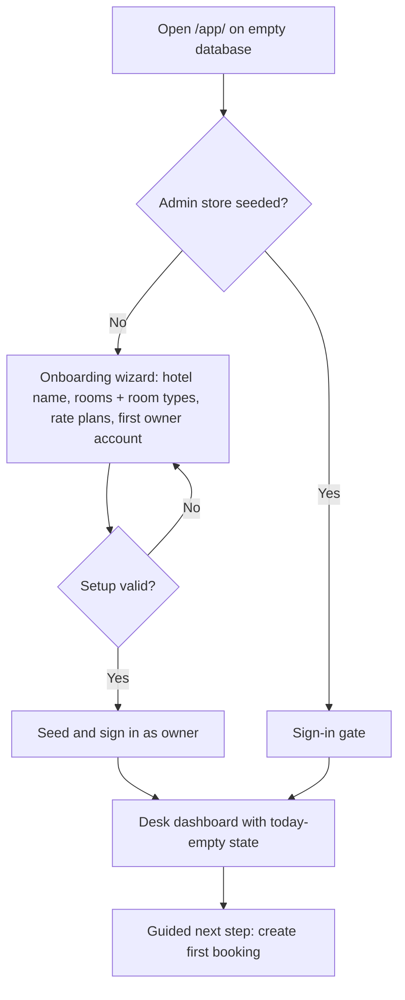
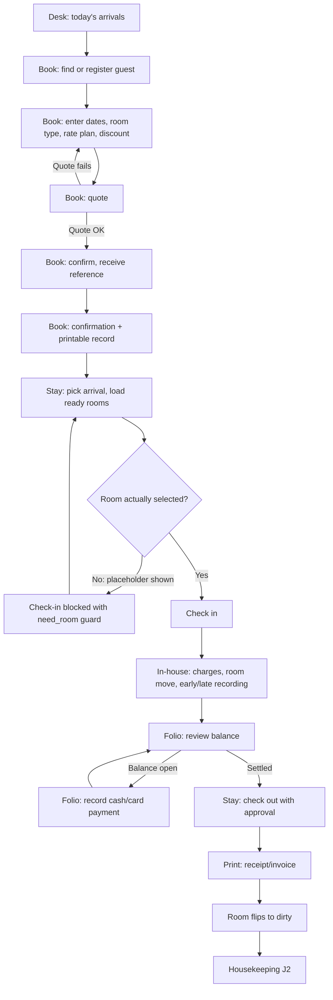
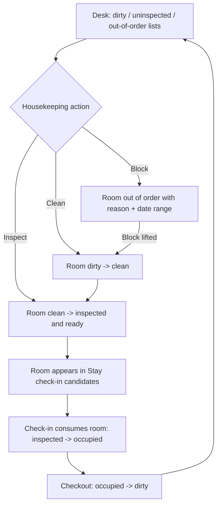
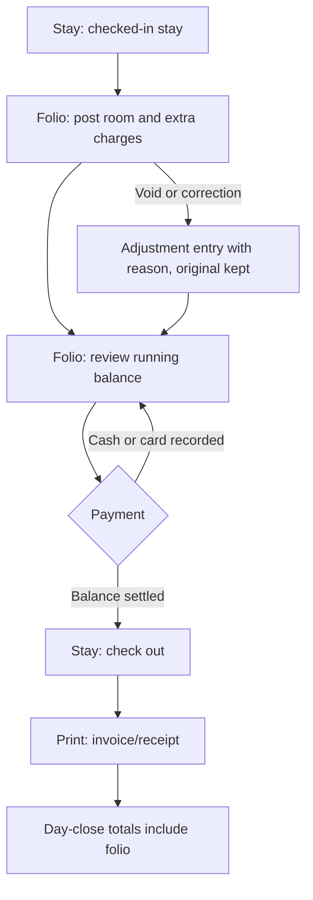
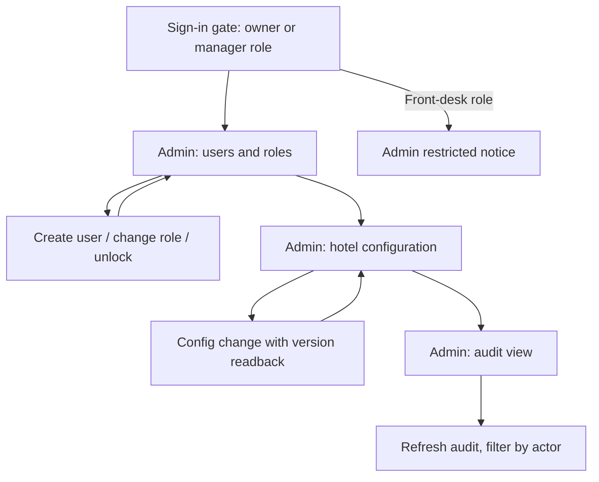

# Full-system UX flows, wireframes, and prototype record

Status: active. Product-owner design spec for the hotel-mgmt desk journeys,
owned by `product-owner` (Closes #412). This is a T0 docs-only artefact:
it sets the flow map, the screen inventory, the wireframes, and the wording
rules that all follow-up journey fixes and builds share. It changes no
production code and revises no catalogue keys.

## 1. Scope in / out

In:

- One flow map per journey (book-to-checkout, housekeeping, folio/billing,
  admin) plus the empty-database first-run path, authored as Mermaid
  diagrams in this document.
- A wireframe for every screen across gate/sign-in, desk, book, stay,
  folio, print, and admin.
- The clickable-prototype decision (deferred, with recorded reason).
- UX-writing rules for all new/changed copy, aligned with the
  VI-primary catalogue (`messages/vi.json` for the pilot desk,
  `messages/en.json` as the default-locale fallback).
- The follow-up issue breakdown (journey spec issues plus
  implementation issues) and the `Design` milestone proposal.

Out:

- No production code changes (design/spec intent only).
- No changes to the VI-primary catalogue itself (align to it, do not
  revise it here). New keys needed by follow-ups are named here but
  land through the normal catalogue process with
  `script/catalogue-coverage-check.sh` green.
- Implementation of the follow-up spec/implementation issues (separate
  issues, separate sessions).

## 2. Personas (recap)

Receptionist (front desk, daily loop), housekeeper (room state),
hotel owner/manager (oversight, configuration, users), guest
(indirect: confirmations, receipts). Full archetypes live in
`docs/product/personas.md`.

## 3. Journey flow maps

Conventions: each diagram shows the happy path top to bottom plus the
named failure/rollback edge. Screen names match the route inventory in
section 4 (`gate`, `desk`, `book`, `stay`, `folio`, `print`, `admin`).
Catalogue keys cited are existing keys unless marked NEW.

### J0. Empty-database onboarding (first run)

Covers QA finding 3: first run on an empty database has no guided
onboarding today. The gate must detect the unseeded state and route
the owner through setup before the desk loop is reachable.



Acceptance notes: the wizard is an owner-only path; skipping is not
offered (an unconfigured desk must not accept bookings). Every wizard
field carries an explicit empty-state hint; the seeded desk shows a
"no arrivals today" empty state, never a blank table.

### J1. Book-to-checkout (front-desk loop)

Covers QA finding 1 (#411 StayView check-in room preselection
mismatch): after ready rooms load, the room select must either show an
explicit empty placeholder or bind `checkinRoomId` to a real
candidate — never a phantom selection.



Failure/rollback edges: booking confirmation failure keeps the draft
(book-confirm-error); check-in failure keeps the arrival listed
(stay-checkin-error); checkout requires a settled folio plus approval
(stay-approval-section) — an unsettled folio blocks checkout, never
auto-waives.

### J2. Housekeeping (rooms)

Covers QA finding 2: the desk UI has no housekeeping clean/inspect
actions. The desk and stay surfaces must expose clean and inspect
transitions inline; the full room lifecycle stays visible on the desk
dashboard lists.



Acceptance notes: clean and inspect are separate explicit actions
with confirmation status (never a silent toggle); out-of-order blocks
always carry a reason and a date range; the desk board shows all three
lists at a glance (desk-dirty-list, desk-uninspected-list,
desk-outoforder-list).

### J3. Folio / billing



Failure/rollback edges: payment recording failure keeps the open
balance (no partial post); corrections are adjustment entries with a
reason — the original charge line is never edited in place.
Cash-only recording baseline per D-10 in
`docs/project/decision-log.md` (no integrated payment processing).

### J4. Admin (users, configuration, audit)



Acceptance notes: role-gated sections degrade to an explicit
restricted notice (admin-restricted-notice), never a blank page;
every mutation shows an error or success status inline.

## 4. Screen inventory and wireframes

Route base is `/app/` (`app/src/router.ts`). Every screen below
exists in `app/src/views/`; `data-testid` values name the contract
surface. All screens share the shell: top nav (`shell-nav`), locale
switcher (EN/VI), sign-in gate (`shell-gate`), business-date header,
loading/empty/error states in plain words, and print CSS preserved on
printable surfaces.

| # | Screen | Route | View | Sections |
|---|---|---|---|---|
| 0 | Sign-in gate + shell | all (gate) | `App.vue` | gate form (`shell-gate`), locale switch, top nav, restricted notice |
| 1 | Desk dashboard | `/` | `DeskView.vue` | business date, arrivals / in-house / departures tables, dirty + uninspected + out-of-order lists, board, backup report |
| 2 | Book | `/book` | `BookView.vue` | guest find-or-register, dates + room type + rate + discount, quote, confirm, reference readback, confirmation + print/copy |
| 3 | Stay | `/stay` | `StayView.vue` | arrivals / in-house / departures, check-in with room select, room move, early/late recording, checkout review + approval |
| 4 | Folio | `/folio` | `FolioView.vue` | charge list + post charge, payments + record payment, balance, errors |
| 5 | Print | `/print` | `PrintView.vue` | receipt/invoice preview, print action |
| 6 | Admin | `/admin` | `AdminView.vue` | users + roles, hotel configuration, audit view |
| 7 | Fallback | unknown paths | `Placeholder.vue` | unknown-route notice with nav back |

Wireframe key: `[ ]` input, `( )` select, `{ }` action, `*` key data,
`!` status/error line, `...` repeated rows.

### S0. Sign-in gate + shell (all routes)

```text
+--------------------------------------------------+
| [Hotel name]              [EN | VI]              |
+--------------------------------------------------+
|  Sign in                                     |
|  Name      [........................]        |
|  Password  [........................]        |
|  {Sign in}                               |
|  ! That sign-in did not work. Check the      |
|    name and password and try again.          |
+--------------------------------------------------+
| Nav: Desk | Book | Stay | Folio | Print | Admin  |
+--------------------------------------------------+
```

Rules: one shell-owned gate (no per-screen copies); front-desk role
on admin sections sees `admin-restricted-notice`, never blank.

### S1. Desk dashboard (`/`)

```text
* Business date: <date>                     {Refresh}
! <error, if any>
Backup: * last report (...)  [support text]
Arrivals today               In-house             Departures
* name * ref * room-type ... * name * room ... * name * room ...
Dirty rooms      Needs inspection    Out of order
* 101 {Clean}    * 102 {Inspect}     * 103 * reason * dates
Board: * occupancy summary
```

Rules: every list has an explicit empty state ("no arrivals today");
clean/inspect are inline actions per J2 (QA finding 2 fix point).

### S2. Book (`/book`)

```text
Guest: [name............] {Find} {Register new}
! <guest status>
Arrival [date]  Departure [date]  Room type (....)
Rate plan (....)  Discount [name........]
{Get quote}
Quote: * N nights, * total  ! <quote error>
{Confirm booking}  ! <confirm error>
=> * Reference: ABC123
* readback (guest, dates, room type, total)
{New booking}  Confirmation {Print} {Copy} * copied?
```

Rules: guest find-or-register precedes dates; quote precedes
confirm; the reference readback repeats the booking facts for
read-back verification.

### S3. Stay (`/stay`)

```text
* Business date: <date>                     {Refresh}
Arrivals | In-house | Departures tables (as desk)
Check in:  arrival (ref....)  room (Pick a room...) {Check in}
  ! Pick a ready room first  (only when truly nothing selected)
  * status line
Move:      stay (....)  new room (....) {Move}  * status
Early/late: arrival [....] departure [....] {Record} * status
Checkout:  departure (....) {Review folio} * folio status
  approval-by [....] {Check out}  * status
```

Rules: the room select always opens on an explicit placeholder
("Pick a room...") until a real candidate binds (QA finding 1 / #411
fix point); the `need_room` guard stays for the truly-empty case.

### S4. Folio (`/folio`)

```text
Stay (....)  * Balance: <amount>
Charges: * desc * amount * time ...
Post charge: [desc] [amount] {Post}  ! <error>
Payments: * method * amount * time ...
Record payment: (cash|card) [amount] {Record}  ! <error>
```

Rules: payments record cash/card only (D-10 baseline); corrections
are adjustment entries with a reason, never in-place edits.

### S5. Print (`/print`)

```text
Receipt/Invoice preview (hotel header, folio lines, totals)
{Print}
```

Rules: print CSS preserved; preview matches the printed page.

### S6. Admin (`/admin`)

```text
Users and roles: * identity * role (role....) {Save} {Unlock}
  ! <users error>
Create: [name] [identity] [secret] (role) {Create}
Hotel configuration: * version * key/value list  ! <error>
Audit: {Refresh} * actor * action * time ...  ! <error>
```

Rules: mutations always confirm inline; restricted roles see the
notice, never the tables.

### S7. Fallback (unknown paths)

```text
! Unknown page. {Back to desk}
```

## 5. UX writing (VI-primary catalogue alignment)

- Single source of truth stays `messages/` (`messages/README.md`):
  every user-visible string resolves through `t()`; behaviour
  switches on envelope codes, never on wording.
- The pilot desk is VI-primary: `messages/vi.json` carries
  receptionist-friendly hotel-domain wording; `messages/en.json` is
  the default-locale fallback. New/changed copy ships in both
  locales with `{param}` placeholders intact.
- Key naming for copy this design implies (NEW keys land through the
  normal catalogue process, none added here):
  `desk.onboarding.*` (wizard steps and hints),
  `desk.housekeeping.clean/inspect` (inline action labels),
  `stay.checkin.room_placeholder` (the explicit empty option for
  #411), `desk.empty.*` (per-list empty states).
- Tone: plain verbs first ("Pick a ready room first"), one idea per
  line, no jargon, no invented hotel terms.
- Deviations from the VI-primary catalogue: none. This document adds
  no keys and revises no wording; where a needed string has no key
  yet, the wireframe shows the English draft and the follow-up
  journey spec must catalogue both locales before implementation.

## 6. Clickable prototype decision: deferred with reason

The clickable prototype is explicitly deferred, not dropped:

- Reason: the product is an on-premise LAN system with no approved
  hosted tooling; standing up an external prototyping host for
  click-throughs would add a dependency the deployment model
  (D-5) does not allow, and the Vue desk app itself is the natural
  prototype surface once journey specs land.
- What substitutes: the wireframes in section 4 plus the flow maps
  in section 3 are the reviewable design; reviewers walk each
  journey against the inventory table.
- Revisit: the first book-to-checkout journey spec may propose an
  in-app clickable walkthrough (static route or flagged slice in
  `app/`) as its prototype vehicle; that proposal goes through its
  own issue and owner decision.

## 7. Follow-up issue breakdown

To be filed after this design lands (separate issues, separate
sessions); each links back to #412:

Product-owner journey specs (one per journey, T0):

1. Book-to-checkout journey spec (incl. #411 preselection rule).
2. Housekeeping journey spec (clean/inspect actions, room lifecycle).
3. Folio/billing journey spec (charges, payments, corrections).
4. Admin journey spec (users, configuration, audit).
5. Empty-DB onboarding journey spec (wizard, seed, first booking).

Implementation issues (one small task per worker/PR), sequenced after
each journey spec passes its spec-reviewer gate:

6. StayView check-in placeholder + binding (closes #411).
7. Desk clean/inspect inline actions.
8. Onboarding wizard + empty states.
9. Remaining journey deltas per approved specs.

## 8. Milestone proposal: `Design` milestone

Proposal: create a `Design` milestone and attach this epic plus the
five journey-spec follow-ups to it.

- Rationale: `Design` is a track, not a plan phase — like the
  standing `Pilot` and `Harness` milestones, it never closes and
  holds design-then-build sequencing across phases. Numbered
  `Phase <N> - <scope>` names are reserved for plan milestones 1-6
  per `docs/project/milestone-conventions.md`, so the new track
  name does not collide.
- Alternative for the owner: attach the follow-ups to the existing
  `Phase 5 - desk UI` board instead (the journeys land in the desk
  UI). Both satisfy the no-nulls filing rule; the choice is an
  owner decision recorded on #412 before it closes.
- This document takes no decision: the milestone exists only after
  the owner accepts the proposal on the epic.

## 9. Acceptance mapping (issue #412)

| Criterion | Evidence in this spec |
|---|---|
| Mermaid flows for all four journeys + three QA findings | J0-J4 in section 3; #411 rule in J1/S3; clean/inspect in J2/S1; onboarding in J0 |
| Wireframe per screen, full inventory | Table + S0-S7 in section 4 |
| Prototype linked or deferred with reason | Section 6 (deferred, reason + revisit recorded) |
| Copy follows VI-primary catalogue; deviations listed | Section 5 (zero deviations) |
| Follow-up spec + implementation issues filed and linked | Section 7 (filed after landing, linked from #412 before close) |
| Design milestone accepted or alternative assigned | Section 8 (proposal + alternative, owner decision on #412) |

<!-- ao-role: product-owner -->
Role: product-owner · AO session hotel-mgmt-527
