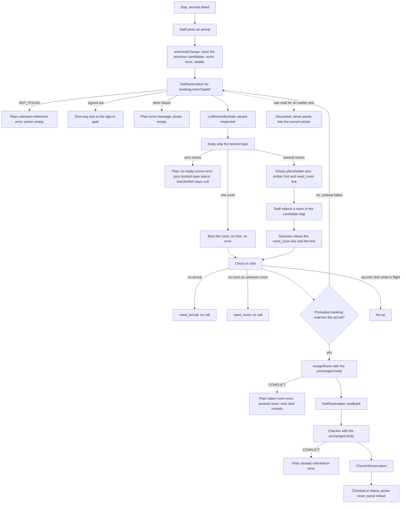
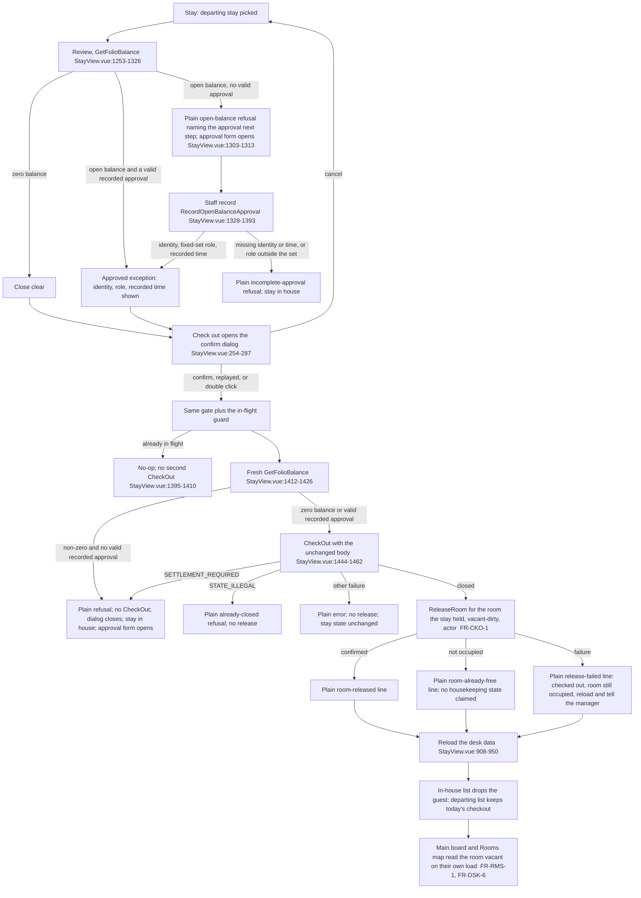
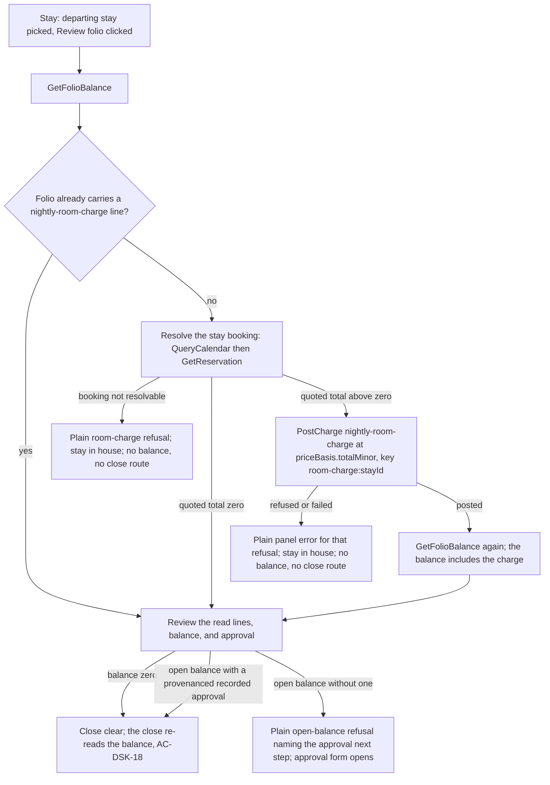
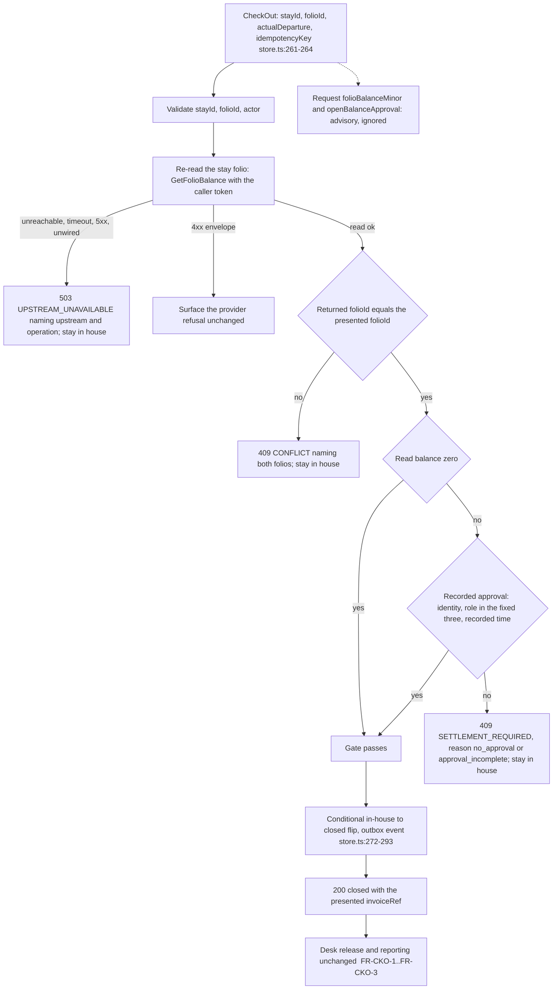

# MVP requirements — small-hotel property management system

Status: active. Requirements wording for the hotel-mgmt MVP, owned by
`business-analyst`. Every functional requirement (FR) below implements
an MVP capability from the product scope
(`docs/product/mvp-scope.md`, active); capabilities the product scope
tags Later or lists as out of scope have no FR here and are named in
section 6 instead. Non-functional requirements (NFRs) carry measurable
targets and state no schema, module boundary, technology, or stack
choice. Test-case authorship belongs to `qa-lead`; the handoff notes
in section 4 say what each guard must observe.

## Conventions

- FR ids take the form `FR-<domain>-<n>`, where the domain code is one
  of `RES` (reservations and booking), `FDK` (front-desk check-in and
  check-out), `RMS` (rooms and housekeeping), `RTE` (rates and
  availability), `GST` (guests/CRM), `BIL` (billing and folio), `RPT`
  (reporting), `ADM` (configuration and administration), `CUS`
  (per-hotel workflow customisation).
- NFR ids take the form `NFR-<area>-<n>`.
- Each FR states observable behaviour followed by Given/When/Then
  acceptance criteria that a tester can execute without guessing at
  unspecified behaviour.
- "Staff" means any signed-in front-desk staff, manager, or owner
  account acting within its access; role limits live in `FR-ADM-2`
  and `NFR-SEC-1`.

## 1. Functional requirements

### 1.1 Reservations and booking (`FR-RES-*`)

FR-RES-1 — Create direct reservation. Staff can record a reservation
with stay dates, room type, guest, and price basis.
Given a room type has sellable availability for the requested dates;
when staff enter the dates, room type, guest, and price basis and
confirm; then the reservation exists with a unique reference, the
requested dates, room type, guest link, and quoted price, and it
appears on the reservation calendar.

FR-RES-2 — Modify reservation. Staff can change the dates, room type,
or guest of an existing reservation before check-in.
Given a reservation that has not been checked in; when staff change
its dates, room type, or guest and confirm; then the reservation
reflects the new values, its quoted price is recalculated from the
rate plan in force, and the change is recorded with who made it and
when.

FR-RES-3 — Cancel reservation with reason. Staff can cancel a
reservation before check-in and must record a reason.
Given a reservation that has not been checked in; when staff cancel it
and record a cancellation reason; then the reservation state becomes
cancelled with the reason kept, and the held availability is released
for the cancelled dates.

FR-RES-4 — Walk-in booking. Staff can create a same-day reservation
for a guest at the desk.
Given a guest arrives without a reservation and a room type has
availability for tonight; when staff create the reservation with
today as arrival; then the reservation is created in the confirmed
state, ready for immediate check-in, and appears on today's arrivals list.

FR-RES-5 — Reservation calendar. Staff can see reservations across
dates and room types on one screen.
Given reservations exist across several dates and room types; when
staff open the calendar; then every reservation appears on its
correct dates with its room type and state, and selecting one shows
its reference, guest, and price.

FR-RES-6 — No-show handling. Staff can mark an unarrived reservation
as no-show and release the held room.
Given a reservation whose arrival date has passed without check-in;
when staff mark it as no-show; then the reservation state becomes
no-show, the held room is released for sale, and the no-show is kept
in the reservation history.

### 1.2 Front-desk check-in and check-out (`FR-FDK-*`)

FR-FDK-1 — Check-in. Staff can register arriving guests and assign a
ready room.
Given a reservation due for arrival and a vacant, clean, inspected
room of the booked type; when staff check the guest in against that
room; then the reservation becomes an in-house stay linked to the
room, and the room state becomes occupied.

FR-FDK-2 — Check-out. Staff can close the stay, present the folio,
and release the room.
Given an in-house stay with a settled folio (zero balance) or an
authorised approval recorded under `FR-BIL-7`; when staff check the
guest out; then the stay is closed, the folio is presented as the
final invoice, and the room state becomes vacant and dirty.
Amendment (Refs #588): at the desk the close performs the release
itself for the room the stay held, releases nothing when the close
did not commit, and reports a release it could not confirm without
reopening or retrying the close (section 19.3, `BR-18`).
Amendment (Refs #601): the close is decided on the folio Billing
holds — the service re-reads that folio and re-validates the
approval recorded against it, the balance and the approval object a
request carries are advisory only, and a folio that cannot be read
refuses the close instead of closing on an unverified balance
(section 22, `FR-CKS-1`..`FR-CKS-5`).

FR-FDK-3 — Room moves. Staff can move a guest to another room
mid-stay with the history kept.
Given an in-house stay and a vacant, clean, inspected room; when
staff move the guest to the new room; then the stay links to the new
room, the old room becomes vacant and dirty, and the move with both
room numbers and its time is kept in the stay history.

FR-FDK-4 — Early check-in and late check-out. Staff can record early
arrivals and late departures against the stay.
Given an in-house stay whose actual arrival or departure falls
outside the hotel's standard times; when staff record the early
arrival or late departure; then the actual times are kept on the
stay and remain visible on the arrivals and departures lists.

FR-FDK-5 — Arrivals and departures list. Staff can see daily lists of
who is expected, in house, and leaving.
Given reservations, in-house stays, and departures exist for today;
when staff open the daily lists; then expected arrivals, in-house
guests, and due departures each appear exactly once with guest name,
room or room type, and state.

### 1.3 Rooms and housekeeping (`FR-RMS-*`)

FR-RMS-1 — Room inventory with live status. Staff can see every room
with its current state.
Given rooms exist in any mix of occupied, vacant, dirty, clean,
inspected, and out-of-order states; when staff open the room view;
then every room appears exactly once with its correct current state.

FR-RMS-2 — Housekeeping status updates. Staff can mark rooms dirty,
clean, or inspected as work completes.
Given a room in a dirty state; when staff mark it clean and then
inspected; then the room state advances through each recorded change
with who made it and when, and an inspected vacant room is offered
for check-in assignment.

FR-RMS-3 — Out-of-order and maintenance blocks. The manager can take
rooms out of sale with a recorded reason and date range.
Given a room and a date range with a recorded reason; when the
manager blocks the room; then the room shows out of order for that
range, and no new reservation or check-in can take that room for a
blocked date.

FR-RMS-4 — Room setup and attributes. The manager can define floors,
bed types, and features per room and room type.
Given a new or edited room or room type; when the manager saves its
floor, bed type, capacity, and features; then the values appear in
the room inventory and are available when assigning rooms at
check-in. Desk surface (Refs #590): section 20 specifies the screen
that performs this save and its floor move, with the capability
statement unchanged.

### 1.4 Rates and availability (`FR-RTE-*`)

FR-RTE-1 — Rate plans per room type. The manager can define sellable
prices per room type, season, and day.
Given a room type and a date range; when the manager saves a nightly
price for that combination; then new reservations for that room type
and date quote that price. Desk surface (Refs #590): section 20
specifies the range save that writes one row per night, with the
capability statement unchanged.

FR-RTE-2 — Availability overview. Staff can see sellable rooms by
room type and date at a glance.
Given rooms, reservations, and out-of-order blocks exist; when staff
open the availability view for a date range; then each room type and
date shows the count of rooms still sellable, excluding occupied,
blocked, and already-reserved rooms.

FR-RTE-3 — Manual discounts and special rates. The manager can apply
a named discount or special price to a reservation.
Given a reservation with a quoted price; when the manager applies a
named discount or special price; then the reservation shows the
adjusted price with the discount name kept, and the folio charges
follow the adjusted price.

FR-RTE-4 — Stay restrictions. The manager can set minimum stay or
closed-to-arrival days per date range.
Given a minimum-stay or closed-to-arrival restriction on a date
range; when staff attempt a reservation that violates it; then the
reservation is refused with the violated restriction named.

FR-RTE-5 — Reservation price basis. Every reservation carries the
rate plan and price it was quoted from.
Given an applicable rate plan at booking time; when the reservation
is created; then it records the rate plan used and the nightly
breakdown, so a later rate change does not alter the quoted price
unless staff explicitly recalculate it under `FR-RES-2`.

### 1.5 Guests and CRM (`FR-GST-*`)

FR-GST-1 — Guest profiles with stay history. Staff can keep one
record per guest with past and upcoming stays.
Given stays linked to a guest; when staff open the guest profile;
then the profile shows the guest's details with every past and
upcoming stay linked to it.

FR-GST-2 — Guest preferences and notes. Staff can store preferences
and remarks that are visible at booking time.
Given a guest profile with saved preferences or notes; when staff
start a new reservation for that guest; then the preferences and
notes are shown before the booking is confirmed.

FR-GST-3 — Repeat-guest recognition. Staff can see that a guest has
stayed before at booking time.
Given a guest with at least one completed stay; when staff search
for the guest while booking; then the guest is flagged as returning
with the count of past stays visible.

FR-GST-4 — Booking confirmation record. Staff can produce a
confirmation the hotel can share with the guest.
Given a confirmed reservation; when staff request its confirmation;
then a confirmation showing the hotel, guest, dates, room type, and
quoted price is produced in a form the hotel can print or send as a
message.

### 1.6 Billing and folio (`FR-BIL-*`)

FR-BIL-1 — Guest folio. Each stay has one running folio collecting
room charges and charge items.
Given a checked-in stay; when staff open its folio; then a single
folio exists for the stay showing every posted charge and payment
with a running balance.

FR-BIL-2 — Room and extra charges. Staff can post nightly room
charges and charge items to the folio.
Given an in-house stay; when staff post a nightly room charge or a
hotel-defined charge item; then the folio line shows the item, amount,
and posting time, and the balance increases by the line amount.
Amendment (Refs #600): the desk check-out posts the stay's nightly
room charge itself, at its review step and before any balance is
presented, at the stay's own frozen quoted total (`FR-RTE-5`), once
per stay and never a second time, and posts nothing for a stay whose
quoted total is zero; a room charge that cannot be posted refuses the
check-out instead of closing an uncharged folio (section 21,
`FR-CKP-1`..`FR-CKP-5`).

FR-BIL-3 — Payment recording. Staff can record cash and card
payments against the folio.
Given an open folio with a balance; when staff record a cash or card
payment with its amount; then the payment appears on the folio with
method and time, and the balance decreases by the paid amount.

FR-BIL-4 — Invoice and receipt. Staff can produce a printable
invoice and payment receipt for the guest.
Given a folio with charges and payments; when staff request the
invoice or a receipt; then the printed invoice matches the folio
lines and balance exactly, and each receipt matches one recorded payment.

FR-BIL-5 — Configurable taxes and fees. Hotel-set tax and fee rules
apply to folio lines.
Given tax and fee rules set by the hotel; when a charge is posted;
then the folio shows the tax and fee amounts derived from those
rules, and the balance includes them.

FR-BIL-6 — Day-close totals. The manager can close the day with
totals of charges and payments taken.
Given a business date with posted charges and recorded payments;
when the manager runs day-close; then the system produces the totals
of charges and of payments per method for that date, and the totals
agree with the folios posted that day.

FR-BIL-7 — Settlement before check-out. Check-out requires a settled
folio or a recorded approval.
Given an in-house stay whose folio has a non-zero balance; when staff
attempt check-out; then check-out is refused unless an authorised
approval for the open balance is recorded against the folio.
Amendment (Refs #588): the approval is the record written through
the open-balance approval operation, carrying the approver identity,
the role held, and the recorded time — a free-form string is not an
approval — and every route to the close re-reads the balance at
that moment, refusing on an incomplete or unknown-role record
(section 19.3, `BR-17`).
Amendment (Refs #601): the refusal is enforced on the folio's own
record, not on the one a request supplies. The close passes only
when the folio Billing holds reads a zero balance or carries a
provenanced approval — approver identity, a role from the hotel's
fixed three, and a recorded time — and an approval written with a
role outside that set is refused at recording time and stamped with
the service's own clock (section 22, `FR-CKS-3`, `BR-46`).

### 1.7 Reporting (`FR-RPT-*`)

FR-RPT-1 — Occupancy report. The owner can see occupied and
available rooms over a chosen period.
Given bookings across a chosen period; when the owner opens the
occupancy report; then each date shows occupied and available room
counts that agree with the reservations and stays in the system.

FR-RPT-2 — Revenue summary. The owner can see room and extra revenue
totals over a chosen period.
Given posted charges across a chosen period; when the owner opens the
revenue summary; then room revenue and extra revenue totals agree
with the folios posted in that period.

FR-RPT-3 — Front-desk daily sheet. The manager can open a one-page
view of arrivals, in-house guests, departures, and open balances.
Given today's reservations, stays, and folios; when the manager
opens the daily sheet; then arrivals, in-house guests, departures,
and folios with open balances each appear with figures that agree
with the underlying records.

FR-RPT-4 — Housekeeping status report. Staff can see rooms needing
cleaning or inspection right now.
Given rooms in dirty and clean-but-uninspected states; when staff
open the housekeeping report; then every room needing cleaning or
inspection appears, and rooms already inspected or out of order do
not.

### 1.8 Configuration and administration (`FR-ADM-*`)

FR-ADM-1 — Hotel profile setup. The owner can set the hotel's
identity, contact details, and local settings.
Given valid hotel identity, contact, and local settings entered by
the owner; when saved; then the details appear on confirmations,
invoices, and receipts, and the local settings govern dates, times,
and stay policies hotel-wide.

FR-ADM-2 — User accounts and roles. The owner can create accounts for
owner, manager, and front-desk staff with matching access.
Given a new user with a name, sign-in identity, and one of the
three roles; when the owner saves the account; then the user can
sign in and can reach exactly the functions its role permits:
front-desk staff operate the desk, the manager additionally controls
rates, rooms, and reports, and the owner additionally controls users
and hotel setup. Room and room-type inventory is co-editable:
`FR-ADM-3` (owner) and `FR-RMS-4` (manager) edit the same inventory
with no primary. Desk surface (Refs #590): section 20 specifies the
product wording a non-manager sees on the management screen; it adds
no enforcement and no role.

FR-ADM-3 — Room and room-type setup. The owner can define the
property's rooms, types, and capacity.
Given rooms with numbers, room types, floors, and capacity entered
by the owner; when saved; then the rooms appear in the inventory,
availability, and calendar with the defined capacity and type.

FR-ADM-4 — Rate-plan and policy setup. The manager can enter rate
plans, check-in and check-out times, and stay policies.
Given rate plans, standard check-in and check-out times, and stay
policies entered by the manager; when saved; then new reservations
price from those rate plans and arrivals and departures lists use
those standard times. Standard check-in and check-out times are a
single shared setting, co-editable here and under `FR-CUS-2`, not
two separate settings.

FR-ADM-5 — Data export and backup. The owner can export hotel data
and keep restorable on-premise copies.
Given the owner's request; when an export or backup runs; then a
complete copy of the hotel's data (reservations, stays, folios, and
payments, per `NFR-BKP-1`) is written to on-premise storage
and the system reports success or failure of the run to the owner.

### 1.9 Per-hotel workflow customisation (`FR-CUS-*`)

FR-CUS-1 — Customisable required guest fields. The owner can choose
which guest details are mandatory at booking and at check-in.
Given the owner marks a guest field mandatory for booking or for
check-in; when staff confirm a booking or check-in without that
field; then the action is refused and the missing field is named.

FR-CUS-2 — Customisable stay policies. The owner can set the hotel's
check-in and check-out times and cancellation wording.
Given times and cancellation wording saved by the owner; when staff
book, check in, or cancel; then the hotel's own times and wording
are the ones shown and enforced. The standard times are the same
single shared setting as `FR-ADM-4`.

FR-CUS-3 — Custom charge items. The manager can define the hotel's
own charge items.
Given a charge item with a name and price defined by the manager;
when staff post charges; then the hotel's item is available to post
to any folio and appears on invoices under its own name.

## 2. Non-functional requirements

NFR-DEP-1 — Single-property on-premise installation. One installation
serves exactly one hotel property: its rooms, reservations, guests,
and folios belong to that property alone.
Given a running installation; when any screen, report, or export is
used; then only that property's data can appear, and data from any
other property never appears. Target: 100% of sampled records in
acceptance testing belong to the installed property.

NFR-BKP-1 — Backup frequency and recovery point. The hotel loses no
more than one operating day of data after a failure the backup story
covers.
Given daily backups run as configured; when the host fails and data
is restored from the latest backup; then every reservation, stay,
folio, and payment recorded at least 24 hours before the failure is
present. Targets: recovery point objective (RPO) at most 24 hours;
a scheduled backup completes successfully at least 6 days out of 7.

NFR-BKP-2 — Restore time and verifiability. A failed installation can
be brought back on equivalent on-premise hardware within half a
working day, and the owner can tell a backup worked without
technical help.
Given a restorable copy and equivalent hardware; when restore is
performed; then the system is operable again within 4 hours
(recovery time objective, RTO), and every backup run reports plain
success or failure with its time to the owner or manager. Targets:
RTO at most 4 hours; 100% of backup runs produce a visible
success-or-failure report.

NFR-AUD-1 — Audit trail for reservation, room, and folio changes.
Every creation, change, cancellation, state transition, charge, and
payment records who did it and when, and the trail cannot be edited
through normal use.
Given any change covered above; when the change is saved; then the
record keeps the acting user and timestamp, and no desk, manager, or
owner function alters or deletes that entry. Target: 100% of sampled
changes in acceptance testing carry an unaltered actor and
timestamp. (A dedicated on-screen audit log view is a Later product
capability; this requirement covers recording only.)

NFR-CON-1 — No double-booking under simultaneous bookings. Two staff
booking the last sellable room for overlapping dates cannot
both succeed.
Given one remaining sellable unit for the requested dates; when two
staff submit bookings for overlapping dates at the same time; then
exactly one booking succeeds and the other is refused with the
conflict named. Target: 0 double-bookings across repeated paired
simultaneous attempts in acceptance testing.

NFR-CON-2 — No double room assignment at check-in. Two staff
checking different guests into the same ready room at the same time
cannot both succeed.
Given one ready room; when two check-ins target it simultaneously;
then exactly one check-in takes the room and the other is refused
with the room conflict named. Target: 0 double assignments across
repeated paired simultaneous attempts.

NFR-PERF-1 — Desk response under a full small hotel. With 50 rooms,
a full book of reservations, and 5 staff signed in at once, routine
desk actions stay within fixed bounds.
Given the load above; when staff open the reservation calendar,
availability view, arrivals list, or a folio; then each screen shows
complete results within 2 seconds, and check-in, check-out, charge
posting, and payment recording each complete within 3 seconds.
Targets: 2 seconds for the named views; 3 seconds for the named
actions; measured at the desk on the hotel's own premises.

NFR-PERF-2 — Report response. The standard reports stay usable on a
full small hotel's data.
Given two years of operating data for a 50-room hotel; when the
owner or manager opens any standard report in section 1.7; then it
completes within 5 seconds. Target: 5 seconds per standard report.

NFR-SEC-1 — Role-based access. Every function is reachable only by
the roles the requirements grant it to, and guests have no sign-in.
Given each of the three roles; when a user attempts a function its
role is not granted; then access is refused. Targets: 100% of
out-of-role attempts refused in acceptance testing; 0 guest-facing
sign-ins exist.

NFR-SEC-2 — Authentication. Every user signs in with a unique
identity and a secret, and unattended sessions do not stay open.
Given sign-in and idle-session rules; when a wrong secret is entered
5 times in a row for one identity, the identity locks until the
owner or manager unlocks it, and a sign-in attempt against the
locked identity is refused with code `IDENTITY_LOCKED` (distinct
from `UNAUTHENTICATED` for a wrong secret or an expired session);
when a session idles 15 minutes, it signs out. Targets: lockout after 5 consecutive failures; automatic
sign-out after 15 idle minutes.

NFR-RET-1 — Data retention. Closed stays, folios, payments, and
their audit entries stay retrievable for at least 24 months of
operating data in the live system, and records newer than the
hotel's configured retention floor cannot be purged.
Given the retention floor configured for the hotel (a hotel local
setting owned by `FR-ADM-1`); when a purge is attempted; then
records newer than the floor are kept and the purge
refuses them. Targets: 24 months minimum retrievable history; 0
records removed from within the floor. (The legal minimum period, if
longer, is open question OQ-4.)

NFR-TZ-1 — Date and timezone handling. Every timestamped record
carries its UTC offset, and every date shown or reported follows the
hotel's local date.
Given the hotel's configured local timezone; when a reservation,
stay event, charge, payment, or report date is recorded or shown;
then the stored record carries the UTC offset and the displayed
date matches the hotel's local calendar day, including across
daylight-saving changes where applicable. Target: 100% of sampled
records carry an offset and render on the correct local date.

NFR-I18N-1 — Internationalisation with Vietnamese primary.
The desk operates in Vietnamese as the primary target language
with English as the development and fallback language; both ship
from the message catalogue with no behaviour change between
locales.
Given the running system in either locale; when any screen,
confirmation, invoice, receipt, or report is shown; then every
user-visible string comes from the message catalogue (no
behaviour logic depends on either language's wording), a missing
Vietnamese string falls back to its English source, and dates,
numbers, and currency follow the active locale
rules. Targets: 100% of user-visible strings sourced from the
catalogue in both locales; the Vietnamese key set stays at
parity with the English set (every placeholder intact).

NFR-AVL-1 — On-premise availability. The desk keeps working through
an internet outage.
Given the hotel's internet connection is down; when staff book,
check in, check out, post charges, record payments, and print invoices;
then every one of those actions completes on the on-premise
installation exactly as when connected. Target: 100% of the named
desk actions succeed with no outside connectivity.

## 3. Per-hotel workflow customisation behaviour

### 3.1 Configurable per hotel (no code changes)

| Lifecycle part | What the owner or manager can change | Behaviour |
|---|---|---|
| Required guest fields | Which guest details are mandatory at booking and at check-in (`FR-CUS-1`) | Refusal names the missing field; optional fields stay optional |
| Check-in and check-out times | The hotel's standard times (`FR-CUS-2`, `FR-ADM-4`) | Arrivals, departures, and early/late recording use the hotel's times |
| Cancellation reasons | The hotel's own list of cancellation reasons (`FR-RES-3`) | Cancelling requires picking one of the hotel's reasons |
| No-show rules | Whether a no-show keeps any charge and which reason list applies (`FR-RES-6`) | Marking no-show follows the hotel's rule and keeps the reason |
| Open-balance check-out | Whether check-out with an open balance needs an approval, and which role may approve (`FR-BIL-7`) | Unapproved open-balance check-out is refused; approvals are recorded with who approved, the role held, and when, and the close is decided on that recorded approval, never on a value a request supplies (`BR-46`) |
| Charge items | The hotel's own charge items with names and prices (`FR-CUS-3`) | Only defined items can be posted; invoices show the hotel's names |
| Taxes and fees | The hotel's tax and fee rules (`FR-BIL-5`) | Folio lines derive tax and fee amounts from the hotel's rules |
| Stay restrictions | Minimum stay and closed-to-arrival days per date range (`FR-RTE-4`) | Violating reservations are refused with the restriction named |
| Discounts and special rates | Named discounts the manager may apply (`FR-RTE-3`) | Applied discounts are kept by name on the reservation and folio |
| Cancellation wording | The hotel's cancellation wording shown to guests (`FR-CUS-2`) | Confirmations carry the hotel's wording |

### 3.2 Fixed in the MVP (not configurable per hotel)

- The lifecycle order itself: reservation precedes check-in, check-in
  precedes an in-house stay, and check-out closes the stay; no hotel
  can skip, reorder, or rename these states.
- One folio per stay and one property per installation: folios cannot
  be split across payers and data cannot be shared across properties
  in the MVP.
- The three roles (owner, manager, front-desk staff) and what each
  may reach; custom roles beyond the defaults are Later.
- No event-driven automation: no automatic status changes, reminders,
  or messages fire from lifecycle events; automated workflow rules
  are Later.
- Cash and card are the only payment methods; further methods are an
  open product decision (OQ-1).

### 3.3 How the owner configures without code

Given the owner or manager opens the hotel's settings; when they
change any item in section 3.1 and save; then the desk immediately
works with the new setup — new bookings, check-ins, charges, and
prints follow the changed configuration with no restart, no file
editing, and no technical assistance. Each change records who made
it and when under `NFR-AUD-1`.

## 4. Traceability

Each row maps one MVP product-scope capability to its FR id(s). Test
spec ownership transfers to `qa-lead`: each handoff note states what
each guard must observe. Later and out-of-scope items from the
product scope have no FR and are listed in section 6.

| Product-scope capability | FR id(s) | Test-spec handoff note for `qa-lead` |
|---|---|---|
| Create direct reservation | FR-RES-1, FR-RTE-5 | Guard books each room type across a season boundary and checks quoted price and reference |
| Modify and cancel reservation | FR-RES-2, FR-RES-3 | Guard changes dates/type/guest, checks repricing, then cancels and checks the reason and released availability |
| Walk-in booking | FR-RES-4 | Guard creates a same-day booking and checks arrival-state readiness and arrivals-list entry |
| Reservation calendar | FR-RES-5 | Guard seeds multi-date, multi-type bookings and checks placement and detail drill-down |
| No-show handling | FR-RES-6 | Guard marks a past-arrival booking no-show and checks state, released room, and history |
| Check-in | FR-FDK-1 | Guard checks in against a ready room and checks stay link and occupied state |
| Check-out | FR-FDK-2, FR-BIL-7 | Guard checks out a settled stay and checks closure, final invoice, and vacant-dirty state with the departed room released once and the desk lists re-read; guard attempts open-balance check-out and checks refusal on every desk route unless an authorised, provenanced approval is recorded, and that an approved close stays closed when the release fails (Refs #588); guard closes through the service with a forged balance and again with a forged approval and checks that both are refused on the folio Billing holds, that an unreadable folio refuses rather than closes, and that the desk flows keep passing (Refs #601) |
| Room moves | FR-FDK-3 | Guard moves an in-house guest and checks both room states and kept history |
| Early check-in and late check-out | FR-FDK-4 | Guard records off-hours arrival/departure and checks kept times and list visibility |
| Arrivals and departures list | FR-FDK-5 | Guard seeds all three groups and checks exactly-once listing with names and states |
| Room inventory with live status | FR-RMS-1 | Guard sets every state and checks each room appears once with the right state |
| Housekeeping status updates | FR-RMS-2 | Guard walks dirty to inspected and checks check-in offer and change record |
| Out-of-order and maintenance blocks | FR-RMS-3 | Guard blocks a range and checks display plus refused booking and check-in on blocked dates |
| Room setup and attributes | FR-RMS-4 | Guard defines floor/bed/features and checks inventory and assignment visibility |
| Rate plans per room type | FR-RTE-1 | Guard sets seasonal/day prices and checks new quotes follow them |
| Availability overview | FR-RTE-2 | Guard seeds occupancy, blocks, and bookings and checks per-type per-date counts |
| Manual discounts and special rates | FR-RTE-3 | Guard applies a named discount and checks kept name and folio effect |
| Stay restrictions | FR-RTE-4 | Guard sets each restriction type and checks refusal names the restriction |
| Guest profiles with stay history | FR-GST-1 | Guard links past and upcoming stays and checks profile completeness |
| Guest preferences and notes | FR-GST-2 | Guard saves notes and checks they surface before booking confirmation |
| Repeat-guest recognition | FR-GST-3 | Guard books for a past guest and checks the returning flag and stay count |
| Booking confirmation record | FR-GST-4 | Guard produces a confirmation and checks hotel, guest, dates, type, and price |
| Guest folio | FR-BIL-1 | Guard opens a stay folio and checks single folio with running balance |
| Room and extra charges | FR-BIL-2 | Guard posts room and extra lines and checks lines plus balance movement; the desk check-out review posts the stay's one nightly room charge at its frozen quoted total when the folio carries none, posts nothing for an already-charged folio or a zero quote, and refuses the review when the charge cannot be posted (Refs #600) |
| Payment recording | FR-BIL-3 | Guard records cash and card payments and checks method, time, and balance movement |
| Invoice and receipt | FR-BIL-4 | Guard prints the invoice and receipts and checks exact match to folio and payments |
| Configurable taxes and fees | FR-BIL-5 | Guard sets rules, posts a charge, and checks derived amounts and balance |
| Day-close totals | FR-BIL-6 | Guard posts a day of activity, closes, and checks per-method totals agree with folios |
| Occupancy report | FR-RPT-1 | Guard compares per-date counts against seeded bookings |
| Revenue summary | FR-RPT-2 | Guard compares room/extra totals against seeded folios |
| Front-desk daily sheet | FR-RPT-3 | Guard compares all four groups against underlying records |
| Housekeeping status report | FR-RPT-4 | Guard checks only rooms needing work appear |
| Hotel profile setup | FR-ADM-1 | Guard saves identity and local settings and checks prints and date behaviour |
| User accounts and roles | FR-ADM-2 | Guard creates each role and checks sign-in plus exact function reach |
| Room and room-type setup | FR-ADM-3 | Guard defines rooms and checks inventory, availability, and calendar uptake |
| Rate-plan and policy setup | FR-ADM-4 | Guard saves plans, times, and policies and checks pricing and list behaviour |
| Data export and backup | FR-ADM-5 | Guard runs export/backup and checks completeness plus success/failure report |
| Customisable required guest fields | FR-CUS-1 | Guard marks fields mandatory and checks refusal names the field |
| Customisable stay policies | FR-CUS-2 | Guard saves times and wording and checks desk enforcement and display |
| Custom charge items | FR-CUS-3 | Guard defines an item and checks posting availability and invoice naming |

Coverage: 40 MVP capabilities mapped, 0 unmapped.

## 5. Open questions (decided by `product-owner`, impact worded by `business-analyst`)

- OQ-1 — Which payment methods beyond cash and card must payment
  recording support on day one (for example bank transfer or hotel
  credit)? Until decided, `FR-BIL-3` covers cash and card only.
- OQ-2 — Free text, fixed list, or both for reservation change and
  cancellation reasons? Until decided, `FR-RES-2` records the change
  and `FR-RES-3` requires a reason from the hotel's list.
- OQ-3 — What does day-close mean for a hotel that never fully closes:
  which totals must balance and who signs them off? Until decided,
  `FR-BIL-6` produces per-method totals without a sign-off step.
- OQ-4 — Which guest fields, if any, must the system refuse to delete
  for record-keeping, and what is the legal minimum retention period?
  Until decided, `NFR-RET-1` holds 24 months retrievable with a
  hotel-configured floor.
- OQ-5 — What is the minimum backup-and-restore story the hotel can
  actually operate: who triggers a backup and how do they know it
  worked? Until decided, `FR-ADM-5` with `NFR-BKP-1`/`NFR-BKP-2` sets
  daily backups with a visible success-or-failure report as the
  product-level expectation.

OQ-6 and OQ-7 (PRD section 10) are product-owned with no
requirements wording at stake; see `business-rules.md` [section 10](business-rules.md).

## 6. Explicitly not specified here

The following product-scope Later items and out-of-scope exclusions
have no FR in this document and must not be read into one: waitlist,
guest self-service online booking, channel manager and OTA
integration, express and self-service check-in, housekeeping task
assignment, dynamic pricing and yield rules, multi-currency rates,
automated guest messaging, loyalty programme and campaigns, split and
shared folios, integrated payment processing, accounting-system
integration, custom report builder, cross-property and trend
analytics, the on-screen activity and audit log view, customisable
folio layout, custom roles beyond the defaults, automated workflow
rules, multi-property operation of any kind, and further languages
beyond English and Vietnamese (`NFR-I18N-1` covers the two
operating locales).

## 7. Desk UI migration shell slice (Refs #291)

Scaffold slice of ADR-0003 (accepted 2026-10-25): the placeholder
Vue 3 + Vite shell served under `/app/` from which the screen
migrations started. Design
lives in `docs/architecture/hld.md` [section 11](../architecture/hld.md) and
`docs/architecture/lld.md` [section 11](../architecture/lld.md); acceptance criteria live in the
issue body (the `docs/product/acceptance-criteria.md` slice is
separate `product-owner` work under gate gap 4). This section
records only the requirements delta the T3 spec gate requires.

Supersession note (second re-review, Refs #381): the screen
migrations have since landed as real routes — catalogue (#305),
desk (#306), book (#307), stay (#308), folio (#309), print
(#310), admin (#311) — with the placeholder kept as the
unknown-path fallback, and the legacy static pages are
decommissioned with 301 redirects to the `/app/` routes (#313).
Placeholder-only items below are marked SUPERSEDED where the
landed screens replace them; the standing shell behaviours
(shared client and session store, `/app/` fallback, offline
banner, CI job, OpenAPI mirror) hold as written.

### 7.1 Explicit no-change statements

- Every MVP requirement in sections 1 and 2 is unchanged by this
  slice: all `FR-RES-*`, `FR-FDK-*`, `FR-RMS-*`, `FR-RTE-*`,
  `FR-GST-*`, `FR-BIL-*`, `FR-RPT-*`, `FR-ADM-*`, and `FR-CUS-*`
  keep their wording, and every NFR keeps its target. During the
  parallel run staff work continues on the untouched legacy pages,
  so all desk flows behave exactly as specified.
- No data-dictionary entries: the shell introduces no data
  entities or fields (`data-dictionary.md` unchanged).
- No business rules: the shell introduces no domain policy
  (`business-rules.md` unchanged).
- The section 4 traceability table and its coverage count are
  unchanged: the shell adds no MVP capability, so the 40 mapped
  capabilities stand. The shell handoff table below is separate
  and does not alter that count.

### 7.2 Shell-scoped functional requirements

Ids use the `SHL` (migration shell) namespace. These are
temporary scaffold requirements: they constrain the placeholder
shell only and are superseded per screen as follow-up issues
land real routes.

FR-SHL-1 — Placeholder route renders under `/app/`. Staff can
open the migration shell and see the placeholder view; no app
routes exist beyond it. (SUPERSEDED: real routes landed for
desk #306, book #307, stay #308, folio #309, print #310, and
admin #311 — the placeholder now serves as the unknown-path
fallback only; the single-placeholder assertion held for the
scaffold slice.)
Given staff load any `/app/*` path (including a history-mode deep
link or reload); when the shell boots; then exactly one
placeholder route renders, and no other app route exists.

FR-SHL-2 — Shared Bearer API client plus session store used by
the placeholder. The placeholder authenticates through the one
shared client and the one session store, with a single
401-to-sign-out path.
Given a signed-in session in the shell; when any API call
through the shared client receives a `401` / `UNAUTHENTICATED`
response; then the session store token is cleared and the shell
routes to sign-in. The token persists in `sessionStorage`
(survives reload, dies with the tab).

FR-SHL-3 — Print routes reserved, none implemented. Print URLs
are reserved to live under `/app/print/`, but this slice
implements no print route. (SUPERSEDED: print screens landed
under `/app/print/` per #310; the namespace reservation held
for the scaffold slice only.)
Given staff load any `/app/print/...` path; when the shell
routes it; then no print document is rendered by this slice
(reservation of the namespace only; the print route lands in a
follow-up issue).

FR-SHL-4 — Legacy pages and `/docs` mirror intact. The old
static pages and the Swagger mirror keep serving exactly as
before. (PARTLY SUPERSEDED: the mirror half stands; the
served-legacy half is superseded by #313 — legacy pages are
decommissioned and 301 redirect to the `/app/` routes.)
Given the shell is deployed; when staff load any legacy page at
`/` or the `/docs` Swagger mirror; then each serves exactly its
pre-slice content, and the byte-identical OpenAPI mirror
(`contracts/openapi.yaml` vs `frontend/docs/openapi.yaml`) stays
green.

### 7.3 Shell-scoped non-functional requirements

NFR-SHL-1 — CI build job green. The Vite + Vue 3 + Router +
Pinia + TypeScript app builds and tests in CI.
Given a commit touching the shell; when the new CI job (Node 22
+ `npm ci` + build + test, matching the existing Node matrix)
runs; then build and test both pass. Target: 100% of shell
commits green before merge.

NFR-SHL-2 — Nginx fallback correctness. Every `/app/*` path
that matches no static asset falls back inside the block to
`/app/index.html` (NOT `/index.html`).
Given any `/app/*` path with no matching static file; when
Nginx serves it; then the response is `/app/index.html` with a
200 status. Target: 100% of sampled non-asset `/app/*` paths
(deep link, reload, unknown path) return the shell entry.

NFR-SHL-3 — Offline banner with manual retry, no write
queueing. A LAN disconnect in the shell is clearly signalled and
never silently queued.
Given the shell loses connectivity; when an API call fails or
the browser fires `offline`; then a banner names the disconnect
and offers a safe manual retry, and no desk write is queued for
later replay. Target: 100% of disconnect drills show the banner
and queue 0 writes.

### 7.4 Traceability handoff for `qa-lead`

Guards for the standing shell behaviours live on disk (created
by the #291 implementation PR and extended per screen since);
the superseded placeholder-only assertions above held for the
scaffold slice. Each handoff note names the guard that covers
the standing behaviour.

| Shell item | Guard (on disk; follow-up screens extended it) | Handoff note for `qa-lead` |
|---|---|---|
| FR-SHL-1 | Placeholder render: `app/src/router.test.ts` (migration shell router suite); per-screen render suites (`DeskView.test.ts`, `BookView.test.ts`, `StayView.test.ts`, `FolioView.test.ts`, `PrintView.test.ts`, `AdminView.test.ts`) | Superseded as an assertion (real routes landed); the suites now cover the six routes with the placeholder as unknown-path fallback |
| FR-SHL-2 | Shared-client 401 test: `app/src/api/client.test.ts` (token clears, routes to sign-in); session store: `app/src/stores/session.test.ts` | Standing: 401 still clears the store token and routes to sign-in |
| FR-SHL-3 | Namespace-reservation check (scaffold slice only) | Superseded: print screens landed under `/app/print/` per #310; covered by the print screen suite |
| FR-SHL-4 | Mirror check: `script/openapi-route-check.sh` (byte-identical mirror); legacy-page assertions | Mirror half standing (check stays green); legacy half superseded by #313 (301 redirects) |
| NFR-SHL-1 | CI build job (Node 22 + `npm ci` + build + test over the shell) | Standing: the job itself is the guard; red blocks the PR |
| NFR-SHL-2 | Fallback assertion over sampled non-asset `/app/*` paths | Standing: every response is `/app/index.html` with status 200 |
| NFR-SHL-3 | Disconnect drill (offline banner, manual retry, zero queued writes) | Standing: banner hooks (`offline-banner`, `offline-text`, `offline-retry`) in `app/src/App.test.ts` |

### 7.5 Explicitly not specified here

Real screen routes (desk, book, stay, folio, print, admin),
the catalogue layer, and decommission of the old pages have no
FR or NFR in this slice and must not be read into one; each
lands with its own spec-gated follow-up issue. No backend or
contract change is specified anywhere in this slice.

## 8. Desk UI styling pass (Refs #338)

Presentation-only slice of the approved Phase 1 UI contract
(the `product-owner` contract comment on #338): the Vue desk
under `/app/` becomes MVP-usable for a non-technical stand-in
with no behaviour change. Design (tokens, PrimeVue component
mapping) lives with `architect` (HLD/LLD); acceptance criteria
live with `product-owner` (issue body plus
`docs/product/acceptance-criteria.md`, a separate
`product-owner` slice); test strategy and the run record live
with `qa-lead`. This section records only the requirements
delta the T2 spec gate requires.

Amendment (Refs #564): `FR-DSP-1` is refreshed to the shell
as built — the signed-in user name and Sign out live in the
account disclosure instead of rendering inline on the bar —
because the `#563` audit recorded a design gap there. The
rest of this section stands unchanged.

Amendment (Refs #565): the money/date no-change bullet in
section 8.1 is narrowed — the Book quote and the Folio board
now render the desk VND money shape and the desk quote dates
recorded in section 14. The rest of this section stands
unchanged.

### 8.1 Explicit no-change statements

- Every MVP requirement in sections 1 and 2 is unchanged by
  this slice: all `FR-RES-*`, `FR-FDK-*`, `FR-RMS-*`,
  `FR-RTE-*`, `FR-GST-*`, `FR-BIL-*`, `FR-RPT-*`, `FR-ADM-*`,
  and `FR-CUS-*` keep their wording, and every NFR keeps its
  target. The desk loop (book, check-in, charge, pay,
  check-out, print) behaves exactly as specified; only
  presentation changes.
- Refusal semantics are unchanged: `FR-RTE-4`, `FR-CUS-1`,
  and `FR-BIL-7` refusals still fire on exactly the same
  conditions — only their on-screen wording becomes
  stand-in-readable plain sentences (see `FR-DSP-3`).
- Money and dates render as the hotel locale settings govern
  (`FR-ADM-1`, `NFR-TZ-1` hold); the contract changes
  presentation, never values — except the Book quote and
  Folio money/date display shape recorded in section 14
  (Refs #565).
- No data-dictionary entries: the slice introduces no data
  entities or fields (`data-dictionary.md` unchanged).
- No business rules: the slice introduces no domain policy
  (`business-rules.md` unchanged).
- The section 4 traceability table and its coverage count are
  unchanged: the slice adds no MVP capability, so the mapped
  capabilities stand. The handoff table below (section 8.4) is
  separate and does not alter that count.

### 8.2 Presentation-scoped functional requirements

Ids use the `DSP` (desk presentation) namespace. These
constrain presentation only: routes, APIs, refusal
conditions, print output, and tests stay intact, and no new
screen or flow is specified here.

FR-DSP-1 — Global shell navigation. Staff always see where
they are and can reach every screen, including the session
controls.
Given staff are signed in on any `/app/` screen; when they
look at the top shell; then the six destinations Desk,
Book, Stay, Folio, Print, and Admin appear in that order,
the active route is highlighted (bold label plus underline)
so the stand-in always knows the current screen, and the
signed-in user name and Sign out do not render inline on the
bar: one compact Account trigger at the end of the row opens
a disclosure carrying the name and Sign out, Escape closes
it and hands focus back to the trigger, and a screen or
locale change closes it. Each item routes to its existing
path (`/app/`, `/app/book`, `/app/stay`, `/app/folio`,
`/app/print`, `/app/admin`): no route is added, removed, or
renamed.

FR-DSP-2 — Single shell-owned sign-in gate. A signed-out
visitor meets exactly one sign-in form.
Given a signed-out visitor on any `/app/*` path; when the
shell renders; then only the sign-in form is shown
(per-screen sign-in copies are removed), and a failed
sign-in reads as one plain sentence naming that the sign-in
did not work and to try again. Sign-out returns to the
sign-in form and clears the session token as today
(`NFR-SEC-2` hold).

FR-DSP-3 — Plain-words state coverage on every screen.
Loading, empty, error, and refusal states read as
non-technical sentences.
Given any desk screen awaiting data, holding no rows,
hitting a failure, or refusing a business action; when the
state renders; then the screen states what is happening and
the next step in plain words: loading names the affected
region while the rest stays visible and disables
repeat-write buttons until the call returns; every empty
list names what is empty and the next step; errors never
surface technical codes; every refusal is one plain
sentence naming the cause (for example, an open-balance
check-out refusal names the balance and the payment-or-
approval next step). Refusal conditions are unchanged —
only the wording becomes stand-in readable.

FR-DSP-4 — Print output unchanged. Receipts, invoices, and
confirmations print exactly as today.
Given a folio with charges and payments; when staff print
the receipt, invoice, or confirmation; then the printed
document matches the folio lines and balance exactly
(`FR-BIL-4` holds byte-for-byte in behaviour), the existing
print stylesheet is preserved, and screen styling does not
leak into print.

### 8.3 Presentation-scoped non-functional requirements

NFR-DSP-1 — Stand-in demo readability. A non-technical
stand-in completes the desk loop on the UI alone.
Given a signed-in stand-in with no guidance beyond the
screens; when they work book, check-in, charge, pay,
check-out, then print receipt/invoice; then every step
completes guided only by what the screens say, and every
refusal met along the way reads as a plain sentence.
Target: 1/1 unassisted passes on the demo script
(`product-owner` acceptance; `qa-lead` owns the run
record).

NFR-DSP-2 — Keyboard focus visibility. Keyboard users
always see where focus is.
Given any interactive element on any `/app/` screen; when
it receives keyboard focus; then a visible focus indicator
shows (2px desk-blue outline per the contract section 1 tokens).
Target: 100% of interactive elements on the six routes
show the indicator on focus.

User-visible strings stay in the catalogue: `NFR-I18N-1`
holds — every new plain-words sentence ships in
`messages/en.json` and stays covered by
`script/catalogue-coverage-check.sh`.

### 8.4 Traceability handoff for `qa-lead`

Existing guards cover current markup; the Phase 2
implementation PR extends them where markup changes,
updates characterization tests where markup changed, and
deletes no test without replacement. New items name the
missing guard explicitly instead of citing one.

| Pres item | Guard (existing on disk; implementation PR extends) | Handoff note for `qa-lead` |
|---|---|---|
| FR-DSP-1 | Six-route shape: `app/src/router.test.ts:16` (migration shell router suite); per-screen render: `app/src/views/DeskView.test.ts:126`, `BookView.test.ts:202`, `StayView.test.ts`, `FolioView.test.ts`, `PrintView.test.ts`, `AdminView.test.ts`; account disclosure `app/src/shell-restyle.test.ts:236` (trigger opens, Escape closes with focus back on the trigger), 44px target `app/src/shell-restyle.test.ts:120` | Extend with shell-nav render plus active-highlight assertions on each of the six routes; keep the existing `data-testid` hooks (`*-view`, `offline-banner`, `shell-session-trigger`, `shell-signout`) so characterization tests survive |
| FR-DSP-2 | Sign-in round trips: `app/src/views/DeskView.test.ts:134` (signed-out form), `:143` (sign-in shows dashboard), `:288` (failure surfaces without signing in), `:341` (sign-out back to form); session store: `app/src/stores/session.test.ts:8` (sessionStorage-only persistence, reload restore, sign-out clears); 401 path: `app/src/api/client.test.ts:55` (token clears, routes to sign-in) | Collapse per-screen sign-in copies into the one shell gate; move the per-view sign-in tests to the gate without deleting coverage |
| FR-DSP-3 | Empty-state wording: `app/src/views/DeskView.test.ts:247` (empty catalogue string when every list is empty); failure wording: `DeskView.test.ts:199` (unknown-guest catalogue string on GetGuest failure), `:302` (locked wording), `:320` (session-expired string on 401); offline wording: `app/src/App.test.ts:17` (banner hooks `offline-banner`, `offline-text`, `offline-retry`) | Add per-screen loading/empty/error/refusal wording assertions; refusal-condition tests stay untouched (semantics unchanged, wording only) |
| FR-DSP-4 | Exact-match backend guards for `FR-BIL-4` (unchanged) plus `app/src/views/PrintView.test.ts` (print screen incl. `print-view`, `print-signin` hooks) | Add a served-print assertion that printed output still matches the folio exactly and no screen style leaks into print; print CSS stays preserved |
| NFR-DSP-1 | Missing — Phase 2 must create the stand-in demo run record (scripted book to print pass, unassisted, plain-sentence refusals) | `qa-lead` owns the run record; 1/1 unassisted passes is the exit signal |
| NFR-DSP-2 | Missing — Phase 2 must create the focus-visibility check (e.g. keyboard-focus assertion over the six routes) | Guard tabs through every interactive element on each route and checks the visible indicator; 100% show it |

### 8.5 Explicitly not specified here

No new screens or flows; the six existing routes are the
complete set. No backend, API, contract, schema, or
error-code change. No Figma mockups and no marketing-grade
visuals. The PrimeVue component mapping (forms, tables,
dialogs, messages per pattern) is design, not
requirements: it lives with `architect` (HLD/LLD) and must
not be read as an FR here. The
`docs/product/acceptance-criteria.md` slice for this
change is separate `product-owner` work under the gate;
this section traces to the issue-body acceptance only.

## 9. Desk UI client gaps follow-up (Refs #375)

Requirements delta closing the UI client FR/NFR gaps filed while
the #338 styling implementation is in flight: responsive/mobile
viewport behaviour, touch target sizes, print multi-page rules,
and i18n layout robustness, with stand-in story and traceability
inputs. Presentation-constraining only: routes, APIs, refusal
conditions, values, and tests stay intact. Design (tokens,
breakpoints, component mapping) lives with `architect`;
acceptance criteria live with `product-owner` (issue body plus
`docs/product/acceptance-criteria.md`, a separate
`product-owner` slice); test strategy and guards live with
`qa-lead`. This section records only the requirements delta.

Amendment (Refs #565): the money/date no-change bullet in
section 9.1 is narrowed — the Book quote and the Folio board
now render the desk VND money shape and the desk quote dates
recorded in section 14. The rest of this section stands
unchanged.

### 9.1 Explicit no-change statements

- Every MVP requirement in sections 1 and 2 is unchanged, and
  every item in sections 7 and 8 keeps its wording and target.
  The desk loop behaves exactly as specified; only the
  presentation guarantees below are added.
- Refusal semantics are unchanged: `FR-RTE-4`, `FR-CUS-1`, and
  `FR-BIL-7` refusals still fire on exactly the same
  conditions — the items below constrain how the screens and
  prints carrying them lay out, never when they fire.
- Money, dates, and numbers render as the hotel locale
  settings govern (`FR-ADM-1`, `NFR-TZ-1` hold); the catalogue
  stays the source of truth for every user-visible string
  (`NFR-I18N-1` holds) — except the Book quote and Folio
  money/date display shape recorded in section 14
  (Refs #565).
- No data-dictionary entries: this section introduces no data
  entities or fields (`data-dictionary.md` unchanged).
- No business rules: this section introduces no domain policy
  (`business-rules.md` unchanged).
- The section 4 traceability table and its coverage count are
  unchanged: this section adds no MVP capability, so the
  mapped capabilities stand. The handoff table below (section 9.5)
  is separate and does not alter that count.

### 9.2 Presentation-scoped functional requirements

Ids continue the `DSP` (desk presentation) namespace from section 8.

FR-DSP-5 — Supported viewports and responsive reflow. Staff
can work every desk screen on a desktop display, and the
shell reflows without loss on narrower screens.
Given staff open any of the six desk routes (Desk, Book,
Stay, Folio, Print, Admin) at a viewport width of 1024 CSS
px or wider; when the screen renders; then the full shell
shows with no horizontal page scroll and every desk action
is reachable.
Given any of the six routes at a viewport width from 360 up
to 1023 CSS px; when the screen renders; then the shell
stacks to a single column, the nav wraps with no overlap,
data tables scroll horizontally inside their own region
(never the page), and every desk action stays reachable —
nothing is hidden, overlapped, or cut off. Viewports below
360 CSS px are not targeted. (Whether the full desk loop
must be phone-operable or readably reflowed only is a
`product-owner` scope call — see section 9.6 decision D1, which
must be answered before any dev implementation PR opens;
the widths above assume reflow-usable.)

FR-DSP-6 — Print multi-page rules. Long invoices, receipts,
and confirmations print readably across pages.
Given a folio document (invoice, receipt, or confirmation)
longer than one printed page; when staff print it; then
every printed page carries the table header row, no line row
splits across a page break, and the totals-and-balance block
never splits across pages: it stays on the same page as the
final lines it totals, or — when they cannot fit together —
opens a new page whole with the repeated header row above
it. Printed values still match the folio exactly (`FR-BIL-4`
and `FR-DSP-4` hold), and every printed string still comes
from the catalogue (`NFR-I18N-1` holds).

### 9.3 Presentation-scoped non-functional requirements

NFR-DSP-3 — Minimum touch target sizes for desk touch use.
Staff on a touch display hit every control first time.
Given any of the six desk routes; when staff use touch; then
every interactive element (nav items, buttons, links, form
inputs, table row actions) presents a hit target of at least
44 by 44 CSS px, and adjacent targets are separated so one
tap lands on exactly one control. Targets: 100% of
interactive elements on the six routes meet 44 by 44; 0
adjacent-target overlaps. (Size follows the 44px desk-touch
convention; it is a layout guarantee, not a behaviour
change.)

NFR-DSP-4 — i18n layout robustness. Translated and
hotel-named strings never break the desk layout.
Given catalogue strings up to 40% longer than the English
source, or containing long unbroken words, and given the
hotel's own long names (charge items, policies, reasons);
when any of the six routes or any of the three print
documents renders; then every string wraps inside its region
(long words break), no catalogue or hotel-named string is
cut off by a fixed width, an ellipsis, or a no-wrap rule,
and no region overflows horizontally. Layout never depends
on the length or wording of any single language
(`NFR-I18N-1` holds). Targets: 0 truncated catalogue or
hotel-named strings and 0 horizontal overflows on the six
routes and the three print documents under the stress
render; 100% of user-visible strings still sourced from the
catalogue.

### 9.4 Story inputs for `product-owner` (proposed `US-DSP-*` companions)

Inputs only: story wording and placement belong to
`product-owner` in `docs/product/user-stories.md`. Each
input states its `Traces to` line against the new ids. The
stories stay persona-neutral pending decision D2.

- US-DSP-1 — As a non-technical stand-in working the desk
  away from the counter PC, I want every screen to reflow
  readably on the narrower display so that I can serve
  guests without anything hidden or overlapped. Acceptance:
  given any of the six routes at 360–1023 CSS px, every desk
  action stays reachable with no overlap and no page-level
  sideways scroll. Traces to: FR-DSP-5.
- US-DSP-2 — As a non-technical stand-in using the touch
  display, I want every button and field big enough to tap
  first time so that I never mis-tap a charge or payment.
  Acceptance: given any of the six routes, every control
  meets the 44-by-44 minimum with no overlapping neighbour.
  Traces to: NFR-DSP-3.
- US-DSP-3 — As front-desk staff, I want long invoices to
  print with the header on every page and the totals kept
  whole so that the guest's paper copy is readable and
  matches the folio. Acceptance: given a multi-page invoice,
  each page carries the header row and the totals block
  prints whole beside its final lines (or whole on a fresh
  headed page). Traces to: FR-DSP-6, FR-BIL-4.
- US-DSP-4 — As a non-technical stand-in, I want screens and
  prints to stay readable when hotel wording is long so that
  our own charge names and policies never break the layout.
  Acceptance: given long hotel-named strings, nothing is cut
  off and no region scrolls sideways. Traces to: NFR-DSP-4.
- US-DSP-5 — As a non-technical stand-in with no guidance
  beyond the screens, I want to complete the whole loop
  (book, check-in, charge, pay, check-out, print) on the
  styled UI so that the demo proves the desk is operable
  without training. Acceptance: given the demo script, every
  step completes guided only by what the screens say, meeting
  any of the new guarantees along the way as plain readable
  output. Traces to: NFR-DSP-1, FR-DSP-5, NFR-DSP-3,
  FR-DSP-6, NFR-DSP-4.

### 9.5 Traceability handoff for `qa-lead`

No guard exists yet for any new item below: the dev
follow-up implementation PR must create them. Each handoff
note names the missing guard explicitly instead of citing
one. Existing baselines are named so extensions land on top.

| Item | Guard (existing baseline on disk; follow-up extends or creates) | Handoff note for `qa-lead` |
|---|---|---|
| FR-DSP-5 | Missing — viewport reflow assertions (new; e.g. served-shell or component render at 360, 768, and 1280 CSS px asserting single-column stack, in-region table scroll, no overlap, no page scroll). Baseline: viewport meta `app/index.html:5`, wrapping nav + 1100px column (`App.vue`), per-screen render suites (section 8.4) | Guard renders each of the six routes at the three widths and checks stack, scroll containment, reachability, and no overlap |
| NFR-DSP-3 | Missing — touch-target audit (new; e.g. computed-size assertion over every interactive element on the six routes). No existing guard | Guard measures every control on each route and checks 44 by 44 with 0 overlaps; 100% meet it |
| FR-DSP-6 | Missing — multi-page print CSS pins (new; e.g. header-repeat, row break-avoid, totals keep-whole assertions at print source). Baseline: `PrintView.test.ts:250,275,303,476,544` (exact match + isolation) plus unchanged `FR-BIL-4` backend guards | Guard prints a multi-page folio and checks repeated headers, unsplit rows, and the whole totals block; exact-match guards stay green |
| NFR-DSP-4 | Missing — expansion stress render (new; e.g. pseudo-locale at +40% length plus long-word catalogue render over the six routes and three print documents, asserting wrap and zero overflow). Baseline: `script/catalogue-coverage-check.sh` (string sourcing only, not layout) | Guard renders the stress catalogue and checks 0 truncated strings and 0 horizontal overflows; catalogue job stays green |
| US-DSP-1..5 | Inputs for `product-owner` (section 9.4); guards ride the four rows above plus the M7 stand-in demo record (`desk-styling-test-traceability.md` [section 4](../testing/desk-styling-test-traceability.md) — `qa-lead` extends the script so the loop meets a narrow-viewport, touch, long-print, and long-wording moment) | No story invents an FR; every story traces to an item above |

### 9.6 Explicitly not specified here (plus open scope calls)

- No new screens or flows; the six existing routes are the
  complete set. No backend, API, contract, schema, or
  error-code change. No new tokens, breakpoints, or component
  choices (design lives with `architect`).
- The UI contract section these items will need at
  implementation time (spec-gate T2 shape) is not written
  here: it belongs to the dev follow-up's spec set, owned by
  `product-owner` with `architect` input. This docs-only
  change is T0 and needs no contract to land.
- D1 (for `product-owner`, standing open scope call): is the full desk loop
  phone-operable, or is readable reflow to 360 px enough?
  `FR-DSP-5` assumes reflow-usable; the styling implementation
  shipped on that assumption, and the call stays open for a
  follow-up.
- D2 (for `product-owner`, standing open scope call): stand-in persona — new P4 in
  `personas.md`, or stand-ins run in a P2 context? Stories in
  section 9.4 stay persona-neutral pending the call.

## 10. Desk UI design rollout (Refs #419)

Requirements delta for the owner-supplied six-screen Claude desk UI
design rollout: Main desk board (#420), Book (#421), Stay
check-in/out (#422), Folio (#423), Rooms visual map (#424), and the
4-step Onboarding setup wizard (#425). The T2 UI contract for this
change lives with `product-owner` in
`docs/product/desk-ui-design-rollout.md` sections 3–4, the
done-conditions live with `product-owner` as AC-DSK-1..8 in
`docs/product/acceptance-criteria.md` section 11, flow diagrams and
the two-new-screen placement note live with `architect`, and guard
mapping lives with `qa-lead`. This section records only the
requirements delta the T2 spec gate requires.

Amendment (Refs #565): the money/date no-change bullet in
section 10.1 is narrowed — the Book quote and the Folio board
now render the desk VND money shape and the desk quote dates
recorded in section 14. The rest of this section stands
unchanged.

### 10.1 Explicit no-change statements

- Every MVP requirement in sections 1 and 2 is unchanged by this
  rollout: all `FR-RES-*`, `FR-FDK-*`, `FR-RMS-*`, `FR-RTE-*`,
  `FR-GST-*`, `FR-BIL-*`, `FR-RPT-*`, `FR-ADM-*`, and `FR-CUS-*`
  keep their wording, and every NFR keeps its target. The four
  restyles (Main board restyle part of #420, Book #421, Stay
  restyle part of #422, Folio #423) are presentation-only: the
  booking, check-in/out, charge, pay, and print flows behave
  exactly as specified, except for the narrow screen-scoped
  items in section 10.2.
- Refusal semantics are unchanged: `FR-RTE-4`, `FR-CUS-1`, and
  `FR-BIL-7` refusals still fire on exactly the same
  conditions — only their on-screen wording becomes
  stand-in-readable plain sentences (the `FR-DSP-3` rule
  holds), and checkout still requires a settled folio or a
  recorded approval.
- Data-model impact: none. The rollout introduces no data
  entities or fields (`data-dictionary.md` unchanged): the
  Rooms map visualises existing room state, and the wizard
  persists through the existing hotel-configuration surface
  (`FR-ADM-1`).
- No business rules: the rollout introduces no domain policy
  (`business-rules.md` unchanged). Wizard launch gating in
  `FR-DSK-7` is a navigation rule over existing configuration,
  not a hotel-domain policy; check-in and checkout gating in
  `FR-DSK-4` restate `FR-FDK-1` and `FR-BIL-7`.
- Money, dates, and numbers render as the hotel locale
  settings govern (`FR-ADM-1`, `NFR-TZ-1` hold); the catalogue
  stays the source of truth for every user-visible string
  (`NFR-I18N-1` holds) — except the Book quote and Folio
  money/date display shape recorded in section 14
  (Refs #565).
- The section 4 traceability table and its coverage count are
  unchanged: the rollout adds no MVP capability, so the mapped
  capabilities stand. The handoff table below (section 10.4) is
  separate and does not alter that count.
- Sections 8 and 9 stand: `FR-DSP-3` plain-words states,
  `FR-DSP-4` print preservation, and `NFR-DSP-3` 44px targets
  hold and are extended by section 10.3, not replaced.

### 10.2 Presentation-scoped functional requirements

Ids use the `DSK` (desk rollout) namespace, tracing one-to-one to
`AC-DSK-1..8`. They constrain presentation and narrowly-scoped
screen behaviour only: APIs, refusal conditions, print output,
and values stay intact, and no new screen or flow beyond the six
is specified here.

FR-DSK-1 — Shared shell across the six screens. Staff always
know which screen they are on and can switch locale anywhere.
Given staff are signed in on any of the six screens; when they
look at the shell; then the teal header shows the configured
hotel name, the nav tabs appear in canvas-manifest order (Main,
Stay, Onboarding, Rooms, Book, Folio) with the active screen
highlighted, and the locale toggle switches the whole screen
between EN and VI with no mixed-locale copy. The sign-in gate
behaves exactly as today (`FR-DSP-2` holds). Within this
rollout's scope, the tab set and order above supersede the
`FR-DSP-1` six-destination list, which named a different screen
set; print and admin destinations stay reachable as today.

FR-DSK-2 — Main desk board per the design. Staff see the whole
desk state on one board and act on housekeeping without leaving
it.
Given today has arrivals, in-house stays, rooms needing
cleaning, and an out-of-service room; when staff open the Main
board; then arrivals-today, in-house, departures (or its
explicit empty state), need-cleaning with the two housekeeping
action buttons, and out-of-service with reason and date each
render per the design grouping; when staff use the two
housekeeping buttons; then the room state advances through the
existing dirty-to-clean-to-inspected transitions (`FR-RMS-2`
holds) with who did it and when recorded (`NFR-AUD-1` holds),
and the board counts refresh to match. No backend or transition
change: the buttons drive the existing state machine only.

FR-DSK-3 — Book screen two-column layout. Staff book exactly as
today in the new layout.
Given a guest and sellable dates; when staff work the Book
screen; then guest search, guest registration, get-quote, and
confirm-booking complete exactly as specified (`FR-RES-1`,
`FR-GST-3` hold) in the new two-column layout (guest card above
quote card on the left; dates/room/discount card on the right).

FR-DSK-4 — Stay explicit empty room placeholder with hint.
Staff never check a guest into an unchosen room.
Given a booking with no room selection bound; when staff open
Stay check-in; then the room select shows the explicit empty
placeholder with the pick-a-ready-room hint, and check-in stays
blocked with the plain-words next step until a ready room of
the booked type is chosen; given exactly one ready candidate,
the existing single-room auto-select (Refs #411) binds it and
the placeholder does not show, since a selection is bound.
Checkout still requires a settled folio or a recorded approval
(`FR-FDK-2`, `FR-BIL-7` hold). Amendment (Refs #586): the
candidate load trigger moves to the arrival pick (section 18);
the placeholder, hint, single-candidate auto-select, and
blocked-until-chosen rule here are unchanged.

FR-DSK-5 — Folio screen charges/payments layout. Staff settle
folios exactly as today in the new layout.
Given an in-house stay with charges and payments; when staff
work the Folio screen; then posting a charge and recording a
payment update the running balance exactly as specified
(`FR-BIL-1`, `FR-BIL-2`, `FR-BIL-3` hold) in the new
charges/payments two-card layout with locale-correct amount
formatting.

FR-DSK-6 — Rooms visual map over existing room state. Staff see
every room at a glance with counts they can trust.
Given rooms across floors in a mix of the five statuses; when
staff open the Rooms map; then the floor-grouped map shows the
summary counts and the rendered room cards with the counts
always matching the cards; each card shows its status chip
(the one chip vocabulary shared with the Main board), room
type, and the live note (occupant plus checkout date,
out-of-service reason plus date, or upcoming arrival). The map
is read-only over existing room state (`FR-RMS-1`, `FR-RMS-2`,
`FR-RMS-3` hold); per-card actions are not specified here —
action placement needs a `product-owner` decision before
building, and no actions are invented.

FR-DSK-7 — Onboarding wizard gated to first run. First-run
setup completes through the wizard; a seeded desk never sees
it.
Given an empty database; when the app loads; then the
Onboarding wizard launches and walks staff through setup with
progress and back/continue navigation; step 1 persists the
hotel name through the existing hotel-configuration surface
(`FR-ADM-1` holds), which then appears in the shell header and
on printed documents; given a seeded database; then the wizard
never launches. Wizard steps 2–4 need a `product-owner` spec
(and owner decision where the design is silent) before
building beyond step 1; step 1 does not ship on assumed
later-step content.

### 10.3 Presentation-scoped non-functional requirements

NFR-DSK-1 — VI-primary catalogue coverage across all six
screens. The pilot desk reads fully in Vietnamese with English
parity and no hardcoded copy.
Given any of the six screens in either locale; when staff read
the screen; then every user-visible string resolves through
the catalogue (`NFR-I18N-1` holds): new or changed copy ships
in both `messages/en.json` and `messages/vi.json` with
placeholders intact, `script/catalogue-coverage-check.sh` is
green on every screen PR, and the hotel name shown is the
configured value — never the design's example content
hardcoded. Targets: 100% of user-visible strings sourced from
the catalogue in both locales; coverage check green on every
screen PR; 0 hardcoded hotel-name occurrences. New keys land
through the normal catalogue process: `desk.rooms.*` (map
summary chips and card notes), `desk.onboarding.*` (wizard
steps, placeholders, helper text),
`stay.checkin.room_placeholder` plus hint, and `desk.empty.*`
per-list empty states where the design needs one with no key
yet.

NFR-DSK-2 — Print isolation preserved. Screen styling never
leaks into print.
Given a folio with charges and payments; when staff print the
receipt, invoice, or confirmation from any of the six screens;
then the printed document matches the folio lines and balance
exactly (`FR-BIL-4` and `FR-DSP-4` hold byte-for-byte in
behaviour), the existing print stylesheet is preserved, and
the configured hotel name appears on every printed document.
Target: 0 print-output differences attributable to the
rollout; printed values still match the folio exactly.

NFR-DSK-3 — 44px minimum targets on all six screens. Touch and
keyboard users hit every control first time, including on the
two new screens.
Given any of the six screens; when staff use touch or
keyboard; then every interactive element (nav items, buttons,
links, form inputs, per-card actions, wizard navigation)
presents a hit target of at least 44 by 44 CSS px, and
adjacent targets are separated so one tap lands on exactly one
control (`NFR-DSP-3` holds, extended from the restyle routes
to the full rollout set including the Rooms map and the
wizard). Targets: 100% of interactive elements on the six
screens meet 44 by 44; 0 adjacent-target overlaps.

### 10.4 Traceability handoff for `qa-lead`

No new MVP capability is added, so each row traces to its
`AC-DSK-n` condition and its underlying MVP FRs. Existing
guards are named `file:line`; where no guard exists, the row
names the missing guard explicitly and the screen
implementation PR must create it.

| Item | Guard (existing on disk; follow-up extends or creates) | Handoff note for `qa-lead` |
|---|---|---|
| FR-DSK-1 | Baseline: shell suites `app/src/App.test.ts` (banner hooks) and `app/src/router.test.ts` (migration shell router suite); per-screen render suites (`DeskView.test.ts`, `BookView.test.ts`, `StayView.test.ts`, `FolioView.test.ts`) | Extend with six-screen shell render: configured hotel name in teal header, canvas-manifest tab order with active highlight, whole-screen EN/VI toggle with no mixed-locale copy |
| FR-DSK-2 | Baseline lanes: `app/src/views/DeskView.vue:143` (unified clean-up list: dirty rows with clean buttons plus awaiting-inspection rows with inspect buttons, Refs #540), `:188` (out-of-service list with reason plus date), `:207` (board lanes); suite `app/src/views/DeskView.test.ts`. Buttons: present on the need-cleaning card — clean advances dirty-to-clean, inspect advances clean-to-inspected via `UpdateRoomState` | Guard renders the five design cards (incl. departures empty state and out-of-service reason plus date), drives both housekeeping buttons, and checks state advance plus refreshed board counts |
| FR-DSK-3 | Characterization suite `app/src/views/BookView.test.ts` (quote-before-book flow, refusals code-switched) | Extend with two-column layout assertions only; flow and refusal tests stay untouched (semantics unchanged) |
| FR-DSK-4 | Placeholder: `app/src/views/StayView.vue:177` (explicit empty option) with hint text; guards `app/src/views/StayView.test.ts:296` (placeholder-first options incl. empty value), `:349` (need_room guard, no AssignRoom call), `:381` (single-candidate auto-select, Refs #411) | Extend with hint-wording assertion; refusal-condition and auto-select tests stay untouched (only wording is new) |
| FR-DSK-5 | Characterization suite `app/src/views/FolioView.test.ts` (folio open, postings, payments, plain-words refusals) | Extend with two-card layout plus locale-amount assertions; posting and balance tests stay untouched |
| FR-DSK-6 | Missing — no Rooms map view or route exists (`app/src/router.ts` has no map route; the design is the only source) | Guard renders seeded floors/statuses and checks the summary-counts-match-cards invariant plus per-card chip, type, and live note; refusal/transition tests ride the existing room-state guards |
| FR-DSK-7 | Missing — no wizard view or route exists (empty-database path has no screen) | Guard checks wizard launch on empty database, step-1 hotel-name persistence surfacing in header and prints, and no launch on a seeded database; steps 2–4 ride the future product-owner spec |
| NFR-DSK-1 | `script/catalogue-coverage-check.sh` plus `messages/en.json` and `messages/vi.json` (both exist) | Coverage job stays green on every screen PR; new `desk.rooms.*`, `desk.onboarding.*`, `stay.checkin.*`, `desk.empty.*` keys land through the normal catalogue process |
| NFR-DSK-2 | `app/src/views/PrintView.test.ts` (print screen incl. exact-match and isolation pins) plus unchanged `FR-BIL-4` backend guards | Add a served-print assertion that no rollout styling leaks into print and the configured hotel name appears on every printed document |
| NFR-DSK-3 | Missing automated audit (section 9.5 names the same gap for the restyle routes; no touch-target guard exists) | Guard measures every interactive element on all six screens incl. the map and wizard and checks 44 by 44 with 0 overlaps |

### 10.5 Explicitly not specified here

- The T2 UI contract section (token set, shell, component
  mapping, plain-word states, print rules) is not written here:
  it lives with `product-owner` in
  `docs/product/desk-ui-design-rollout.md` sections 3–4, which
  satisfies the T2 UI-contract minimum, so requirements here do
  not reword absent UI expectations.
- No new screens or flows beyond the six; print, admin, and
  gate/sign-in screens are out of this design batch and keep
  their current presentation.
- No backend, API, contract, schema, or error-code change. No
  new design tokens, breakpoints, or component choices (design
  lives with `architect`).
- The `docs/product/acceptance-criteria.md` slice (`AC-DSK-1`
  through `AC-DSK-8`) is separate `product-owner` work under
  the gate; the test strategy and run records are separate
  `qa-lead` work. This section traces to the issue-body
  acceptance only through the `AC-DSK-n` ids above.
- Open owner calls carried from the rollout spec (recorded on
  the affected sub-issue with the owner decision per its
  section 6, never assumed): Rooms-map action placement
  (#424) and wizard steps 2–4 content (#425).

## 11. Onboarding wizard steps 2–4 (Refs #438)

Requirements delta for the deferred wizard steps: step 2 (hotel
config details), step 3 (rooms/room-types seed), and step 4 (first
owner account), built on the wizard shell and step 1 shipped in
PR #437. Scope and done-conditions live with `product-owner`
(`docs/product/desk-ui-design-rollout.md` [section 10](../product/desk-ui-design-rollout.md),
`AC-DSK-9` through `AC-DSK-11`); the four-step flow with per-step
validation, back edges, and failure/rollback edges lives with
`architect` (J0 in `docs/product/ux-flows-wireframes.md`); guard
mapping lives with `qa-lead` (handoff table in section 11.4
below). This section records only the requirements delta the T2
spec gate requires: the exact wizard fields plus validation per
step (section 11.2), and the NFR delta (section 11.3: none —
existing NFRs hold, stated explicitly).

### 11.1 Explicit no-change statements

- Every MVP requirement in sections 1 and 2 is unchanged by
  this change: `FR-ADM-1`, `FR-ADM-2`, `FR-ADM-3`,
  `FR-RMS-4`, `FR-CUS-1`, `FR-CUS-2`, and every NFR keep
  their wording and targets. Steps 2–4 add no MVP
  capability: each step is first-run entry of an existing
  admin capability through its existing persistence path,
  and the referenced FR acceptance criteria govern field
  meaning and persistence.
- No new FR ids are added in the `ADM`, `RMS`, or `CUS`
  namespaces. The wizard-scoped `FR-DSK-8` through
  `FR-DSK-10` below (continuing the section 10 namespace)
  constrain first-run entry only and must not be read as
  new capabilities.
- The section 4 traceability table and its coverage count
  are unchanged: the 40 mapped capabilities stand. The
  handoff table below (section 11.4) is separate and does
  not alter that count.
- No data-dictionary entries: this section introduces no
  data entities or fields. Every wizard field is covered
  by an existing entry — hotel identity, contact details,
  and local settings by section 12 (Hotel, owning FRs
  `FR-ADM-1`, `FR-CUS-1`, `FR-CUS-2`); room numbers, room
  types, floors, and capacity by the room/room-type entries
  (owning FRs `FR-ADM-3`, `FR-RMS-4`); the owner account by
  the user entry (owning FR `FR-ADM-2`)
  (`data-dictionary.md` unchanged).
- No business rules: this section introduces no domain
  policy (`business-rules.md` unchanged). Wizard launch
  gating stays a navigation rule over existing
  configuration (section 10.1), and validation failures
  below refuse entry, never business outcomes.
- Sections 7, 8, 9, and 10 stand with their wording and
  targets unchanged.

### 11.2 Wizard-scoped functional requirements

Ids continue the `DSK` (desk rollout) namespace from section
10. Each item states the exact wizard fields, the validation
that keeps staff on the failing step, and the existing
persistence path with its server-enforced rules named so no
validation is invented: blank-vs-valid and uniqueness rules
below restate what `UpdateHotelConfig`, `UpsertRoomType` /
`UpsertRoom`, and `CreateUser` already enforce (guards in
section 11.4), except the step-3 intra-batch room-number
duplicate rule, which is wizard client-side validation:
`UpsertRoom` updates on duplicate server-side
(`services/rooms/src/store.ts:237-260`,
`services/rooms/src/pgstore.ts:194-213`), and the wizard
gates to an empty database, so only intra-batch duplicates
can occur.

FR-DSK-8 — Wizard step 2: remaining hotel profile. Staff
complete the `FR-ADM-1` profile started in step 1 (hotel
name already saved) through the existing
hotel-configuration path.
Given the wizard at step 2; when staff enter contact
details (address, phone, email — each optional, stored
verbatim when entered and left unset when blank), the
local timezone (required: blank is refused naming the
timezone field), and the retention floor in days
(optional: blank keeps the 365-day default; a entered
value must be an integer of 0 or more, else refused
naming the retention-floor field), then continue
persists the values through `UpdateHotelConfig` with
actor and timestamp recorded (`NFR-AUD-1` holds). The
saved details appear on confirmations, invoices, and
receipts, and the local settings govern dates, times,
and stay policies hotel-wide (`FR-ADM-1` holds).
Back returns to step 1 with entered values kept; a
validation failure keeps staff on step 2, names the
missing or invalid field in plain words, and persists
nothing for the step. Standard check-in/out times,
rate plans, cancellation wording and reason lists, and
charge and tax rules are not wizard fields: the manager
enters them in Admin after the wizard as today
(`FR-ADM-4`, `FR-CUS-1`, `FR-CUS-2`, `FR-BIL-5` hold).

FR-DSK-9 — Wizard step 3: rooms and room-types seed.
Staff define the `FR-ADM-3` property inventory through
the existing seed path.
Given the wizard at step 3; when staff enter room types
(name required: blank is refused naming the room-type
name; capacity and bed type per `FR-RMS-4`) and rooms
(number required: blank is refused naming the room
number; each number unique within this step's batch — a
repeated number is refused client-side naming the number
before anything persists (the wizard gates to an empty
database, so only intra-batch duplicates can occur);
each room
linked to a room type saved in this step; floor
optional), then continue persists them through
`UpsertRoomType` / `UpsertRoom` with actor and
timestamp recorded (`NFR-AUD-1` holds). The saved
rooms appear in the inventory, availability, and
calendar with the defined capacity and type
(`FR-ADM-3` holds). Back returns to step 2 with
entered values kept; a validation failure keeps staff
on step 3, names the missing, duplicate, or unlinked
field in plain words, and persists nothing for the
step.

FR-DSK-10 — Wizard step 4: first owner account. Staff
create the `FR-ADM-2` owner sign-in through the
existing admin user path, completing setup with a
working owner sign-in.
Given the wizard at step 4; when staff enter the
display name (required: blank is refused naming the
name field), the sign-in identity (required: blank is
refused naming the identity field; an identity already
in use is refused naming the identity), and a secret
(required: empty is refused naming the secret field;
`NFR-SEC-2` holds), with the role fixed to owner,
then finishing persists the account through
`CreateUser` with the creator recorded, and the wizard
completes to the desk — the owner signs in and reaches
exactly the owner-permitted functions. Manager and
front-desk accounts are created in Admin afterwards
(`FR-ADM-2` holds). Back returns to step 3 with
entered values kept; a validation failure keeps staff
on step 4, names the missing or taken field in plain
words, and persists nothing. The wizard never shows
again on the now-seeded database (`FR-DSK-7` holds).

### 11.3 Non-functional requirements delta: no-change statement

No new NFR is added by this change. The existing NFRs
cover steps 2–4 as stated:

- Catalogue coverage (`NFR-DSK-1`, `NFR-I18N-1` hold):
  every new step-2–4 string ships in
  `desk.onboarding.*` in both `messages/en.json` and
  `messages/vi.json` with placeholders intact, and
  `script/catalogue-coverage-check.sh` stays green; the
  configured values shown are never hardcoded example
  content.
- Role enforcement (`NFR-SEC-1` holds): setup stays
  owner-or-manager pathing with server-side enforcement
  unchanged — a front-desk `UpdateHotelConfig` or
  `CreateUser` attempt is refused `FORBIDDEN`, and the
  wizard surfaces the existing owner/manager sentence.
- Authentication (`NFR-SEC-2` holds): the step-4 secret
  is required and stored hashed; lockout and idle
  sign-out behave exactly as specified.
- Audit (`NFR-AUD-1` holds): every step persist records
  the acting user and timestamp.
- Timezone rendering (`NFR-TZ-1` holds): the step-2
  timezone governs the hotel's local date exactly as
  specified.
- Touch targets (`NFR-DSK-3` holds, extended to the
  wizard): every step-2–4 control meets 44 by 44 CSS
  px with 0 adjacent-target overlaps.

### 11.4 Traceability handoff for `qa-lead`

No new MVP capability is added, so each row traces to
its `AC-DSK-n` condition and its underlying MVP FRs.
Existing guards are named `file:line`; where no guard
exists, the row names the missing guard explicitly and
the steps 2–4 implementation PR must create it.

| Item | Guard (existing on disk; follow-up extends or creates) | Handoff note for `qa-lead` |
|---|---|---|
| FR-DSK-8 | `UpdateHotelConfig` guards: `services/admin/src/server.test.ts:148` (persist), `:170` (values round trip), `:180` (front-desk `FORBIDDEN`), `:207` (actor recorded); `services/admin/src/pgstore.test.ts:103` (timezone write) | Extend with step-2 view assertions: contact fields optional and stored verbatim, blank timezone refused naming the field, non-integer or negative retention floor refused naming the field, back-to-step-1 keeps values, nothing persisted on failure |
| FR-DSK-9 | Seed-path guards: `services/rooms/src/server.test.ts:70` (type upsert), `:79` (room upsert), `:109` (second type), `:137`–`:147` (unknown-type `NOT_FOUND`), `:149`–`:202` (owner defines rooms; inventory + availability uptake); `script/e2e-desk-loop.sh` rooms step (type + two rooms, sellability check) | Create step-3 view assertions: per-field blank/unlinked refusals plus the intra-batch duplicate view refusal, each naming the field, inventory/availability/calendar uptake, back-to-step-2 keeps values, nothing persisted on failure |
| FR-DSK-10 | `CreateUser` guards: `services/admin/src/server.test.ts:122` (create), `:132` (duplicate identity refused), `:283`–`:335` (role validation incl. bad-role), `:289` (front-desk `FORBIDDEN`), `:82`–`:101` (lockout path), `:409` (unlock), `:440`–`:486` (unlock refusals), `:374`–`:400` (front-desk role change refused), `:337`–`:372` (last-owner guard), `:620` (sign-in round trip); secret-required enforced in code at `services/admin/src/pgstore.ts:209` | Create step-4 view assertions: blank/taken/empty-secret refusals naming the field, fixed-owner role, completion routes to the desk with a working owner sign-in, back-to-step-3 keeps values, wizard never shows again on the seeded database |
| Navigation + gate (FR-DSK-7 holds) | `app/src/views/OnboardingView.test.ts:61` (step 1 on empty database), `:90` (seeded redirect), `:104` (blank stays), `:126` (persist + complete), `:161` (forbidden sentence), `:190` (plain retry), `:224` (VI render) | Extend with steps 2–4 navigation: 25/50/75/100 progress, back/continue on every step with values kept, per-step validation naming the field |
| Catalogue (NFR-DSK-1) | `script/catalogue-coverage-check.sh` plus `messages/en.json` / `messages/vi.json` (both exist) | Coverage job stays green on the steps 2–4 PR; new `desk.onboarding.*` keys land en + vi through the normal catalogue process |
| NFR-DSK-3 on wizard | Missing automated audit (sections 9.5 and 10.4 name the same gap for the other routes; no touch-target guard exists) | Guard measures every step-2–4 control and checks 44 by 44 with 0 overlaps |

### 11.5 Explicitly not specified here

- The T2 UI contract section for steps 2–4 is not
  written here: it lives with `product-owner` in
  `docs/product/desk-ui-design-rollout.md` section 10.5,
  which satisfies the T2 UI-contract minimum, so
  requirements here do not reword absent UI
  expectations (per the UI contract gap rule, the
  contract exists and is referenced, not missing).
- No new screens or flows beyond the four wizard steps;
  rate-plan and stay-policy setup stays in Admin
  post-wizard (`FR-ADM-4`); print, admin, and
  gate/sign-in screens keep their current presentation.
- No backend, API, contract, schema, or error-code
  change: `UpdateHotelConfig`, `UpsertRoomType` /
  `UpsertRoom`, and `CreateUser` behave exactly as
  specified, with the server-side rules above restated,
  not extended.
- The `docs/product/acceptance-criteria.md` slice
  (`AC-DSK-9` through `AC-DSK-11`) is separate
  `product-owner` work already on the #438 stack
  (PR #441); the test strategy and run records are
  separate `qa-lead` work. This section traces to the
  issue-body acceptance only through the `AC-DSK-n`
  ids above.

## 12. Business-date display format (Refs #503)

Requirements delta recording the #495 S9 follow-up decision:
the desk renders the business date in the design's locale
long-weekday form (Main design `Thứ Tư, 28/10/2026`) while
the API canonical form stays ISO `YYYY-MM-DD`. The change
is display-only: no API, contract, validation, stored-value,
or e2e-harness change. Scope and done-conditions live with
`product-owner` (issue #503 body); the UI contract section
this T2 change needs lives with `product-owner` (section
12.6 names the gap per the UI contract gap rule); guard
mapping lives with `qa-lead`. This section records only the
requirements delta the T2 spec gate requires: the decision
with rationale (section 12.1), the FR delta (section 12.3),
and the traceability inputs (section 12.5).

### 12.1 Decision: display-only (not display+API)

The business-date header on the desk screens changes
presentation only. The canonical `businessDate` stays ISO
`YYYY-MM-DD` everywhere it is stored or transmitted.

Rationale:

- The canonical form is load-bearing across the stack.
  `businessDate` is `{"type": "string", "format": "date"}`
  (described as `YYYY-MM-DD`) in
  `contracts/http/DailySheet.json`,
  `contracts/http/ListArrivalsDepartures.json`,
  `contracts/http/AssignRoom.json`, and
  `contracts/http/RunDayClose.json` (mirrored in
  `contracts/openapi.yaml` and `frontend/docs/openapi.yaml`).
  Server validation refuses anything else
  (`messages/en.json:39` — "businessDate must be a
  YYYY-MM-DD date"). The e2e harness builds ISO dates
  (`script/e2e-desk-loop.sh`), and day-close totals key on
  the business date (`FR-BIL-6`, `BR-26`). A display+API
  change would ripple across services, validation messages,
  the harness, and API consumers for a presentation need.
- The design gap is presentation-only:
  `docs/design/Main.dc.html` shows `Thứ Tư, 28/10/2026`
  where the app renders the raw `{{ businessDate }}` ISO
  value.
- The existing NFRs already point this way: `NFR-I18N-1`
  requires dates to follow the active locale rules, and
  `NFR-TZ-1` requires the displayed date to match the
  hotel's local calendar day. Formatting in the view layer
  satisfies both without touching values.

Affected screens and keys (each renders the same catalogue
label plus the raw ISO value today):

- Desk board — `app/src/views/DeskView.vue:9`
  (`data-testid="desk-business-date"`).
- Stay — `app/src/views/StayView.vue:14`
  (`data-testid="stay-business-date"`).
- Rooms map — `app/src/views/RoomsView.vue:8`
  (`data-testid="rooms-business-date"`).
- Catalogue label key `desk.today.business_date`
  (`messages/en.json:347`, `messages/vi.json:347`) is
  unchanged in both locales. Formatting uses the platform
  locale formatter, not catalogue strings, so no new
  catalogue keys land and `NFR-DSK-1` coverage is
  unaffected.

Out of the display change: request/response payloads,
validation messages, stored values, e2e and shell scripts,
print documents (no business-date line there), the
dom-diff allowlist patterns (DD-01..DD-07 — the
frozen-vs-live date exemption stands regardless of
format), and per-card arrival/checkout notes (for example
`Arriving ${ISO}` in `RoomsView.test.ts:231` and
`until 02/11` in `DeskView.test.ts` — API-echoed values
that keep today's rendering).

### 12.2 Explicit no-change statements

- Every MVP requirement in sections 1 and 2 is unchanged
  by this change, and every item in sections 7 through 11
  keeps its wording and target. The desk loop (book,
  check-in, charge, pay, check-out, print) behaves exactly
  as specified; only the three header strongs above change
  presentation.
- Refusal semantics are unchanged: `FR-RTE-4`,
  `FR-CUS-1`, and `FR-BIL-7` refusals still fire on
  exactly the same conditions.
- `FR-BIL-6` day-close, `BR-26`, `NFR-TZ-1`,
  `NFR-I18N-1`, and `NFR-DSK-1` hold unchanged: totals
  still key on the ISO business date, the displayed date
  still matches the hotel's local calendar day, and no new
  user-visible strings land.
- One new data-dictionary entry (Business date, a
  previously undefined term referenced by `FR-BIL-6`) and
  one new business rule (BR-43, the canonical-vs-display
  boundary) land with this section; every other entry and
  rule keeps its wording.
- The section 4 traceability table and its coverage count
  are unchanged: this section adds no MVP capability, so
  the 40 mapped capabilities stand. The handoff table
  below (section 12.5) is separate and does not alter that
  count.

### 12.3 Presentation-scoped functional requirement

Ids continue the `DSK` (desk rollout) namespace from
sections 10 and 11.

FR-DSK-11 — Business-date locale display (display-only).
Staff see the business date in the design's long-weekday
form on every screen that shows it; every value behind
the screens stays ISO.
Given the hotel's local business date in canonical
`YYYY-MM-DD` form; when any of the Desk, Stay, or Rooms
screens renders the business-date header; then the shown
value is the locale long-weekday form derived from the
canonical date and never a re-parsed display string: VI
shows weekday long plus `dd/MM/yyyy` (for 2026-10-28:
`Thứ Tư, 28/10/2026`, matching
`docs/design/Main.dc.html` exactly), EN shows weekday
long plus `MM/dd/yyyy` (for 2026-10-28: `Wednesday,
10/28/2026`).
Given the same render; when the screen calls any API;
then every sent `businessDate` stays `YYYY-MM-DD`, every
validation message, stored value, and printed document
keeps the ISO form, and no consumer parses the displayed
string (`BR-43` holds).

### 12.4 Non-functional requirements delta: no-change statement

No new NFR is added by this change. The existing NFRs
cover the display format as stated:

- Locale date rules (`NFR-I18N-1` holds): the weekday
  form follows the active locale, with the VI form above
  as the primary and the EN form as the fallback-locale
  equivalent.
- Timezone rendering (`NFR-TZ-1` holds): the formatted
  value derives from the canonical date on the hotel's
  local calendar day, including across daylight-saving
  changes where applicable.
- Catalogue coverage (`NFR-DSK-1` holds): no new strings
  land, `script/catalogue-coverage-check.sh` stays green,
  and the configured hotel name rule is untouched.

### 12.5 Traceability handoff for `qa-lead`

No new MVP capability is added, so the row traces to the
#503 issue-body acceptance. The existing display pin is
named `file:line`; where no guard exists, the row names
the missing guard explicitly and the dev follow-up
implementation PR must create it.

| Item | Guard (existing on disk; follow-up extends or creates) | Handoff note for `qa-lead` |
|---|---|---|
| FR-DSK-11 display | Existing display pin the dev PR updates (display only): `app/src/views/DeskView.test.ts:240` (strong text equals `localBusinessDate()` ISO). No display pin exists for the Stay or Rooms header strongs (their suites assert ISO only on API-echoed card notes, e.g. `RoomsView.test.ts:231`, which stay ISO) | Guard renders each of the three screens in both locales and checks the header strong shows the section 12.3 form for a fixed date (VI `Thứ Tư, 28/10/2026`, EN `Wednesday, 10/28/2026`); card-note ISO assertions stay untouched |
| FR-DSK-11 payloads unchanged | Standing ISO assertions the dev PR must keep green: request-body pins `app/src/views/DeskView.test.ts:54` (`ListArrivalsDepartures` body), `:513`, `:529`, `:576` (payload echoes), `:760`, `:781`, `:832` (sheet payloads); `StayView.test.ts:64` (fixed `2026-10-26` body), `:142` (truthy body); contract guards `contracts/http/*.json` (`format: date`) | Any red here means the boundary leaked: the dev PR changes display assertions only, never payload, contract, or validation behaviour |
| Missing guard | Missing — no formatted-display assertion exists (no guard renders the weekday form today) | The dev follow-up PR creates the section-12.3 render assertions (fixed date, both locales) while keeping every payload row above green |

### 12.6 Explicitly not specified here (plus gate dependencies)

- No new screens or flows; the three header strongs are
  the complete surface. No backend, API, contract, schema,
  validation, or error-code change. No new design tokens
  or component choices (design lives with `architect`).
- No touched flow changes behaviour — formatting is a
  pure presentation mapping of an already-loaded value —
  so no new per-flow implementation diagram ships here;
  the existing load/error states (`FR-DSP-3` holds) cover
  the failure paths. `architect` confirms the diagram
  position in its spec slice.
- UI contract gap (per the UI contract gap rule, stated
  not worded around): this T2 reader-visible change needs
  a UI contract section, owned by `product-owner` as part
  of acceptance criteria with `architect` input on layout.
  It is not written here. Expected home: the S9
  resolution in `docs/product/desk-ui-design-rollout.md`
  (with `architect` input), or the #503 acceptance slice
  in `docs/product/acceptance-criteria.md`. No UI
  contract = `SPEC-GATE FAIL`; the dev implementation PR
  opens only after the contract exists and the gate
  passes.
- The specified change is tier T2 (reader-visible UI,
  values unchanged). This section is its FR/NFR part. The
  remaining T2 minimum set — acceptance criteria, the UI
  contract above, traceability completion, and the gate
  verdict — belongs to `product-owner` / `architect` /
  `qa-lead` / `spec-reviewer`; the dev implementation PR
  opens only on `SPEC-GATE PASS`.
- The `docs/product/acceptance-criteria.md` slice for
  this change is separate `product-owner` work under the
  gate; the test strategy and run records are separate
  `qa-lead` work. This section traces to the issue-body
  acceptance only through the decision and `FR-DSK-11`
  above.

## 13. Desk UI pixel-faithful restyle (Refs #517)

Requirements delta for owner decision B (2026-11-07): the desk
shell (#518) plus the six screens — Main (#519), Book (#520),
Stay (#521), Folio (#522), Rooms (#523), Onboarding (#524) — are
rebuilt markup-and-style to the owner-supplied boards
(`docs/design/Main.dc.html`, `Book.dc.html`, `Stay.dc.html`,
`Folio.dc.html`, `Rooms.dc.html`, `Onboarding.dc.html`, each
screen on its long line 2, plus `manifest.json` and
`docs/design/README.md`). The T2 UI contract for this change
lives with `product-owner` in
`docs/product/desk-ui-pixel-faithful-restyle.md` sections 6.1–6.5
(layout shell and navigation scope, component mapping,
token scope, plain-words states, print rules); the binding
done-conditions live with `product-owner` as `AC-RST-1` through
`AC-RST-8` in `docs/product/acceptance-criteria.md` section 12;
flow detail and the ADR-0003 partial-supersession record live
with `architect`; guard mapping lives with `qa-lead`. This
section records only the requirements delta the T2 spec gate
requires: the exact rebuild-vs-keep scope (section 13.1), the
per-surface FRs (section 13.2), the NFRs (section 13.3), and the
traceability inputs (section 13.4).

Exact scope: markup and styling on all seven surfaces are
rebuilt to the design values (shared tokens plus the per-surface
layouts in the restyle spec sections 3–5); logic, hooks,
stores, routers, API calls, request fields, state transitions,
validation, copy, catalogue keys, and print output stay exactly
as today. Concretely unchanged: the Vue Router table and
history-mode `/app/` serving with fallback, the session store
with `sessionStorage` token and the single 401-to-sign-in path,
the one shared Bearer API client, the one `t()` catalogue
wrapper, every `businessDate` request field in ISO form, every
housekeeping and folio state transition, every per-step wizard
validation naming the missing field with nothing persisted on
failure, and every print route and document.

Amendment (Refs #565): the money/date no-change bullet in
section 13.1 is narrowed — the Book quote and the Folio board
now render the desk VND money shape and the desk quote dates
recorded in section 14. The rest of this section stands
unchanged.

Amendment (Refs #586): the Stay check-in load timing is
re-baselined. The arrival pick now loads the booking and the
booked-type ready rooms (previously the first Check in click
did), and a valid room selection clears the room guard
message; the commit deliberately stays on the Check in
button. The narrow delta is section 18; the placeholder,
hint, and single-candidate auto-select rule in `FR-DSK-4`
and the check-in capability in `FR-FDK-1` keep their
wording.

### 13.1 Explicit no-change statements

- Every MVP requirement in sections 1 and 2 is unchanged by
  this restyle: all `FR-RES-*`, `FR-FDK-*`, `FR-RMS-*`,
  `FR-RTE-*`, `FR-GST-*`, `FR-BIL-*`, `FR-RPT-*`, `FR-ADM-*`,
  and `FR-CUS-*` keep their wording, and every NFR keeps its
  target. The desk loop (guest search, walk-in registration,
  get-quote then confirm, check-in with the commit on the
  button after the arrival-pick candidate load (section 18,
  Refs #586), move and times,
  charge posting, payment recording, settled-folio checkout,
  print) behaves exactly as specified; only markup and styling
  move to the design values, except for the narrowly-scoped
  presentation items in section 13.2.
- Refusal semantics are unchanged: `FR-RTE-4`, `FR-CUS-1`,
  and `FR-BIL-7` refusals still fire on exactly the same
  conditions — only their on-screen visuals move to the design
  values (the `FR-DSP-3` plain-words rule holds); checkout
  still requires a settled folio or a recorded approval, and
  check-in still blocks until a ready room of the booked type
  is chosen (`FR-DSK-4` holds).
- Data-model impact: none. The restyle introduces no data
  entities or fields (`data-dictionary.md` unchanged): the
  Rooms map still visualises existing room state, and the
  wizard still persists through the existing
  hotel-configuration, seed, and user paths (`FR-ADM-1`,
  `FR-ADM-3`, `FR-ADM-2`).
- No business rules: the restyle introduces no domain policy
  (`business-rules.md` unchanged). Shell tab order, wizard
  launch gating, and check-in/checkout gating stay navigation
  and restatements of `FR-FDK-1` / `FR-BIL-7`, never new
  policy.
- Money, dates, and numbers render as the hotel locale
  settings govern (`FR-ADM-1`, `NFR-TZ-1` hold); the
  business-date headers keep the locale long-weekday display
  form derived from canonical ISO (`FR-DSK-11`, `BR-43`
  hold); the catalogue stays the source of truth for every
  user-visible string (`NFR-I18N-1` holds). Amendment
  (Refs #565): the Book quote nightly lines/total and the
  Folio board money render the design VND shape — locale
  grouping, no decimals, `đ` suffix — and the nightly quote
  lines the desk `dd/mm/yyyy` date, as recorded in section 14;
  values, print output, and catalogue keys are unchanged.
- The section 4 traceability table and its coverage count are
  unchanged: the restyle adds no MVP capability, so the 40
  mapped capabilities stand. The handoff table below
  (section 13.4) is separate and does not alter that count.
- Sections 7 through 12 stand with their wording and targets
  unchanged: `FR-DSP-3` plain-words states, `FR-DSP-4` print
  preservation, `NFR-DSK-1` catalogue coverage,
  `NFR-DSK-2` print isolation, `NFR-DSK-3` 44px targets, and
  `FR-DSK-1` through `FR-DSK-11` hold and are extended by
  section 13.3, not replaced.

### 13.2 Presentation-scoped functional requirements

Ids use the `RST` (restyle) namespace, tracing one-to-one to
`AC-RST-1..7`. They constrain presentation only: routes, APIs,
refusal conditions, values, copy, and print output stay
intact, and no new screen or flow beyond the seven surfaces is
specified here. Design values below cite the boards per the
fact-schema provenance convention (each board keeps its screen
on one long line 2, cited as `:<line>`); token values are the
section 13.3 single source, not per-surface forks.

FR-RST-1 — Shared shell rebuild across the seven surfaces.
Staff always know which screen they are on and can switch
locale anywhere.
Given staff are signed in on any of the seven surfaces; when
they look at the shell; then the teal header bar
(`height:60px`, `background:#0F4C47`, `color:#fff`,
`padding:0 24px`, brand `18px`) shows the configured hotel
name (never the boards' example content hardcoded), the nav
tabs render the design padding, radius (`8px`), and
active-tab inversion (`background:#fff`,
`color:#0F4C47`, `font-weight:600`), and the locale pill
(`1px solid #9CC9C4`, `radius:8px`, `padding:6px 12px`,
`margin-left:auto`) switches the whole screen between EN and
VI with no mixed-locale copy. Keep: the router table,
history-mode `/app/` serving and fallback, the session store
with `sessionStorage` token and the single 401-to-sign-in
path, locale-toggle behaviour, and the sign-in gate
(`FR-DSP-2` holds); print and admin destinations stay
reachable as today. The tab-set conflict the restyle spec
records (five tabbed boards show six tabs without
Onboarding/Rooms tabs; the Rooms board highlights its own
non-tab) is resolved by an owner decision on #518 before its
implementation PR merges — no FR here assumes the outcome.
Traces to: US-FDK-5; FR-FDK-5.

FR-RST-2 — Main desk board per the design. Staff see the
whole desk state on one board and act on housekeeping
without leaving it.
Given today has arrivals, in-house stays, rooms needing
cleaning, and an out-of-service room; when staff open the
Main board; then the business-date row (muted `14px` label,
`26px/700` value, primary refresh button), the two
`repeat(3,1fr)` card-grid rows (`gap:16px`), row dividers
(`1px solid #EEF1F0` top), the departures explicit empty
state (muted `15px`), and the two housekeeping action
buttons render the design values per
`docs/design/Main.dc.html:2`; when staff use the two
housekeeping buttons; then the room state advances through
the existing dirty-to-clean-to-inspected transitions
(`FR-RMS-2` holds) with who did it and when recorded
(`NFR-AUD-1` holds), and the board counts refresh to match.
No backend or transition change: the buttons drive the
existing state machine only; desk reads keep the
`businessDate` request field unchanged and the weekday-long
display (`FR-DSK-11` holds).
Traces to: US-FDK-5, US-RMS-2; FR-FDK-5, FR-RMS-2;
`AC-RST-2`.

FR-RST-3 — Book screen two-column layout. Staff book
exactly as today in the new layout.
Given a guest and sellable dates; when staff work the Book
screen; then the h1 `22px` title, the `1.3fr 1fr`
two-column grid (guest card above quote card left; stay
card right), the `repeat(4,1fr)` stay field grid, labels
`14px`, full-width `min-height:44px` inputs/selects with
`margin-top:6px`, `15px` quote rows with dividers, and muted
`14px` helper copy render the design values per
`docs/design/Book.dc.html:2`–`:5`; guest search, walk-in
registration, get-quote then confirm-booking, and the
empty-vs-quoted presentation complete exactly as specified
(`FR-RES-1`, `FR-GST-3` hold). The B3 quote-copy REPORTED
item stays reported: empty-vs-quoted wording is unchanged
unless the owner decides on #520.
Traces to: US-RES-1, US-GST-3; FR-RES-1, FR-GST-3;
`AC-RST-3`.

FR-RST-4 — Stay check-in/out stacked cards. Staff check in
and out exactly as today in the new layout.
Given bookings and stays for the business date; when staff
work Stay check-in/out; then the h1 `22px` intro, the five
stacked cards (daily lists; check-in; move; times;
checkout with folio-reconciliation hint in muted `14px`),
labels `14px`, and full-width `min-height:44px` controls
render the design values per
`docs/design/Stay.dc.html:2`–`:7`; the check-in card keeps
the arrival pick as the candidate-load trigger (the #586
delta, section 18: picking an arrival loads the booking and
the booked-type ready rooms), the explicit empty
room-select placeholder with hint blocks check-in until a
ready room is chosen (`FR-DSK-4` holds, including the
single-candidate auto-select), a valid room selection
leaves no room guard message behind, the commit stays on the
Check in button, move and times flows, and
checkout gated on a settled folio or a recorded approval
(`FR-FDK-1`, `FR-FDK-2`, `FR-BIL-7` hold) behave exactly as
specified, with all request fields unchanged. The T3
single-vs-two-step REPORTED item is resolved on its load half
by #586 (section 18): the load moves to the arrival pick, the
step structure and the commit stay as they are, and no
further step-structure change is specified unless the owner
decides on #521.
Traces to: US-FDK-1, US-FDK-2; FR-FDK-1, FR-FDK-2,
FR-BIL-7; `AC-RST-4`.

FR-RST-5 — Folio screen charges/payments layout. Staff
settle folios exactly as today in the new layout.
Given an in-house stay with charges and payments; when
staff work the Folio screen; then the `1fr 1fr` two-card
grid (charges card; payment card with muted label and
`30px/700 #8A4B08` balance), `15px` example lines with
dividers, labels `14px`, and full-width `min-height:44px`
inputs render the design values per
`docs/design/Folio.dc.html:2`; the per-stay open form
(stay-ID entry stays), charge posting and payment recording
with the running balance (`FR-BIL-1`, `FR-BIL-2`,
`FR-BIL-3` hold), locale-correct amount formatting, and
print output (`FR-BIL-4`, `FR-DSP-4` hold) behave exactly
as specified. The F3 stay-ID REPORTED item stays reported:
the open form is unchanged unless the owner decides on
#522.
Traces to: US-BIL-1, US-BIL-2, US-BIL-3; FR-BIL-1,
FR-BIL-2, FR-BIL-3; `AC-RST-5`.

FR-RST-6 — Rooms map over existing room state. Staff see
every room at a glance with counts they can trust.
Given rooms across floors in a mix of the five statuses;
when staff open the Rooms map; then the title row
(`26px/700` h1, muted `14px` summary line, primary reload
button), the status-chip row (`999px` chips, `12px` dots at
radius `3px`), floor sections (h2 `18px`,
`margin:0 0 8px`), `repeat(6,1fr)` floor grids
(`gap:12px`), and room cards (status tint background,
`radius:12px`, `padding:14px`, `gap:6px`,
`min-height:104px`; `22px` number; `12px/600` badge with
`radius:6px padding:4px 8px`; `13px` type in `#3B4A48`;
`14px` note line) render the design values per
`docs/design/Rooms.dc.html:2`; live room-state rendering,
the summary-counts-match-cards invariant, housekeeping
buttons, floor grouping, and all reads behave exactly as
specified (`FR-RMS-1`, `FR-RMS-2`, `FR-RMS-3` hold) with
chip wording unchanged. The R3 chip-vocabulary REPORTED
item stays reported: wording is unchanged unless the owner
decides on #523.
Traces to: US-RMS-1, US-RMS-2, US-RMS-3; FR-RMS-1,
FR-RMS-2, FR-RMS-3; `AC-RST-6`.

FR-RST-7 — Onboarding wizard per the design. First-run
setup completes through the wizard; a seeded desk never
sees it.
Given an empty database; when the app loads; then the slim
setup header (`height:60px`, teal, `18px/700`), the
centred `560px` column (`gap:16px`), the muted progress
line, the `8px` track (`#D9E0DE`, `radius:4px`) with the
primary bar at 25/50/75/100 percent, the card (`radius:12px`,
`padding:18px`) with `16px` h3, the `min-height:44px`
input, the muted `14px` helper, and the primary continue
action render the design values per
`docs/design/Onboarding.dc.html:2`; launch gating on the
empty database with seeded redirect, all four steps with
progress and back/continue navigation, per-step validation
naming the missing field with nothing persisted on
failure, hotel-name persistence and its surfacing
(`FR-ADM-1`, `FR-DSK-7`, `FR-DSK-8` through `FR-DSK-10`
hold), and step wording behave exactly as specified;
given a seeded database, the wizard never launches. The
O3/O4 step-naming and helper/placeholder REPORTED items
stay reported: wording is unchanged unless the owner
decides on #524.
Traces to: US-ADM-1, US-ADM-3; FR-ADM-1, FR-ADM-3;
`AC-RST-7`.

### 13.3 Presentation-scoped non-functional requirements

NFR-RST-1 — VI-primary catalogue coverage with zero
hardcoded copy across all seven surfaces. The pilot desk
reads fully in Vietnamese with English parity and no
hardcoded strings or hotel name.
Given any of the seven surfaces in either locale; when
staff read the screen; then every user-visible string
resolves through the catalogue (`NFR-I18N-1` holds): any
new or changed copy ships in both `messages/en.json` and
`messages/vi.json` with placeholders intact,
`script/catalogue-coverage-check.sh` is green on every
child PR, and the hotel name shown is the configured value
— never the boards' example content hardcoded. This
restyle is expected to add zero keys; any key a worker
needs follows the normal catalogue process and is recorded
in the child PR body. Targets: 100% of user-visible
strings sourced from the catalogue in both locales; the
Vietnamese key set stays at parity with the English set
(every placeholder intact); coverage check green on every
child PR; 0 hardcoded hotel-name occurrences.

NFR-RST-2 — Print isolation preserved. Screen styling
never leaks into print.
Given a folio with charges and payments; when staff print
the receipt, invoice, or confirmation from any of the
seven surfaces; then the printed document matches the
folio lines and balance exactly (`FR-BIL-4` and
`FR-DSP-4` hold byte-for-byte in behaviour), the existing
print stylesheet is preserved, and the configured hotel
name appears on every printed document. Target: 0
print-output differences attributable to the restyle;
printed values still match the folio exactly.

NFR-RST-3 — Single token source with 44px minimum targets
on all seven surfaces. Tokens land once and every control
stays hittable by touch and keyboard.
Given any of the seven surfaces; when staff use touch or
keyboard; then every interactive element (nav items,
buttons, links, form inputs, per-card and housekeeping
actions, wizard navigation) presents a hit target of at
least 44 by 44 CSS px with 0 adjacent-target overlaps, and
every rendered colour, radius, and spacing value resolves
through the one shared source `app/src/theme/tokens.ts`
(header `#0F4C47`, primary `#0F766E`, page `#F4F6F5`,
ink `#1B2B2A`, card `12px`, pill/tab `8px`): no
per-surface colour, radius, or target-size deviations — a
surface that needs one files it as a follow-up instead of
forking a token. Targets: 100% of interactive elements on
the seven surfaces meet 44 by 44; 0 adjacent-target
overlaps; 0 per-surface token forks.

### 13.4 Traceability handoff for `qa-lead`

No new MVP capability is added, so each row traces to its
`AC-RST-n` condition and its underlying MVP FRs. Existing
guards are named `file:line`; where no guard exists, the
row names the missing guard explicitly and the child
implementation PR must create it.

| Item | Guard (existing on disk; follow-up extends or creates) | Handoff note for `qa-lead` |
|---|---|---|
| FR-RST-1 | Shell render: `app/src/App.vue:127` (`shell-nav`), `:139` (`shell-nav-<route>` tabs), `:141` (`shell-nav-active`); visible set `app/src/App.vue:222`–`227` (`NAV_ITEMS`); routes `app/src/router.ts:47` (desk), `:53` (book), `:59` (stay), `:65` (onboarding), `:74` (rooms), `:80` (folio), `:86` (print), `:91` (admin); suites `app/src/App.test.ts:189` (shell-nav items), `:217` (configured hotel name in header), `:374` (per-destination active highlight) | Extend with seven-surface shell render: teal-header hotel name, design padding/radius/active inversion, locale-pill whole-screen EN/VI switch with no mixed-locale copy, and the #518 board-conflict owner decision recorded before merge; keep the `shell-nav-*` hooks so characterization tests survive |
| FR-RST-2 | Board frame: `app/src/views/DeskView.test.ts:286` (five design cards incl. departures empty state and out-of-service reason plus date), `:268` (weekday-long business-date header), `:347` (dirty-to-clean with count refresh), `:407` (clean-to-inspected); sellability field `app/src/views/DeskView.test.ts:327` (`roomType`, never `roomTypeId`) | Extend with design-value assertions only (date row, grid rows, dividers, two housekeeping buttons); transition, count-refresh, and payload tests stay untouched (semantics unchanged) |
| FR-RST-3 | Layout: `app/src/views/BookView.test.ts:254` (two-column design cards, guest above quote); flow: `:396` (quote with nightly lines and total), `:556` (confirm with snapshot, frozen price basis, sellable count, one idempotency key); refusals `:1060` (no rate price, plus the #589 not-operational marking `:999`), `:1093` (sold-out), `:1121` (restriction) | Extend with two-column/grid/label/control assertions only; search, walk-in, quote, confirm, and refusal tests stay untouched |
| FR-RST-4 | Lists: `app/src/views/StayView.test.ts:296` (three daily lists under shell session), `:282` (weekday-long business-date header); gate: `:367` (need_room guard, no AssignRoom call), `:399` (single-candidate auto-select); cards: `:1048` (design cards with room hint and checkout gate note); checkout: `:740` (zero-balance close), `:778` (open-balance approval gate) | Extend with stacked-cards/labels/controls assertions only; the check-in cases move to the arrival-pick load timing with the change (section 18, Refs #586) and are rewritten with a note, never deleted; placeholder gate, auto-select, move/times, and checkout-gate tests stay untouched |
| FR-RST-5 | Layout: `app/src/views/FolioView.test.ts:501` (charges/payments two-card layout with locale-correct amounts); postings: `:215` (room charge with idempotency key and re-read), `:246` (card payment with idempotency key); print pin `:565` (restyle stays out of print) | Extend with two-card grid/balance-accent/labels/controls assertions only; open, posting, balance, and print tests stay untouched |
| FR-RST-6 | Map: `app/src/views/RoomsView.test.ts:193` (summary-counts-match-cards invariant across five statuses), `:228` (per-card chips, types, live notes), `:176` (weekday-long business-date header); actions: `:286` (dirty-to-clean with count refresh), `:345` (clean-to-inspected) | Extend with title-row/chip-row/floor/card design-value assertions only; live-state, invariant, button, grouping, and wording tests stay untouched (chip vocabulary unchanged) |
| FR-RST-7 | Wizard: `app/src/views/OnboardingView.test.ts:61` (step 1 per design on empty database), `:198` (hotel-name persist and advance), `:391` (step 2 at 50 percent with back), `:537` (step 3 at 75 percent), `:709` (step 4 at 100 percent with owner fixed); gate `:124` (seeded redirect) | Extend with slim-header/column/progress/card/input/helper/continue design-value assertions only; gating, four-step flow, validation, persistence, and wording tests stay untouched |
| NFR-RST-1 | `script/catalogue-coverage-check.sh` plus `messages/en.json:568` (`desk.shell.brand`) and `:569`–`:574` (nav keys) with `messages/vi.json` parity (both exist) | Coverage job stays green on every child PR; this restyle is expected to add zero keys — any needed key lands en + vi through the normal catalogue process and is recorded in the child PR body; 0 hardcoded hotel-name occurrences |
| NFR-RST-2 | `app/src/views/PrintView.test.ts:208` (print screen incl. exact-match and isolation pins) plus unchanged `FR-BIL-4` backend guards; folio pin `app/src/views/FolioView.test.ts:565` (restyle stays out of print) | Add a served-print assertion that no restyle styling leaks into print and the configured hotel name appears on every printed document |
| NFR-RST-3 | Tokens single source: `app/src/theme/tokens.ts:22` (header `#0F4C47`), `:23` (primary `#0F766E`), `:15` (page `#F4F6F5`), `:17` (ink `#1B2B2A`), `:37` (card `12px`), `:44` (targets `44px`); pins `app/src/theme/tokens.test.ts:43` (primary fill), `:52` (focus ring), `:69` (scale alignment), `:75` (no residual PrimeVue default) | Missing automated audit — no touch-target or token-fork guard exists: the child PRs must create the seven-surface 44-by-44 audit (100% meet, 0 overlaps) and the no-fork pin (every rendered colour/radius/spacing resolves through `tokens.ts`) |
| Design-facts gate + screenshots | Facts gate: `app/e2e/design-facts.spec.ts:159` (matching app DOM passes for all six screens), `:379` (mismatches fail with design `file:line` vs app selector), `:485` (token colours resolve through computed styles), `:511` (live shell conformance) | `qa-lead` owns the per-surface gate rule: design-facts green (nav order/labels, headings, buttons, inputs, token colours per the fact schema) plus side-by-side before/after screenshots covering what schema v1 excludes (layout geometry, typography, radii, spacing) with per-screen owner review on every child PR — screenshots and owner review have no automated guard by design and must not be read as passing without both |

### 13.5 Explicitly not specified here (plus gate dependencies)

- The T2 UI contract section (layout shell and navigation
  scope, component mapping, token scope, plain-words states,
  print rules) is not written here: it lives with
  `product-owner` in
  `docs/product/desk-ui-pixel-faithful-restyle.md` sections
  6.1–6.5, which satisfies the T2 UI-contract minimum, so
  requirements here do not reword absent UI expectations
  (per the UI contract gap rule, the contract exists and is
  referenced, not missing).
- No new screens or flows beyond the seven surfaces; the
  sign-in gate keeps its current behaviour; print and admin
  keep their current presentation and stay reachable.
- No backend, API, contract, schema, validation, or
  error-code change. No new design tokens, breakpoints, or
  component choices (design lives with `architect`; token
  edits land once in `app/src/theme/tokens.ts`).
- No data-dictionary or business-rule change (both
  documents unchanged, stated in section 13.1).
- The `docs/product/acceptance-criteria.md` slice
  (`AC-RST-1` through `AC-RST-8`) is separate
  `product-owner` work already on the #517 stack (PR #525);
  the ADR-0003 partial-supersession record and any
  flow-detail refresh are separate `architect` work; the
  test strategy and run records are separate `qa-lead`
  work. This section traces to the issue-body acceptance
  only through the `AC-RST-n` ids above.
- The specified change is tier T2 (reader-visible UI
  across seven surfaces; no new subsystem, data-model, API,
  flow, copy, or refusal-semantics change). This section is
  its FR/NFR part. The remaining T2 minimum set — acceptance
  criteria, the UI contract above, traceability completion,
  and the gate verdict — belongs to `product-owner` /
  `architect` / `qa-lead` / `spec-reviewer`; no child
  implementation PR (#518–#524) opens until `SPEC-GATE
  PASS` on the re-pushed head.

## 14. Desk money and date display shape (Refs #565)

Requirements delta recording the #563 audit follow-up decision
(the `G-BK-2` and `G-FO-2` gaps): the Book quote and the Folio
board render money in the owner boards' VND shape and the
nightly quote lines in the desk date form, while every stored,
transmitted, and printed value stays exactly as today. The
change is display-only: no API, contract, validation,
stored-value, print, copy, or catalogue-key change. Scope and
done-conditions live with `product-owner` (issue #565 body and
its acceptance; the B3 quote-presentation resolution in
`docs/product/desk-ui-design-rollout.md` is the matching
`product-owner` slice); the T2 UI contract for these two
surfaces already exists in
`docs/product/desk-ui-pixel-faithful-restyle.md` sections
6.1–6.5 and is referenced, not reworded, here; guard mapping
lives with `qa-lead`. This section records only the
requirements delta the T2 spec gate requires: the decision with
rationale (section 14.1), the FR delta (section 14.3), and the
traceability inputs (section 14.5).

### 14.1 Decision: display-only VND shape, not display+API

The Book quote and the Folio board change presentation only.
The canonical money values stay in minor currency units and the
canonical dates stay ISO `YYYY-MM-DD` everywhere they are
stored, transmitted, or printed.

Rationale:

- The design gap is presentation-only. The owner boards draw
  VND as `1.800.000 đ`, `60.000 đ`, `960.000 đ`
  (`docs/design/Folio.dc.html:3`, `docs/design/Book.dc.html:3`),
  while the live screens rendered two-decimal figures with no
  suffix (`12.000,00` on the Folio lines and balance,
  `Đêm 2026-12-08: 1200.00` / `Tổng cộng: 2400.00` on the Book
  quote) as captured in the #563 audit evidence.
- The canonical forms are load-bearing across the stack. Every
  amount crosses the REST contracts in minor units
  (`priceMinor`, `amountMinor`, `balanceMinor`; `contracts/http/*.json`
  and `contracts/openapi.yaml`), the folio running balance and
  settlement gate key on them (`FR-BIL-1`, `FR-BIL-2`,
  `FR-BIL-3`, `FR-BIL-7`), day-close totals key on them
  (`FR-BIL-6`), and print documents must match the folio exactly
  (`FR-BIL-4`). A display+API change would ripple through
  services, validation messages, contracts, and consumers for a
  presentation need.
- The existing NFRs already point this way: `NFR-I18N-1`
  requires dates, numbers, and currency to follow the active
  locale rules, `NFR-TZ-1` requires the displayed date to match
  the hotel's local calendar day, and `FR-ADM-1` makes the
  hotel locale settings authoritative. Formatting in the view
  layer satisfies all three without touching values.
- VND has no subunit. An amount whose minor units leave a
  sub-dong remainder rounds to the nearest dong for display
  only (`1250` minor renders `13 đ`); the stored minor value
  never changes. The v1 fixtures used toy decimals, so the
  display and the stored value can differ by less than one dong
  on those fixtures alone.
- The EN equivalent is EN grouping with the same `đ` suffix
  (`1,800,000 đ`, `60,000 đ`). The `đ` is formatter output, not
  catalogue copy — `Intl` currency style would emit `₫`, not the
  design's `đ` — the same class as the locale date output in
  section 12, so no catalogue key lands and `NFR-DSK-1`
  coverage is untouched.
- The quote date form is a pure display mapping: the canonical
  night date stays ISO on the wire, and the nightly line renders
  the design desk form `dd/mm/yyyy` (`08/12/2026` for
  2026-12-08) in both desk locales, never a raw ISO string.

Affected surfaces and keys (the catalogue labels are unchanged
in both locales; only the formatted placeholder values change):

- Book quote nightly line — `desk.book.quote_night`
  (`messages/en.json:399`, `messages/vi.json` parity), whose
  `nightDate` and `amount` placeholders now carry the desk date
  form and the VND shape.
- Book quote total — `desk.book.quote_total`
  (`messages/en.json:400`), whose `amount` placeholder now
  carries the VND shape.
- Folio board — the charge lines, folded tax/fee parts, payment
  lines, due figure, and running-balance sentences
  (`desk.folio.folio_line`, `desk.folio.folio_balance`, and the
  posting status lines; `messages/en.json:467`–`:468`), whose
  `amount` and `balance` placeholders now carry the VND shape.

Out of the display change, kept on purpose: the Book booking
read-back sentence and the currency-less confirmation fallback
(plain decimal figures), the confirmation price when the server
supplies a currency code (existing currency-code render), the
printed documents (`PrintView`, `FR-BIL-4` and `FR-DSP-4`
hold), Stay check-out amounts, every request/response payload
and validation message, stored values, the e2e and shell
scripts, and the dom-diff allowlist patterns. Widening the VND
shape to those surfaces is a separate decision with its own
issue; two money shapes on the desk is a known, recorded
follow-up rather than an accepted end state.

### 14.2 Explicit no-change statements

- Every MVP requirement in sections 1 and 2 is unchanged by
  this change, and every item in sections 7 through 13 keeps
  its wording and target except the four money/date no-change
  bullets amended to point here (sections 8.1, 9.1, 10.1,
  13.1). The desk loop (book, check-in, charge, pay,
  check-out, print) behaves exactly as specified; only the two
  surfaces' money and quote-date presentation changes.
- Refusal semantics are unchanged: `FR-RTE-4`, `FR-CUS-1`, and
  `FR-BIL-7` refusals still fire on exactly the same
  conditions, and the sold-out and restriction quote refusals
  are untouched.
- `FR-BIL-1`, `FR-BIL-2`, `FR-BIL-3`, and `FR-BIL-7` hold:
  the folio still shows every charge and payment with the same
  amounts and the same running balance; only their display
  shape changes.
- `FR-BIL-4`, `FR-DSP-4`, and `NFR-RST-2` hold: print output
  is byte-for-byte unchanged and still matches the folio lines
  and balance exactly.
- `FR-ADM-1`, `NFR-TZ-1`, and `NFR-I18N-1` hold: the hotel
  locale settings govern grouping, the displayed quote date
  stays on the hotel's local calendar day derived from the
  canonical date, and no new catalogue keys land
  (`NFR-DSK-1` coverage untouched;
  `script/catalogue-coverage-check.sh` stays green).
- No data-dictionary entries: the change introduces no data
  entities or fields (`data-dictionary.md` unchanged) — the
  minor-unit amounts and ISO dates are already defined.
- No business rules: the change introduces no domain policy
  (`business-rules.md` unchanged); `BR-43` already holds the
  canonical-vs-display boundary.
- The section 4 traceability table and its coverage count are
  unchanged: this section adds no MVP capability, so the 40
  mapped capabilities stand. The handoff table below (section
  14.5) is separate and does not alter that count.

### 14.3 Presentation-scoped functional requirements

Ids use the `MNY` (money and date display) namespace. They
constrain presentation only: routes, APIs, refusal conditions,
values, copy, catalogue keys, and print output stay intact, and
no new screen or flow is specified here. Design values cite the
boards per the fact-schema provenance convention (each board
keeps its screen on one long line 2; the money examples cited
sit on `:3`).

FR-MNY-1 — Desk money display shape (VND, display-only).
Staff read every quote and folio amount in the design VND
shape, and the amount behind it never changes.
Given an amount held in minor currency units; when the Book
quote nightly line or total, or the Folio board charge line,
folded tax/fee part, payment line, due figure, or running
balance renders it; then the shown amount uses the active
locale's grouping with no decimals and the `đ` suffix — VI
`1.800.000 đ`, `60.000 đ`, `960.000 đ` and EN `1,800,000 đ`,
`60,000 đ` — and never a two-decimal figure
(`docs/design/Folio.dc.html:3`, `docs/design/Book.dc.html:3`).
Given an amount whose minor units leave a sub-dong remainder;
when it renders; then only the display rounds to the nearest
dong and the stored and transmitted minor value is unchanged.
Given the same render; when the screen calls any API; then
every amount still travels in minor units in every request and
response, and no consumer parses the displayed string
(`FR-BIL-1`, `FR-BIL-3` hold).

FR-MNY-2 — Desk quote date form (display-only).
Staff read quote dates as desk dates, never raw ISO strings.
Given a quote night whose canonical date is `YYYY-MM-DD`; when
the Book quote renders that nightly line; then the shown date
is `dd/mm/yyyy` in both desk locales (for 2026-12-08:
`08/12/2026`) and never the raw ISO string. Given an
unparseable date ref; when the line renders; then the screen
falls back to the canonical value it received instead of
failing or blanking the line. Given the same render; when the
screen sends the quote or confirm request; then every date
field stays ISO `YYYY-MM-DD` (`FR-RES-1` holds).

### 14.4 Non-functional requirements delta: no-change statement

No new NFR is added by this change. The existing NFRs cover the
display shape as stated:

- Locale rules (`NFR-I18N-1` holds): grouping follows the
  active locale, the VI shape above is primary, and the EN
  shape is the fallback-locale equivalent; the `đ` suffix is
  formatter output, so the catalogue key set stays at parity
  with zero new keys.
- Timezone rendering (`NFR-TZ-1` holds): the desk date derives
  from the canonical date on the hotel's local calendar day and
  never shifts a night across midnight.
- Catalogue coverage (`NFR-DSK-1` holds): no new strings land,
  `script/catalogue-coverage-check.sh` stays green, and the
  configured hotel name rule is untouched.
- Print isolation (`NFR-RST-2` holds): the shape is a screen
  formatter only; printed documents keep their current render.

### 14.5 Traceability handoff for `qa-lead`

No new MVP capability is added, so each row traces to the #565
issue-body acceptance, `AC-DSK-5`, and the #563 audit gaps
`G-BK-2` / `G-FO-2`. Existing guards are named `file:line`;
where a guard was created or extended by the #565 change, the
row says so and the row must stay green from now on.

| Item | Guard (on disk; the #565 change created or extended it) | Handoff note for `qa-lead` |
|---|---|---|
| FR-MNY-1 money shape | Formatter pins `app/src/i18n/index.test.ts:177` (VI `1.800.000 đ` / `960.000 đ` / `0 đ`, EN `1,800,000 đ` / `60,000 đ`) and `:187` (sub-dong display rounding `1250` → `13 đ`, `1240` → `12 đ`); view pins `app/src/views/FolioView.test.ts:192` (tax/fee parts and `107 đ`), `:200` (payment `30 đ`, never `-30 đ`), `:204` and `:543` (balance `77 đ` in both locales), `:556` (EN grouping `18,000 đ`), `:567` and `:571` (VI `18.077 đ` / `18.000 đ`); e2e pin `app/e2e/folio.spec.ts:113` (`625 đ` balance over a `62500`-minor API value) | Both locales must render the design shape with no decimals and the `đ` suffix; the API minor-unit value in the e2e assertion is the value-unchanged evidence |
| FR-MNY-2 quote date form | Formatter pins `app/src/i18n/index.test.ts:195` (`08/12/2026` and `01/11/2026`, unchanged by a locale switch) and `:203` (canonical fallback for empty, timestamp, and rollover input); view pin `app/src/views/BookView.test.ts:395` — `:407`–`:413` assert `01/11/2026` / `02/11/2026`, reject `2026-11-01` and `100.00`, and assert `220 đ`, and `:420`–`:422` assert the VI re-render; e2e pin `app/e2e/book.spec.ts:59` (nightly rows match `dd/mm/yyyy` and contain no `YYYY-MM-DD`), `:61` (`2,400 đ` total) | A raw ISO string or a two-decimal figure on a nightly line is a failure; the canonical-fallback row keeps the line usable instead of blanking it |
| Values and payloads unchanged | Request/response pins the #565 change keeps green: quote/confirm fixtures and bodies `app/src/views/BookView.test.ts:82` (`QuotePrice`), `:428` (confirm with frozen price basis), folio postings `app/src/views/FolioView.test.ts:224` (room charge with idempotency key and re-read), `:255` (card payment with idempotency key and re-read); contract guards `contracts/http/*.json` (minor-unit integer amounts, `format: date`) | Any red here means the boundary leaked: the change touches display assertions only, never payload, contract, or validation behaviour |
| Existing edge guards | `app/src/views/desk-edge-guards.test.ts:500` (QA-EDGE-2 negative-amount refusal with the `77 đ` balance line), `:1289` (QA-EDGE-12 mid-flow locale switch, quote value survives) | Both stay green; a locale switch re-renders the shape without a new quote read (`AC-DSK-8` holds) |
| #563 evidence refresh | `docs/testing/evidence/563/README.md:57` (Book image, `G-BK-2`) and `:58` (Folio image, `G-FO-2`), both refreshed in the same change per the record's same-change rule | The side-by-side images must show the fixed renders; a later desk change that alters these two screens owes the same refresh |

### 14.6 Explicitly not specified here (plus gate dependencies)

- No new screens or flows; the Book quote rows and the Folio
  amount lines are the complete surface. No backend, API,
  contract, schema, validation, error-code, copy, or
  catalogue-key change. No new design tokens or component
  choices (design lives with `architect`; the surfaces' tokens
  are already in `app/src/theme/tokens.ts`).
- No touched flow changes behaviour — formatting is a pure
  presentation mapping of already-loaded values — so no new
  per-flow implementation diagram ships here; the existing
  load, empty, and error states (`FR-DSP-3` holds) cover the
  failure paths.
- UI contract: the T2 UI contract for the seven surfaces
  already exists in
  `docs/product/desk-ui-pixel-faithful-restyle.md` sections
  6.1–6.5 (layout shell and navigation scope, component
  mapping, token scope, plain-words states, print rules) and
  covers these two surfaces, so no new UI contract section is
  owed and this section does not reword absent UI expectations
  (per the UI contract gap rule, the contract exists and is
  referenced, not missing). The #565 quote-presentation
  resolution (B3 labels and empty-vs-quoted wording) is the
  `product-owner` slice on `docs/product/*`; labels stay
  unchanged here.
- The specified change is tier T2 (reader-visible UI, values
  unchanged). This section is its FR/NFR part. The remaining
  T2 minimum set — acceptance criteria, the UI contract
  reference above, traceability completion, and the gate
  verdict — belongs to `product-owner` / `qa-lead` /
  `spec-reviewer`; the implementation PR opens only on
  `SPEC-GATE PASS`.
- The `docs/product/acceptance-criteria.md` slice for this
  change is separate `product-owner` work; the test strategy
  and run records are separate `qa-lead` work. This section
  traces to the issue-body acceptance only through the
  decision and `FR-MNY-1` / `FR-MNY-2` above.

## 15. Folio open-folio guest and room context (Refs #568)

Requirements delta recording the #568 fix: the Folio charges
card titles with the open folio's guest and room (the design
board reads `Khoản phí · Lê Minh · P.201`,
`docs/design/Folio.dc.html:3`), composed at the desk from the
stay the folio belongs to through the existing `GetStay` /
`GetGuest` reads plus the room-state read the desk already
uses. The change adds client-side reads only: no new endpoint,
contract, schema, validation, stored value, print, or
refusal-semantics change, and one catalogue key. Scope and
done-conditions live with `product-owner` (`AC-DSK-14`,
`docs/product/desk-ui-design-rollout.md` section 6.9, and
D-17); the T2 UI contract for the surface is the section 6.9
UI-contract delta over the restyle spec, referenced not
reworded here; guard mapping lives with `qa-lead` and the
per-flow diagram with the `architect`. This section records
only the requirements delta the T2 spec gate requires: the
decision with rationale (section 15.1), the explicit FR
no-change statement (section 15.2), the NFR delta (section
15.3), and the traceability inputs (section 15.4).

### 15.1 Decision: no new FR — the existing reads carry the context

The open-folio title composes three values the requirements
already name, so no new functional requirement lands:

- The folio is `FR-BIL-1`: opening a stay's folio shows its
  charges, payments, and running balance. The title context
  hangs off that same open, not a new capability.
- The guest name is `FR-GST-1`: the guest profile already
  carries the guest's details, and `GetGuest` is that read.
- The room number is `FR-RMS-1`: room inventory already shows
  every room with its live state, and `ListRoomsByState` is
  that read.

Rationale:

- No new capability is added. The change reuses three
  already-specified read operations
  (`app/src/views/FolioView.vue:599-615`) and renders their
  values in an existing card title; every write, balance,
  settlement, and print path is untouched.
- The behaviour is a presentation composition of existing
  reads, so the binding condition is `AC-DSK-14`
  (`product-owner`) rather than a new FR id; the FRs above
  already state those reads' contracts and outcomes.
- The raw identifiers stay non-visible: the title never shows
  a stay, folio, guest, or room UUID (the #372 owner
  amendment), and the `Stay ID` / `Folio ID` entries stay in
  the existing reference disclosure
  (`app/src/views/FolioView.vue:783-786`).
- One new catalogue key `desk.folio.charges_context` ships
  with the `{heading} · {guest} · {room}` shape in both
  locales (`messages/en.json:467`, `messages/vi.json:467`),
  and the existing fallback halves are reused
  (`messages/en.json:354-357`), so `NFR-I18N-1` and
  `NFR-DSK-1` coverage hold.

### 15.2 Explicit no-change statements

- Every MVP requirement in sections 1 and 2 is unchanged by
  this change, and every item in sections 7 through 14 keeps
  its wording and target. The desk loop (book, check-in,
  charge, pay, check-out, print) behaves exactly as
  specified; only the Folio charges-card title changes.
- `FR-BIL-1` holds: one folio per stay, every charge and
  payment, the same running balance. The title context is a
  read-only companion, not a second folio view and not a new
  balance source.
- `FR-GST-1` holds: the guest profile keeps its details and
  stay links; the title reads the stay guest's full name
  only, and a refused guest read never leaks a guest ID.
- `FR-RMS-1` holds: every room still appears once with its
  live state; the title reads the room number from the same
  inventory lanes and never shows the room ID.
- Refusal semantics are unchanged: `FR-RTE-4`, `FR-CUS-1`,
  and `FR-BIL-7` fire on exactly the same conditions, and
  the new context reads are best effort — a refused stay
  read keeps the plain title instead of surfacing an error.
- `FR-BIL-4` and `FR-DSP-4` hold: invoice and receipt print
  output is unchanged; the title composition never reaches
  print.
- One new catalogue key lands
  (`desk.folio.charges_context`, both locales) and the
  existing fallback halves (`desk.today.unknown_guest`,
  `desk.today.room_unknown`) are reused; no other copy
  changes.
- No data-dictionary entries: the change introduces no data
  entity or field (`data-dictionary.md` unchanged); stay,
  guest, and room identifiers already exist and are only
  read.
- No business rules: no domain policy changes
  (`business-rules.md` unchanged); `BR-43` already holds the
  canonical-vs-display boundary.
- The section 4 traceability table and its coverage count
  are unchanged: this section adds no MVP capability, so the
  mapped capabilities stand. The handoff table below (section
  15.4) is separate and does not alter that count.

### 15.3 Non-functional requirements delta: no-change statement

No new NFR is added. The existing NFRs cover the change:

- Desk response (`NFR-PERF-1` holds): resolving the context
  adds three to seven client-side reads per folio open — one
  `GetStay`, one `GetGuest`, and one to five
  `ListRoomsByState` lane reads — on top of the existing
  `GetFolioBalance` (`app/src/views/FolioView.vue:812-819`).
  The Folio screen's two-second target still applies, and
  the reads are sequential and best effort (the section 6.9
  request-count note records the accepted desk-local cost; a
  composed server read stays a separate decision).
- Internationalisation (`NFR-I18N-1` holds): the title and
  both fallback halves resolve through `t()`, VI is primary
  (`Khoản phí · Lê Minh · P.201`) and EN the fallback
  (`Charges · Lê Minh · Room 201`), and the one new key keeps
  its placeholders in both locales.
- Catalogue coverage (`NFR-DSK-1` holds): the new key ships
  in `messages/en.json` and `messages/vi.json` with the
  runtime mirrors byte-identical, so
  `script/catalogue-coverage-check.sh` stays green.
- Print isolation (`NFR-DSK-2` holds): the composition is
  screen-only; the print views keep their current render.
- Audit trail (`NFR-AUD-1` holds): the context is a read of
  existing records; no write, no state change, and no new
  audit event.

### 15.4 Traceability handoff for `qa-lead`

No new MVP capability is added, so each row traces to the
#568 issue-body acceptance, `AC-DSK-14`, and rollout spec
section 6.9. Guards the #568 change created or extended are
named `file:line`; they must stay green from now on.

| Item | Guard (on disk; the #568 change created or extended it) | Handoff note for `qa-lead` |
|---|---|---|
| FR-BIL-1 title context (open folio names guest and room) | `app/src/views/FolioView.test.ts:682` (EN title `Charges · Lê Minh · Room 201`), `:714-723` (VI title `Khoản phí · Lê Minh · P.201`), `:613` (the charges title resolves through `GetStay` / `GetGuest` / `ListRoomsByState` and the new key); view `app/src/views/FolioView.vue:752-768`, `:81` | Both locales must render `heading · guest · room` like the board; the plain title stands until the context resolves |
| FR-GST-1 guest half | `app/src/views/FolioView.test.ts:698` (`GetGuest` is issued), `:655-658` (the guest read carries the stay's `guestId`); view `app/src/views/FolioView.vue:565-574`, `:612` | The guest name comes from the stay's guest; an unresolved half takes `desk.today.unknown_guest`, never a guest ID |
| FR-RMS-1 room half | `app/src/views/FolioView.test.ts:698-704` (one `ListRoomsByState` call, the `occupied` lane), `:659-667` (the room row matches `roomId`); view `app/src/views/FolioView.vue:576-591`, `:549`, `:613` | The room number comes from the same inventory lanes the desk board uses; an unresolved half takes `desk.today.room_unknown`, never a room ID |
| #372 raw-ID rule (no UUID by default) | `app/src/views/FolioView.test.ts:708-712` (the title and the balance line name no stay, folio, guest, or room ID); reference disclosure `app/src/views/FolioView.vue:783-786` | The title and balance line never show a record ID; the `Stay ID` / `Folio ID` entries stay behind the existing disclosure |
| Clear on stay-ID change plus the stale-read token | `app/src/views/FolioView.test.ts:726-738` (the context clears and the title returns to `Charges` when the typed stay ID changes), `:742-766` (a slow earlier stay read never paints); view `app/src/views/FolioView.vue:795-801`, `:812-819` | A previous folio's context must never paint over a newer stay; re-reads after a post or payment keep the title steady |
| Best-effort refusal | `app/src/views/FolioView.test.ts:769-788` (a refused stay read keeps the plain `Charges` title); view `app/src/views/FolioView.vue:599-615` | A refused read keeps the plain title and a signed-out response still reaches the one 401 gate; no error or technical code appears in the title |
| Browser Folio flow | `app/e2e/folio.spec.ts:121-128` (the browser title names the seeded guest and `Room <number>` and contains no raw stay ID) | Authoritative run in the `browser-e2e` CI job against the lab |
| Catalogue | `messages/en.json:467`, `messages/vi.json:467` (`desk.folio.charges_context`), `messages/en.json:354-357` (fallback halves reused); `script/catalogue-coverage-check.sh` | One new key in both locales with placeholders intact; the runtime mirrors stay byte-identical |
| #563 evidence refresh | `docs/testing/evidence/563/README.md:69` and `:91` (the Folio image is refreshed for #568 and the title reads `Khoản phí · Lê Minh · P.201`) | The side-by-side image must show the fixed title; a later change that alters this screen owes the same refresh |

### 15.5 Explicitly not specified here (plus gate dependencies)

- No new screens or flows; the charges-card `h3` title is the
  complete surface. No backend, API, contract, schema,
  payload, validation, error-code, or print change; the three
  read operations already exist.
- No new design tokens or component choices (design lives
  with `architect`): the title keeps the card-heading token
  and the existing `Card` title slot.
- UI contract: the T2 UI-contract delta already exists in
  `docs/product/desk-ui-design-rollout.md` section 6.9
  (layout and navigation scope, component mapping, token
  scope, plain-words states, print rules) and is referenced,
  not reworded, here, so no UI contract is missing.
- The touched flow is the folio open, whose write behaviour
  is unchanged; the per-flow implementation diagram for the
  new read chain is the `architect` slice, and this section
  does not restate it.
- The specified change is tier T2 (reader-visible UI, values
  and contracts unchanged). This section is its FR/NFR part;
  the remaining T2 minimum set — acceptance criteria, the UI
  contract reference above, traceability completion, the
  per-flow diagram, and the `SPEC-GATE PASS` verdict —
  belongs to `product-owner` / `architect` / `qa-lead` /
  `spec-reviewer`.
- The `docs/product/acceptance-criteria.md` slice for this
  change is separate `product-owner` work; the test strategy
  and run records are separate `qa-lead` work.

## 16. Book app-localized date pickers (Refs #581)

Requirements delta recording the #581 change: the Book arrival
and departure fields become the PrimeVue `DatePicker`, localized
from the app locale (VI `dd/mm/yyyy`, EN `mm/dd/yyyy`) and never
from the browser UI language, while the quote and booking payloads
keep the canonical ISO `yyyy-mm-dd`. This is a behaviour change,
not a display-only one — the control, its typed/parsed form, the
invalid-entry path, and an app-level PrimeVue locale bridge are
specified here. Scope and done-conditions live with
`product-owner` (issue #581 body and its acceptance); the T2 UI
contract for the surface is `product-owner` work and is called out
as missing in section 16.6; the per-flow implementation diagram is
the `architect` slice (the implementation PR refreshes LLD section
12.5 edge A); guard mapping lives with `qa-lead`. This section
records only the requirements delta the T2 spec gate requires: the
decision with rationale (section 16.1), the explicit no-change
statements (section 16.2), the FR delta (section 16.3), the NFR
delta (section 16.4), and the traceability inputs (section 16.5).
No `docs/README.md` row flips: `requirements/mvp-requirements.md`
is already `active`.

### 16.1 Decision: app-localized picker, ISO payload unchanged

The owner decided the control (issue #581, 2026-11-09): the Book
date fields use the PrimeVue `DatePicker` and follow the app
locale, because the native `<input type="date">` control rendered
in the browser UI language (Chromium ignores the page `lang`),
which is why it was removed in #566. The two text fields come back
as one picker each, with the app locale authoritative:

- The app locale is the only locale input: `localeTag` /
  `catalogueLocale()` feed `primeVueDateFormat` and the generated
  calendar wording (`app/src/i18n/primevueLocale.ts:51`, `:55`),
  and `installPrimeVueLocale` mirrors the active tag into the shared
  PrimeVue config once from `app/src/main.ts:22`. Nothing reads
  `navigator.language` or the `<html lang>` attribute.
- The field text, the typed/parsed form, and the opened calendar
  use that one table: VI reads `dd/mm/yyyy` with `Tháng 12 2026` /
  `T2`…`CN`, EN reads `mm/dd/yyyy` with `December 2026` / `S`…`S`
  (evidence pair `docs/testing/evidence/563/side-by-side-Book-vi.png`
  under an `en-US` browser and `side-by-side-Book-en.png` under a
  `vi-VN` browser).
- The canonical payload contract holds: the picker models a local
  calendar `Date`, the writable computeds are the only bridge
  (`app/src/views/BookView.vue:527-545`), and they convert through
  `dateFromCanonical` / `canonicalFromDate`
  (`app/src/i18n/index.ts:261`, `:265`), so `arrivalDate` /
  `departureDate` stay ISO and every `QuotePrice`,
  `CheckRoomTypeSellability`, and `CreateReservation` payload keeps
  `yyyy-mm-dd`.
- The existing quote path is preserved: a real calendar-day change
  runs `onStayInput` (`app/src/views/BookView.vue:653`) exactly like
  the typed change did, and a locale switch only re-renders the
  same day.
- The design-facts gate needs no schema change: schema v1's `text`
  kind describes the picker's inner input, so the decided excerpt
  keeps `kind: 'text'` and pins the locale-shaped placeholder
  (`app/e2e/design-facts.ts:347-350`). The issue's conditional
  "route a schema change through `architect`" is therefore not
  triggered.

Affected surfaces and keys:

- Book arrival/departure fields, `app/src/views/BookView.vue:153-192`
  (`book-arrival-date` / `book-departure-date`, now on the picker's
  inner input).
- One new visible catalogue key `desk.book.date_placeholder`
  (`messages/en.json:399` = `mm/dd/yyyy`, `messages/vi.json:399` =
  `dd/mm/yyyy`) plus the eight byte-identical runtime mirrors under
  `services/*`; the field labels reuse `desk.book.arrival` and
  `desk.book.departure`.
- Calendar month and weekday wording is generated from `Intl` for
  the app locale, not hand-copied catalogue keys
  (`app/src/i18n/primevueLocale.ts:34-45`, pinned by
  `app/src/i18n/primevueLocale.test.ts:25`).
- The Book pair in `docs/testing/evidence/563/README.md` and the
  opened-calendar images, refreshed in the same change; the #563
  audit comment records the same mechanism and the deliberate board
  divergence (the board draws text fields; the picker adds the
  calendar affordance).

Out of the change, kept on purpose: every other date surface
(business-date header, quote/Folio desk dates, Stay/Folio fields),
the quote's `dd/mm/yyyy` nightly-line form (`FR-MNY-2`), print
output, stored values, and every API and contract shape.

### 16.2 Explicit no-change statements

- Every MVP requirement in sections 1 and 2 is unchanged by this
  change, and every item in sections 7 through 15 keeps its wording
  and target. The desk loop (book, check-in, charge, pay,
  check-out, print) behaves exactly as specified; only how the two
  Book date fields are entered and shown changes.
- `FR-RES-1`, `FR-RES-4`, and the rest of section 1.1 hold: a
  quote still resolves the requested dates, room type, guest, and
  price basis, and a walk-in booking still creates the reservation
  as specified.
- Refusal semantics are unchanged: `FR-RTE-4`, `FR-CUS-1`, and
  `FR-BIL-7` still fire on exactly the same conditions, and the
  sold-out and restriction quote refusals are untouched.
- `FR-MNY-2` holds: quote nightly lines still render the desk
  `dd/mm/yyyy` form in both locales, never a raw ISO string.
- `FR-RST-3` and the Book layout requirements hold: the
  two-column Book screen, its card structure, hooks, and copy stay
  as today; only the control inside the two date labels changes.
- `FR-ADM-1`, `NFR-TZ-1`, and `NFR-I18N-1` hold: the app locale
  (the hotel locale settings' app-side expression) governs the field
  form, and every payload date stays the canonical ISO value on the
  hotel's local calendar day.
- `NFR-DSK-1` coverage holds: exactly one visible key lands in both
  catalogues with placeholder parity, and
  `script/catalogue-coverage-check.sh` stays green.
- No data-dictionary entries and no business rules: the change
  introduces no new entity or field and no domain policy
  (`data-dictionary.md` and `business-rules.md` unchanged);
  `BR-43` already holds the canonical-vs-display boundary, and the
  reservation dates remain the fields section 1 of the data
  dictionary defines.
- The section 4 traceability table and its coverage count are
  unchanged: this section adds no MVP capability. The handoff table
  below (section 16.5) is separate and does not alter that count.

### 16.3 Behaviour-scoped functional requirements

Ids use the `BDP` (Book date picker) namespace, continuing the
slice-scoped pattern of sections 10 through 15. They constrain the
two Book date fields only.

FR-BDP-1 — Book date fields follow the app locale, not the browser.
Staff enter and read the Book arrival and departure dates in the
form of the app locale, whatever the browser UI language is.
Given the app locale is VI and the browser UI language is anything
else; when the Book arrival or departure field renders, or staff
open its calendar; then the field text, typed/parsed form, and
placeholder read `dd/mm/yyyy` and the calendar month and weekday
wording is VI (`Tháng 12 2026`, `T2`…`CN`). Given the app locale is
EN; then the same surface reads `mm/dd/yyyy` with `December 2026`
and `S`…`S`. Given a field holds a selected day; when the VI/EN
toggle changes the app locale; then both fields re-render that same
calendar day in the new form without losing or shifting it and
without clearing the quote. Given either render; then the form is
derived only from the app locale and never from `navigator.language`
or the `<html lang>` attribute.

FR-BDP-2 — A chosen day submits the canonical ISO date and
re-renders the quote.
Staff choose a day either from the calendar overlay or by typing a
complete desk-form date, and the payload still receives ISO.
Given staff select a day in the calendar overlay or type a complete
desk-form date; when the value commits; then `arrivalDate` /
`departureDate` hold that day as `yyyy-mm-dd`, and the
`QuotePrice`, `CheckRoomTypeSellability`, and `CreateReservation`
requests carry that ISO value (for a day shown as `15/11/2026` in
VI or `11/15/2026` in EN: `2026-11-15`). Given a committed real
calendar-day change; then the quote clears and re-renders through
the existing `onStayInput` path exactly as a typed change did.
Given only a locale switch; then no quote read fires, the quote
stays as it was, and the entered day survives (AC-DSK-8 holds).

FR-BDP-3 — Malformed or incomplete entry never becomes a payload
date.
Given an impossible, rolled-over, incomplete, or non-date textual
entry (`02/31/2026`, `31/02/2026`, partial text, a raw ISO string);
when it is committed or the field loses focus; then the canonical
value stays empty or the last valid day, the picker display reverts
or clears, and no quote or confirm request carries a malformed date.
Given a blank field; then the canonical value stays empty and the
existing submission validation decides the request, so the picker
never invents a date.

### 16.4 Non-functional requirements delta: no-change statement

No new NFR is added. The existing NFRs cover the change:

- Internationalisation and catalogue coverage (`NFR-I18N-1` and
  `NFR-DSK-1` hold): the visible field copy is the existing label
  keys plus one new placeholder key shipped in both catalogues and
  all eight mirrors; the calendar's month and weekday names are
  `Intl` output for the active app locale, so they are not a second
  catalogue and `script/catalogue-coverage-check.sh` stays green.
- Timezone correctness (`NFR-TZ-1` holds): the model `Date` is
  built from the canonical day in local time and converted back the
  same way, so the hotel's calendar day never shifts across a
  timezone boundary, and impossible days are rejected
  (`app/src/i18n/index.ts:261-271`).
- Desk response (`NFR-PERF-1` holds): the picker adds no network
  read; a quote read fires only on a real calendar-day change.
- Print isolation (`NFR-DSK-2` and `NFR-RST-2` hold): the control
  is screen-only; printed documents keep their current render.
- Accessibility boundary (recorded gap, not a new NFR): the
  field's visible copy is catalogue-owned, while the calendar
  overlay's screen-reader strings (`chooseDate`, `prevMonth`,
  `nextMonth`, `today`, `clear`) stay PrimeVue's English defaults
  in both app locales; the boundary is recorded at
  `app/src/i18n/primevueLocale.ts:17-23` and in the evidence
  README. No guard asserts those strings today; mapping them needs
  catalogue keys of their own and is the #581 follow-up, outside
  this change's visible-copy scope.

### 16.5 Traceability handoff for `qa-lead`

Each row traces to the #581 issue-body acceptance and to this
section's FRs. Guards the #581 change created or extended are named
`file:line`, must stay green from now on, and need one new row in
`docs/testing/desk-ui-rollout-test-traceability.md` (`qa-lead`).

| Item | Guard (on disk; the #581 change created or extended it) | Handoff note for `qa-lead` |
|---|---|---|
| FR-BDP-1 app-locale form and switch | `app/src/i18n/primevueLocale.test.ts:18` (format table `dd/mm/yy` / `mm/dd/yy`), `:25` (generated `Tháng 1` / `January`, `CN` / `S`), `:39` (app-level install and locale switch); `app/src/views/BookView.test.ts:468` (placeholder `mm/dd/yyyy` → `dd/mm/yyyy` and values `11/01/2026` → `01/11/2026` on a switch); evidence pair run under the opposite browser locale | Both app locales must render the locale form under the opposite browser UI locale (`en-US` for VI, `vi-VN` for EN); a browser-locale-driven field is a failure |
| FR-BDP-2 ISO payload and quote path | `app/src/views/BookView.test.ts:506` (a calendar-overlay day click sets `arrivalDate === '2026-11-15'` and the `QuotePrice` body carries `2026-11-15` / `2026-11-05`), `:429` (typed desk form and the ISO quote body; a locale switch keeps the quote); bridge `app/src/views/BookView.vue:527-545`, `:653`; helpers `app/src/i18n/index.ts:261`, `:265` | The clicked or typed day must reach the payload as ISO and run `onStayInput`; a locale switch must not clear the quote or fire a read |
| FR-BDP-3 malformed entry | `app/src/views/BookView.test.ts:485-486` (`02/31/2026` leaves `arrivalDate === ''`); `app/src/i18n/index.test.ts:248` (rollovers, impossible days, and non-date text parse to `''`) | Any malformed or partial entry must leave the canonical ref empty or unchanged; a shifted day is a failure |
| Design-facts gate | `app/e2e/design-facts.ts:347-350` (decided `text` kind plus the locale-shaped `dd/mm/yyyy` placeholders in the gate locale); `app/e2e/design-facts.spec.ts` green | Schema v1 needs no new kind and no `architect` schema route; the gate must stay green against the updated excerpt |
| Existing Book suites | `app/src/views/BookView.test.ts:429`; `app/e2e/book.spec.ts:43-44` (typed desk form through the existing `getByTestId` path) and the quote/confirm payload pins in the same suites | Keep both on their current path; changes only with a stated rationale |
| Catalogue parity | `messages/en.json:399`, `messages/vi.json:399` (`desk.book.date_placeholder`) and the eight `services/*` mirrors; `script/catalogue-coverage-check.sh` | One new key in both locales with placeholder parity; the mirrors stay byte-identical |
| #563 evidence refresh | `docs/testing/evidence/563/README.md` Book pair plus `book-datepicker-vi.png` / `book-datepicker-en.png`; the #563 audit comment's `G-BK-1` row | The living record must name the DatePicker mechanism and the deliberate board divergence in the same change |
| Missing guard (calendar a11y strings) | Missing — no guard asserts localized overlay labels (`Choose date`, `Previous month`, …); the boundary is recorded at `app/src/i18n/primevueLocale.ts:17-23` and in the evidence README | The follow-up issue adds the catalogue keys and a guard; this change deliberately leaves them English |

### 16.6 Explicitly not specified here (plus gate dependencies)

- No new screens or flows; the two Book date fields are the
  complete surface. No backend, API, contract, schema,
  validation-message, error-code, stored-value, or print change,
  and no new dependency (PrimeVue `4.5.5` is already used).
- No new design tokens or component choices beyond the
  owner-decided DatePicker; the field keeps its existing grid cell
  and the stock control styling.
- UI contract gap (per the UI contract gap rule, stated not worded
  around): this T2 reader-visible change needs a UI contract
  section — layout and navigation scope, component mapping for the
  picker, design-token scope, plain-word states (blank,
  typed-invalid, selected), and print rules. Owner:
  `product-owner` as part of acceptance criteria, with `architect`
  input on technical layout. It is not written here; expected home
  is the Book resolution in
  `docs/product/desk-ui-design-rollout.md` (section 6.x delta) or
  the #581 acceptance slice in
  `docs/product/acceptance-criteria.md`. No UI contract =
  `SPEC-GATE FAIL`; the implementation PR is held at the gate until
  the contract exists and `spec-reviewer` posts PASS.
- Per-flow implementation diagram: the touched flow is the Book
  quote, and its happy-path plus failure/rollback path diagram is
  the `architect` slice; the implementation PR refreshes LLD
  section 12.5 edge A for the DatePicker mechanism and the moved
  anchors. This section does not restate the diagram.
- The specified change is tier T2 (reader-visible UI, new input
  mechanism, payload values unchanged). This section is its FR/NFR
  part. The remaining T2 minimum set — acceptance criteria, the UI
  contract above, traceability completion (including the new
  rollout traceability row), and the `SPEC-GATE PASS` verdict —
  belongs to `product-owner` / `architect` / `qa-lead` /
  `spec-reviewer`.
- The `docs/product/acceptance-criteria.md` slice for this change
  is separate `product-owner` work; the test strategy and run
  records are separate `qa-lead` work.

## 17. Desk list-backed stay picker (Refs #582)

Requirements delta for the #582 change: the Folio and Print
open-folio steps lead with a select of the business date's in-house
stays (`ListArrivalsDepartures`, room numbers through
`ListRoomsByState`), while the stay-ID text field stays visible and
working as the manual fallback. Identifiers, payloads, validation,
print output, and refusal semantics are unchanged. This section
records only the T2 spec-gate requirements delta: the decision
(section 17.1), the explicit no-change statements (section 17.2),
the FR delta (section 17.3), the NFR statement (section 17.4), and
the traceability handoff (section 17.5). No `docs/README.md` row
flips: `requirements/mvp-requirements.md` is already `active`.

### 17.1 Decision: list first, manual entry as the fallback

The owner request of 2026-11-09 (issue #582) is that desk staff stop
typing refs, IDs, and codes where a list API already exists. The two
open-folio steps are the only desk surfaces where such a field has a
list API:

- Folio and Print both open a folio by stay ID. The business date's
  in-house stays already come from `ListArrivalsDepartures`
  (`contracts/http/ListArrivalsDepartures.json`: `businessDate` in,
  `inHouse` rows with `stayId` / `guestId` / `roomId` out), and
  `ListRoomsByState` (`contracts/http/ListRoomsByState.json`) turns
  each room UUID into the human number. No new endpoint, contract,
  schema, or backend change.
- The select is the primary control, labelled `guest · room` so
  staff recognise the stay; the existing stay-ID text field stays
  visible below it. The two controls are mutually exclusive — picking
  or typing clears the other — so the open call sends exactly one
  identifier, the same value typed entry always sent.
- The list covers only the business date's arrivals/in-house/
  departures, so manual entry must stay reachable for any other
  stay. A failed or empty list read shows a plain catalogue notice
  and leaves manual entry working.
- The audit found no other desk ref/ID/code text input with a list
  API. The booking-reference field on Print keeps manual entry
  (no list API), the Onboarding room-creation field keeps manual
  entry (no room list exists during first-run setup), and room
  numbers that refer to an existing room already use the Stay
  panel's room select. Issue #582 records the audit result.

Affected surfaces and keys:

- `app/src/views/FolioView.vue` (`folio-stay-select`,
  `folio-stay-id`, `folio-stay-list-notice`) and
  `app/src/views/PrintView.vue` (`print-stay-select`,
  `print-stay-id`, `print-stay-list-notice`).
- Shared helper `app/src/stay-options.ts` (business date, in-house
  rows, guest names, occupied-room numbers).
- Four new visible catalogue keys (`desk.stay.pick_stay_label`,
  `desk.stay.pick_stay_prompt`, `desk.stay.stay_list_empty`,
  `desk.stay.stay_list_failed`) in both locales and the eight
  byte-identical runtime mirrors; option text reuses the existing
  `desk.today.*` keys and the manual labels reuse
  `desk.folio.stay_id` / `desk.print.stay_id`.
- The Folio VI + EN evidence pairs in
  `docs/testing/evidence/563/README.md`, refreshed in the same
  change; the design-facts Folio decided inputs now lead with the
  select and keep the text field.

### 17.2 Explicit no-change statements

- Every MVP requirement in sections 1 and 2 keeps its wording and
  target. The desk loop (book, check-in, charge, pay, check-out,
  print) behaves exactly as specified; only how the open-folio step
  offers the stay identifier changes.
- Refusal semantics are unchanged: `FR-RTE-4`, `FR-CUS-1`, and
  `FR-BIL-7` fire on exactly the same conditions, and the existing
  unknown-folio, unknown-item, bad-method, unknown-payment, and
  unknown-reference wordings stand.
- Print output is unchanged (`FR-BIL-4`, `FR-DSP-4`); the picker
  never reaches a printed document.
- No data-dictionary entries and no business rules: the change
  introduces no new entity or field and no domain policy. The
  canonical identifier stays the stay UUID on the wire.
- The section 4 traceability table and its coverage count are
  unchanged: this section adds no MVP capability. The handoff table
  in section 17.5 is separate.

### 17.3 Behaviour-scoped functional requirements

Ids use the `LSP` (list-backed stay picker) namespace, continuing the
slice-scoped pattern of sections 10 through 16. They constrain the
Folio and Print open steps only.

FR-LSP-1 — The open-folio step offers the business date's in-house
stays as a select.
Given the desk business date and one or more in-house stays; when
staff open the Folio or Print screen; then the open step shows a
select whose options are that date's in-house stays from
`ListArrivalsDepartures`, each labelled with the guest name and the
human room number resolved through `ListRoomsByState`, and no option
label shows a raw record UUID. Given staff pick an option; then the
picked `stayId` is the value the open request sends, unchanged.

FR-LSP-2 — Manual stay-ID entry stays reachable and equivalent.
Given a stay that is not in the business date's in-house list (or a
list that is empty or failed to load); when staff type a stay ID;
then the text field accepts it, a plain catalogue notice explains
the empty or failed list (`desk.stay.stay_list_empty` /
`desk.stay.stay_list_failed`), and the open, charge, and payment
requests carry the same `stayId` value the typed path carried
before. Picking an option clears the typed value and typing clears
the picked option, so exactly one identifier is held.

FR-LSP-3 — Only list-backed fields convert; the rest stay manual.
Given a desk ref/ID/code field; when a list API exists for it; then
the field offers that list (the two open-folio stay fields in this
change). Given no list API exists (the Print booking-reference
field) or no list can exist yet (Onboarding room creation), then the
field keeps manual entry. Given a room-number field that refers to
an existing room; then the room is chosen from `ListRoomsByState`
data, as the Stay panel's room select already does.

### 17.4 Non-functional requirements delta: no-change statement

No new NFR is added. The existing NFRs cover the change:

- Internationalisation and catalogue coverage (`NFR-I18N-1`,
  `NFR-DSK-1` hold): four new visible keys ship in both catalogues
  with placeholder parity, all eight mirrors stay byte-identical,
  and `script/catalogue-coverage-check.sh` stays green.
- Desk response (`NFR-PERF-1` holds): the change adds two existing
  list reads plus one `GetGuest` per in-house stay on screen entry;
  the open action itself adds no read, and a failed list read
  degrades to manual entry without blocking the screen.
- Print isolation (`NFR-DSK-2`, `NFR-RST-2` hold): the picker is
  screen-only; printed documents keep their current render.
- Accessibility: the select and its options are catalogue-owned
  visible copy; the native `select` keeps keyboard and screen-reader
  behaviour without a new component contract.

### 17.5 Traceability handoff for `qa-lead`

Each row traces to the #582 issue-body acceptance and to this
section's FRs. Guards the #582 change created or extended are named
`file:line`, must stay green from now on, and need one new row in
`docs/testing/desk-ui-rollout-test-traceability.md` (`qa-lead`).

| Item | Guard (on disk; the #582 change created or extended it) | Handoff note for `qa-lead` |
|---|---|---|
| FR-LSP-1 in-house select | `app/src/views/FolioView.test.ts` (#582 stay-picker cases: business date sent, option labelled by guest and room, picked ID opens the folio); `app/src/views/PrintView.test.ts` (#582 stay-picker case); `app/e2e/folio.spec.ts` and `app/e2e/print.spec.ts` open through the select | Options must render the human guest/room label and send the unchanged `stayId` |
| FR-LSP-2 manual fallback and degradation | `app/src/views/FolioView.test.ts` / `app/src/views/PrintView.test.ts` (#582 empty-list and failed-read cases keep the manual field working and send the typed ID) | Empty and failed reads must show the plain notice and never block manual entry |
| FR-LSP-3 audit and scope boundary | `app/src/views/OnboardingView.vue` keeps the manual room-number field; `app/e2e/print.spec.ts` keeps manual `print-ref`; the #582 issue comment records "none left" for the audited desk screens | Do not convert the Onboarding room-creation or Print booking-reference fields; both are deliberate manual entries |
| Design-facts gate | `app/e2e/design-facts.ts` Folio decided inputs (select then text stay field); `app/e2e/design-facts.spec.ts` green | The gate must stay green against the updated decided input kinds |
| Existing suites | `app/src/views/FolioView.test.ts`, `app/src/views/PrintView.test.ts`, `app/e2e/folio.spec.ts`, `app/e2e/print.spec.ts` | Keep the existing identifier payloads green; the first browser flows now use the select and later flows keep the typed path |
| Catalogue parity | `messages/en.json`, `messages/vi.json` (four `desk.stay.*` keys) and the eight `services/*` mirrors; `script/catalogue-coverage-check.sh` | New keys in both locales with placeholder parity; mirrors byte-identical |
| #563 evidence refresh | `docs/testing/evidence/563/README.md` Folio VI pair plus the new EN pair | Refresh both pairs in the same change; the open step is flow state, so the board half is unchanged |

Per-flow implementation diagram: the touched flow is the desk
open-folio step (Folio and Print). Happy path: screen entry →
`ListArrivalsDepartures(businessDate)` → `ListRoomsByState('occupied')`
+ `GetGuest` per row → options `guest · room` → pick → open action
sends the unchanged `stayId` → existing folio reads. Failure/rollback:
list read fails or is empty → plain notice → manual stay-ID field
keeps the open action working; rollback is reverting the single PR,
which restores the text-input-only open step. The implementation PR
refreshes the LLD edge for this flow.

## 18. Stay arrival-pick candidate preload and room-error lifecycle (Refs #586)

Requirements delta for the #586 change: on the Stay check-in
panel the arrival pick loads the booking and the booked-type
ready rooms into the room select (previously the first Check in
click did), and a valid room selection clears the `Pick a ready
room first.` message. The commit deliberately stays on the
Check in button, `AssignRoom` → `CheckIn` →
`CheckInReservation` keep their request bodies, and no backend,
contract, catalogue, or validation change is involved. The
decision lives with `product-owner` in
`docs/product/desk-ui-design-rollout.md` section 6.12 (Refs
#586) and the binding done-condition is `AC-DSK-17` in
`docs/product/acceptance-criteria.md` section 11, which keeps
`AC-DSK-4` on the placeholder/guard/auto-select rule and
rewords `AC-RST-4` to this load timing. This section records
only the T2 spec-gate requirements delta: the decision (section
18.1), the explicit no-change statements (section 18.2), the FR
delta (section 18.3), the NFR statement (section 18.4), the
traceability handoff with its per-flow diagram (section 18.5),
and the gate dependencies (section 18.6). No `docs/README.md`
row flips: `requirements/mvp-requirements.md` is already
`active`.

### 18.1 Decision: load on the arrival pick, commit on the button

The owner's manual QA on `/app/stay` (2026-11-09) found the
board's single-form check-in card unreachable in practice: the
room select stayed empty after the guest pick because the
candidate read ran only on the first Check in click
(`app/src/views/StayView.vue:853-925`, `:937-939`), and the
multi-candidate guard message `Pick a ready room first.` stayed
on screen after a valid room was chosen because only the
single-candidate branch cleared it (`:906-912`). The change
moves the existing read pair to the pick and clears the message
on a valid selection:

- Trigger: `onArrivalChange` (`app/src/views/StayView.vue:820-828`)
  keeps its reset (candidate list, room map, bound room id,
  status, error, details) and then runs the existing candidate
  load — `GetReservation` for the booking's `roomTypeId`, then
  `ListRoomsByState` with `state: 'vacant-inspected'`, keeping
  only the rooms whose `roomTypeId` matches the booking. Same
  read pair, same booked-type filter, same request bodies as
  the old first-click load; only the trigger moves.
- Latest pick wins: a read that returns late for an earlier
  arrival never paints into the current picker, so the
  candidate list always belongs to the selected arrival.
- Picker states stay as specified today: one ready room binds
  automatically with no hint and no error; several keep the
  explicit empty placeholder plus the amber hint
  (`data-testid="stay-checkin-room-hint"`); zero ready rooms of
  the booked type keep the plain no-ready-rooms error with the
  booked-type status; an unknown reference keeps the plain
  refusal; a signed-out read keeps the one-way exit to the
  sign-in gate; any other failure keeps the plain error.
- Error lifecycle: selecting a room that is in the candidate
  map clears the guard message immediately, in the
  multi-candidate path too; the amber hint, bound to the empty
  room id, disappears with the selection. Selecting the
  placeholder or a value outside the candidate map leaves the
  guard in place at commit time.
- Commit stays on the button, once: a Check in click after a
  successful preload reuses the loaded booking (the existing
  `checkinRef` guard) so no candidate read happens twice; the
  existing `need_arrival` / `need_room` / unknown-reference /
  no-ready-rooms / `CONFLICT` validation runs first; and a
  second click while in flight stays a no-op. A failed preload
  leaves `checkinRef` null, so a Check in click retries the
  load instead of committing a stale selection.

### 18.2 Explicit no-change statements

- Every MVP requirement in sections 1 and 2 keeps its wording
  and target: `FR-FDK-1` (check-in against a ready room of the
  booked type), `FR-FDK-2`, and `FR-FDK-5` are unchanged; this
  change moves a screen read trigger and a message lifecycle,
  not the check-in capability. (`FR-FDK-2` gains an amendment
  pointer to section 19 from #588; the check-in behaviour here
  is untouched.)
- Refusal semantics are unchanged: the unknown-reference,
  no-ready-rooms, taken-room (`CONFLICT`), already-checked-in,
  `need_arrival`, and `need_room` wordings fire on exactly the
  same conditions with the same plain strings, and
  `FR-RTE-4` / `FR-CUS-1` / `FR-BIL-7` refusals are untouched.
- Request bodies and contracts are unchanged: `GetReservation`,
  `ListRoomsByState` (`vacant-inspected`), `AssignRoom`,
  `CheckIn`, and `CheckInReservation` keep their fields, and no
  endpoint, contract, schema, service, or stored value changes.
  `integration-contract-needs.md` is unaffected.
- No data-dictionary entries and no business rules: no entity,
  field, or domain policy appears. `business-rules.md` stands
  (`BR-16` check-in requirements and `BR-28` ready-room offer
  unchanged), as do the check-in steps in `use-cases.md`
  (`UC-6`) and `sequence-diagrams.md` (the check-in sequence):
  picking the room and then committing it is the same flow.
- Catalogue and locales are unchanged: every visible string is
  an existing `desk.stay.*` key, both locales stay intact, no
  key is added, removed, or reworded, and
  `script/catalogue-coverage-check.sh` stays green
  (`NFR-I18N-1`, `NFR-DSK-1` hold).
- Print output is unchanged (`FR-BIL-4`, `FR-DSP-4`); the
  check-in panel never reaches a printed document.
- The section 4 traceability table and its coverage count are
  unchanged: this section adds no MVP capability. The handoff
  table in section 18.5 is separate.
- Sections 7 through 17 stand with their wording and targets
  unchanged, except the narrow amendments in section 13
  (`FR-RST-4`, the section 13.1 desk-loop bullet, and the
  section 13.4 row) and the `FR-DSK-4` pointer recorded in
  section 10.

### 18.3 Behaviour-scoped functional requirements

Ids use the `CIP` (check-in preload) namespace, continuing the
slice-scoped pattern of sections 10 through 17. They constrain
the Stay check-in panel only.

FR-CIP-1 — The arrival pick loads the booked-type ready-room
candidates. Staff see the room picker ready as soon as the guest
is picked.
Given arrivals loaded on Stay; when staff pick an arrival; then
the panel resets the previous booking's candidates, room map,
bound room id, status, error, and details, reads the booking
through `GetReservation` and the ready rooms through
`ListRoomsByState` (`state: 'vacant-inspected'`), keeps only the
rooms whose type matches the booking, and populates the room
select — without a Check in click. Given several candidates;
then the select opens on the explicit empty placeholder. Given
exactly one; then it binds automatically. Given a second arrival
pick before the first read returns; then the later pick owns the
picker and the earlier read never paints into it.

FR-CIP-2 — Picker states and plain-word failures stay as today.
Given a picked arrival; when the load finishes; then one ready
room binds with no hint and no error, several show the empty
placeholder plus the amber pick-a-ready-room hint, zero ready
rooms of the booked type show the plain no-ready-rooms error
with the booked-type status, an unknown reference shows the
plain unknown-reference refusal, a signed-out read takes the
existing one-way exit to the sign-in gate, and any other
failure shows the plain error message — with the same catalogue
strings in both locales and no technical code shown. While the
pick read runs, the existing progress line renders and the
Check in button stays disabled, so a repeat click during the
read is a no-op.

FR-CIP-3 — A valid room selection clears the guard message.
Given several ready rooms and the `Pick a ready room first.`
message on screen; when staff select a room that is in the
candidate map; then the message and the amber hint disappear
immediately and no error renders. Given staff clear the select
back to the placeholder or hold a value outside the candidate
map; then a Check in click still names the missing ready room
and starts nothing.

FR-CIP-4 — Commit stays on the Check in button, once, with
unchanged bodies. Given a populated picker and a selected room;
when staff click Check in; then `AssignRoom` → `CheckIn` →
`CheckInReservation` run once with the existing request bodies
(the `CheckIn` room id still comes from the `AssignRoom` echo),
no candidate read is repeated (the preloaded booking is
reused), and a second click while in flight is a no-op. Given
no arrival, no room, an unknown reference, no ready rooms, or a
`CONFLICT`; then the existing validation and plain refusals
fire on the same conditions as today, and a failed preload
leaves nothing bound so the click retries the load instead of
committing a stale selection.

### 18.4 Non-functional requirements delta: no-change statement

No new NFR is added. The existing NFRs cover the change:

- Catalogue coverage and localisation (`NFR-I18N-1`,
  `NFR-DSK-1` hold): zero new keys, both locales intact,
  `script/catalogue-coverage-check.sh` green.
- Desk response (`NFR-PERF-1` holds): the same read pair
  (`GetReservation` plus `ListRoomsByState`) runs on the
  arrival pick instead of the first click; the screen-entry
  reads are unchanged, so an arrival pick costs one read pair
  and a Check in click after a successful preload costs none.
- Concurrency and safety (`NFR-CON-2`, `BR-11` hold): the
  click-to-commit path is unchanged, so two staff checking in
  the same ready room still resolve through the existing
  `AssignRoom` conflict.
- Audit (`NFR-AUD-1` holds): the preload is a read; no audit
  event is added or dropped.
- Accessibility (`NFR-RST-3` holds): the same native selects,
  hint, and button keep their target sizes and keyboard
  behaviour; no new control appears.

### 18.5 Traceability handoff for `qa-lead`

Each row traces to the #586 issue-body acceptance and to this
section's FRs. The change shipped in PR #594, so every guard below
is present on disk as a `file:line` pin and stays green from now
on; the cases the change created are named with that pin.
`qa-lead` owns the matching rows in
`docs/testing/desk-restyle-test-traceability.md` (R4),
`docs/testing/traceability-matrix.md`, and
`docs/testing/desk-ui-rollout-test-traceability.md`.

| Item | Guard (on disk; the #586 change shipped in PR #594) | Handoff note for `qa-lead` |
|---|---|---|
| FR-CIP-1 arrival-pick load | `app/src/views/StayView.test.ts:332-397` (arrival flow: the pick alone populates the select and one button click commits, with a note), `app/e2e/stay.spec.ts:68-73` (pick, select, commit) | The assertion is "the arrival pick alone populates the options"; the booked-type filter stays pinned by the same fixture |
| FR-CIP-2 picker states and failures | `app/src/views/StayView.test.ts:453-492` (need_room guard, no `AssignRoom`), `:493-537` (single-candidate auto-select), `:943` (unknown reference), `:538-606` (plain no-ready-rooms error with the booked-type status, nothing bound, a click retries the load), `app/src/views/desk-edge-guards.test.ts:1225-1263` (placeholder plus back/forward gate on the arrival-pick load, with a note) | The guard, auto-select, and refusal cases run on the pick timing and never disappeared; the no-ready-rooms case now exists at `:538` |
| FR-CIP-3 error cleared on selection | `app/src/views/StayView.test.ts:402-434` (multi-candidate pick, select a room, message and hint gone, no error, then one commit) | The case covers the multi-candidate path the owner reported, not only the single-candidate branch |
| FR-CIP-4 commit once, unchanged bodies | `app/src/views/StayView.test.ts:332-397` (body assertions: `AssignRoom` `roomNumber` plus `stayLink`, `CheckIn` room id from the echo), `:1772-1798` (in-flight double-click assigns once), `:967` (taken room), `:997` (already checked in), `:607-664` (failed preload retries the load, nothing commits), `app/src/views/desk-edge-guards.test.ts:1225-1263` (no stay calls without a room) | One button click after the preload assigns once with no repeated candidate read; the second-click no-op case stays |
| Design-facts gate | `app/e2e/design-facts.spec.ts`, `app/e2e/design-facts.ts` Stay entry, `docs/technical/desk-ui-fact-schema.md` (`[data-testid="stay-checkin-room"] select`), `docs/testing/dom-diff-allowlist.md` DD-13, `app/src/stay-restyle.test.ts:55-100` source pins | The decided input stays the same `select`; option subtrees stay exempt under DD-13, so no schema or allowlist change — #594 re-ran the fact-level gate green with that reason |
| Catalogue parity | `messages/en.json`, `messages/vi.json` and the eight `services/*` mirrors; `script/catalogue-coverage-check.sh` | Zero new keys; every state above uses an existing `desk.stay.*` string in both locales |

Per-flow implementation diagram (T2; `product-owner` section 6.12
carries the flow source, `architect` refreshes the LLD edge with
the code):

Failure/rollback path: a failed preload leaves nothing bound, so
a Check in click retries the load; a conflict resets the preload
and the next click reloads; the whole change reverts with the
single implementation PR (view, guards, and the doc/gate pins),
because it carries no data migration and no service deploy.

### 18.6 Explicitly not specified here (plus gate dependencies)

- Implementation: the view change, the guard rewrites, the e2e
  flow, the design-facts re-run, and the evidence screenshots
  are the downstream `dev` PR for #586, not this section.
- The T2 UI-contract section is not written here: it lives with
  `product-owner` in
  `docs/product/desk-ui-design-rollout.md` section 6.12 (layout
  and navigation scope, component mapping, token scope,
  plain-words states, print rules), so requirements do not
  reword absent UI expectations (the UI contract gap rule is
  satisfied).
- Flow-detail refresh and the LLD edge for this flow are
  `architect` work; the per-flow diagram here is the
  requirements-side source the implementation must match.
- Test strategy, the guard re-run record, and the traceability
  completions above are `qa-lead` work; the before/after
  evidence rule (`AC-RST-8`,
  `docs/testing/evidence/563/README.md`) is refreshed in the
  implementation PR.
- Step-structure redesign, room-pick-commits, an auto-commit,
  and any change to move, times, or checkout flows are out of
  scope; the commit stays on the Check in button.
- Design-facts schema or allowlist changes are not specified:
  the decided input stays the same `select` and the option
  subtrees stay exempt under DD-13.
- The specified change is tier T2 (reader-visible UI flow in
  one view; no new subsystem, data model, endpoint, contract,
  catalogue key, or refusal reason). This section is its FR/NFR
  part; the remaining T2 minimum set — acceptance criteria, the
  UI contract above, traceability completion, and the gate
  verdict — belongs to `product-owner` / `qa-lead` /
  `spec-reviewer`, and no implementation PR opens until
  `SPEC-GATE PASS`.

## 19. Stay check-out room release and unpaid-close gate (Refs #588)

Requirements delta for the #588 change: on the Stay check-out panel
a committed close now releases the departed room and refreshes the
desk, and the no-unpaid-close rule now holds on every route to the
close against a freshly read balance, with a recorded approval as
the only exception. Neither obligation is new — `FR-FDK-2` already
requires the room to become vacant and dirty at check-out and
`BR-18` restates it, while `FR-BIL-7` and `BR-17` already refuse an
open balance without an authorisation — but nothing in the desk UI
performed the release, and the gate was evaluated on review-time
state. The decision lives with `product-owner` in
`docs/product/desk-ui-design-rollout.md` [section 6.13](../product/desk-ui-design-rollout.md)
(Refs #588), and the binding done-condition is `AC-DSK-18` in
`docs/product/acceptance-criteria.md` [section 11](../product/acceptance-criteria.md),
which keeps `AC-FDK-2` as the MVP condition and gains its pointer.
This section records only the T2 spec-gate requirements delta: the
decision (19.1), the explicit no-change statements (19.2), the FR
delta (19.3), the NFR statement (19.4), the traceability handoff
with its per-flow diagram (19.5), and the gate dependencies
(19.6). No `docs/README.md` row flips: the five requirements files
this change touches are already `active`.

### 19.1 Decision: the close releases the departed room, and every route re-checks the balance

The owner's manual QA on `/app/stay` (2026-11-09) reported two
desk-close gaps. The release obligation belongs to the check-out
capability, but which component performs it was never pinned to the
screen: Stay's `CheckOut` runs the folio gate and closes the stay
(`services/stay/src/store.ts:148-168` gate, called at `:263`) and
writes no room state, the room release is a separate Rooms operation
(`contracts/http/ReleaseRoom.json`, default `toState`
`vacant-dirty`), the scripted desk loop releases explicitly
(`script/e2e-desk-loop.sh:422-424`), and no screen action under
`app/src` calls `/v1/rooms/ReleaseRoom` — the browser suite records
exactly that (`app/e2e/stay.spec.ts:99-110`). Separately, the close
gate was review-time state only: the Check out button carries it
(`app/src/views/StayView.vue:254-262`, `canCheckOut` `:643-648`) but
the confirm button inside the dialog was gated on the in-flight flag
alone (`:264-287`), `onCheckOut` fell back to the review-time
approval object when the fresh read carried none, and the approval
that stood in for a payment was written with a reviewer value and a
free-text role (`:201-252`).
The change decides six things:

- The close performs the release. After a committed `CheckOut` the
  panel releases the departed room through `ReleaseRoom` with that
  room's number, `toState` `vacant-dirty`, and the signed-in staff
  name as `actor`. The room number comes from the departing row the
  staff picked, resolved through the room-state map the panel
  already loaded (`roomNumbers`, `app/src/views/StayView.vue:568`,
  filled in `loadPanelData` `:908-950`); staff never retype it and
  the panel never releases a room the stay did not hold.
- The release runs only for a close this panel committed. A refused
  close, an already-closed stay (`STATE_ILLEGAL`), a failed write,
  or a replayed click releases nothing, so a room a new guest may
  occupy is never freed by mistake.
- A failed release fakes neither end. When the release cannot be
  confirmed, the close stands and is reported as closed; the panel
  says in plain catalogue words that the guest is checked out while
  the room still reads occupied, and names the next step (reload the
  desk; tell the manager if it persists). A reply saying the room is
  not occupied means the intended end state already holds, and the
  panel says the room is free without claiming a housekeeping state
  it did not set. Nothing is reported released before the rooms
  service confirms it, and the close is never reported failed
  because the release failed.
- The panel refreshes once, after the release attempt. The existing
  reload (`loadPanelData`, `:908-950`) runs after it, so the
  in-house list drops the guest and the departing list keeps
  today's checkout — expected, because a closed stay moves into the
  departures list. The Main board and Rooms map need no manual
  reload: they read room state on their own load
  (`FR-RMS-1`, `FR-DSK-2`, `FR-DSK-6`), and the fix corrects the
  state at source instead of repairing a cached view.
- Every route to the close is gated on the freshly read folio. The
  dialog confirm carries the same gate as the Check out button, and
  `onCheckOut` decides on the `GetFolioBalance` read it performs
  itself: a zero balance, or a recorded approval for this stay,
  passes; anything else refuses, sends no `CheckOut`, closes the
  dialog, keeps the stay in house, and shows the plain refusal
  naming the approval next step with the approval form open. The
  review-time approval fallback is removed, so a charge added
  between review and confirm refuses instead of closing on stale
  state. The in-flight guard keeps a replayed or double click a
  no-op.
- The only exception is a recorded, provenanced approval, and it
  stays visible. An approval counts only as the object
  `GetFolioBalance` returns after `RecordOpenBalanceApproval`: a
  non-blank approver identity, a role from the hotel's three fixed
  roles (requirements section 3.2, the same set the reviewer select
  offers), and a recorded time (Billing writes `approvedAt` on the
  record, `services/billing/src/main/java/com/hotel/billing/service/BillingService.java:302-314`).
  A free-form string cannot stand in for that record: the
  approver-role control offers the fixed role set instead of free
  text, an object missing the identity or the time, or carrying a
  role outside the set, is not an approval, and the panel then
  refuses in a plain incomplete-approval sentence with the stay in
  house. When an approval does stand, the panel shows the approver
  identity, the role, and the recorded time in the desk time form,
  so the exception is visible where staff confirm it. The approval
  covers the open balance as it stands at the close (`BR-17`).

Symptom-2 classification and its requirements consequence. The
implementation lab reproduction must state which candidate it finds,
with the screen, the steps, and the observed payloads; the
requirements delta above is written so that each finding has a
defined home:

| Candidate | Classification | Requirements consequence |
|---|---|---|
| The desk never posts a room charge, so a fresh folio reads zero and the close passes with nothing paid for the room | **missing** charge posting, not a gate bypass | No requirement changes here: a zero balance correctly passes `FR-BIL-7` and `BR-17`. The charge-posting obligation is filed as a follow-up; posting economics stay out of this change. |
| The panel records any reviewer or role text, so an open balance closes without an authorised approver | **bypassed** | Closed by the recorded-approval rule above (`FR-CKO-5`); `BR-17` now states what counts as an approval. |
| The gate reads review-time state, so a balance that moved afterwards closes | **stale state** | Closed by the every-route fresh read (`FR-CKO-4`). |
| The gate input and the approval provenance are client-supplied and Stay trusts them | **server trust** (defence in depth) | Out of scope under the owner's UI-first constraint: the desired server-side re-derivation is filed as a follow-up and no requirements wording for it is fixed here. |

### 19.2 Explicit no-change statements

- The two MVP capabilities keep their wording and targets:
  `FR-FDK-2` and `FR-BIL-7` gain an amendment pointer to this
  section (below) and keep their Given/When/Then conditions; what
  changes is where the desk performs the release and when the gate
  is evaluated, not what the capability promises.
- Request bodies and contracts are unchanged: `GetFolioBalance`,
  `RecordOpenBalanceApproval`, and `CheckOut` keep their fields,
  and the one added call is the existing `ReleaseRoom` with its
  documented request (`roomNumber`, `toState` `vacant-dirty`,
  `actor`) and no new field or state value. No backend, schema, or
  stored-value change; `integration-contract-needs.md` section 2b
  already names `ReleaseRoom` for check-out and stands as written.
- No new role and no role-set change: the three roles stay fixed
  (requirements section 3.2) and which of them may approve stays the
  hotel's open-balance rule (requirements section 3.1). The change
  narrows what the desk may record as an approver role, it does not
  change who may approve.
- Refusal semantics are unchanged for every other condition: the
  unknown-reference, unknown-room, already-closed, and generic
  error wordings fire on the same conditions with the same plain
  strings, and `FR-CUS-1`, `FR-RTE-4`, and the check-in refusals are
  untouched.
- Money, dates, and numbers keep their decided display shape
  (section 14); the new approver line uses the same desk time form
  and adds no new display convention.
- Print output is unchanged (`FR-BIL-4`, `FR-DSP-4`, `NFR-DSK-2`):
  the check-out panel reaches no printed document.
- The section 4 traceability table and its coverage count are
  unchanged: this section adds no MVP capability. Its row for
  check-out gains the release and every-route notes, and the handoff
  table in section 19.5 is separate.
- Sections 7 through 18 stand with their wording and targets
  unchanged, except the `FR-FDK-2` and `FR-BIL-7` amendment
  pointers in section 1, the section 3.1 row, and the one
  cross-reference note added to section 18.2.

### 19.3 Behaviour-scoped functional requirements

Ids use the `CKO` (check-out) namespace, continuing the
slice-scoped pattern of sections 10 through 18. They constrain the
Stay check-out panel only, and each maps to an accepted
done-condition in `AC-DSK-18`.

FR-CKO-1 — A committed close releases the departed room, once.
Given an in-house stay whose folio is settled or carries a valid
recorded approval; when staff confirm the close and the stay comes
back closed; then the panel sends exactly one `ReleaseRoom` for the
room that stay held, asking for `vacant-dirty` and naming the
signed-in staff member as `actor`, and then reloads the desk data.
The room number is the one the departing row shows, resolved from
the loaded room-state map, never retyped and never guessed. Given a
refused close, an already-closed stay, a replayed or double click,
or a close that never returned; then no release is sent for that
attempt.

FR-CKO-2 — Release outcomes are reported truthfully.
Given a release the rooms service confirms; then the panel says in
plain catalogue words that the room is now vacant and dirty. Given
a reply that the room is not occupied; then the panel says the room
is already free and claims no housekeeping state it did not set.
Given a release that fails; then the close is still reported as
closed, and a separate plain sentence says the guest is checked out
while the room still reads occupied and names the next step (reload
the desk; tell the manager if it persists). The panel never
reports a room released before the rooms service confirms it, and
never reports the close as failed because the release failed. Every
one of these states uses catalogue strings in both locales and
shows no technical code or raw envelope.

FR-CKO-3 — The desk stops showing the room occupied after a close.
Given a committed close and a confirmed release; when the panel
reload finishes; then the in-house list no longer names the guest,
the departing list keeps today's checkout, and the Main board and
Rooms map read the room vacant on their own load with no manual
reload — the state was corrected at source, not patched in a cached
view. Given the release could not be confirmed; then the desk keeps
saying the room still reads occupied, so no surface claims a
vacancy the room record does not have.

FR-CKO-4 — Every route to the close is gated on the freshly read
folio. Given an in-house stay with a non-zero balance and no valid
recorded approval; when staff attempt the close by the Check out
button, by the dialog confirm, or by a replayed or double click;
then no `CheckOut` is sent, the stay remains in house, the dialog
closes, and the panel shows the plain open-balance refusal naming
the approval next step with the approval form open; a second
attempt while a close is in flight is a no-op. Given a balance that
moved after the review; then the close refuses on the value read at
that moment instead of the reviewed one. Given a zero balance; then
the close proceeds.

FR-CKO-5 — The only exception is a recorded, provenanced approval,
and it stays visible. Given an approval recorded through
`RecordOpenBalanceApproval` that carries an approver identity, a
role from the hotel's three fixed roles, and a recorded time; when
staff close the stay; then the close succeeds and the panel shows
the approver identity, the role, and the recorded time in the desk
time form, so the approved exception is visible rather than silent.
Given an approval object missing the identity or the recorded time,
carrying a role outside the fixed set, or given a free-form note
standing in for the record; then it is not an approval: the panel
refuses in a plain incomplete-approval sentence naming the next
step (record the approval again) and the stay remains in house. The
approver-role control offers the fixed role set, so a free-form
role cannot be recorded from the desk at all.

### 19.4 Non-functional requirements delta: no-change statement

No new NFR is added. The existing NFRs cover the change:

- Catalogue coverage and localisation (`NFR-I18N-1`,
  `NFR-DSK-1` hold): the five new strings are specified by
  `product-owner` in the rollout section 6.13 and ship in
  `messages/en.json`, `messages/vi.json`, and the runtime mirrors
  with placeholders intact, while the one string the panel stops
  rendering is removed from both catalogues in the same change;
  `script/catalogue-coverage-check.sh` stays green.
- Desk response (`NFR-PERF-1` holds): a close costs one extra
  write (`ReleaseRoom`) plus the reload the panel already ran; no
  new read is added on screen entry, so the entry budget is
  unchanged.
- Concurrency and safety (`NFR-CON-2`, `BR-11` hold): the release
  is not an assignment and takes no ownership, a second close is
  refused before any release, and the release is never sent for a
  close this panel did not commit.
- Audit (`NFR-AUD-1` holds): the release names the acting staff
  member, and the approval record already keeps who approved, the
  role, and when; no audit event type is added or dropped.
- Accessibility (`NFR-RST-3`, `NFR-DSK-3` hold): the approver-role
  control becomes a select of the same field size and keyboard
  behaviour the reviewer select already meets; no new interactive
  control appears.
- Availability (`NFR-AVL-1` holds): the close, the release, and the
  refusal all run on the on-premise installation exactly as today.

### 19.5 Traceability handoff for `qa-lead`

Each row traces to the #588 acceptance criteria and to this
section's FRs. Guards the change rewrites are named `file:line` and
must stay green from now on; where no guard exists yet, the row
names the missing guard explicitly and the implementation PR must
create it. `qa-lead` owns the matching rows in
`docs/testing/desk-ui-rollout-test-traceability.md`,
`docs/testing/traceability-matrix.md`, and the QA-EDGE-8 case in
`docs/testing/manual-qa-testsuite.md`.

| Item | Guard (on disk today; the #588 change rewrites or creates it) | Handoff note for `qa-lead` |
|---|---|---|
| FR-CKO-1 release once | `app/src/views/desk-edge-guards.test.ts:908-947` (QA-EDGE-8 "closes the stay once, writes no room state, and re-reads the lists" — rewritten: closes once, sends exactly one `ReleaseRoom` for the departed room with `{roomNumber, toState: 'vacant-dirty', actor}`, writes no other room state, re-reads the lists, with a note citing #588 replacing the `:935-936` comment), `app/src/views/StayView.test.ts:1006-1041` (settled close — extended with the release body and the reload), `app/e2e/stay.spec.ts:99-110` (the "no screen action can produce it" comment and the API-only exemption rewritten to a browser assertion) | The assertion must be "exactly one release, for the room the stay held, after a committed close"; `script/e2e-desk-loop.sh:422-424` pins the API-side state the screen must now produce. The stale claim that the vacant-dirty turn is the server side of `CheckOut` (`desk-edge-guards.test.ts:840-849`) is contradicted by the loop and must not survive silently |
| FR-CKO-2 release outcomes | Missing guard: no `StayView.test.ts` case covers a confirmed release line, a not-occupied reply, or a failed release; the implementation PR creates all three (close reported as closed on failure, plain next-step sentence, no second close attempt) | The failed-release case must prove the close is not retried and not reported failed; the not-occupied case must prove no housekeeping state is claimed |
| FR-CKO-3 desk surfaces | `app/src/views/StayView.test.ts:278-308` (panel load under the shell session), `:1006-1041` (post-close list re-read); `app/e2e/stay.spec.ts:99-110` (board lane and room state after the dialog close) | The browser case must assert the room reads `vacant-dirty` and the board lane no longer shows it occupied without a manual reload; the in-house list must drop the guest while the departing list keeps today's checkout |
| FR-CKO-4 every-route gate | `app/src/views/StayView.test.ts:1043-1086` (open-balance gate and disabled Check out button), `:1115-1155` (charge added between review and confirm — rewritten to a local refusal with no `CheckOut` sent), `:1240-1277` (confirm dialog asks once), `app/src/views/desk-edge-guards.test.ts:1104-1151` (double-confirmed close happens once) | Missing guard: no case pins the dialog confirm gate itself (the dialog cannot open from a disabled button today) or a refused close that leaves the stay in house with the approval form open; the implementation PR creates both. The `:1115-1155` rewrite must show zero `CheckOut` calls, not a server refusal |
| FR-CKO-5 recorded approval, visible | `app/src/views/StayView.test.ts:1043-1086` (approval recorded then close passes; the recorded body assertion), `:1199-1238` (stringified approval — rewritten: the stringified object must now carry `approvedAt` too, else it becomes the incomplete-approval refusal case), `:1087-1113` (reviewer role select options — extended to the approver-role select over the same set), happy-path stub `:176-183` (the stub approval must return `approvedBy`, `role`, and `approvedAt`) | Missing guard: no case covers an approval missing the identity or the time, or carrying a role outside the fixed set; the implementation PR creates it. The visible approver line must assert identity, role, and the recorded time |
| Catalogue parity | `messages/en.json`, `messages/vi.json` and the runtime mirrors; `script/catalogue-coverage-check.sh` | Five new keys plus the one removed key in both locales with placeholders intact; every state above uses a catalogue string |
| Design-facts gate | `app/e2e/design-facts.spec.ts`, `app/e2e/design-facts.ts` Stay entry, `docs/technical/desk-ui-fact-schema.md` | The approval block, the confirm dialog, and the check-out status rows are flow state outside the fact schema, so no fact changes and the gate must stay green with no fact edit; a fact edit means the implementation drifted into the resting render |

Per-flow implementation diagram (T2; `product-owner` section 6.13
carries the flow source, `architect` refreshes the LLD edge with the
code):

Failure/rollback path: a refused close writes nothing, sends no
release, and leaves the stay in house with the approval form open; a
close that succeeds keeps the closed state even when the release
fails, and the panel names the release next step instead of
reopening or retrying the close; the release is never attempted for
a close this panel did not commit. The whole change reverts with the
single implementation PR (view, guards, e2e flow, catalogue keys,
and evidence) because it carries no data migration, no contract
change, and no service deploy.

### 19.6 Explicitly not specified here (plus gate dependencies)

- Implementation: the view change, the guard rewrites, the e2e
  flow, the catalogue keys, the design-facts re-run, and the
  before/after evidence are the downstream `dev` PR for #588, not
  this section.
- The T2 UI-contract section is not written here: it lives with
  `product-owner` in
  `docs/product/desk-ui-design-rollout.md` section 6.13 (layout and
  navigation scope, component mapping, token scope, plain-words
  states, print rules), so requirements do not reword absent UI
  expectations (the UI contract gap rule is satisfied).
- Acceptance criteria are `product-owner` work (`AC-DSK-18` plus
  the `AC-FDK-2` pointer); the guard mapping and traceability
  completions above are `qa-lead` work; the architect LLD diagram
  refresh and the service design-note edges are `architect` work.
- A server-side re-derivation of the balance and of the approval
  provenance is not specified in this section: under the owner's
  UI-first constraint it stayed a defence-in-depth follow-up. The lab
  did show the UI cannot hold the obligation alone, so it was filed
  as #601 and is specified in section 22 (`FR-CKS-1`..`FR-CKS-5`)
  without changing the desk behaviour worded above.
- A charge-posting obligation for the desk flow is not specified in
  this section: if the lab classified symptom 2 as a missing charge,
  it is filed as a follow-up and the charge/payment posting economics
  (nightly charge job, rates, payment capture) stay as they are. The
  lab did classify it that way (`docs/testing/evidence/588/README.md`,
  symptom 2c), and the obligation it filed is specified in section 21
  (Refs #600) without changing anything above.
- A release action on the Rooms map, a redesign of the Stay panel,
  rewritten open-balance policy wording beyond `BR-17`, and the
  retired legacy static pages are out of scope.
- The specified change is tier T2 (reader-visible desk flow plus an
  enforcement change in one view; no new subsystem, data model,
  endpoint, contract, or refusal reason). This section is its
  FR/NFR part; no implementation PR opens until `SPEC-GATE PASS`.

## 20. Rooms and rates management desk screen (Refs #590)

Requirements delta for the #590 change: the desk gains one management
screen where a manager creates and edits room types, places rooms on
floors, and sets the nightly price of a room type across a date range,
with one price row per night. Neither capability is new — `FR-RMS-4`
already requires the manager to define floors, bed types, and features
per room and room type, and `FR-RTE-1` already requires a nightly price
per room type and day to become the price a new reservation quotes —
but the product has no way to do either one after first-run setup: the
wizard writes types and rooms once against an empty database, and
nothing under `app/src` calls the pricing operations at all. The
decision lives with `product-owner` in
`docs/product/rooms-rates-management.md` and
`docs/design/RoomsRates.dc.md` (owner approval 2026-11-09, recorded as
D-22 and D-23 in `docs/project/decision-log.md`); the binding
done-conditions are `AC-MANAGE-1..11` in
`docs/product/acceptance-criteria.md` [section 13](../product/acceptance-criteria.md).
This section records only the T2 spec-gate requirements delta: the
decision (20.1), the explicit no-change statements (20.2), the FR
delta (20.3), the NFR statement (20.4), the traceability handoff
(20.5), and the gate dependencies (20.6). No `docs/README.md` row
flips: the three requirements files this change touches are already
`active`.

### 20.1 Decision: one screen, three sections, existing operations only

Owner QA (2026-11-09) found that room types, floors, and prices are
API-only in the product. The first-run wizard is the only screen that
writes the inventory (`app/src/views/OnboardingView.vue:921-930` types,
`:935-938` rooms) and it runs against an empty database only
(`:530-533`); nothing under `app/src` calls `UpsertRatePlan` or
`UpsertRatePrice` today — the only callers are the browser-test seed
helpers (`app/e2e/desk-flow.ts:134-166`) and curl. A property
therefore cannot price its rooms through the product, which is the
same gap behind the booking refusal tracked in #589.

The change decides six things:

- **One screen, three sections in setup order.** The screen is one
  route (`/manage`, name `manage`, `/app/manage` served by the
  existing `/app/` history base) reached from one nav tab after
  `Rooms`. Its sections run in the order a property is set up — room
  types, then rooms and floors, then prices — so a manager never lands
  on an empty type list while trying to price a type.
- **Four existing writes, three existing reads.** The screen posts
  `UpsertRoomType` and `UpsertRoom` (rooms service) and
  `UpsertRatePlan` and `UpsertRatePrice` (rates service), and reads
  `ListRoomTypes`, `ListRoomsByState`, and `QuotePrice`. No new
  operation, field, error code, schema, or event is added
  (`contracts/http/UpsertRoomType.json`, `UpsertRoom.json`,
  `UpsertRatePlan.json`, `UpsertRatePrice.json`, `ListRoomTypes.json`,
  `ListRoomsByState.json`, `QuotePrice.json`).
- **A range save is a client-side fan-out, not a batch operation.**
  One save writes one `UpsertRatePrice` per night in date order, and
  the range includes both end dates (a first night of the 1st and a
  last night of the 7th is seven rows). The write is safe to repeat
  because the store keys a price by plan, room type, and night and
  upserts on that key (`services/rates/internal/store/postgres.go:115-145`,
  the `ON CONFLICT` at `:134-135`; in-memory equivalent
  `services/rates/internal/store/store.go:157-160` and `:179-195`).
  That key is why a partial save can resume instead of restarting.
- **A plan is created by an explicit action or not at all.**
  `UpsertRatePrice` refuses a night whose plan does not exist with
  `NOT_FOUND` (`services/rates/internal/store/store.go:188-191`), and
  that refusal is the screen's only signal that the plan is missing.
  `UpsertRatePlan` overwrites the stored description on a name
  conflict (`services/rates/internal/store/postgres.go:92-95`), so the
  screen never sends it as a precaution and never sends it twice for a
  plan that already exists. The user-visible path is: name the missing
  plan, offer the create action, post the name only, then retry the
  nights that were still pending (owner decision O-4).
- **The operation keys are names, so v1 locks them.** `UpsertRoomType`
  updates by type name (`services/rooms/src/pgstore.ts:138-172`,
  in-memory `services/rooms/src/store.ts:217-236`) and `UpsertRoom`
  updates by room number (`services/rooms/src/pgstore.ts:194-225`,
  in-memory `services/rooms/src/store.ts:237-262`). Changing a type's
  name in the form would therefore create a second type, so the name is
  read-only while editing (G1), and no screen offers a rename.
  Likewise a room is edited by its existing number. Features are
  preserved on a type edit because the screen never sends `features`
  and the store merges the stored object
  (`services/rooms/src/pgstore.ts:150-160`).
- **A blank floor means "keep the stored value", never "clear it".**
  An absent `floor` member leaves the stored floor in place
  (`COALESCE($3, floor)`, `services/rooms/src/pgstore.ts:213`;
  in-memory `services/rooms/src/store.ts:246`), while an empty string
  is stored as an empty floor label and then omitted from inventory
  rows (`services/rooms/src/server.ts:116-124`). The screen therefore
  sends no `floor` member when the field is blank — the same rule the
  wizard already follows (`app/src/views/OnboardingView.vue:928-933`)
  — and v1 offers moving a room between floors, never un-filing it
  (G5).
- **The role check is a product-surface rule, not enforcement.** The
  screen reads the signed-in role from the session store, exactly as
  the Admin console's cosmetic gate does
  (`app/src/views/AdminView.vue:482`, `app/src/stores/session.ts:22`,
  `:54`, `:63-71`). The rooms and rates operations check the session
  token and no role today, so this screen states the refusal in
  product wording and claims no server-side permission (G6;
  `NFR-SEC-1` unchanged; follow-up slice).

### 20.2 Explicit no-change statements

- The MVP capabilities keep their wording and targets: `FR-RMS-4`,
  `FR-RTE-1`, `FR-ADM-2`, `FR-ADM-3`, and `FR-ADM-4` gain a pointer
  to this section and keep their Given/When/Then conditions. What
  changes is where the desk performs the work, not what the
  capabilities promise.
- Operations and contracts are unchanged: no new operation, field,
  error code, state value, event, or schema. `UpsertRatePrice` and
  `UpsertRatePlan` carry no `actor` and the screen does not invent
  one; the actor the rooms operations require is the signed-in staff
  name the rest of the desk already sends.
- No new pricing semantics: seasons, child or derived rates,
  occupancy-based pricing, plan-level defaults, and tax or fee math
  stay out. The screen writes the existing per-night rows and nothing
  else (`FR-RTE-1`, sections 1.4 and 14).
- The booking refusal is unchanged: `FR-RTE-4` and the sold-out,
  restriction, and no-price refusals keep their conditions and
  wording, #589's `no_rate_price` / `no_rate_plan` mapping stays the
  Book screen's source of truth, and this screen consumes the same
  reason codes instead of introducing a second phrase.
- The three roles, what each may reach, and the role-set statement
  (section 3.2, `NFR-SEC-1`, `BR-35`) are unchanged. No server-side
  enforcement is added or claimed here.
- Money and dates keep their decided shape (section 14, `BR-43`):
  integer minor units on the wire, the desk VND display, ISO night
  dates, and an inclusive range computed on the hotel's calendar day
  (`NFR-TZ-1`).
- Print output is unchanged (`FR-BIL-4`, `NFR-DSK-2`): the screen has
  no print surface and its styling does not reach the print routes.
- No delete and no rename: no operation exists for either, so the
  screen offers neither (G1, G3, G4), and an owner request becomes a
  follow-up rather than an implied capability.
- The section 4 traceability table and its coverage count are
  unchanged (40 MVP capabilities mapped, 0 unmapped): this section
  adds no MVP capability. The handoff table in section 20.5 is
  separate.
- Sections 7 through 19 stand with their wording and targets
  unchanged; the change is additive. The one new business rule
  (`BR-44`) and the one new data-dictionary entry (Nightly price)
  record the per-night price granularity this screen relies on and
  introduce no behaviour beyond `FR-RTE-1` and `FR-RTE-5`.

### 20.3 Behaviour-scoped functional requirements

Ids use the `MGMT` (management screen) namespace, continuing the
slice-scoped pattern of sections 10 through 19. They constrain the new
desk screen only, and each maps to an accepted done-condition in
`AC-MANAGE-1..11`.

FR-MGMT-1 — One management entry inside the shared desk shell.
The manager reaches the rooms and rates setup from one tab, and the
rest of the shell is untouched.
Given a signed-in user of any hotel role; when they open the desk
shell; then a manage tab labelled `Quản lý` (VI) / `Manage` (EN) sits
immediately after `Rooms` and opens the screen at `/app/manage`, and
every other tab, route, the sign-in gate, and the print surfaces
behave exactly as before. Given the screen opens; when it renders;
then the tab label, the document title, the screen title, and the
intro resolve through the catalogue in the active locale, the shell
keeps its layout (brand the only shrinkable item, one nav row, the
`1200px` content column), and the design token set gains nothing.

FR-MGMT-2 — Staff can read every room type the property sells.
Given room types exist; when the manager opens the room-types section;
then every type appears once with its name, guest capacity, and bed
type, the heading carries the count, and a missing capacity or bed
type renders a muted placeholder rather than a guessed value. Given
the property has no room type; then the section shows the empty
sentence with the first action and no invented row. Given a type was
created or edited on this screen; when the Book screen next reads;
then the same `ListRoomTypes` result lists it, so the type is quotable
and bookable with no further step.

FR-MGMT-3 — The manager can create a room type and change an existing
type's capacity and bed type.
Given the room-type form; when the manager saves a name with an
optional guest count inside `1..20` (the form's sanity bound, while the
contract's only limit is a minimum of 1) and an optional bed type; then
the screen sends one `UpsertRoomType` carrying `name`, `actor`, and
only the fields that were filled, and the type persists. Given an
existing type is edited; when the save succeeds; then its features are
preserved because the screen never sends `features`, the name is
read-only while editing with the helper that a different name would
create a second type, and the change updates that type instead of
adding a second one. Given a save succeeds; then the form returns to
the create state, the list re-reads, the saved row shows the new
values, and a success line names the type. Given the name is blank or
the guest count falls outside `1..20`; then the screen names the field
and the correction in plain words and sends nothing.

FR-MGMT-4 — The manager can add a room, or update an existing room's
type and floor, keyed by room number.
Given at least one room type; when the manager saves a room number
with a type and an optional floor, bed type, and guest count; then the
screen sends one `UpsertRoom` keyed by the number with that type's
name, the filled fields, and `actor`, so an existing number is an
update rather than a duplicate. Given the room did not exist; then it
is created in the state the service assigns and the screen writes no
state of its own. Given the floor field is blank; then the request
carries no `floor` member at all — never an empty string — so a stored
floor is not cleared from this screen. Given the save succeeds; then
the room list re-reads and the room appears under its floor, or under
the no-floor group when it has none, and a success line names the room
number. Given the selected type is unknown to the rooms service; then
the screen says in plain words that the type could not be found and
writes nothing.

FR-MGMT-5 — The manager can move a room to another floor without
changing anything else about it.
Given a room shown in its floor group; when the manager types a
different floor in that room's row and saves; then the screen sends
one `UpsertRoom` for that room number with the typed floor and the
row's chosen type, the list re-reads `ListRoomsByState`, and the room
renders under its new floor. Given the move succeeds; then the room's
state, current occupancy, and history are unchanged — a setup write
never transitions a room — and the Rooms map and the Book screen
report the new floor on their own next load. Given the read of one
room state fails; then that state's group renders as unavailable with
a plain sentence naming what could not be read plus a retry action,
and no room is dropped silently. Given a room has no stored floor;
then it sits in the no-floor section, and giving it a floor is a move
of that room, not a second room.

FR-MGMT-6 — Staff can read the stored nightly price of every night in
a selected range.
Given a room type, a rate-plan name, and a first and last night; when
the manager reads the range; then the screen shows one column per
night with the weekday, the desk date form, and the stored price in
the desk money shape, and a range longer than the visible page is
paged rather than truncated. Given a night has no stored price; then
its column shows the no-price state and never a price carried from a
neighbouring night, a default, or zero. Given a night's read fails for
another reason; then that column says the price could not be read.
Given the selected plan does not exist; then the section shows the
plan-missing state of `FR-MGMT-8` instead of prices. Given no visible
night has a price; then the section renders the empty state of
`FR-MGMT-9`.

FR-MGMT-7 — One save writes one nightly price row per night of an
inclusive range.
Given a room type, a rate-plan name, an inclusive first and last
night spanning at most 31 nights, and a whole amount in đồng within
the screen's accepted range (`0` to `100 000 000`, digits only); when
the manager saves; then the screen sends one `UpsertRatePrice` per
night in date order, each carrying the plan name, that room type's id,
the ISO night date, and the amount in integer minor units, and the
range includes both end dates (the 1st to the 7th writes seven rows).
Given the range exceeds 31 nights or the last night falls before the
first; then the screen refuses in plain words before anything is sent.
Given the amount is missing, not whole, or outside the range; then the
screen names the field and sends nothing. Given a save is in flight;
then the save and read actions are disabled and the action states its
progress, so a repeated click starts no second round. Given the save
finishes; then the price grid re-reads the saved range and a quote for
that room type and those dates returns the stored prices. Given the
save fails at a night; then `FR-MGMT-10` applies.

FR-MGMT-8 — An unknown rate plan is named and created only on an
explicit action.
Given the plan name the manager typed does not exist; when the first
night's write is refused as an unknown plan; then the screen says in
plain words that no rate plan carries that name and offers the create
action, and does nothing else. Given the manager chooses that action;
then the screen sends one `UpsertRatePlan` carrying the plan name only
and then retries the nights that were still pending. Given a plan
already exists; then the screen never re-sends `UpsertRatePlan` for it,
neither as a precaution nor before a save, because that operation
overwrites the stored description. Given the manager does not choose
the create action; then no plan is created and no night is written.

FR-MGMT-9 — A room type with no price for the dates is stated as not
open for booking, with the action that opens it.
Given no visible night has a stored price; when the manager reads the
prices section; then the section states that the room type is not open
for booking and that a price is needed for those dates, using the
vocabulary the Book screen already uses for the same condition
(`desk.book.room_type_not_operational`), and the price form stays
visible and usable inside that state. Given the empty state renders;
then no price is shown, implied, or shown as zero, and the state names
the action that opens the type for booking. Given a price is then
saved for those dates; when the desk quotes the type; then the quote
returns those prices and the Book screen offers the type for booking.

FR-MGMT-10 — A partial save states what was written and resumes where
it stopped.
Given a multi-night save; when a night's write fails; then the screen
stops, writes no further night, states saved-of-total in plain words,
names the first night that did not save, and offers a resume action.
Given the manager resumes; then the writes start at that first unsaved
night, so no night is written twice for the sake of retrying and no
night before it is skipped. Given the failure is reported; then the
nights already written stay written, and the screen never claims a
night saved that the operation did not confirm.

FR-MGMT-11 — A non-manager role gets the read-only screen and the
refusal in product wording.
Given a signed-in front-desk account; when they open the screen; then
every list renders, a plain notice states that the setup is visible
here and that only the owner or a manager can change it, and every
create and save action is disabled with the sentence that only the
owner or a manager can change rooms and prices and that a manager
should be asked. Given a front-desk account triggers a write anyway;
then the screen sends nothing. Given a write is refused by the server;
then the screen shows the same plain sentence and never an envelope
code, field name, or status number; an expired session follows the
existing expire-to-sign-in path. Given any role; then this gate is a
product-surface rule only — the operations check the session token and
no role today — so nothing on this screen claims server-side role
enforcement (`NFR-SEC-1` unchanged; the enforcement slice is the
recorded follow-up).

FR-MGMT-12 — Every state is worded in plain language in both locales.
Given any section; when it is loading, empty, unreadable, waiting on
valid input, refused, partially saved, or successfully saved; then a
plain sentence names what happened and the next action, no envelope
code, stack trace, or zero-filled row reaches the screen, and every
visible string resolves through the catalogue with VI and EN parity
(`NFR-DSK-1` holds).

### 20.4 Non-functional requirements delta: no-change statement

No new NFR is added. The existing NFRs cover the change:

- Internationalisation and catalogue coverage (`NFR-DSK-1` holds):
  this screen is a seventh desk surface, held to the same target —
  every visible string is a VI-primary catalogue key with EN parity,
  its keys ship in both `messages/en.json` and `messages/vi.json` per
  section PR with placeholders intact, and
  `script/catalogue-coverage-check.sh` stays green. The NFR's "six
  screens" wording names the desk-UI rollout set rather than an
  exhaustive screen list and is not reworded here; whether
  `product-owner` enumerates this surface there is their call.
- Touch and keyboard targets (`NFR-DSK-3` holds): the screen keeps the
  `44px` minimum target and the label-above-input pattern, so the
  same target applies to its controls by the same rule.
- Print isolation (`NFR-DSK-2` holds): the screen has no print
  output, and nothing on it reaches the existing print routes.
- Desk response (`NFR-PERF-1` holds): a screen load is at most one
  `ListRoomTypes` read plus the five `ListRoomsByState` reads the Rooms
  map already performs, a price grid read is one single-night
  `QuotePrice` per visible night and none for nights off the page, and
  one save writes at most 31 rows sequentially. No endpoint is added
  and nothing polls.
- Role-based access (`NFR-SEC-1` holds, not narrowed): the refusal on
  this screen is cosmetic, the operations still check the token only,
  and the enumerated operations, contracts, and stored values are
  untouched. Server-side role enforcement stays the recorded gap (G6)
  and is not claimed by this change.
- Audit (`NFR-AUD-1` holds): room-type, room, plan, and price writes
  flow through the services' existing events
  (`services/rooms/src/pgstore.ts` emits on the room-type and room
  writes, `services/rates/internal/store/postgres.go:110` and `:144`
  for plans and prices). The rates contracts carry no `actor`, and the
  rates store writes `created_by` / `updated_by` as `system`
  (`services/rates/internal/store/postgres.go:93`, `:133`), so a price
  or plan write is attributed to the service, not to a named staff
  member. That is today's behaviour, unchanged by this screen and
  recorded as a gap rather than papered over; adding an actor to the
  rate operations is a contract change outside this slice.
- Concurrency (`NFR-CON-1`, `NFR-CON-2` hold): a price write touches no
  availability record and a floor move changes no room state, so
  neither obligation is affected.
- Availability and offline behaviour (`NFR-AVL-1`, `NFR-SHL-3` hold):
  a read that fails offline renders the plain read-error state with a
  retry, and no write is queued or replayed later.
- Time and locale (`NFR-TZ-1`, `NFR-I18N-1`, `BR-43` hold): night dates
  travel as ISO and the inclusive range is computed on the hotel's
  calendar day; the desk money and date forms are the decided display
  shapes.

### 20.5 Traceability handoff for `qa-lead`

The implementation landed in #609, so the mapping below is the
merged-head one: every `FR-MGMT` item in 20.3 names a guard that
exists and passes, and no row is left as a promise for a later PR.
Sections 20.1–20.4 keep the wording they carried when they gated the
change, so their present-tense observations ("today", "nothing under
`app/src` calls ...") describe the tree before #609; this subsection
is the current statement of the traceability facts. Each citation was
resolved and spot-read at the merged head (`0d684f1`), and that head's
CI run `42725774632` is green, including `app-build` (the component
guards `M1`–`M10`) and `browser-e2e` (`app/e2e/manage.spec.ts`). Every
row traces to the #590 acceptance criteria and to this section's FRs.
`qa-lead` owns the same `M1`–`M10` ids, the per-section evidence rule
`MR-1`, and the matrix rows in
`docs/testing/rooms-rates-management-test-traceability.md` and
`docs/testing/traceability-matrix.md` section 11. The four T2
per-flow implementation diagrams (the range price write with partial
failure and resume, the floor move with read-back, the room-type
create/edit, and the refusal path) live with `architect` in
`docs/architecture/lld.md` section 19; this section does not duplicate
them.

| Item | Guard at the merged head (passing) | What the guard asserts |
|---|---|---|
| FR-MGMT-1 entry, tab, title | `M1` `app/src/views/ManageView.test.ts:271-311`; `app/src/router.test.ts:20-38` (ten routes, no route removed or renamed) and `:104-108` (`/manage` resolves to the screen); `app/src/App.vue:263-272` (`NAV_ITEMS`, eight tabs); `app/src/shell-restyle.test.ts:28-29` (`EN_NAV` / `VI_NAV` label arrays), `:205-225` (active tab per destination), `:226-248` (whole-shell locale switch); `app/src/shell-titles.test.ts:31-58` (per-screen titles, management case `:50-53`); `app/e2e/manage.spec.ts:65-75` | The screen title, intro, and three sections render in both locales with a plain read-error state; `Quản lý` / `Manage` sits immediately after `Rooms` in both locale arrays compared in order against the signed-in shell; the tab is active on `/manage`; the document title resolves through `desk.shell.doc_title_manage`; the sign-in gate, every other route, and the print surfaces are unchanged. The tab-position gap the earlier wording named is covered here, so no row carries a missing-guard note |
| FR-MGMT-2 room-type list | `M2` `app/src/views/ManageView.test.ts:313-344`; parity `services/rooms/src/server.test.ts:105-135` (list with names and stable order, empty list); `app/e2e/manage.spec.ts:84-89` | One row per type with name, guests, and bed type under a heading carrying the count; a missing capacity or bed type renders the muted placeholder and never a guessed value; an empty database renders the empty sentence with the first action and no invented row; the type the manager just saved comes back through `ListRoomTypes` on the re-read and on the Book picker |
| FR-MGMT-3 create/edit a room type | `M3` `app/src/views/ManageView.test.ts:346-432`; parity `services/rooms/src/server.test.ts:68-103`, `services/rooms/src/pgstore.ts:138-192` (features merged when absent, `:157`), `services/rooms/src/store.ts:217-235`; `app/e2e/manage.spec.ts:78-89` | A save posts one `UpsertRoomType` carrying `name`, `actor`, and only the filled fields; an edit sends no `features` member so the stored features survive; the name field is read-only while editing; the list re-reads and shows the stored values with a success line naming the type; a blank name or a guest count outside `1..20` names the field and sends zero requests |
| FR-MGMT-4 add or update a room | `M4` `app/src/views/ManageView.test.ts:434-497`; parity `services/rooms/src/server.test.ts:149-202` (owner-defined room reaches inventory and availability), `:241-269` (stored floor in inventory rows), `services/rooms/src/pgstore.ts:194-263` (`:213` `COALESCE($3, floor)`), `services/rooms/src/store.ts:237-260` (`:246` keeps a stored floor, `:255` keeps a stored state), `services/rooms/src/server.ts:112-125` (a room with no floor omits the member); `app/e2e/manage.spec.ts:92-97` | A save posts one `UpsertRoom` keyed by number with the selected type's name, the actor, and a `floor` member only when the field is non-blank (never `''`); a new room appears in its floor group after the re-read; an existing number updates that room instead of adding a second one; the screen writes no room state of its own |
| FR-MGMT-5 floor move with read-back | `M5` `app/src/views/ManageView.test.ts:499-566`; parity `app/src/views/RoomsView.vue:460-495` (floor grouping plus the unknown-floor group), `:601-613`, `app/src/views/RoomsView.test.ts:495-525`; `app/e2e/manage.spec.ts:99-107` | Editing a row's floor and saving posts `UpsertRoom` for that number with the typed floor, then re-reads `ListRoomTypes` and the five `ListRoomsByState` reads merged by `roomId`; the room renders under the new floor with its state and occupancy unchanged and is not duplicated; a blank floor keeps the stored floor and sends no `floor` member; a failed state read renders that group unavailable with a plain sentence and a retry while the other groups still render |
| FR-MGMT-6 nightly price read | `M6` `app/src/views/ManageView.test.ts:568-662`; parity `app/src/views/BookView.vue:498-506` (the `no_rate_price` / `no_rate_plan` mapping), `services/rates/internal/store/store.go:265-274` (the priced-night refusal reason), `:395-401` (the plan-level refusal reason) | With a type, a plan name, and a first and last night, the grid renders one column per night with the weekday, the desk date form, and the stored price in the desk money shape; a night with no stored price reads the no-price state and never a carried, defaulted, or zero price; a failed read reads the could-not-read state; an unknown plan takes the plan-missing state instead of prices; a longer range pages seven nights at a time, each visible page issuing one single-night `QuotePrice` per visible night and none off-page |
| FR-MGMT-7 range write, one row per night | `M7` `app/src/views/ManageView.test.ts:664-751`; parity `services/rates/internal/store/postgres_test.go:46-89` (two nights become two `rate_prices` rows at `:56-70` and the quote follows), `services/rates/internal/handler/handler.go:140-167` (route and field validation), `services/rates/internal/store/postgres.go:114-145` (`:134-135` the upsert key); `app/e2e/manage.spec.ts:111-129` and `:141-151` | One save over an inclusive range posts one `UpsertRatePrice` per night in date order, each carrying the plan name, the room-type uuid, the ISO night date, and the amount in integer minor units; the 1st-to-7th range posts seven calls; a range longer than 31 nights or a last night before the first is refused in plain words with zero requests; a missing, non-integer, or out-of-range amount names the field and sends nothing; the save action is disabled while a write is in flight; the browser case writes three nights, re-reads the grid, and gets `QuotePrice.totalMinor` `120000000` for each night afterwards (acceptance criterion 4) |
| FR-MGMT-8 explicit plan creation | `M8` `app/src/views/ManageView.test.ts:753-861`; parity `services/rates/internal/store/postgres.go:83-101` (`:92-95` a name conflict overwrites the description), `services/rates/internal/handler/handler.go:118-138` (name-only payload is valid), `services/rates/internal/store/store.go:179-195` (`:188-191` unknown plan `NOT_FOUND`); `app/e2e/manage.spec.ts:115-125` | A first write refused as an unknown plan shows the plain plan-missing sentence plus the explicit create action and writes no further night; the create action posts exactly one `UpsertRatePlan` with the name only and then retries the nights still pending; declining creates no plan and writes no night; no plan is created before or as a precaution during a save |
| FR-MGMT-9 no-price empty state | `M9` `app/src/views/ManageView.test.ts:863-885`; reused keys `messages/en.json:424-425`, `messages/vi.json:424-425`; parity `app/src/views/BookView.vue:658-670` and `:498-506`, `app/src/views/BookView.test.ts:999-1059`; `app/e2e/manage.spec.ts:131-139` | When no visible night has a price, the section renders the not-open-for-booking title and body using the existing `desk.book.room_type_not_operational` keys (no second phrase), states that a price is needed for those dates, shows no price and no zero, and keeps the pricing form visible and usable inside the state |
| FR-MGMT-10 partial save and resume | `M8` `app/src/views/ManageView.test.ts:789-861` (the stop, the saved-of-total line, the named night, the resume); parity `services/rates/internal/store/postgres.go:134-135` (the upsert key that makes resume safe) | A failure at any night stops the loop with the nights already written left written, states saved-of-total, names the first night that did not save, and resumes from that night, so no night is written twice or skipped; a replayed click during the write starts no second round |
| FR-MGMT-11 refusal path | `M10` `app/src/views/ManageView.test.ts:887-952`; parity `app/src/views/AdminView.vue:482` (the cosmetic gate precedent), `app/src/views/AdminView.test.ts:465-485` (manager sees the console), `:487-516` (front-desk read-only with zero admin calls), `app/src/stores/session.ts:22`, `:54`, `:63-72` (role persisted beside the token), `app/src/api/client.ts:96-110` (`expireSession` and the single 401 path), `:168-183` (the 401 branch) | With a front-desk role, every list still renders, the plain notice states that only the owner or a manager can change the setup, and every create and save action is disabled with the plain refusal sentence; triggering a disabled action sends zero requests; a server refusal renders that same sentence with no envelope code, field name, or status number; a 401 follows the existing expire-to-gate path; owner and manager roles render the same screen with actions enabled and no refusal copy |
| FR-MGMT-12 states and catalogue | `script/catalogue-coverage-check.sh` (fail-closed: both catalogues, the eight byte-identical mirrors, 420/420 literal `t()` keys, eight nav `labelKey` entries); every `M1`–`M10` case asserts its strings in EN and VI, and `M1` at `app/src/views/ManageView.test.ts:271-297` flips locale on one mount and rejects `message-missing:` fallbacks; design-facts gate `app/e2e/design-facts.ts:499-528` (`NAV_TAB_ALLOWANCES`, one entry) with `app/e2e/design-facts.spec.ts:644-665` (order plus the allowance label) and `docs/technical/desk-ui-fact-schema.md` section 8 | Every loading, empty, read-error, validation, refusal, partial-save, and success state is a plain sentence in both locales with no envelope code, stack trace, or zero-filled row; only this screen's own keys are added to `messages/en.json` and `messages/vi.json` with placeholders matching; the single app-only nav tab stays inside its committed allowance and zero design tokens are added |
| Browser evidence | `app/e2e/manage.spec.ts:52-151` (the whole screen: tab and route `:65-75`, type create `:78-89`, room add and floor move `:92-107`, price range with the explicit plan creation `:111-129`, no-price empty state `:131-139`, per-night `QuotePrice` after `:141-151`); screenshots `docs/testing/evidence/590/before-manage-vi.png`, `docs/testing/evidence/590/after-manage-vi.png`, `docs/testing/evidence/590/after-manage-en.png` | The browser flow proves the screen performs the writes the seed used to perform; `app/e2e/desk-flow.ts:135-166` stays a precondition for other flows and is never cited as evidence for this screen |

### 20.6 Explicitly not specified here (plus gate dependencies)

- Implementation — the route, the view, the nav entry, the catalogue
  keys, the guards, the browser flows, and the VI/EN screenshots
  against the approved board section — is the downstream `dev` work,
  split one PR per section after `SPEC-GATE PASS`, not this section.
- The T2 UI-contract section is not written here: it lives with
  `product-owner` in `docs/product/rooms-rates-management.md` section
  10 (layout and navigation scope, component mapping, token scope,
  plain-words states, print rules), so requirements do not reword
  absent UI expectations.
- Acceptance criteria are `product-owner` work (`AC-MANAGE-1..11`),
  the LLD delta, the four per-flow implementation diagrams, and the
  G2/G6 decisions are `architect` work, and the guard mapping and
  traceability completion are `qa-lead` work.
- New reads (`ListRatePlans`, `ListRatePrices`), server-side role
  enforcement, deletes, room-type or room renames, clearing a floor
  back to un-filed, seed data and the install path, the booking
  refusal wording itself (`#589`), and new pricing semantics are out
  of scope. Adding either new read now would make the change T3 and
  need an ADR plus HLD delta, so the two gaps are recorded as
  follow-ups to keep it T2.
- The specified change is tier T2 (a reader-visible desk surface
  driving existing operations; no new subsystem, data model,
  endpoint, contract, or refusal reason). This section is its FR/NFR
  part; no implementation PR opens until `SPEC-GATE PASS` on the
  then-current head.

## 21. Stay check-out room-charge posting (Refs #600)

Requirements delta for the #600 change: the desk check-out posts the
stay's room charge at its own review step, before it presents a
balance, at the stay's frozen quoted total, one line per stay. The
obligation is not new — `FR-BIL-2` already requires nightly room
charges to be posted to the folio and `FR-BIL-1` already makes that
folio the stay's single running account — but nothing in the desk flow
performed it, so the obligation had no guard on the close: a charge
reached a folio only from the Folio screen or from the API desk loop
(`script/e2e-desk-loop.sh:365`), a stay the desk checked in and out
ended with a folio that never carried the room, that folio read
`0.00`, and `BR-17` correctly let the zero balance pass. The #588 lab
record classified this as **missing (charge posting)**, not a gate
bypass (`docs/testing/evidence/588/README.md` symptom 2c), and section
19.6 carried it as the one follow-up that change left open.

The decision lives with `product-owner` in
`docs/product/desk-ui-design-rollout.md` [section 6.14](../product/desk-ui-design-rollout.md)
(the five-part decision, the one-line-per-stay shape, the T2 UI
contract delta; tier T2 confirmed), recorded as D-24 in
`docs/project/decision-log.md`. The chosen posting point and its
per-flow diagram are named in the LLD
(`docs/architecture/lld.md` [section 20](../architecture/lld.md),
`architect`-owned). The binding done-condition is `AC-DSK-19` in
`docs/product/acceptance-criteria.md` [section 11](../product/acceptance-criteria.md),
which keeps `AC-FDK-2` and the #588 `AC-DSK-18` as they stand and
gains the posting pointer. This section records only the T2 spec-gate
requirements delta: the decision (21.1), the explicit no-change
statements (21.2), the FR delta (21.3), the NFR statement (21.4), the
traceability handoff with its per-flow diagram (21.5), and the gate
dependencies (21.6). No `docs/README.md` row flips: the six
requirements files this change touches are already `active`.

### 21.1 Decision: the review posts one room charge at the stay's frozen quote

Three posting points were candidates for a stay the desk checks in;
the decision picks the desk check-out review:

| Posting point | Verdict | Reason |
|---|---|---|
| A nightly background job | rejected | The repo runs no scheduler, and adding one is a new subsystem (T3) with its own restart, catch-up, and double-post semantics — a much larger change than the missing obligation. |
| The server-side close | rejected | The close stays the desk orchestration the #588 gate shaped: the desk decides on what it read, and Billing is told nothing the desk did not read (section 19). A server-side post would move money movement behind a call whose input the desk supplies anyway. |
| The desk check-out review | **chosen** | The review is the only route to the close, so every close presents a folio that carries the room it paid for, and the #588 gate then refuses an unpaid close on every route (`FR-CKO-4`). One write, one read, inside a step the operator already takes. |

The decided behaviour, in five parts:

- **The review posts before the balance is presented.** On the
  check-out review the desk reads the folio, posts the stay's room
  charge when the folio carries none, re-reads the folio, and only
  then shows a balance and the check-out route. No route to the close
  exists before that review (`FR-CKO-4` keeps every route gated).
- **The amount is the stay's own frozen quote.** The charge is the
  `priceBasis.totalMinor` of the booking the stay was checked in
  against (`FR-RTE-5`, `BR-13`), resolved through the reservation
  calendar entry that links the stay and read back as a booking — live
  stay rows carry no booking reference. Rates repricing, proration for
  early departure or extension, and any re-derivation from today's
  prices are out of scope (`BR-20` keeps recording the actual times and
  decides no money): the desk posts the price the stay was booked at.
- **One room-charge line per stay, never a second.** The line is one
  `nightly-room-charge` line for the stay, named for the room the stay
  held (or the plain room-charge name when the loaded room state
  cannot name it), posted under one key per stay so a repeated review
  replays instead of charging twice (`FR-BIL-2` fixes the item,
  amount, posting time, and balance movement, not a line-per-night
  split; section 19.4's concurrency statement holds unchanged). A
  folio that already carries a room-charge line — posted from the
  Folio screen or by the API desk loop — is left untouched, and a stay
  whose quoted total is zero posts nothing and reviews the folio as
  read, so a free stay still closes on the zero balance `BR-17`
  allows. A per-night breakdown of that one line is a separate
  folio-presentation decision and is not made here.
- **A charge that cannot be posted refuses the review.** A stay whose
  booking cannot be resolved refuses in one plain catalogue sentence
  naming the room charge and the next step; a room-charge post that is
  refused or fails ends the review in the plain panel error sentence
  for that refusal. Either way nothing is posted, no balance and no
  check-out route are presented, and the stay remains in house — a
  charge that did not land never reads as a reviewed folio.
- **The #588 gate is unchanged and becomes meaningful.** After the
  post, `BR-17` and `FR-BIL-7` govern exactly as written: a settled
  folio or a recorded, provenanced approval passes; an open balance
  without one refuses on every UI route; the confirm route still
  re-reads the balance. The lab case that opened #588 — a fresh folio
  reading zero and closing — now carries the room charge and refuses
  until it is settled or approved.

### 21.2 Explicit no-change statements

- The capabilities keep their wording and targets: `FR-BIL-2`
  gains an amendment pointer to this section (section 1.6) and keeps
  its Given/When/Then conditions, and `FR-BIL-1`, `FR-BIL-5`,
  `FR-BIL-7`, `FR-FDK-2`, and `FR-RTE-5` are untouched. What changes
  is where the desk performs the posting, not what the capability
  promises.
- No new MVP capability, story, or business scope enters the MVP
  count: section 4 keeps its 40 mapped capabilities and its coverage
  line, and only the `FR-BIL-2` handoff note gains the posting
  sentence. The #600 behaviour is numbered as slice-scoped
  requirements (`FR-CKP-*`, section 21.3) on the section 10–20
  pattern, and the #588 `FR-CKO-*` ids are unchanged.
- Contracts keep their fields and error cases:
  `PostCharge` (`stayId`, `itemKind`, `itemName`, `amountMinor`, the
  optional `idempotencyKey`, `actor`), `GetFolioBalance` (including
  the charge lines the review reads), and `GetReservation` (including
  the `priceBasis` total) are used as they are documented. The one
  contract-shape addition is the optional `stayId` link on a
  reservation calendar entry so a stay can be resolved to the booking
  it was checked in against; it is additive and optional, adds no
  operation, request member, or error code, and is recorded in
  `integration-contract-needs.md` section 3c. No schema, stored-value,
  or service-side derivation change is specified.
- No scheduler, no nightly job, no background catch-up, no payment
  capture, and no payment-method change (`BR-23`, `BR-27` stand).
- The check-out gate, the room release, and the refusal wording they
  use are the #588 slice unchanged (`FR-CKO-1`..`FR-CKO-5`,
  `AC-DSK-18`): the posting runs before the gate reads the balance and
  never inside or instead of it.
- Money, dates, and numbers keep their decided display shape
  (section 14); the balance line shows the same desk money form it
  already shows, and the posted line adds no display convention.
- Print output is unchanged (`FR-BIL-4`, `NFR-DSK-2`): the posting
  adds no print surface or route, and a printed invoice now shows the
  room line it was always meant to show, in the existing layout.
- Refusal semantics are unchanged for every other condition: the
  unknown-reference, unknown-room, already-closed, and generic error
  wordings fire on the same conditions with the same plain strings,
  and `FR-CUS-1`, `FR-RTE-4`, and the check-in refusals are
  untouched. The one new sentence (`desk.stay.refused_room_charge`)
  is owned by `product-owner` in rollout section 6.14.
- No role change: the three roles stay fixed (requirements section
  3.2), and the posting carries the signed-in staff member as `actor`
  under the existing audit rule (`NFR-AUD-1`, `BR-36`).
- Sections 7 through 20 stand with their wording and targets
  unchanged, except the `FR-BIL-2` amendment pointer in section 1.6,
  the section 4 handoff note, and the cross-reference note in section
  19.6.

### 21.3 Behaviour-scoped functional requirements

Ids use the `CKP` (check-out posting) namespace, continuing the
slice-scoped pattern of sections 10 through 20; `CKO` stays the #588
check-out release-and-gate namespace. They constrain the Stay
check-out review only, and each maps to an accepted done-condition in
`AC-DSK-19`.

FR-CKP-1 — The check-out review posts the stay's room charge before
it presents a balance.
Given an in-house stay whose folio carries no room charge; when staff
open the check-out review; then the desk posts exactly one
`nightly-room-charge` line for that stay, named for the room the stay
held or with the plain room-charge name when the loaded room state
cannot name it, with its amount equal to the stay's frozen quoted
total (`priceBasis.totalMinor`, `FR-RTE-5` — never a re-derived,
prorated, or today's-price figure), before any balance is shown; and
the balance the review then presents includes that line. Given a
review that cannot read the folio; then no charge is posted and the
review ends in the plain error state it already uses.

FR-CKP-2 — One room charge per stay, never a second.
Given a folio that already carries a room-charge line, whether it was
posted from the Folio screen or by the API desk loop; when staff
review the check-out; then nothing is posted and the review reads the
stored lines and balance as they are. Given a review repeated after a
post that landed; then the repeated review posts nothing and the stay
carries exactly one room-charge line. The desk never posts a second
room charge for the same stay by any route.

FR-CKP-3 — A zero quote posts nothing.
Given a stay whose frozen quoted total is zero; when staff review the
check-out; then no line is posted and the review proceeds on the folio
as read, so a free stay still closes on the zero balance `BR-17`
allows and no zero-amount line is invented.

FR-CKP-4 — A charge that cannot be posted refuses the review.
Given a stay whose booking cannot be resolved from the calendar it was
checked in against; when staff review the check-out; then the panel
refuses in one plain catalogue sentence naming the room charge and the
next step (check the booking, try again), with no technical code and
no raw envelope, nothing is posted, and no balance and no check-out
route are presented. Given a room-charge post the service refuses or
that fails; then the review ends in the plain panel error sentence for
that refusal, no balance and no check-out route are presented, and the
stay remains in house. In both cases the desk sends no `CheckOut`, and
a charge that did not land never reads as a reviewed folio.

FR-CKP-5 — The close that follows is gated on a settled or approved
folio.
Given a folio that now carries the posted room charge with a non-zero
balance and no valid recorded approval; when staff attempt the close by
the Check out button, the dialog confirm, or a replayed or double
click; then no `CheckOut` is sent, the stay remains in house, and the
plain open-balance refusal names the approval next step. Given a
settled folio, or an open balance with a recorded, provenanced
approval; then the close proceeds exactly as `FR-CKO-4` and
`FR-CKO-5` state. The posting never substitutes for the gate: a
zero-balance pass still requires the balance to be zero after the
posting step.

### 21.4 Non-functional requirements delta: no-change statement

No new NFR is added. The existing NFRs cover the change:

- Internationalisation and catalogue coverage (`NFR-I18N-1`,
  `NFR-DSK-1` hold): the one new string
  (`desk.stay.refused_room_charge`) is specified by `product-owner` in
  rollout section 6.14 and ships in `messages/en.json`,
  `messages/vi.json`, and the runtime mirrors with placeholders
  intact; every other state reuses an existing catalogue string, and
  `script/catalogue-coverage-check.sh` stays green.
- Desk response (`NFR-PERF-1` holds): a review that needs the charge
  costs one folio read, one calendar read, one booking read, one
  `PostCharge`, and one more folio read, all inside the action the
  operator already took; no read is added on screen entry, and
  nothing polls.
- Concurrency and safety (`NFR-CON-2`, `BR-11` hold): the posting
  takes no room assignment and changes no room state; the one-key-per-
  stay post makes a repeated or replayed review a replay rather than a
  second charge (`BillingService.postCharge` claims the key before it
  inserts), and the panel's in-flight guard keeps a double-clicked
  review a no-op.
- Audit (`NFR-AUD-1`, `BR-36` hold): the posted line records the
  acting staff member and its posting time under the existing charge
  event, and no audit event type is added or dropped.
- Cash and card only, and the settlement rule, are unchanged
  (`BR-23`, `BR-27`, `BR-17`).
- Availability and offline behaviour (`NFR-AVL-1` holds): the review,
  the post, and the refusal all run on the on-premise installation as
  when connected; a read that fails renders the plain read-error state
  and queues nothing.
- Time and locale (`NFR-TZ-1`, `NFR-I18N-1`, `BR-43` hold): the
  posting time is a stored timestamp with its UTC offset, the desk
  shows existing display forms, and the calendar read uses the stay's
  actual arrival day on the hotel's local calendar.

### 21.5 Traceability handoff for `qa-lead`

Each row traces to `AC-DSK-19` and to this section's FRs. Guards that
exist are cited `file:line` and must stay green; where no guard exists
yet the row names the missing guard explicitly and the implementation
PR must create it. The `StayView` guards below were
written by the implementation PR for #600 and are cited at its head
(`ao/hotel-mgmt-910/600-desk-checkout-room-charge`, commit
`1b43762`); `qa-lead` re-pins them at the merged head and owns the
matching rows in
`docs/testing/desk-ui-rollout-test-traceability.md`,
`docs/testing/traceability-matrix.md`, and the check-out cases in
`docs/testing/manual-qa-testsuite.md`.

| Item | Guard (on disk at the implementation head; a row marked missing is created by the implementation PR) | Handoff note for `qa-lead` |
|---|---|---|
| FR-CKP-1 post at the frozen quote | `app/src/views/StayView.test.ts:1207-1290` (review posts one `nightly-room-charge` line: item named for the room, `amountMinor` `120000` from the booking's `priceBasis.totalMinor`, `idempotencyKey` `room-charge:s-1`, then the balance line including it); `app/e2e/stay.spec.ts:78-103` (the browser flow posts its own charge: one line, amount equal to the quote total, item named for the stay's room) | The assertion must be "one line, at the booking's own quoted total, before a balance is presented". The browser case must not post the charge through the API any more — the desk performs it, and a seed-side post would mask a regression |
| FR-CKP-2 no second charge | `app/src/views/StayView.test.ts:1207-1290` (the repeated review at `:1281-1290` posts nothing), `:1291-1310` (a folio that already carries a room charge is left untouched, zero `PostCharge` calls) | The two cases are separate obligations: same-review replay, and a charge written before the review. One room-charge line per stay is the observable |
| FR-CKP-3 zero quote | Missing guard: no case covers a stay whose frozen quoted total is zero (nothing posted, the review proceeds on the folio as read, and the zero-balance close still passes). The implementation PR creates it | The case must prove both halves: zero `PostCharge` calls, and the review reaching the zero-balance clear state on the read folio |
| FR-CKP-4 unpostable charge refuses | `app/src/views/StayView.test.ts:1311-1357` (an unresolvable booking refuses the review: plain sentence, zero `PostCharge`, empty folio status, no Check out button, zero `CheckOut`); missing guard: no case covers a `PostCharge` the service refuses (for example `VALIDATION_FAILED`) or a transport failure, which must end the review in the plain panel error with no close route | The refusal must name the room charge and the next step in both locales and show no code or envelope; the failure case must assert the stay stays in house and the review leaves no check-out context behind |
| FR-CKP-5 gate unchanged after the post | `app/src/views/StayView.test.ts:1086-1206` (settled close still clears), `:1207-1290` (the posted charge opens the balance: plain open-balance refusal, approval form, disabled Check out, zero `CheckOut`), `:1358-1476` (approval route), `:1612-1676` (a charge added between review and confirm refuses on the confirm route), `app/src/views/desk-edge-guards.test.ts:970-1033` (the close still happens once and releases the departed room once) | The gate cases must run on a folio that carries the room charge, not on a zero read; the `desk-edge-guards` close case keeps its "exactly one release" assertion and gains the post-free default folio the PR's stub now returns |
| Catalogue parity | `messages/en.json`, `messages/vi.json`, the eight runtime mirrors; `script/catalogue-coverage-check.sh` | One new key in both locales with placeholders intact; the refusal string is the only new copy |
| Design-facts gate | `app/e2e/design-facts.spec.ts`, `app/e2e/design-facts.ts` Stay entry, `docs/technical/desk-ui-fact-schema.md` | The review state is flow state outside the fact schema, so no fact changes and the gate stays green with no fact edit; a fact edit means the implementation drifted into the resting render |

Per-flow implementation diagram (T2). The flow source is `product-owner`
section 6.14 and the `architect` code-edge diagram is LLD section 20;
this diagram is the requirements-side view, drawn from the same flow
and citing the review step it constrains:

Failure/rollback path: an unresolved booking and a refused or failed
post both end the review with nothing posted, no balance, and no
check-out route, so the stay cannot be closed uncharged; a folio that
already carries the charge is never charged twice; and the whole
change reverts with the single implementation PR (view, guards,
browser flow, catalogue keys) because it carries no data migration,
no contract removal, no schema change, and no service deploy — folio
lines already written stay valid. `BR-17`/`FR-BIL-7` keep governing
the close whatever the posting does.

### 21.6 Explicitly not specified here (plus gate dependencies)

- Implementation — the review change, the guard rewrites, the browser
  flow, the catalogue keys, the evidence, and the LLD edge — is the
  downstream `dev` PR for #600, not this section.
- Acceptance criteria are `product-owner` work (`AC-DSK-19` plus the
  `AC-FDK-2` pointer and rollout section 6.14, which also carries the
  T2 UI contract so requirements do not reword absent UI
  expectations); the LLD section 20 posting point and per-flow
  diagram are `architect` work; the guard mapping and traceability
  completions above are `qa-lead` work.
- A nightly scheduler, a server-side close posting or any server-side
  re-derivation of the charge, rates repricing, proration for early
  departure or extension, payment capture, a per-night breakdown of
  the folio's room-charge line, and the retired legacy pages are out
  of scope; a scheduler or a server-side obligation would make the
  change T3 and need its own ADR.
- The decision-log entry D-24, the posting-time choice between the
  possible trigger moments, and the product wording of the refusal
  sentence stay with `product-owner`.
- The specified change is tier T2 (reader-visible desk behaviour
  inside one view: one write and one refusal state on a step that
  already exists; no new subsystem, data model, endpoint, gate,
  print, or stored-value change). This section is its FR/NFR part; no
  implementation PR opens until `SPEC-GATE PASS`.

## 22. Server-side check-out settlement gate (Refs #601)

Requirements delta for the #601 change: the check-out gate stops
deciding on what the request asserts and decides on the folio Billing
holds. The rule itself is not new — `FR-BIL-7` already refuses an
unpaid close without an authorised approval, `BR-17` already states
what counts as an approval, and `AC-DSK-18` with `FR-CKO-4` /
`FR-CKO-5` already pins the desk's every-route gate (section 19) — but
until now the gate's inputs were the caller's own
`folioBalanceMinor` and `openBalanceApproval`
(`services/stay/src/store.ts:148-168`, called at `:263`), and Billing
accepted any non-blank approver role
(`services/billing/src/main/java/com/hotel/billing/service/BillingService.java:255-262`).
A caller that bypasses the desk could therefore send a matching
balance plus an arbitrary approval and close an unpaid stay.

The #588 lab record classified exactly that as symptom 2(d) "server
trust, defence in depth" (`docs/testing/evidence/588/README.md`: a
check-out carrying a balance of `120000` and a `night-auditor` role
was answered `200`), and section 19.6 recorded it as the one follow-up
that change left open. The tier-T3 architecture delta — ADR-0005
(`docs/architecture/decisions/adr-0005-server-side-checkout-gate.md`,
proposed) and LLD section 21 — is the sibling `architect` handoff this
section words in requirements terms; `AC-CKO-1` / `AC-CKO-2` are the
matching `product-owner` conditions.

### 22.1 Decision: the close is decided on the folio Billing holds

The decided behaviour, in five parts:

- **Billing owns the folio facts, Stay owns the close, and the request
  asserts neither.** Billing is the only authority for a folio's
  balance and for the open-balance approval recorded against it; Stay
  is the only authority for the in-house to closed transition. A
  check-out request may say which stay it closes, which folio it
  presents, its actual departure time, and its idempotency key; a
  field that restates a Billing-owned fact is advisory input at most
  and never decides the close.
- **The folio is re-read on every route to the close.** Stay reads the
  stay's folio through `GetFolioBalance` with the caller's session
  forwarded, and uses the balance that read returns. The request's
  `folioBalanceMinor` is not shape-validated and not compared with the
  read: a request asserting zero against a folio that reads non-zero is
  refused, and one asserting a non-zero balance against a settled folio
  closes. The desk already behaves this way from the client side
  (section 19.3); the server now holds the same rule on its own.
- **The presented folio must be the folio the balance came from.** The
  `folioId` the desk presents as the final invoice must equal the folio
  Billing returns for that stay; a different one is refused rather than
  closed against a balance nobody verified for the presented invoice
  (one stay, one folio — `BR-21`).
- **An approval counts from the folio record, never from the request.**
  A non-zero balance passes only when the folio carries a recorded
  approval with a non-blank approver identity, a role from the hotel's
  fixed three (`owner`, `manager`, `front-desk`, requirements section
  3.2), and a recorded time. An absent, free-form, incomplete, or
  out-of-set record is refused with `SETTLEMENT_REQUIRED` and the stay
  remains in house. The recording side validates the same thing at
  write: an out-of-set role is refused there, and the recorded time is
  the service's own clock, never a value from the request.
- **An unreadable folio refuses the close.** A transport failure, a
  timeout, a 5xx, or an unwired client refuses with
  `UPSTREAM_UNAVAILABLE` (503) naming the upstream and operation, and
  the stay remains in house. A money fact is never served from a cached
  or assumed value; a Billing 4xx envelope is surfaced unchanged so a
  rejected session still reads `UNAUTHENTICATED`.

| Gate placement | Verdict | Reason |
|---|---|---|
| Keep trusting the request (status quo) | rejected | That is the finding: a desk-bypassing caller closes an unpaid stay with an arbitrary approval, and `BR-17` never holds on the server. |
| Move the gate into Billing as the deferred `RequestCheckoutGate` | rejected | Billing would need the stay state and would decide the transition Stay owns, reviving a deferred operation and adding a Billing to Stay read on the money path (`docs/technical/integration.md` F4). The check-out boundary stays where the state transition is. |
| Stay re-reads the folio and re-validates the record | **chosen** | The enforcement point is the transition itself, it reuses the existing `GetFolioBalance` and the fail-closed upstream pattern Reservations already uses for Rates, and it needs no new operation, schema, or stored value. |
| Reconcile after the fact from events | rejected | A reconciliation that runs after the close is not a gate: the stay is already closed and the room already released. |

### 22.2 Explicit no-change statements

- The capabilities keep their wording and targets: `FR-FDK-2` and
  `FR-BIL-7` gain a second amendment pointer to this section and keep
  their Given/When/Then conditions; what changes is who decides the
  close, not what check-out promises.
- The desk wording is untouched: `FR-CKO-1`..`FR-CKO-5` (section 19.3)
  and `AC-DSK-18` stand as written, and the same refusal conditions
  reach the desk through the same plain catalogue sentences. This
  section adds no desk state, no approver control, and no panel route.
- No new MVP capability, story, or business scope enters the MVP
  count: section 4 keeps its 40 mapped capabilities and its coverage
  line, and only the `Check-out` handoff note gains the server clause.
  The behaviour is numbered as slice-scoped requirements (`FR-CKS-*`,
  section 22.3) on the section 10–21 pattern.
- Charging policy is not re-decided. Section 21 keeps its posting point
  and its rejected server-side option: this change makes the gate
  server-decided, it does not move the room charge off the desk
  review, and it posts nothing.
- Authorization is not re-decided: which of the three roles may approve
  an open balance, and whether an approval is needed at all, stays the
  hotel's open-balance rule (requirements section 3.1). The fixed three
  roles stay fixed (section 3.2) and still travel as code, never as
  per-hotel config. This section validates only that a recorded
  approval is well formed and provenanced.
- No schema, table, migration, stored value, or event change is
  specified. `GetFolioBalance` keeps its shape and is now also read
  server-side; `CheckOut` keeps its fields, with `folioBalanceMinor`
  and `openBalanceApproval` becoming advisory (`architect` owns the
  contract edit and the error-set addition).
- Money, dates, and numbers keep their decided display shape
  (section 14), and print output is unchanged (`FR-BIL-4`,
  `NFR-DSK-2`): a refused close writes nothing, so no invoice or
  receipt changes.
- The approval's audit content is unchanged (`NFR-AUD-1`, `BR-36`): it
  keeps who approved, the role held, and when, and the recorded time
  now comes from the service clock.
- Sections 7 through 21 stand with their wording and targets unchanged,
  except the two amendment pointers in section 1, the section 3.1
  behaviour cell, the section 4 handoff note, and the section 19.6
  follow-up bullet.

### 22.3 Behaviour-scoped functional requirements

Ids use the `CKS` (check-out settlement) namespace, continuing the
slice-scoped pattern of sections 10 through 21; `CKO` stays the #588
desk release-and-gate namespace and `CKP` the #600 posting namespace.
They constrain the service that performs the close, and each maps to
an accepted done-condition in `AC-CKO-1` / `AC-CKO-2`.

FR-CKS-1 — The close is decided on the folio Billing holds.
Given a check-out request for an in-house stay, whatever balance or
approval object the request carries; when the close is decided; then
the service re-reads the stay's folio through `GetFolioBalance` with
the caller's session forwarded, and decides on the balance and the
approval that read returns; the request's `folioBalanceMinor` and
`openBalanceApproval` are advisory input that is ignored — not
shape-validated and not compared with the read — so a request
asserting a zero balance for a folio that reads a non-zero one is
refused, and a request asserting a non-zero balance for a folio that
reads zero closes. The close is never decided on a value the caller
supplied.

FR-CKS-2 — The folio presented as the invoice is the folio the balance
came from.
Given a close whose `folioId` differs from the folio Billing returns
for that stay; when the close is decided; then it is refused with
`CONFLICT` naming both folios and the stay remains in house. A stay
has exactly one folio (`BR-21`), so a mismatched pair is never closed
against a balance nobody verified for the presented invoice.

FR-CKS-3 — An approval counts from the folio record, never from the
request.
Given a read folio with a non-zero balance; when the close is decided;
then it passes only if the folio's recorded open-balance approval
carries a non-blank approver identity, a role from the hotel's fixed
three (`owner`, `manager`, `front-desk`, requirements section 3.2),
and a present, parseable recorded time; an absent, free-form (a string
or any non-object), incomplete, or out-of-set record is refused with
`SETTLEMENT_REQUIRED` — `reason` `no_approval` when none is recorded
and `approval_incomplete` when one is recorded without all three — and
the stay remains in house. Given staff record an approval through the
open-balance approval operation with a role outside the fixed three;
then the write is refused with `VALIDATION_FAILED` naming `role`, and
the recorded time is the service's own clock, never a body value.
Given a provenanced record; then the close proceeds exactly as
`FR-CKO-4`, `FR-CKO-5`, and `FR-FDK-2` state.

FR-CKS-4 — An unreadable folio refuses the close.
Given the folio read fails — transport failure, timeout, a 5xx, or no
Billing client configured; then the close is refused with
`UPSTREAM_UNAVAILABLE` (503) naming the upstream and the operation,
the stay remains in house, no state change and no check-out event are
written, and no room is released. Given a 4xx envelope from Billing;
then it is surfaced unchanged, so a rejected session still reads
`UNAUTHENTICATED`. A close never proceeds on a balance nobody
verified: the on-premise availability promise (`NFR-AVL-1`) does not
extend to an unverified money fact.

FR-CKS-5 — Every route to the close is gated, and a refusal changes
nothing.
Given a replayed `idempotencyKey`, a repeated click, or two paired
simultaneous closes; then the gate is evaluated before the replay is
served and before the conditional state flip, so every route to the
close is gated, a replay returns the original close only once its gate
passes, and paired simultaneous closes still resolve exactly one
winner with the loser refused `STATE_ILLEGAL` (`NFR-CON-2`). Given a
refused close of any kind above; then no stay state changes, no
check-out event is written, no idempotency record is stored, no room
is released, and the desk shows its existing plain refusal sentences
(the #588 strings, unchanged). Given a close that passes; then
`FR-CKO-1`..`FR-CKO-3` govern the release and its reporting exactly as
written.

### 22.4 Non-functional requirements delta: no-change statement

No new NFR is added. The existing NFRs cover the change:

- Internationalisation and catalogue coverage (`NFR-I18N-1`,
  `NFR-DSK-1` hold): no desk copy is added — the refusals reach the
  panel through the strings section 19.3 already specifies — and the
  service-side messages stay service catalogue entries, so
  `script/catalogue-coverage-check.sh` stays green.
- Desk response (`NFR-PERF-1` holds): a close costs one synchronous
  upstream read with a bounded timeout inside the action the operator
  already took; no read is added on screen entry and nothing polls.
- Concurrency and safety (`NFR-CON-2`, `BR-11` hold): the gate runs
  before the conditional flip, so a refused close releases nothing and
  paired simultaneous closes still resolve exactly one winner.
- Audit (`NFR-AUD-1`, `BR-36` hold): a refused close writes no audit
  entry, a committed close keeps the acting staff member, and the
  approval keeps who approved, the role held, and the recorded time.
- Security (`NFR-SEC-1`, `NFR-SEC-2` hold): the caller's session
  travels on the upstream read and a rejected session surfaces
  unchanged; role reach is untouched, so this is not an authorization
  change.
- Availability (`NFR-AVL-1` holds, with its scope clarified): the desk
  keeps working on-premise for every other step, and a close whose
  folio cannot be read refuses in the desk's existing plain error
  sentence rather than proceeding on an unverified balance.
- Time and locale (`NFR-TZ-1`, `NFR-I18N-1`, `BR-43` hold): the
  recorded time stays a stored timestamp with its UTC offset, and the
  desk shows the existing display forms.

### 22.5 Traceability handoff for `qa-lead`

Each row traces to `AC-CKO-1` / `AC-CKO-2`, to this section's FRs, and
to the #588 evidence record — its symptom 2(d) reproduction (a request
carrying `folioBalanceMinor` `120000` with `role` `night-auditor`
answered `200`, `docs/testing/evidence/588/README.md`) is the exact
payload this change must refuse. Guards that exist are cited
`file:line` at the requirement's head (`0dcb68e`); where no guard
exists yet, the row names the missing guard and the implementation PR
creates it, for `qa-lead` to re-pin at the merged head.

| Item | Guard (on disk today; a row marked missing is created by the implementation PR) | Handoff note for `qa-lead` |
|---|---|---|
| FR-CKS-1 client balance ignored | `services/stay/src/server.test.ts:128-238` (the check-out block decides on the presented `folioBalanceMinor`: `:147-163` refuses on it and `:164-178` closes on it — the current trust being replaced); Postgres parity `:406-460` (`:430` refusal, `:435-451` closes on the presented approval). Missing guards: forged balance low (request `0`, Billing `6000` → 409 `SETTLEMENT_REQUIRED`, stay in house, no `stay.checked-out` event) and forged balance high (request `6000`, Billing `0` → 200 closed, proving the claim is ignored in both directions) | The pair is one obligation: the client value must be provably ignored up and down, not merely overridden in the unsafe direction |
| FR-CKS-2 folio mismatch | Missing guard: Billing returns a different `folioId` → 409 `CONFLICT` naming both, stay in house, no event | The presented invoice ref must be proven to be the folio the balance came from, not any folio of the stay |
| FR-CKS-3 approval provenance | `services/stay/src/server.test.ts:164-178` (the request's own object closes today — the hole); Postgres parity `:435-451`. Missing guards: absent, free-form (string), incomplete (no identity or no recorded time), and out-of-set role (`night-auditor`) each refused 409 `SETTLEMENT_REQUIRED` with `reason` `no_approval` / `approval_incomplete`, stay in house; a provenanced record (`owner`/`manager`/`front-desk` plus a recorded time) closes; Billing write side: an out-of-set `role` refused 400 `VALIDATION_FAILED` naming `role`, and a body-supplied time ignored while the record keeps the service-stamped time (`services/billing/src/main/java/com/hotel/billing/service/BillingService.java:302-313`) | The read-side cases must carry the malformed record on the folio, not in the request; the write-side case must prove the time is stamped, and the existing #588 desk case that records a provenanced approval must stay green |
| FR-CKS-4 unreadable folio | Missing guard: unreachable, timeout, 5xx, and unwired client each → 503 `UPSTREAM_UNAVAILABLE` naming upstream and operation, stay in house, no event, no release; a 4xx provider envelope surfaced unchanged (`UNAUTHENTICATED` stays `UNAUTHENTICATED`) | A close that cannot read the folio must never be reported as closed, and its refusal must not be mistaken for an open-balance refusal on the desk |
| FR-CKS-5 every route and replay | `services/stay/src/server.test.ts:179-211` (replay returns the original close, a second key is refused `STATE_ILLEGAL`), `:212-238` (paired simultaneous closes, one winner) — rewritten so the gate precedes the replay. Missing guard: a replay of a key whose folio went open after the first close is refused rather than returned | The replay case must prove the gate runs first; the paired case must prove a loser's refusal still writes no event |
| Desk flows stay green | `app/src/views/StayView.test.ts` (the #588 every-route gate, recorded-approval, and approver-role-select cases), `app/src/views/desk-edge-guards.test.ts` (one close, one release), `app/e2e/stay.spec.ts`, `script/e2e-desk-loop.sh` (its `CheckOut` step) — unchanged by this change | These trace to `AC-DSK-18`, `FR-CKO-4`, `FR-CKO-5` and must pass without a desk edit: no client assertion, copy, or control changes here |
| Evidence cross-reference | `docs/testing/evidence/588/README.md` (symptom 2(d), the `night-auditor` payload answered `200`) | The implementation PR re-runs that payload against the new close and records the `409`; the record is the before/after pair for this change |

Per-flow implementation diagram (T3). The architecture-side diagrams
are LLD sections 21.3 and 21.4; this is the requirements-side view of
the same flow, citing the code edges the `architect` named:

Failure/rollback path: every refusal above leaves the stay in house
with no state flip, no `stay.checked-out` event, no idempotency record,
and no room released; the desk shows its existing plain refusal
sentences. The whole change reverts with the single implementation PR:
the desk keeps the section 19 gate, the advisory request fields stay
valid for the desk build that still sends them, and no data migration
exists in either direction (`BR-46`).

### 22.6 Explicitly not specified here (plus gate dependencies)

- Implementation — the Billing client, the gate rewrite, the guard
  rewrites, the contract edit, and the evidence re-run — is the
  downstream `dev` PR for #601, not this section.
- The desk panel is not touched: `AC-DSK-18`, `FR-CKO-1`..`FR-CKO-5`,
  the UI contract, and the copy all stand from #588, and no
  reader-visible UI change is specified here, so no new UI contract
  section applies.
- Acceptance criteria are `product-owner` work (`AC-CKO-1`,
  `AC-CKO-2`, the `AC-FDK-2` pointer, and the rollout spec);
  ADR-0005, LLD section 21, and the contract delta are `architect`
  work; the guard mapping and traceability completions above are
  `qa-lead` work; the rollback note is `release-manager` work.
- Out of scope: charging policy and the sibling charge-posting
  follow-up (section 21 / #600 stand as written); Billing's
  approval-write policy beyond provenance validation (an
  authorisation rule of its own); binding the asserted `actor` to the
  session token (residual risk R6); and any change to `ReleaseRoom`,
  the invoice, or the print surfaces.
- The specified change is tier T3 (the enforcement boundary moves into
  the service and adds one synchronous module-to-module read; the
  contract change is additive only). This section is its FR/NFR part;
  `ADR-0005` must move `proposed` to `accepted` with the owner and no
  implementation PR opens until `SPEC-GATE PASS` on #601.

<!-- ao-role: business-analyst -->
Role: business-analyst · AO session hotel-mgmt-921
