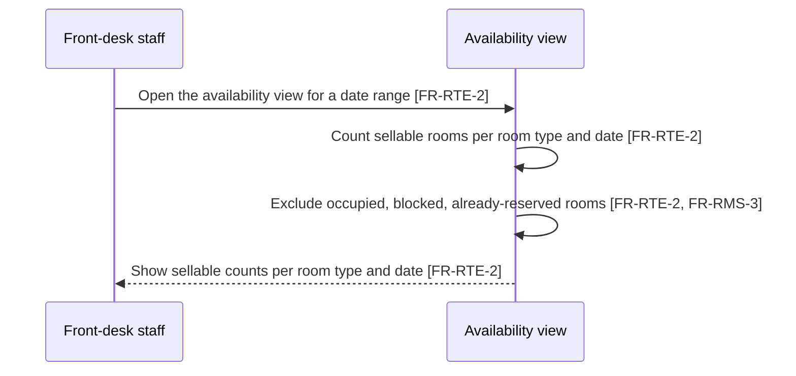

# Behaviour sequence diagrams — booking, check-in/out, folio and housekeeping

Status: active. Business-side time-ordered depiction of the MVP
behaviours, owned by `business-analyst`. This document adds no new
behaviour: every step cites the FR or NFR that already requires it in
`docs/requirements/mvp-requirements.md`, and every configurable step
names the `FR-CUS-*` control from requirements section 3.1 that governs
it. Fixed lifecycle order (§3.2) is never configurable. States cited
below are those of `docs/architecture/state-machine.md`; entity
relationships are those of `docs/architecture/erd.md`. Where the
behaviour docs disagree, section 15 lists the conflict and this document
follows the FR.

Terminology follows `docs/requirements/domain-consistency-audit.md`
(one term per concept): **reservation** for the stored record
(**booking** only for the act of creating one); **room** for the
physical sellable unit and **room type** for the priced category;
**folio** for the running account per stay, **invoice** for the final
printed account presented at check-out, **receipt** for the proof of
one payment; **guest** for the person staying; **charge item** for a
hotel-defined sellable entity and **charge** for a posted folio line;
**price basis** for what a reservation was quoted from; **hotel** for
the business and **property** for deployment/data-isolation context.

Legend used on every diagram: `[FR-X-n]` is the requiring FR;
`[CUS: FR-CUS-n]` marks a step whose content is per-hotel configurable
(requirements §3.1); `[FIXED §3.2]` marks lifecycle order no hotel may
change. Refusals name their cause per `docs/technical/error-handling.md`.
Each diagram states its preconditions and postconditions in one line
each.

## 1. Availability search

Look up sellable rooms by room type and date without creating anything.

- Preconditions: rooms, room types, reservations, and out-of-order blocks exist in the inventory.
- Postconditions: staff see per-type per-date sellable counts; nothing is created or changed.



## 2. New reservation creation

Search, check stay restrictions, run the atomic overbooking check, and
record the reservation with its price basis. The restriction and
conflict refusals are drawn, not only described.

- Preconditions: the guest is identified and the room type has been searched (diagram 1).
- Postconditions: the reservation exists with a unique reference on the calendar, or it was refused with the cause named and nothing was created.

```mermaid
sequenceDiagram
    participant Staff as Front-desk staff
    participant GuestRec as Guest profile
    participant Res as Reservation record
    Staff->>GuestRec: Identify guest [FR-GST-1, FR-GST-3]
    GuestRec-->>Staff: Preferences and notes shown before confirm [FR-GST-2; CUS: FR-CUS-1 fields shown]
    Staff->>Res: Enter dates, room type, guest, price basis [FR-RES-1; CUS: FR-CUS-1 required fields enforced]
    alt Hotel-mandatory guest field missing
        Res-->>Staff: Reservation refused, missing field named [FR-CUS-1]
    else Required fields present
        Res->>Res: Check stay restrictions for the dates [FR-RTE-4; CUS: stay restrictions per §3.1]
        alt Restriction violated
            Res-->>Staff: Reservation refused, restriction named [FR-RTE-4]
        else Restrictions pass
            Res->>Res: Atomic overbooking check: confirmed + in-house vs sellable rooms of the type [NFR-CON-1; states per state-machine]
            alt No sellable unit left or simultaneous reservation won first
                Res-->>Staff: Reservation refused, room type and dates named as conflict [NFR-CON-1]
            else Sellable unit available
                Res->>Res: Record reservation with price basis from rate plan in force [FR-RES-1, FR-RTE-5; CUS: FR-RTE-3 discount may adjust, FR-CUS-2 wording shown; FIXED §3.2 order: reservation precedes check-in]
                Res-->>Staff: Reservation exists with unique reference, appears on calendar [FR-RES-1, FR-RES-5; state confirmed per state-machine]
                Staff->>GuestRec: Produce confirmation to share with guest [FR-GST-4; CUS: FR-CUS-2 hotel wording]
            end
        end
    end
```

## 3. Reservation modification

Change dates, room type, or guest before check-in; the quoted price is
recalculated from the rate plan in force and the change is recorded.

- Preconditions: the reservation exists and has not been checked in.
- Postconditions: the reservation shows the new values with recalculated price and the change record, or it stays unchanged if the new values fail availability or restrictions.

```mermaid
sequenceDiagram
    participant Staff as Front-desk staff
    participant Res as Reservation record
    Staff->>Res: Open the reservation before check-in [FR-RES-2; state confirmed per state-machine]
    Staff->>Res: Change dates, room type, or guest and confirm [FR-RES-2; CUS: FR-CUS-1 required fields enforced]
    Res->>Res: Check stay restrictions for the new dates [FR-RTE-4; CUS: stay restrictions per §3.1]
    alt Restriction violated
        Res-->>Staff: Modification refused, restriction named [FR-RTE-4]
    else Restrictions pass
        Res->>Res: Atomic overbooking check for the new dates and type [NFR-CON-1]
        alt No sellable unit left for the new values
            Res-->>Staff: Modification refused, room type and dates named as conflict [NFR-CON-1]
        else Sellable unit available
            Res->>Res: Recalculate quoted price from the rate plan in force [FR-RES-2, FR-RTE-5; CUS: FR-RTE-3 discount may adjust]
            Res->>Res: Record the change with who made it and when [FR-RES-2; NFR-AUD-1]
            Res-->>Staff: Reservation shows new values, appears on calendar [FR-RES-2, FR-RES-5]
        end
    end
```

## 4. Cancellation

Cancel before check-in with a reason from the hotel's list; the held
availability is released.

- Preconditions: the reservation exists and has not been checked in.
- Postconditions: the reservation state is cancelled with the reason kept and the held availability released.

```mermaid
sequenceDiagram
    participant Staff as Front-desk staff
    participant Res as Reservation record
    Staff->>Res: Open the reservation before check-in [FR-RES-3; state confirmed per state-machine]
    Staff->>Res: Cancel the reservation with a reason from the hotel list [FR-RES-3; CUS: hotel reason list per §3.1; CUS: FR-CUS-2 cancellation wording]
    Res->>Res: Record reservation state as cancelled with the reason kept [FR-RES-3; NFR-AUD-1]
    Res->>Res: Release the held availability for the cancelled dates [FR-RES-3]
    Res-->>Staff: Cancellation shown with reason and released dates [FR-RES-3]
```

## 5. No-show marking

Mark an unarrived reservation past its arrival date as no-show and
release the held room; history is kept.

- Preconditions: the reservation's arrival date has passed without check-in.
- Postconditions: the reservation state is no-show with history kept and the held room released for sale.

```mermaid
sequenceDiagram
    participant Staff as Front-desk staff
    participant Res as Reservation record
    Staff->>Res: Open the unarrived reservation past its arrival date [FR-RES-6; state confirmed per state-machine]
    Staff->>Res: Mark the reservation as no-show [FR-RES-6; CUS: hotel no-show rule and reason list per §3.1]
    Res->>Res: Record reservation state as no-show with history kept [FR-RES-6; NFR-AUD-1]
    Res->>Res: Release the held room for sale [FR-RES-6]
    Res-->>Staff: No-show shown in reservation history [FR-RES-6]
```

## 6. Walk-in booking end to end

Create a same-day reservation for a guest at the desk and land it
ready for immediate check-in.

- Preconditions: a guest arrives without a reservation and a room type has availability for tonight.
- Postconditions: the reservation exists in the confirmed state on today's arrivals list, ready for immediate check-in.

```mermaid
sequenceDiagram
    participant Staff as Front-desk staff
    participant GuestRec as Guest profile
    participant Avail as Availability view
    participant Res as Reservation record
    Staff->>GuestRec: Identify guest at the desk [FR-GST-1, FR-GST-3]
    GuestRec-->>Staff: Preferences and notes shown before confirm [FR-GST-2; CUS: FR-CUS-1 fields shown]
    Staff->>Avail: Check tonight's sellable rooms for the room type [FR-RTE-2]
    Staff->>Res: Create the reservation with today as arrival [FR-RES-4; CUS: FR-CUS-1 required fields enforced]
    Res->>Res: Atomic overbooking check: confirmed + in-house vs sellable rooms of the type [NFR-CON-1]
    alt No sellable unit left for tonight
        Res-->>Staff: Walk-in refused, room type and dates named as conflict [NFR-CON-1]
    else Sellable unit available
        Res->>Res: Record reservation with price basis from rate plan in force [FR-RES-4, FR-RTE-5; CUS: FR-RTE-3 discount may adjust]
        Res-->>Staff: Reservation exists in confirmed state on today's arrivals list [FR-RES-4, FR-FDK-5; FIXED §3.2 order: reservation precedes check-in]
        Staff->>GuestRec: Produce confirmation to share with guest [FR-GST-4; CUS: FR-CUS-2 hotel wording]
    end
```

## 7. Check-in

Register arrival against a ready room; the atomic assignment check
guards against a simultaneous check-in taking the same room.

- Preconditions: the reservation is due for arrival and a vacant, clean, inspected room of the booked type exists.
- Postconditions: the stay is in house linked to the room and the room is occupied, or check-in was refused with the cause named and nothing was created.

```mermaid
sequenceDiagram
    participant Staff as Front-desk staff
    participant Stay as Stay record
    participant Rooms as Room inventory
    Staff->>Stay: Open arrivals list for today [FR-FDK-5; CUS: FR-CUS-2 hotel times]
    Staff->>Rooms: Pick a vacant, clean, inspected room of the booked type [FR-FDK-1, FR-RMS-2; CUS: FR-RMS-4 room attributes used at assignment]
    Rooms->>Rooms: Atomic assignment check on the room [NFR-CON-2]
    alt Room just taken by a simultaneous check-in
        Rooms-->>Staff: Check-in refused, room conflict named [NFR-CON-2]
    else Room free
        Staff->>Stay: Check guest in against the room [FR-FDK-1; CUS: FR-CUS-1 check-in fields enforced; FIXED §3.2 order, states per state-machine: confirmed to checked-in]
        Stay->>Rooms: Room state becomes occupied [FR-FDK-1]
    end
    opt Early arrival recorded [FR-FDK-4]
        Staff->>Stay: Record actual arrival time against the stay [FR-FDK-4; CUS: FR-CUS-2 hotel times]
    end
```

Every status change records who made it and when (`NFR-AUD-1`).

## 8. Room move mid-stay

Move an in-house guest to another ready room; the stay remains in
house with history.

- Preconditions: the stay is in house and a vacant, clean, inspected room exists.
- Postconditions: the stay links to the new room, the old room is vacant and dirty, and the move with both room numbers and its time is kept in the stay history.

```mermaid
sequenceDiagram
    participant Staff as Front-desk staff
    participant Stay as Stay record
    participant Rooms as Room inventory
    Staff->>Rooms: Pick a vacant, clean, inspected room [FR-FDK-3]
    Staff->>Stay: Move guest; stay stays in house with history [FR-FDK-3; FIXED §3.2: stay remains in house, no state change]
    Stay->>Rooms: Old room becomes vacant and dirty [FR-FDK-3]
    Stay-->>Staff: Move with both room numbers and time kept in stay history [FR-FDK-3; NFR-AUD-1]
```

## 9. Check-out

Review the folio, settle it or record an approved open balance, then
close the stay, present the invoice, and release the room as
vacant-dirty.

- Preconditions: the stay is in house and its folio has been reviewed (diagram 10); settlement or approval follows diagram 11.
- Postconditions: the stay is closed with the invoice presented and the room vacant and dirty, or check-out was refused until the folio is settled or approved.

```mermaid
sequenceDiagram
    participant Staff as Front-desk staff
    participant Folio as Folio
    participant Stay as Stay record
    participant Rooms as Room inventory
    Staff->>Folio: Review folio with running balance before check-out [FR-BIL-1]
    alt Folio has an open balance
        Staff->>Folio: Settle by recording payment [FR-BIL-3] or record authorised approval [FR-BIL-7; CUS: hotel approval rule per §3.1]
        alt Neither payment nor approval recorded
            Folio-->>Staff: Check-out refused until settled or approved [FR-BIL-7]
        end
    end
    Staff->>Stay: Check guest out; present the invoice [FR-FDK-2, FR-BIL-4; FIXED §3.2 order: check-out closes the stay, states per state-machine]
    Stay->>Rooms: Room becomes vacant and dirty [FR-FDK-2]
    opt Late departure recorded [FR-FDK-4]
        Staff->>Stay: Record actual departure time against the stay [FR-FDK-4; CUS: FR-CUS-2 hotel times]
    end
```

## 10. Folio charge posting

Post nightly room charges or hotel-defined charge items to the stay
folio; posting an undefined item is refused.

- Preconditions: the stay is in house with its single folio open.
- Postconditions: the folio shows the new charge line with taxes and fees and an increased balance, or the charge was refused and the folio is unchanged.

```mermaid
sequenceDiagram
    participant Staff as Front-desk staff
    participant Folio as Folio (one per stay)
    Staff->>Folio: Open the stay folio [FR-BIL-1; FIXED §3.2: one folio per stay]
    Staff->>Folio: Post nightly room charge or hotel-defined charge item [FR-BIL-2; CUS: FR-CUS-3 hotel charge items]
    alt Item not defined by the hotel
        Folio-->>Staff: Charge refused, only defined items can be posted [FR-BIL-2, FR-CUS-3]
    else Item defined
        Folio->>Folio: Line shows item, amount, posting time; taxes and fees derived [FR-BIL-2, FR-BIL-5; CUS: FR-BIL-5 hotel tax and fee rules]
        Folio-->>Staff: Running balance increased by the line amount [FR-BIL-2]
    end
```

## 11. Settlement, receipt, and approved open balance

Record payments, issue invoices and per-payment receipts, run
day-close totals, and record authorised approval where the hotel
allows an open balance.

- Preconditions: the folio carries charges with a running balance.
- Postconditions: payments are recorded with receipts issued and the balance decreased, or an authorised approval for the open balance is recorded; day-close totals agree with the folios posted that day.

```mermaid
sequenceDiagram
    participant Staff as Front-desk staff
    participant Folio as Folio
    participant Manager as Manager
    Staff->>Folio: Review folio with running balance [FR-BIL-1]
    Staff->>Folio: Record cash or card payment [FR-BIL-3; FIXED §3.2: cash and card only]
    Folio->>Folio: Payment shown with method and time; balance decreases [FR-BIL-3]
    Staff->>Folio: Produce invoice and per-payment receipts [FR-BIL-4]
    Folio-->>Staff: Invoice matches folio lines and balance; each receipt matches one payment [FR-BIL-4]
    opt Open balance approved instead of settled [FR-BIL-7]
        Staff->>Folio: Record authorised approval for the open balance [FR-BIL-7; CUS: hotel approval rule per §3.1]
    end
    Manager->>Folio: Run day-close totals of charges and payments per method [FR-BIL-6]
    Folio-->>Manager: Totals agree with the folios posted that day [FR-BIL-6]
```

## 12. Housekeeping cleaning loop and front-desk handoff

Rooms walk vacant-dirty to clean to inspected before they are
assignable; the handoff with the front desk is drawn in both
directions. `HK` is not a fourth sign-in role: it denotes staff
signed in under one of the three roles (`FR-ADM-2` / `BR-35` /
`NFR-SEC-1`) acting in a housekeeping capacity.

- Preconditions: rooms exist in the inventory with live states visible.
- Postconditions: cleaned rooms advance to inspected and are offered for check-in assignment; rooms needing work appear in the housekeeping report.

```mermaid
sequenceDiagram
    participant Desk as Front-desk staff
    participant Rooms as Room inventory
    participant HK as Staff in housekeeping capacity
    Desk->>Rooms: Check-out or room move releases room as vacant and dirty [FR-FDK-2, FR-FDK-3]
    Rooms-->>HK: Dirty rooms visible in housekeeping report [FR-RPT-4]
    HK->>Rooms: Mark room clean when work completes [FR-RMS-2]
    Rooms-->>HK: Clean-but-uninspected rooms visible for inspection [FR-RPT-4]
    HK->>Rooms: Mark room inspected [FR-RMS-2; FIXED §3.2: dirty to clean to inspected]
    Rooms-->>Desk: Inspected vacant rooms offered for check-in assignment [FR-RMS-2, FR-FDK-1]
    Desk->>Rooms: View live status of every room [FR-RMS-1]
```

Every status change records who made it and when (`NFR-AUD-1`).
Rooms needing cleaning or inspection appear in the housekeeping
report; inspected and out-of-order rooms do not (`FR-RPT-4`).

## 13. Out-of-order date-ranged block and release

Take a room out of sale for a date range with a recorded reason;
blocked dates stay out of availability and check-in until the block
ends.

- Preconditions: the room is not occupied on the blocked dates.
- Postconditions: the room shows out of order for the range and takes no reservation or check-in on a blocked date; when the block ends the room returns to a vacant state.

```mermaid
sequenceDiagram
    participant Manager as Manager
    participant Rooms as Room inventory
    participant Desk as Front-desk staff
    Manager->>Rooms: Block room for a date range with recorded reason [FR-RMS-3; NFR-AUD-1]
    Rooms-->>Desk: Blocked dates excluded from availability and check-in [FR-RMS-3, FR-RTE-2]
    Desk->>Rooms: Attempted reservation or check-in on a blocked date refused [FR-RMS-3]
    Manager->>Rooms: Release the block when the range ends [FR-RMS-3]
    Rooms-->>Desk: Room returns to a vacant state and is sellable again [FR-RMS-3; states per state-machine]
```

## 14. Per-hotel customisation overlay

For each flow above, which steps are configurable (§3.1, via the named
`FR-CUS`/`FR` control) and which order is fixed (§3.2). The same marks
also appear on the diagram steps themselves (`[CUS: …]` and
`[FIXED §3.2]`).

| Diagram | Flow step | Configurable content (control) | Fixed order (not configurable) |
|---|---|---|---|
| 1 | Availability counts | — (counts follow inventory only) | Exclusions fixed: occupied, blocked, already-reserved |
| 2, 6 | Guest fields at reservation creation, guest identification | Which fields are mandatory; refusal names the field (`FR-CUS-1`); fields shown (`FR-CUS-1`) | — |
| 2 | Stay restrictions at creation | Minimum stay, closed-to-arrival days (`FR-RTE-4`) | — |
| 2, 3, 6 | Price basis and discounts | Named discounts kept by name (`FR-RTE-3`); hotel wording (`FR-CUS-2`) | Quoted price basis unchanged unless recalculated (`FR-RTE-5`) |
| 4 | Cancellation wording and reasons | Hotel wording (`FR-CUS-2`); hotel's reason list (`FR-RES-3`) | Cancel only before check-in |
| 5 | No-show handling | Whether a charge is kept and which reason list applies (`FR-RES-6`) | Only past arrival date; history kept |
| 7 | Standard times shown and enforced | Hotel check-in/check-out times (`FR-CUS-2`, `FR-ADM-4`) | — |
| 7 | Guest fields at check-in | Which fields are mandatory; refusal names the field (`FR-CUS-1`) | — |
| 7 | Room assignment | Room attributes used at assignment (`FR-RMS-4`) | Only inspected vacant rooms assigned |
| 8 | Room moves | Room attributes used at assignment (`FR-RMS-4`) | Only inspected vacant rooms assigned; moves keep the stay in house |
| 9, 11 | Open-balance check-out | Whether approval is needed and which role may approve (`FR-BIL-7`) | Lifecycle confirmed to checked-in to closed, never skipped or reordered |
| 10 | Charge items posted | Hotel's own items with names and prices (`FR-CUS-3`); only defined items postable | One folio per stay |
| 10 | Taxes and fees derived | Hotel tax and fee rules (`FR-BIL-5`) | — |
| 11 | Payment methods | — (no configuration point) | Cash and card only |
| 12 | Housekeeping progression | — (no configuration point) | Dirty to clean to inspected; check-out releases vacant-dirty |
| 13 | Out-of-order reason and range | Blocked reason recorded per block (`FR-RMS-3`) | Not occupied on the blocked dates; blocked dates excluded |

Owner or manager changes to any §3.1 item apply at once with no code
changes, and each change records who made it and when (`NFR-AUD-1`,
requirements §3.3).

## 15. Consistency statement and conflicts

Each step above was checked against `docs/architecture/state-machine.md`
(booking: confirmed to checked-in to closed, with cancelled and
no-show branches; room: vacant-dirty to vacant-clean to
vacant-inspected to occupied), `docs/architecture/erd.md` (one folio
per stay; a stay links one room at a time; sellable count excludes
occupied, blocked, already-reserved), and the FR/NFR wording. No step
contradicts them except the finding below, which is listed, not hidden:

- F-SEQ-1 (resolved, wording from audit C-5): `NFR-CON-1` in
  `docs/requirements/mvp-requirements.md` spoke of booking "the last
  sellable room or bed", but beds exist only as room/room-type
  attributes — no story or FR sells a bed separately. Fixed by
  deleting "or bed" from `NFR-CON-1`. This document follows the
  domain model throughout: the sellable unit is the room, and
  diagrams 2, 3, and 6 check room-type sellability only.

Path note: issue #43 asked for `docs/architecture/sequence-diagrams.md`;
behaviour content belongs to requirements, so this depiction lives at
`docs/requirements/sequence-diagrams.md` and the document index points
here.
